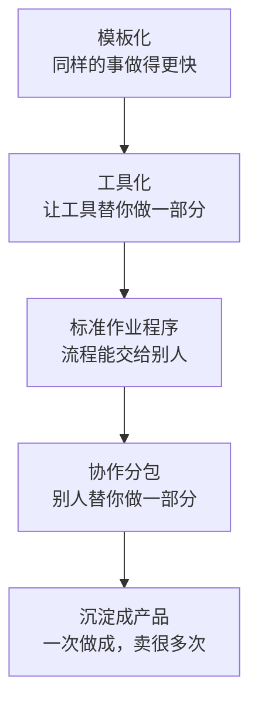

# 从卖时间到卖杠杆

第 4 章算过：一个人卖时间，一年大约只能卖出 900 小时左右，收入的天花板由时薪决定。这一章讲怎么慢慢松动这个天花板。

「杠杆」是指：同样一小时的投入，带来更多的收入。对服务生意来说，杠杆主要有五种来源，从容易到难排列：



前三种是把你自己的一小时变得更值钱，后两种是让收入不完全依赖你的时间。它们不是互斥的，而是一层一层叠加：没有模板和流程，就没法分包；没有在服务中反复验证过的方法，也做不出好的产品。

这一章不讲雇人。雇员工意味着社保、管理、固定成本和劳动法上的一整套责任，它是另一种生意形态。一人公司在不雇人的前提下，也有很多加杠杆的办法。

## 模板化：同样的事做得更快

模板是最简单、最立竿见影的杠杆。你在第 3 章把服务打包以后，每一单的流程、文件、沟通都是相似的。把这些相似的部分做成模板，下次直接改，不用从头写。

### 哪些东西可以做成模板

| 类别 | 例子 |
|---|---|
| 销售文件 | 服务说明书、报价单、案例集、近况更新消息 |
| 启动文件 | 需求问卷、需求确认书、启动会议程 |
| 工作文件 | 设计源文件模板、报表模板、面试评分表、选题库、课程大纲 |
| 沟通文件 | 进度同步、阶段验收、变更报价、交付清单、请求转介绍的消息 |
| 收尾文件 | 交付清单、回顾问卷、案例写作模板 |

### 模板能省多少

以第 4 章的「老板月报」为例。假设第一个客户每月要花 12 小时，做了半年以后：

| 工作 | 刚开始 | 做成模板后 |
|---|---|---|
| 收数据、核对 | 4 小时 | 2 小时（固定了数据清单和核对表） |
| 做报表 | 4 小时 | 1.5 小时（报表模板自动汇总） |
| 解读会（含准备） | 2 小时 | 1.5 小时（解读提纲模板） |
| 日常答疑 | 2 小时 | 1.5 小时（常见问题整理成文档发给客户） |
| 合计 | 12 小时 | 6.5 小时 |

同样收 3000 元，时薪从 250 元变成约 462 元。每月可卖的 73 小时，原来能服务 6 家，现在能服务 11 家。

这就是为什么第 3 章说，服务生意的利润来自重复。价格不变，你越来越熟练，时薪自然就上去了。这也引出一个重要的定价原则：**按结果收费，不按小时收费**。如果按小时收费，你越熟练、做得越快，收入反而越少。

### 做模板的时机

不要一开始就做模板。第一单的时候，你还不知道哪些步骤是固定的、哪些是每个客户都不一样的。比较好的节奏是：

- **第 1–2 单**：认真做，把过程中写的所有东西都保存下来
- **第 3 单**：开始时翻出前两单的文件，看哪些可以复用，改成模板
- **之后每单**：用模板，做完以后花半小时更新模板

## 工具化：让工具替你做一部分

工具化是指用现成的软件，把重复的、机械的部分自动化。这里不需要会写代码，大部分职场人用到的工具都是现成的。

| 重复的事 | 可以用的工具类型 |
|---|---|
| 预约会议、来回对时间 | 在线预约工具，客户自己选你的空闲时段 |
| 收集客户资料 | 在线表单，客户填完自动汇总到表格 |
| 报表汇总 | 表格的公式、数据透视、模板 |
| 文件交付和版本管理 | 网盘的共享文件夹，按固定结构命名 |
| 签约 | 电子签平台 |
| 记账和开票 | 记账软件、电子发票平台 |
| 写初稿、整理会议纪要、翻译初稿 | AI 助手 |

### AI 助手的位置

AI 助手对服务生意的影响很大，值得单独说几句。

它最擅长的是**初稿**和**整理**：会议录音转成纪要、把零散的笔记整理成报告框架、根据岗位要求写职位描述初稿、把客户的需求描述整理成需求确认书草稿、翻译的初稿。这些工作过去可能占你三成的时间，现在可以压缩一大半。

它不擅长、也不应该替代的，是你的**判断**：这个候选人适不适合这家公司、这张报表里哪个数字是真正的问题、这个设计方向对不对这个品牌。客户付钱买的正是这部分。

用 AI 助手处理客户资料时，要注意保密：客户的财务数据、员工信息、未公开的商业信息，在放进任何外部工具之前，先确认合同里的保密约定是否允许，必要时先脱敏。

### 工具也有成本

每一个工具都要花时间学、花钱订阅、花精力维护。判断一个工具值不值得用，简单算一笔账：

$$
\text{每月节省的时间} \times \text{你的最低时薪} > \text{每月的订阅费} + \text{学习和维护的时间成本}
$$

一个每月 100 元的工具，每月能帮你省 2 小时，按 400 元的时薪算，值 800 元，划算。一个每月 300 元、但你一个月只用一次的工具，就不划算。

## 标准作业程序：把做法写下来

**标准作业程序**（Standard Operating Procedure，常简称 SOP）是指把一件事的做法一步步写下来，写到别人照着做也能做到八九成。

模板是「文件」，SOP 是「做法」。比如一个招聘服务：

- 模板：面试评分表、职位描述模板、推荐报告模板
- SOP：拿到一个新岗位后，第一步做什么、第二步做什么、每一步的判断标准是什么、遇到什么情况怎么处理

### SOP 的样子

以「招聘服务的简历初筛」为例：

```text
SOP：简历初筛

目标：从渠道收到的简历中，筛出值得电话初筛的候选人

输入：岗位说明、面试评分表、渠道收到的全部简历
输出：初筛通过名单（表格），每人一行，写明通过理由

步骤：
1. 打开岗位说明，确认三个「必须项」和三个「加分项」
2. 每份简历看 1 分钟以内，只看三处：
   - 最近两份工作的公司类型和岗位
   - 在每家公司的工作时长
   - 是否满足三个必须项
3. 三个必须项全部满足 → 进入「待初筛」
   有一项不确定 → 进入「待定」，在备注写明哪一项
   有一项明确不满足 → 不通过
4. 「待初筛」不足 5 人时，从「待定」中按加分项多少补足
5. 每天 18 点前把名单更新到共享表格

常见情况：
- 简历频繁跳槽（3 年内超过 3 份工作）：不直接淘汰，备注后进入待定
- 简历信息不全：不通过，除非岗位候选人很少

判断标准的来源：
- 必须项和加分项在需求访谈时与客户确认，不自己臆测
```

### 为什么要写 SOP

即使你永远不打算把工作交给别人，写 SOP 也有好处：

- **保证质量稳定**。人在忙的时候、累的时候，容易跳步骤。SOP 是给未来的自己的检查清单
- **发现可以改进的地方**。写下来以后，才看得出哪一步其实可以省掉、哪一步可以用工具代替
- **为分包做准备**。没有 SOP，你没法把工作交给别人，因为每次都要从头讲

写 SOP 不用一次写完。每次做完一单，把这一单里「如果下次有人替我做，他需要知道什么」写下来，慢慢积累。

## 协作分包：找外援，不雇人

当你有了模板和 SOP，就可以把一部分工作交给别人做，你只负责最关键的部分和最终的质量把关。这就是**分包**：你接下客户的整单，把其中一部分交给另一个自由职业者或小团队，按件或按项目付钱给他们。

### 哪些部分适合分包

| 适合分包 | 不适合分包 |
|---|---|
| 标准化程度高、有清晰 SOP 的环节 | 需要你的判断的环节（客户为此请你） |
| 你不擅长或不喜欢、但别人做得好的环节 | 与客户直接沟通、建立信任的环节 |
| 工作量波动大的环节（忙时需要，闲时不需要） | 涉及客户核心敏感信息的环节 |

几个例子：

- 设计工作室：自己负责品牌策略和主视觉，把落地物料的延展（各种尺寸、各种物料）分包给其他设计师
- 招聘服务：自己负责需求访谈和最终面试推荐，把简历初筛和电话初筛的一部分分包给有经验的兼职招聘
- 财务顾问：自己负责分析和解读，把数据整理和报表制作的一部分分包；记账报税交给有资质的代账公司
- 代运营：自己负责定位和选题策划，把图片制作、剪辑分包

### 分包的账怎么算

假设一个设计项目报价 8000 元，原本你自己做要 40 小时，时薪 200 元。分包以后：

| | 自己做全部 | 分包落地物料 |
|---|---|---|
| 你的时间 | 40 小时 | 22 小时（策略、主视觉、和分包方沟通、质检） |
| 分包费 | 0 | 2000 元（分包方约 18 小时） |
| 你的收入 | 8000 元 | 6000 元 |
| 你的时薪 | 200 元 | 约 273 元 |

收入少了，但时薪高了，省下来的 18 小时可以接新的项目。前提是：分包方的质量可靠，你花在沟通和质检上的时间没有超出预期。

### 分包要注意什么

- **先确认合同允不允许**。有的服务合同明确禁止转包或分包，或者要求事先经客户同意。外包合同里关于转包的条款，见[《合同与法律文书》第 4 章](../contracts-legal/04-outsourcing-dev.md)
- **对客户负责的始终是你**。分包方做错了，客户只会找你。所以质量把关不能省
- **保密要传递下去**。你对客户有保密义务，分包方接触到客户信息时，你要和分包方签保密约定，并且只给他完成工作所必需的信息
- **知识产权要理清**。分包方做的成果，著作权默认归分包方，除非你们约定转让。如果你对客户承诺了成果的著作权归客户，就必须先从分包方那里拿到相应的权利
- **找人从小单开始试**。第一次合作用一个小任务、不着急的任务试，满意了再长期合作
- **付款要规范**。付给个人的劳务费，可能涉及代扣代缴个人所得税的义务，你自己的成本也需要相应的凭证入账，具体见[《财务与税务》第 3 章](../opc-finance/03-invoices.md)和[第 2 章](../opc-finance/02-taxes.md)

> [!WARNING]
> 支付劳务报酬时的个税代扣代缴义务、成本入账需要的凭证，因你是个人、个体户还是公司而不同，按 2024 年前后的规定整理，以国家税务总局最新规定为准，拿不准的请教你的代账会计。

### 分包和雇人的区别

分包不是雇人。如果你长期固定地让同一个人按你的要求、在你规定的时间里工作，每月给他固定报酬，这在法律上可能被认定为劳动关系，你就要承担用人单位的责任（社保、劳动合同等）。

保持分包关系的几个特点：按件或按项目结算、对方自主安排工作时间和方式、对方同时为其他客户工作、你验收的是成果而不是管理过程。

## 沉淀成产品：一次做成，卖很多次

杠杆的最后一层，是把服务中积累的东西做成**产品**：做一次，可以卖给很多人，收入不再和你的时间一一对应。

服务型一人公司常见的几种产品：

| 产品 | 例子 | 来自服务中的什么 |
|---|---|---|
| 模板和工具包 | 小公司招聘工具包（职位描述模板、面试评分表、入职清单）；小店品牌设计模板 | 你在服务中做的模板 |
| 课程 | 「小公司老板看懂报表的 6 节课」；「本地商家小红书起号训练营」 | 你在服务中反复讲的内容 |
| 小规模的标准化服务 | 99 元的简历诊断；299 元的店铺主图诊断 | 服务中最小、最标准的一个环节 |
| 付费社群 | 小公司 HR 交流群、电商设计师交流群 | 你积累的同行网络和行业信息 |

课程、训练营、社群、1 对 1 咨询怎么设计、怎么发售、怎么交付，[《知识付费与私域变现》](../knowledge-products/)整本书都在讲，这里只说服务转产品时的几个要点。

### 从服务到产品的路径

产品最好的来源，是你在服务中**被问了很多遍的问题**和**做了很多遍的东西**。

- 每个客户都问「这个岗位应该给多少钱」→ 可以做成一份按城市、按岗位整理的公开数据解读
- 每次服务都要从零教客户怎么看报表 → 可以录成一套短课程，作为服务的前置，也可以单独卖
- 每个客户都需要一套入职材料 → 可以做成模板包

这条路径的好处是：你做产品之前已经知道有人需要，也知道他们需要什么。

### 产品不会自动卖出去

服务转产品最常见的误解，是以为「做一次，躺着收钱」。实际上：

- **产品需要持续的流量**。服务一年接 20 个客户就够活；产品一年卖 20 份，可能连做它的时间都收不回来。产品要卖得多，需要你有自己的流量渠道：社交媒体账号、公众号、社群
- **产品单价远低于服务**。一个服务项目几千到几万元，一个课程或模板包几十到几百元。要靠产品替代服务的收入，销量要高几十倍
- **产品也要维护和售后**。课程要更新、模板要修正、买家有问题要回答

所以比较现实的做法是：**服务为主，产品为辅**。产品一开始的作用往往不是赚钱，而是：

- 让潜在客户以很低的价格先体验你，其中一部分人会升级购买服务
- 让服务交付更高效（客户先看课程，你就不用一遍遍讲基础知识）
- 在你没空接服务的时候，给想找你的人一个选择

## 什么时候开始加杠杆

一个参考的节奏：

| 阶段 | 重点 |
|---|---|
| 前 10 单 | 把服务做好，保存所有文件，开始记时间 |
| 10–30 单 | 做模板、用工具，把单位时间压下来；开始写 SOP |
| 稳定有 5 个以上回头客或按月客户后 | 尝试把一个环节分包出去 |
| 发现某个问题被反复问、某个东西被反复做 | 考虑把它做成一个小产品 |

不要跳步骤。还没有稳定客户就去做课程，或者还没写 SOP 就去分包，往往两头都做不好。

## 本章要点

- 服务生意的杠杆有五层：模板化、工具化、标准作业程序、协作分包、沉淀成产品，一层层叠加
- 模板最立竿见影，同样的价格做得更快，时薪自然上升；所以按结果收费，不按小时收费
- 工具和 AI 助手用来处理初稿和整理，你的判断是客户付钱买的部分；用之前算清值不值，处理客户资料注意保密
- SOP 把做法写到别人照着做也能做到八九成，它是分包的前提
- 分包时确认合同是否允许，你对客户的质量、保密、知识产权负全责；长期固定地按你的要求工作，可能被认定为劳动关系
- 产品来自服务中被反复问的问题和反复做的东西；服务为主、产品为辅，不要跳步骤
