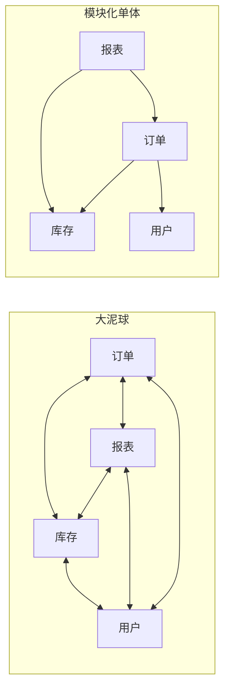
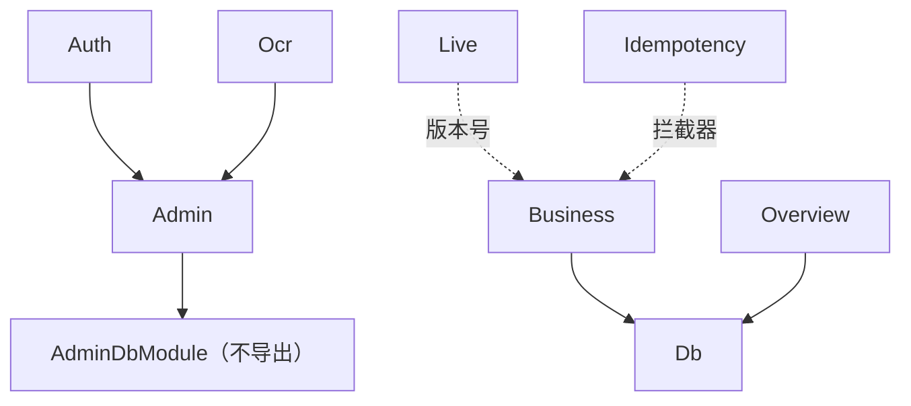

# 单体与模块化单体

一个人做的系统，最常见的架构失误有两种：一种是一开始就照着大厂的图拆成七八个服务，结果大部分时间花在服务之间的胶水上；另一种是什么都不管，代码长成一团，半年后改一处牵动十处。这一章先回答「为什么一个人的系统应该是单体」，再讲怎么把单体做成**模块化单体**：部署上是一个进程，代码里有清楚的边界。

## 关于这本书

这本书讲**一个人维护的系统**该怎么设计。场景是具体的：TypeScript 全栈，一台或几台 VPS，NestJS + PostgreSQL，Docker Compose + nginx 部署，客户端是 Web、Expo 或 Electron。所有方案都按这个尺度挑：维护者只有一个，注意力是最稀缺的资源，运维面越小越好。

它不是面试用的「设计一个 Twitter」题解。书里会反复出现三个真实项目，它们的架构文档就是素材：

| 项目 | 是什么 | 架构上的看点 |
|---|---|---|
| hatch-counter | 门店经营管理，NestJS + Postgres + Drizzle，一台机器上 compose 部署 | 模块边界、RLS 多租户、按版本号缓存、SSE 推送、写接口幂等 |
| hatch-shelf | Expo 离线书架，SQLite 索引 + WebView 阅读器 | 零后端、文件即真相、单一导入管线、决策记录 |
| hatch-recordwall | Expo + Electron 播放器，Cloudflare Worker 前面挂 R2 | 对象存储的访问控制、条件写、缓存与取用形状 |

**适合谁**：已经能把一个全栈应用写出来并部署上线，开始遇到「这块逻辑该放哪」「要不要上 Redis」「重试会不会记两笔」「以后用户多了怎么办」这类问题的人。

**怎么读**：前两章讲结构（模块和分层），是后面所有章节的地基；第 3–7 章各讲一个横切的系统问题，可以按需跳读；第 8 章讲多租户，做 SaaS 的必读；第 9 章把前面的东西串起来，推演一个系统从 1 个用户长到 1 万个用户的过程。

相邻的内容放在别的书里，这里只引用不重复：

- 日志、指标、压测、容量估算：《可观测性与性能》
- Postgres 调参、备份、复制、连接池：《PostgreSQL 运维》
- 模型网关、降级、配额：《LLM 应用上线》
- nginx 的长连接、缓存、限流配置：《Nginx 与反向代理》
- 发布、回滚、零停机：《部署与 CI/CD》

## 架构在决定什么

架构不是画框框，它决定的是一件事：**以后改起来贵不贵**。

一个功能今天怎么写都能跑，区别在于三个月后：

- 改一条业务规则，要动几个文件？会不会漏掉一处？
- 换一个短信服务商、换一个对象存储，要不要动业务代码？
- 出了 bug，能不能从一个请求顺着一条线找到原因？
- 新开一个会话让编码 agent 改代码，它能不能只读一小块就动手，而不用读完整个仓库？

最后一条对重度使用 Claude Code 的人尤其要紧。边界清楚的代码，agent 读得少、改得准；边界模糊的代码，agent 要么读满上下文，要么改漏一处。**好的架构对人和 agent 是同一件事：让局部的修改只需要局部的知识。**

## 微服务解决的是组织问题

微服务流行起来，主要不是因为它在技术上更好，而是因为它解决了大公司的组织问题：几百个工程师在一个代码库里互相踩脚，发布要排队，一个团队的失误拖垮所有人。拆成服务之后，每个团队独立开发、独立发布、独立值班。

这背后是康威定律：系统的结构会趋向于复制组织的沟通结构。**一个人的组织没有沟通结构**，也就没有微服务要解决的那个问题。剩下的只有它的代价：

| 代价 | 单体里 | 拆成服务后 |
|---|---|---|
| 模块之间调用 | 函数调用，不会失败 | 网络调用，会超时、会半截失败、要重试 |
| 一致性 | 一个数据库事务 | 跨服务没有事务，要补偿、要 outbox |
| 部署 | 一个镜像、一次发布 | N 个镜像、版本兼容矩阵、发布顺序 |
| 排障 | 一份日志、一个调用栈 | 分布式追踪，跨服务对时间线 |
| 本地开发 | 起一个进程 | 起一堆进程，或者 mock 一堆服务 |
| 重构 | IDE 里改名、类型检查兜底 | 改接口要考虑旧版调用方 |

每一行都是要一个人去养的东西。对一个人来说，**分布式是最后的手段，不是起点**。

## 单体有两种

「单体」本身不是问题，问题是哪种单体。



- **大泥球**：任何代码都可以直接调用任何代码、直接读写任何表。早期很快，后来每一处改动都可能影响任何地方
- **模块化单体**：按业务领域分成模块，每个模块有公开接口和私有内部，依赖方向是单向的、无环的。部署上仍然是一个进程

模块化单体拿到了单体的全部好处（一个事务、一次部署、一个调用栈），又避免了大泥球的主要问题。而且它给未来留了门：哪天真需要把某个模块拆成独立服务，边界已经在那里了。

## 模块化单体的四条规矩

### 按业务领域分，不按技术分

`controllers/`、`services/`、`models/` 这种按技术分层的顶层目录，会让一个业务改动横跨三个目录。顶层应该是业务领域：

| 按技术分（不推荐作为顶层） | 按领域分 |
|---|---|
| `controllers/order.controller.ts` | `order/order.controller.ts` |
| `services/order.service.ts` | `order/order.service.ts` |
| `models/order.ts` | `order/order.schema.ts` |

分层在模块**内部**做，下一章细讲。

### 公开接口要窄

一个模块对外只暴露少数几个服务或函数，其余都是内部实现。NestJS 的模块天然支持这一点：没写进 `exports` 的 provider，别的模块注入不了。

```typescript
// billing/billing.module.ts
import { Module } from "@nestjs/common";
import { BillingService } from "./billing.service";
import { InvoiceRenderer } from "./invoice-renderer";
import { TaxCalculator } from "./tax-calculator";

@Module({
  providers: [BillingService, InvoiceRenderer, TaxCalculator],
  // 只导出门面，渲染和算税是内部细节，换实现不惊动别的模块
  exports: [BillingService],
})
export class BillingModule {}
```

别的模块如果注入 `TaxCalculator`，Nest 启动时就会报无法解析依赖。这个报错是好事：**边界被破坏时在启动那一刻就炸，而不是等到线上**。

### 数据有主人

每张表只属于一个模块，只有它能写。别的模块要数据，调它的公开接口。这条规矩在单体里最容易被破坏，因为所有表都在同一个库里，`import { orders } from "../order/schema"` 一行就能绕过去。

实际操作上可以放宽为：**读可以跨模块（尤其是报表类查询），写必须经过主人**。报表要 join 五张表，硬要通过五个接口拼数据，只会得到更慢、更难懂的代码。

### 依赖无环

A 依赖 B、B 又依赖 A，说明这两个模块其实是一个，或者有一块共同的东西该抽出来。NestJS 有 `forwardRef()` 能绕过循环依赖，但它掩盖的是设计问题，用到它时应该先停下来想一想。

## 案例：hatch-counter 的九个模块

hatch-counter 的服务端是一个 NestJS 进程，九个模块：Db、Auth、Admin、Business、Ocr、Overview、Health、Live、Idempotency。它的架构文档里专门有一节「模块边界」，记的是**有意划的边界**：



几条值得学的做法：

- **`AdminModule` 只导出三个配置服务**：识别服务商配置给 Ocr，短信配置和审核登录给 Auth。后台的数据库连接（能碰后台表的那条）不导出，业务代码注入它会在启动时报错。文档里的原话大意是：往这个导出名单里加东西之前，先问一句要的是配置，还是那条连接
- **后台的识别测试端点挂在 Ocr 模块下，不在 Admin 下**：挂在 Admin 下的话，Admin 得反过来依赖 Ocr，而 Ocr 已经依赖了 Admin，就成环了
- **业务口径只写一份，在 `packages/core`**：网页端、服务端、管理后台、移动端都调它，同一个店主在电脑和手机上看到的必须是同一个数

这些规矩旁边都写着「为什么」和「改坏了会怎样」。这一点比规矩本身更重要：**改坏了不报错的边界，必须写下来**，否则下一个人（包括三个月后的自己和编码 agent）一定会顺手改坏。

## 用工具守住边界

靠自觉守边界守不住，要让工具报错。NestJS 的 `exports` 管住了依赖注入，但管不住直接 `import` 一个文件。补一道 lint：

```javascript
// eslint.config.mjs（片段）
export default [
  {
    files: ["apps/api/src/**/*.ts"],
    rules: {
      "no-restricted-imports": [
        "error",
        {
          patterns: [
            {
              // 模块之间只能通过 index.ts 暴露的东西互相引用
              group: ["../*/internal/*", "../../*/internal/*"],
              message: "不要引用别的模块的 internal 目录，走它的公开接口",
            },
          ],
        },
      ],
    },
  },
];
```

更完整的方案是 dependency-cruiser 这类依赖分析工具，可以写「`business/` 不得依赖 `admin/`」「不得有循环依赖」这样的规则，在 `pnpm lint` 里跑。

跨包的边界更容易守，因为包本身就是边界：

- hatch-shelf 的 `@shelf/spec` 被 App 和 CLI 共用，规矩是**不得依赖 Node 或 RN 专有 API**。它是纯 TS，所以能在 Node 里测试，也能在 RN 里跑
- hatch-recordwall 的 `packages/core` 不许 import 任何 RN、Expo、Electron 的东西，也不许直接调全局 `fetch`，碰平台的事情只通过一个 `platform()` 接口，由各端在入口装进去

这两个例子是同一个模式：**把不碰平台的逻辑收进一个包，用编译器和包依赖来守边界**。

## 什么时候拆出一个独立服务

模块化单体不是教条。下面几种情况，拆出去是对的：

| 理由 | 例子 |
|---|---|
| 运行位置不同 | recordwall 的曲库是 Cloudflare Worker，跑在边缘、挨着 R2，而播放器跑在手机上，本来就是两处 |
| 握着不同级别的钥匙 | 存储的 AccessKey 不能进 App，所以要一个服务端替客户端持有钥匙、发短期令牌 |
| 资源特征差别很大 | CPU 密集的转码、长时间跑的批处理，会拖慢 API 的延迟，可以拆成单独的 worker 进程 |
| 依赖的运行时不同 | 一段必须用 Python 跑的模型推理 |

注意第三条：拆成**单独的进程**不等于拆成**微服务**。同一个代码库、同一个镜像，用不同的启动命令起一个 API 进程和一个 worker 进程，共享同一个数据库，这仍然是单体，只是多了一个运行角色。第 4 章会讲这种做法。

反过来，下面这些**不是**拆的理由：

- 「这块代码很大」：大就分模块，不需要分进程
- 「以后可能要独立扩容」：以后再说，边界在，拆起来不难
- 「看起来更专业」：维护成本是你自己付的

hatch-counter 的单据识别要调外部视觉模型，单次可能几十秒，看起来像该拆。但它没有拆：识别是 IO 等待，不占 CPU，Node 的事件循环等得起；它和业务共用鉴权、门店上下文和数据库。拆出去只会多一层网络调用和一套部署。

## 本章要点

- 架构决定的是「以后改起来贵不贵」；对人和编码 agent 都一样，好架构让局部修改只需要局部知识
- 微服务解决的是多团队协作的组织问题，一个人没有这个问题，只剩它的分布式代价
- 模块化单体：按业务领域分模块、公开接口窄、数据有主人、依赖无环；部署上仍是一个进程
- 改坏了不报错的边界要写下来，并尽量交给 NestJS 的 `exports`、lint、包依赖去报错
- 拆独立服务的正当理由是运行位置、钥匙级别、资源特征、运行时不同；「代码大」「以后要扩容」不是
- 多一个 worker 进程不等于微服务：同一个代码库、同一个库，换一个启动命令
