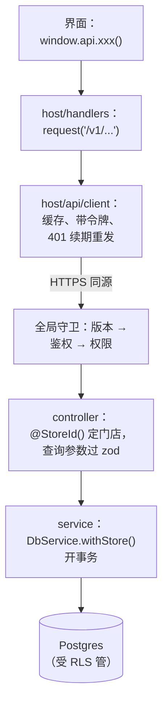
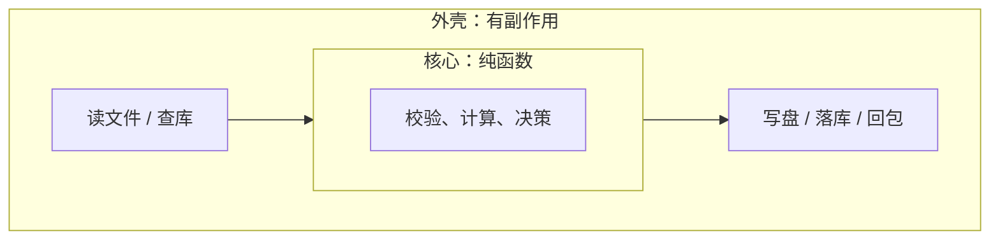

# 分层与边界

上一章把系统按业务切成了模块，这一章往模块里面看：一个请求从进来到落库要经过哪几层，每一层该管什么、不该管什么。分层的目的只有一个：**让一种变化只影响一层**。换数据库驱动不该改业务规则，改业务规则不该改 HTTP 接口，换个前端框架不该重写算钱的逻辑。

## 一层挡住一种变化

判断一层有没有存在的价值，问一句：**它挡住了哪种变化？** 说不出来的层就是多余的。

| 层 | 挡住的变化 | 典型内容 |
|---|---|---|
| 协议层（controller、路由） | HTTP 细节、鉴权方式、参数格式 | 解析参数、调用业务、把结果和错误翻译成 HTTP |
| 业务层（service、纯函数） | 业务规则本身的变化不外溢 | 规则、口径、状态流转、事务边界 |
| 数据层（SQL、ORM 调用） | 存储方式、方言、索引调整 | 查询、写入、迁移 |
| 适配器（外部服务客户端） | 换服务商、换存储 | 短信、对象存储、模型 API 的客户端 |

依赖方向是单向的：协议层依赖业务层，业务层依赖数据层和适配器的**接口**，反过来不行。业务层里出现 `req`、`res`、HTTP 状态码，就说明协议细节漏进来了。

## 案例：一个请求在 hatch-counter 里怎么走

hatch-counter 的架构文档里画了一条完整的请求链，从界面一直到数据库：



每一层各挡一种变化：

- **界面只认一张通道表**（`window.api`）：界面那一百多处调用只知道「这件事叫什么、给什么、回什么」。背后是打 HTTP、读本地 Excel、续令牌还是走缓存，界面不知道；这些换了实现，页面不用改
- **host 层管令牌、缓存、重试**：令牌只在内存、刷新令牌在 httpOnly cookie 里，这些安全细节集中在一处
- **全局守卫管横切的拦截**：客户端版本太旧、没登录、没权限，在进 controller 之前就拦下，controller 里不用每个都判
- **controller 只管「是哪家店、参数对不对」**：门店上下文由一个参数装饰器统一取，顺带判这家店是否停用
- **service 里所有租户数据的读写都经过 `withStore()`**：它开事务、设门店上下文，多租户隔离在这一处保证（第 8 章细讲）

hatch-shelf 里有个类似的规矩：RN 和 WebView 之间通信的消息类型**只在 `bridge.ts` 一个文件里定义**。两边是两个运行时，消息格式就是它们之间的协议，协议只能有一份。

## 业务规则放进纯函数

业务层里最值钱的是规则本身：怎么算毛利、库存怎么扣、一本书的目录结构合不合法。这些规则最好写成**纯函数**：输入数据，输出结果，不读数据库、不发网络请求、不看当前时间。

这个模式常被叫作「函数式核心，命令式外壳」：



hatch-shelf 的导入管线就是这么分的：

- `@shelf/spec` 的 `prepareImport()` 是纯函数：拿到一堆文件的路径和内容，判断 zip slip、扩展名白名单、解析 `book.yaml`、算内容指纹，返回「该写哪些文件、有哪些警告」
- `app/src/import/pipeline.ts` 是外壳：解压、调 `prepareImport()`、原子写盘、更新 SQLite

好处立刻就能看到：同一个 `prepareImport()` 被 App 和 CLI 共用，CLI 的 `push --changed` 判断要不要推，用的是和 App 完全相同的指纹算法，「两边必然一致」。而且纯函数在 Node 里就能测，不需要模拟器。

写成代码大概是这个形状：

```typescript
// 核心：纯函数，不碰 IO
export interface StockMove {
  ingredientId: string;
  qty: number; // 正数入库，负数出库
}

export function deductByRecipe(
  sales: { itemId: string; count: number }[],
  recipes: Map<string, { ingredientId: string; qty: number }[]>,
): StockMove[] {
  const moves: StockMove[] = [];
  for (const sale of sales) {
    for (const line of recipes.get(sale.itemId) ?? []) {
      moves.push({ ingredientId: line.ingredientId, qty: -line.qty * sale.count });
    }
  }
  return moves;
}
```

```typescript
// 外壳：读库 → 调核心 → 写库，事务边界在这里
async function importSales(storeId: string, rows: SaleRow[]) {
  return db.withStore(storeId, async (tx) => {
    const recipes = await loadRecipes(tx);
    const moves = deductByRecipe(rows, recipes);
    await insertSales(tx, rows);
    await insertMoves(tx, moves);
  });
}
```

`deductByRecipe` 可以写几十个单元测试覆盖各种边角情况，一个都不需要数据库。

### 口径只写一份

多端应用的一个经典 bug：服务端算的毛利和客户端算的毛利对不上。原因几乎总是同一个，**同一条规则写了两份**。

hatch-counter 的做法是把判定收进 `packages/core`，各端都调它，不自己重算；服务端只重写和 SQL 方言绑死的那几样（比如把一个聚合下推到数据库里算），判定逻辑不重写。报错文案也一样：给店主看的报错在服务端写，那句中文原样穿过客户端，客户端要分处置就认机器码 `code`，不认文案。

## 边界上的校验

数据跨过信任边界的那一刻要校验，进来之后就信任它。边界在哪：

- HTTP 请求进 controller
- 读用户上传的文件
- 读外部 API 的返回
- 读 WebView 发来的消息

校验用 zod 这类库在入口一次做完，里面的代码拿到的是有类型保证的数据：

```typescript
import { z } from "zod";

export const zCreateExpense = z.object({
  amountCents: z.number().int().positive(),
  categoryId: z.string().uuid(),
  paidOn: z.string().regex(/^\d{4}-\d{2}-\d{2}$/),
  note: z.string().max(200).optional(),
});
export type CreateExpense = z.infer<typeof zCreateExpense>;
```

两个常见错误：

- **在业务层里到处防御性地判空**：说明入口没校验好，或者类型没信任。入口校验一次，里面就别再判
- **只在客户端校验**：客户端校验是为了体验，服务端校验是为了正确。服务端那份不能省

另一条和边界有关的规矩：**没认领的异常一律回一句通用的 500，真实原因只进日志**。堆栈里常带着表名、SQL 片段甚至连接串，原样回给客户端就是信息泄露。

## 适配器：外部依赖只在一处判

外部服务（对象存储、短信、模型 API）要包一层适配器，而且**选哪一家只在一个地方判**。

hatch-counter 的存图就是这样：只有 `createStorage()` 这一个函数读 `STORAGE_PROVIDER` 环境变量，开发时写本机目录，生产时写对象存储。文档里专门写了为什么业务代码别再判一次：两处各判各的，配置写着对象存储能骗过生产检查，图却照样落在本机盘上，要等换机器那天才暴露。

```typescript
export interface Storage {
  save(storeId: string, name: string, body: Buffer, contentType: string): Promise<void>;
  read(storeId: string, name: string): Promise<Buffer | null>;
  remove(storeId: string, name: string): Promise<void>;
}

export function createStorage(env: Env): Storage {
  switch (env.STORAGE_PROVIDER) {
    case "local":
      return new LocalStorage(env.STORAGE_DIR);
    case "s3":
      return new S3Storage(env.S3_ENDPOINT, env.S3_BUCKET);
    default:
      throw new Error(`未知的 STORAGE_PROVIDER：${env.STORAGE_PROVIDER}`);
  }
}
```

recordwall 是同一个思路的另一种形态：`packages/core` 不直接用全局 `fetch`，而是用各端装进来的 `platform().fetch`，因为桌面端渲染进程的 `fetch` 受同源策略管，手机上没有这个问题。差异在适配器里消化，核心代码只有一份。

## 不要过度分层

分层有成本：每多一层，加一个字段就要多改一处。下面这些层在一个人的项目里通常不值得：

| 常见的层 | 问题 | 建议 |
|---|---|---|
| Repository 包一层 ORM | Drizzle 本身就是类型安全的查询构建器，再包一层只是改个名字 | 查询直接写在 service 里，复杂的抽到同模块的 `*-sql.ts` |
| 每个接口一套 DTO + Entity + VO | 同一个形状复制三遍，改字段要改三处 | zod schema 推导类型，一份 |
| 为每个服务写 interface | 只有一个实现的 interface 是噪音 | 只给真的有多个实现的东西（存储、短信）写接口 |
| 「领域层」「应用层」「基础设施层」严格四层 | 业务不复杂时全是转发代码 | 业务复杂到一定程度再引入 |

hatch-counter 把「跟 SQL 绑着的口径」放在 `business/*-sql.ts` 里，比如分析查询、工资查询，没有为它们抽 Repository。这是合适的粒度：SQL 集中在一处好找，又没有多余的转发。

## 把决定写下来

边界划完，最容易丢的是**为什么这么划**。三个月后看到一处看起来很别扭的设计，不知道当初的理由，就会「顺手改掉」，然后重新踩一遍坑。

hatch-shelf 的 README 第 12 节是一张决策记录表，每行三列：决策、结论、理由。比如：

| 决策 | 结论 | 理由（节选大意） |
|---|---|---|
| 渲染方式 | WebView 而非 RN 原生 Markdown 组件 | 原生组件对代码高亮、公式、Mermaid、宽表格支持弱 |
| 数据源 | 文件即真相，SQLite 只做索引 | 索引可重建，以后加同步通道阅读器不用改 |
| 解压库 | 纯 JS 的 fflate | 少一个原生依赖，解压前能逐条检查路径，App 与 CLI 共用 |

hatch-counter 用的是另一种形式：每个现行文档末尾一节「为什么这么定」，规矩旁边写「改坏了会怎样」。两种都好，关键是三样东西写全：

1. **结论**：选了什么
2. **理由**：为什么，当时比过哪些方案
3. **失效条件**：什么情况下这个决定该重新考虑

第三条最常被省略，但它最有用。hatch-shelf 的 README 写了「以后拆仓的条件」：内容需要单独公开、改由别的机器专职写书，或者内容体积开始拖慢 clone。条件没出现，就不用纠结要不要拆。

一个轻量的模板：

```markdown
### 存储：对象存储而非本机磁盘

- 结论：业务图片存对象存储，库里只存文件名
- 理由：容器重启不丢；换机器不用搬文件；库备份不被图片撑大
- 比过：存数据库 bytea（库膨胀、备份慢）；存本机卷（换机器要搬）
- 重新考虑的条件：图片访问量大到对象存储费用超过一台机器的磁盘成本
```

对编码 agent 来说，这类文档就是最好的上下文：它读到「为什么」，就不会把有意为之的设计当成 bug 修掉。

## 本章要点

- 每一层要能说出它挡住了哪种变化，说不出来就是多余的层；依赖方向单向
- 业务规则写成纯函数（函数式核心），IO 和事务放在外壳；同一份核心可以被多端共用、不用数据库就能测
- 同一条规则只写一份；多端共用时收进共享包，报错文案在服务端写一份
- 信任边界上用 zod 一次校验完，里面不再防御性判空；未认领的异常不把细节回给客户端
- 外部依赖包成适配器，选哪一家只在一处判
- 别为一个人的项目照搬四层架构；Drizzle 之上不必再包 Repository
- 决策写下来：结论、理由、比过的方案、重新考虑的条件

## 动手练习

1. **把规则测在数据库外面**：把本章的 `deductByRecipe` 去掉类型注解存成 `recipe.mjs`（加 `export`），再写一个 `recipe.test.mjs`，至少覆盖「一杯拿铁卖两份」和「没有配方的商品」两种情况，运行 `node --test`。

   验证：输出里 pass 数等于用例数、fail 为 0，全程没有启动任何数据库。

   参考答案：纯函数只吃参数、只吐返回值，测试就是构造输入、比较输出。

   ```javascript
   import test from "node:test";
   import assert from "node:assert/strict";
   import { deductByRecipe } from "./recipe.mjs";

   const recipes = new Map([["latte", [{ ingredientId: "milk", qty: 200 }]]]);
   test("两杯拿铁扣 400 牛奶", () => {
     assert.deepEqual(deductByRecipe([{ itemId: "latte", count: 2 }], recipes), [{ ingredientId: "milk", qty: -400 }]);
   });
   test("没有配方的商品不扣库存", () => {
     assert.deepEqual(deductByRecipe([{ itemId: "water", count: 3 }], recipes), []);
   });
   ```

2. **砍掉多余的层**（分析题）：一个人维护的 NestJS + Drizzle 项目，每个接口是 Controller → AppService → DomainService → Repository（包一层 Drizzle），每张表还有 DTO、Entity、VO 三个类，给开支加一个「备注」字段要改七个文件。用「这一层挡住了哪种变化」逐层判断，给出精简后的结构。

   验证：精简后加同一个字段，数一下要改几处，并能说出留下的每一层各挡住了什么。

   参考答案：Controller（HTTP 细节）和一个 service（规则与事务边界）留下；只有一个实现的 DomainService 和只是改名的 Repository 去掉，复杂查询抽到同模块的 `*-sql.ts`；三套类合成一个 zod schema 推导类型。如果数据其实来自两种存储（比如一部分在 Postgres、一部分在第三方 API），Repository 那层就挡住了真实的变化，值得保留。

3. **写一条决策记录**（分析题）：项目目前单实例，你决定会话存 Postgres、不上 Redis。按本章的模板写一条记录。

   验证：记录里有结论、理由、比过的方案，并且「重新考虑的条件」是一个能观察到的信号，而不是「以后用户多了」。

   参考答案：理由写少一个要部署和监控的服务、会话读写量对库压力很小；比过 Redis 和纯签名令牌；重新考虑的条件写成「有了多个实例，且会话读写在 `pg_stat_statements` 里排进最贵的几条」。条件没出现，就不用反复纠结。
