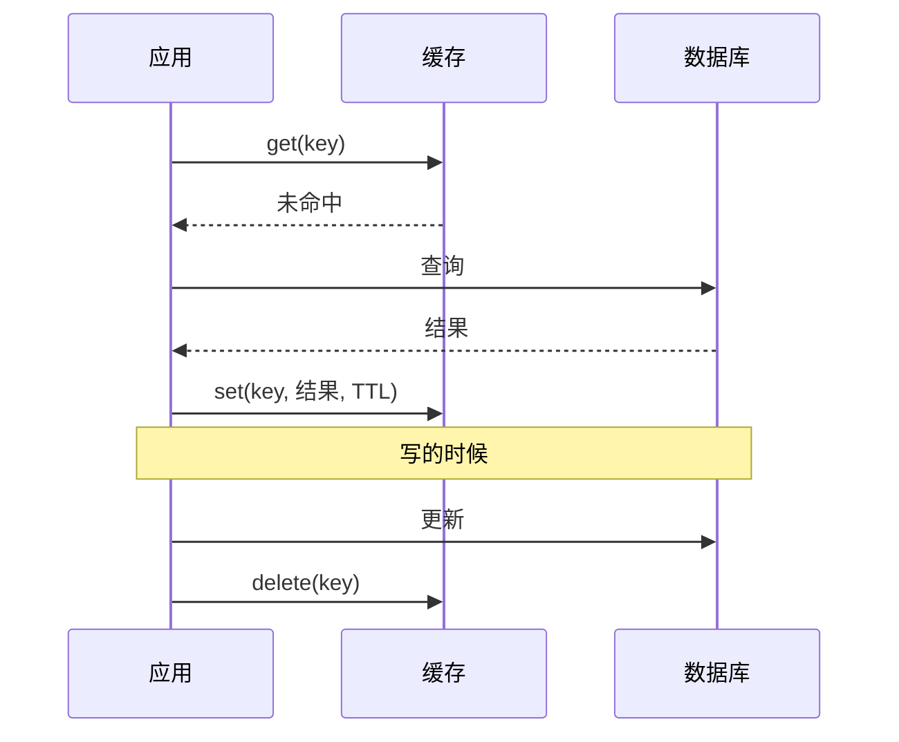
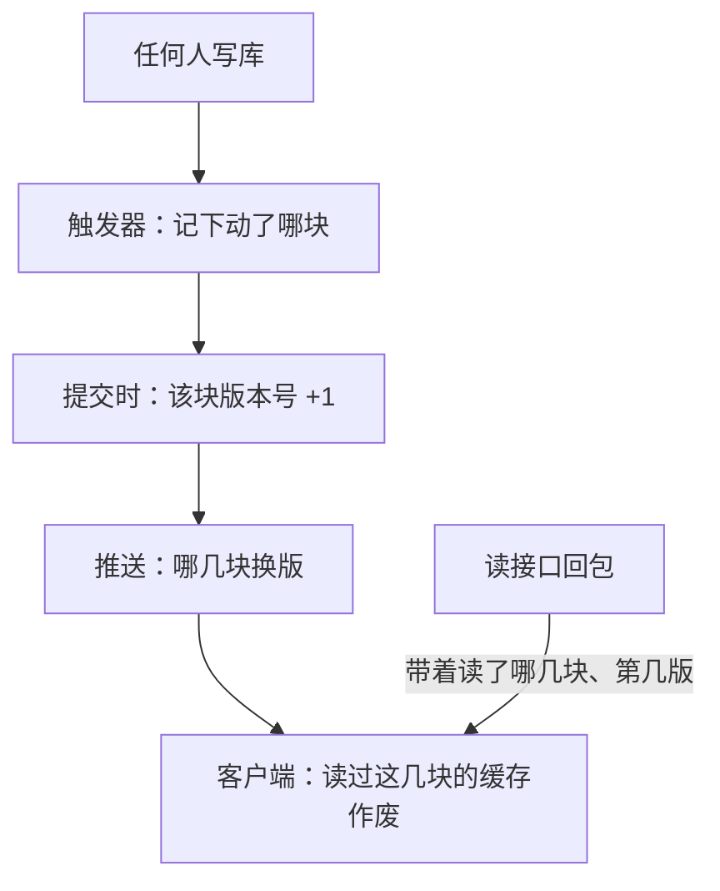
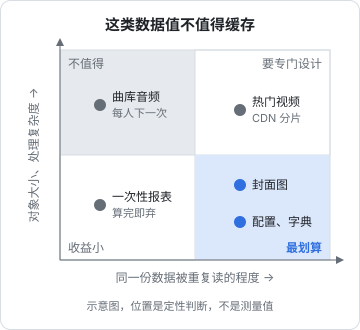

# 缓存策略

「慢了就加缓存」是最常见的直觉，也是最常见的坑。缓存本质上是**数据的第二份拷贝**，有了第二份就有了一致性问题：什么时候它是旧的、谁负责让它失效、失效漏了会怎样。这一章先讲什么时候值得缓存、缓存放在哪一层，再讲失效策略，最后用 hatch-counter 的「按版本号缓存」和 recordwall 的「有意不缓存」两个真实决定，说明缓存的设计取决于数据的取用形状。

## 先问：要不要缓存

加缓存之前，先排除这几种情况：

- **查询本身写得差**：缺索引、N+1、一次取了不需要的列。先修查询，修完多半就不慢了（方法见[《可观测性与性能》](../observability-performance/)的瓶颈定位一章）
- **命中率注定很低**：每个用户只读一次的数据，缓存了也命不中
- **数据必须实时准确**：钱、库存、权限，旧一秒都可能出事，缓存的收益抵不过风险

值得缓存的数据通常同时满足三条：**读得多、变得少、旧一点能接受（或者能准确知道什么时候变了）**。

## 缓存放在哪一层

一个请求从浏览器到数据库，路上每一层都可以缓存：

| 层 | 例子 | 适合缓存什么 | 失效由谁说了算 |
|---|---|---|---|
| 客户端内存 | React 里的查询缓存、hatch-counter 的读接口缓存 | 当前会话反复看的数据 | 客户端（TTL）或服务端通知 |
| HTTP 缓存 | 浏览器按 `Cache-Control`、`ETag` 缓存 | 静态资源、公开的不常变数据 | 响应头 |
| CDN 边缘 | Cloudflare 缓存 | 静态资源、公开图片 | 响应头 + 手动清除 |
| 反向代理 | nginx `proxy_cache` | 公开的接口响应 | nginx 配置 |
| 应用进程内存 | 一个 `Map` | 配置、字典表、小而热的数据 | 应用自己 |
| 共享缓存 | Redis | 多实例共享的会话、计数、热点数据 | 应用自己 |
| 数据库自身 | Postgres 的 shared_buffers、操作系统页缓存 | 热的数据页 | 数据库自动 |

最后一行常被忘记：**数据库本身就有缓存**。一张几万行的表，热数据早就在内存里了，查询走索引是毫秒级的。很多「加 Redis 提速」的需求，其实只是查询没走索引。

越靠近用户的缓存收益越大（连请求都省了），但失效越难控制：浏览器里的缓存你清不掉，只能等它过期。

## 三种读写模式

### Cache-aside（旁路缓存）

最常用的模式。读的时候先查缓存，没有就查库并写进缓存；写的时候更新库，然后**删除**缓存。



写的时候删缓存而不是更新缓存：两个并发写各自更新缓存，到达顺序和写库顺序可能不一致，缓存里就留下了旧值。删掉让下一次读重新加载，更不容易出错。

### Read-through / Write-through

缓存层自己负责从库里加载、写的时候同步写库。应用只和缓存打交道。在 TS 生态里一般是某个库帮你封装好，原理同上。

### Write-behind（写回）

先写缓存，异步批量落库。吞吐高，但进程崩了会丢数据。hatch-counter 的运营事件和使用足迹就是这样：**先攒在内存里、几秒落一次**，请求里一行不写，进程退出前落最后一次，被强杀丢几秒的数。这些是统计数据，丢几秒可以接受；账本数据绝不能这么做。

## 失效策略

缓存最难的是失效。三种基本手段：

| 手段 | 怎么做 | 优点 | 缺点 |
|---|---|---|---|
| TTL | 写进去时定一个过期时间 | 简单，不会永久错 | 过期前读到旧数据；TTL 短命中率低 |
| 主动删除 | 写数据时删相关的缓存键 | 及时 | 漏删一处就永远旧；要知道写影响了哪些键 |
| 版本号 | 数据带版本号，版本变了缓存就作废 | 判断准确 | 要有地方维护版本号 |

实践中常组合使用：主动删除保证及时，TTL 兜底防止漏删的数据永远错下去。

## 进程内缓存：一个 Map 就够

一个实例的时候，最简单的缓存就是进程内存。hatch-counter 里全平台共用的几份配置（识别服务商链、短信通道）就是这样：**在内存里缓存十秒，改动时顺手清掉**，改完不用重启。

```typescript
export class TtlCache<V> {
  private store = new Map<string, { value: V; expiresAt: number }>();
  private loading = new Map<string, Promise<V>>();

  constructor(private ttlMs: number) {}

  async get(key: string, load: () => Promise<V>): Promise<V> {
    const hit = this.store.get(key);
    if (hit && hit.expiresAt > Date.now()) return hit.value;

    // 同一个键的并发加载只跑一次，避免缓存过期那一刻一起打到数据库
    const pending = this.loading.get(key);
    if (pending) return pending;

    const p = load()
      .then((value) => {
        this.store.set(key, { value, expiresAt: Date.now() + this.ttlMs });
        return value;
      })
      .finally(() => this.loading.delete(key));
    this.loading.set(key, p);
    return p;
  }

  invalidate(key: string) {
    this.store.delete(key);
  }
}
```

```typescript
const configCache = new TtlCache<OcrProvider[]>(10_000);

export function getProviders(db: Db) {
  return configCache.get("ocr-providers", () => db.select().from(ocrProviders));
}

export async function updateProvider(db: Db, row: OcrProviderUpdate) {
  await db.update(ocrProviders).set(row).where(eq(ocrProviders.id, row.id));
  configCache.invalidate("ocr-providers");
}
```

`loading` 那张表处理的是**缓存击穿**：一个热键过期的瞬间，几十个请求同时未命中，同时去查库。合并成一次加载，其他请求等同一个 Promise。

进程内缓存的限制：**多个实例时，每个实例各有一份，`invalidate` 只清了自己那份**。第 9 章会把它列进「单实例假设清单」。

## 三个经典问题

| 问题 | 现象 | 对策 |
|---|---|---|
| 击穿 | 一个热键过期，并发请求同时打到库 | 加载合并（上面的 `loading`）；热键提前刷新 |
| 雪崩 | 大量键同时过期（比如同一时刻批量写入、TTL 相同） | TTL 加随机抖动，比如 `ttl * (0.9 + Math.random() * 0.2)` |
| 穿透 | 查询一个不存在的数据，每次都未命中、每次都查库 | 把「不存在」也缓存一小段时间 |

还有一个比这三个都危险的问题：**缓存键漏了维度**。如果一个接口的结果按租户、按用户权限不同，缓存键里就必须带上租户 id 和权限。漏掉的后果不是变慢，而是 A 看到了 B 的数据。hatch-counter 的缓存跟着会话走：换了服务器、门店或账号就整个清空重连。

## 案例：hatch-counter 按版本号缓存读接口

hatch-counter 的网页端遇到的问题是：不缓存的话，切一页就把整页数据重取一遍，网一慢每切一页白等一两秒，筛选、滚动位置全丢，而绝大多数时候数据跟上次一模一样。目标是**没变就不取，变了（不管是谁改的）一两秒内自己跟上**。

它的做法分三步：

1. **把一家店的数据分成八块**（菜品、库存、销量、开支、员工、工资、配置、权限）。每张表归一块，表上挂触发器，事务提交时给这一块加版本号
2. **每个读接口的回包头上带着「这份数据读了哪几块、各是第几版」**。读了哪几块不是在接口上手标的，而是从这次请求实际跑过的 SQL 里认表名，因为手标一百多个接口，漏一个就是一页永远不刷新
3. **服务端通过推送告诉客户端「哪几块换版了」**，客户端把读过这些块的缓存作废，下次进页面时重取



几个关键决定，每个都有理由：

- **推版本号，不推数据**：页面上看的大多是算出来的数（库存是流水重放的、开支按月摊），推行级数据过来客户端就得再算一遍，等于写第二份口径
- **只在内存里，不落盘**：落盘等于又有了一份本地数据，整家店的账躺在店里电脑的硬盘上
- **块的粒度刻意粗**：块越细，「这个接口读了哪几块」越容易对漏，漏的后果是永远不刷新且不报错；块粗的代价只是偶尔多取一次
- **读接口不许写库**：读的时候顺手写了一下，版本号就变，所有读过这块的缓存全部作废，包括刚读完的这一份。连「同值覆盖」也算改了一行，所以要先比再写

文档里还记了它比过的两条路，都被否掉了：「先显示缓存、进页照样再取」只是把等待换成了数字跳一下，请求一个没少；「本地存全量、推行级增量、本地打补丁」要面对两份数据对账的所有问题。

推送那一半在第 5 章细讲。这里要记住的是这个思路：**失效的判断交给唯一知道数据变没变的地方（数据库），而不是靠客户端猜 TTL**。

## 取用形状决定值不值得缓存

recordwall 的曲库是一个 Cloudflare Worker 架在 R2 前面。它对两类数据做了相反的决定：

- **音频不缓存**：Worker 通过 binding 读 R2，不经过边缘缓存。要缓存得自己调 Cache API，这件事**有意没做**。理由是取用形状：每个人把每首歌下到自己手机上一次，之后一直本地放，同一个人第二次读同一个键基本不发生；缓存只在人和人之间才有收益，等第三个人来下的时候边缘早就清了。一层几乎命不中的缓存，换来的是实打实的复杂度（Range 请求的 206 响应还不能直接放进缓存）
- **封面图走缓存**：同一张封面是所有人翻同一个频道时反复要的，几十 KB，正是缓存最划算的形状。Worker 里 `fetch` 出去的子请求默认就按上游缓存头进 Cloudflare 的缓存，不用写代码

文档最后还写了这个结论的失效条件：要是哪天改成「几个人反复放同一批新歌」，就得重测。



把这个判断画成一张图：横轴是「同一份数据被重复读的程度」，纵轴是「单个对象的大小和处理复杂度」。左上角（读一次、大文件）几乎不值得缓存；右下角（反复读、小对象）是缓存最划算的地方。

## HTTP 缓存头

对于浏览器和 CDN 这两层，缓存由响应头控制。几个最常用的组合：

| 场景 | 响应头 | 含义 |
|---|---|---|
| 带内容哈希的静态资源（`app.3f9a2c.js`） | `Cache-Control: public, max-age=31536000, immutable` | 文件名变了就是新文件，旧的永远不会变 |
| `index.html` | `Cache-Control: no-cache` | 可以缓存，但每次用前要问服务器（配合 ETag 走 304） |
| 用户私有的接口数据 | `Cache-Control: private, no-store` | 不许任何中间层缓存 |
| 公开的、可以旧几分钟的数据 | `Cache-Control: public, max-age=300` | 五分钟内直接用 |

`no-cache` 和 `no-store` 经常被搞混：`no-cache` 是「每次都要验证」，`no-store` 才是「完全不存」。带鉴权的接口用 `private, no-store`，避免被任何代理或 CDN 缓存下来串给别人。

在 NestJS 里给一个公开接口加 ETag 和条件请求，Express 适配器默认就会对响应体生成弱 ETag，并在请求带 `If-None-Match` 且匹配时回 304；你要做的只是设对 `Cache-Control`：

```typescript
import { Controller, Get, Header } from "@nestjs/common";

@Controller("v1/public")
export class PublicController {
  @Get("changelog")
  @Header("Cache-Control", "public, max-age=300")
  changelog() {
    return this.changelogService.latest();
  }
}
```

nginx 层面的静态资源缓存头、`proxy_cache` 配置见[《Nginx 与反向代理》](../nginx-gateway/)。

## 什么时候上 Redis

Redis 是好东西，但它是**又一个要部署、要监控、要备份（或者确认不需要备份）的服务**。一个实例的时候，下面这些需求都不需要它：

| 需求 | 单实例时的做法 |
|---|---|
| 配置、字典缓存 | 进程内 Map + TTL |
| 会话 | 签名令牌，或者存 Postgres |
| 限流计数 | 进程内计数；或者交给 nginx 的 `limit_req` |
| 任务队列 | Postgres 表（第 4 章） |
| 推送扇出 | 进程内的订阅表；跨实例用 Postgres `LISTEN/NOTIFY`（第 5 章） |

真正需要 Redis 的信号是：**有了多个应用实例，并且需要它们共享一份高频读写的状态**，而这份状态放 Postgres 会给数据库带来明显压力。在那之前，少一个服务就少一份运维。

## 本章要点

- 缓存是数据的第二份拷贝；先排除查询写得差、命中率注定低、必须实时准确这三种情况
- 值得缓存的数据：读得多、变得少、旧一点能接受或能准确知道何时变了
- 数据库自己就有缓存，很多「加 Redis」的需求其实是缺索引
- Cache-aside 写的时候删缓存不更新缓存；主动删除 + TTL 兜底
- 击穿用加载合并、雪崩用 TTL 抖动、穿透缓存「不存在」；缓存键漏了租户或权限维度是数据泄露
- hatch-counter 的版本号缓存：数据库触发器维护版本号，推版本不推数据，只在内存不落盘
- 取用形状决定值不值得缓存：读一次的大文件不缓存，反复读的小对象缓存
- 单实例时 Redis 的大部分用途都有更简单的替代；多实例共享高频状态时再引入
