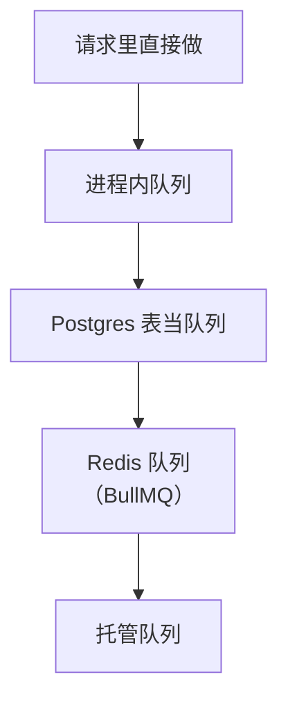
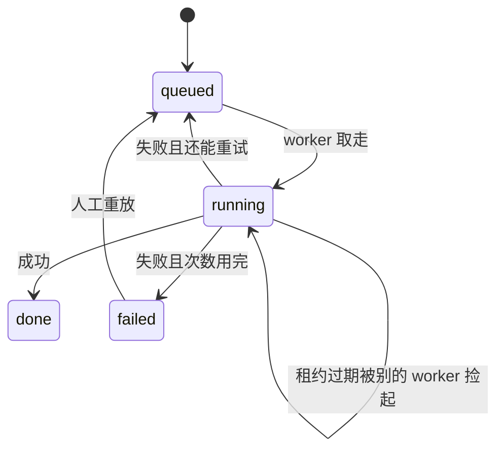

# 队列与异步任务

有些事不该在请求里做完：导出一整家店的账要几分钟，发一条短信可能卡在服务商那里，每天凌晨要给每家店跑一遍体检。这些事交给**异步任务**：请求只负责登记「要做这件事」，立刻返回，真正的活在后台做。这一章讲异步任务的几种实现方式，从进程内队列到用 Postgres 当队列，再讲定时任务和任务设计的几条规矩。核心观点是：**一个人的系统，在用上 Redis 之前，Postgres 已经能当一个很好的队列**。

## 什么时候需要异步

| 信号 | 例子 |
|---|---|
| 请求里做不完 | 整店导出、批量导入几万行、生成 PDF |
| 不该让用户等 | 发通知短信、生成缩略图、写审计 |
| 失败需要重试 | 调第三方 API，对方偶尔 429 或超时 |
| 需要削峰 | 一批请求同时涌进来，后端按自己的速度慢慢消化 |
| 按时间触发 | 每天清理过期数据、每小时检查到期提醒 |

反过来，**用户需要立刻看到结果的事不要异步化**。记一笔账、改个名字，同步做完、同步返回，比「已提交，稍后生效」的体验好得多，代码也简单得多。

## 实现方式的光谱



| 方式 | 持久化 | 多实例 | 额外依赖 | 适合 |
|---|---|---|---|---|
| 进程内队列（数组 + 循环） | 无，进程挂了就丢 | 不支持 | 无 | 丢了能重来的轻活 |
| 进程内队列 + 数据库记状态 | 有 | 需要加锁 | 无 | 低频重活，比如导出 |
| Postgres 表 + `SKIP LOCKED` | 有，和业务数据同一个事务 | 支持 | 无 | 大多数一人项目 |
| Redis + BullMQ | 取决于 Redis 配置 | 支持 | Redis | 高吞吐、需要丰富调度功能 |
| 托管队列（云厂商） | 有 | 支持 | 云服务 | 已经在那个云上，如 Cloudflare Workers |

从左往右，能力越来越强，运维面也越来越大。**选够用的最左边那一个。**

## 案例：hatch-counter 的整店导出

hatch-counter 的「整店导出」是一个典型的重活：把一家店所有表导成 Excel，可选带上全部单据原图，打成 zip 上传到对象存储。它的做法是：

- 后台员工发起导出，接口回 `202 Accepted`，走复核
- 复核批了，**排进进程里的队列，一次跑一家**
- 任务状态记在数据库里（`job_runs`），**进程起来时把没跑完的捡回来**
- 每张表按游标分批读，Excel 流式写、zip 流式打包、流式上传，内存占用和店的大小无关
- 做好之后给店主一个下载入口，7 天有效；每天的清理任务删掉过期的包

这是光谱上第二档：进程内调度，数据库记状态。它够用的原因是导出很低频，一次跑一家也不会排太久；只有一个实例，不存在两个进程抢同一个任务。

注意「进程起来时把没跑完的捡回来」这一条。进程内队列最大的问题是进程重启时队列里的东西就没了，而部署就是一次重启。**只要任务状态在数据库里，重启后能恢复，进程内队列就是可靠的。**

## Postgres 当队列

当任务变多、需要多个 worker 并发处理，或者有了第二个实例，就该用一张表当队列了。Postgres 的 `FOR UPDATE SKIP LOCKED` 正是为这个场景设计的：多个 worker 同时取任务，每个跳过别人已经锁住的行，不会重复取、也不会互相等待。

### 表结构

```sql
CREATE TABLE jobs (
  id            bigint GENERATED ALWAYS AS IDENTITY PRIMARY KEY,
  kind          text        NOT NULL,
  payload       jsonb       NOT NULL,
  status        text        NOT NULL DEFAULT 'queued'
                CHECK (status IN ('queued', 'running', 'done', 'failed')),
  attempts      int         NOT NULL DEFAULT 0,
  max_attempts  int         NOT NULL DEFAULT 5,
  run_at        timestamptz NOT NULL DEFAULT now(),
  locked_until  timestamptz,
  last_error    text,
  created_at    timestamptz NOT NULL DEFAULT now(),
  updated_at    timestamptz NOT NULL DEFAULT now()
);

-- 只索引还没做完的任务，表再大这个索引也很小
CREATE INDEX jobs_ready_idx ON jobs (run_at) WHERE status IN ('queued', 'running');
```

### 取任务

```sql
UPDATE jobs
SET status = 'running',
    attempts = attempts + 1,
    locked_until = now() + interval '5 minutes',
    updated_at = now()
WHERE id = (
  SELECT id FROM jobs
  WHERE attempts < max_attempts
    AND (
      (status = 'queued' AND run_at <= now())
      -- 上一个 worker 拿了任务却在租期内没交回（进程被杀了），重新捡起来
      OR (status = 'running' AND locked_until < now())
    )
  ORDER BY run_at
  LIMIT 1
  FOR UPDATE SKIP LOCKED
)
RETURNING *;
```

`locked_until` 是**租约**：worker 拿到任务后有 5 分钟时间做完，超时没交回就当它死了，别的 worker 可以重新捡起来。这是处理「worker 做到一半进程被杀」的关键。代价是：如果任务真的需要超过 5 分钟，它会被重复执行，所以要么租期设得比最长任务长，要么做的过程中定期续租。

### Worker 循环

用 postgres.js 写一个 worker：

```typescript
import postgres from "postgres";

const sql = postgres(process.env.DATABASE_URL!);

type Job = { id: number; kind: string; payload: unknown; attempts: number; max_attempts: number };
type Handler = (payload: unknown) => Promise<void>;

const handlers: Record<string, Handler> = {
  send_sms: async (p) => { /* 调短信服务商 */ },
  make_thumbnail: async (p) => { /* 生成缩略图 */ },
};

let stopping = false;

async function claim(): Promise<Job | undefined> {
  const [job] = await sql<Job[]>`
    UPDATE jobs SET status = 'running', attempts = attempts + 1,
      locked_until = now() + interval '5 minutes', updated_at = now()
    WHERE id = (
      SELECT id FROM jobs
      WHERE attempts < max_attempts
        AND ((status = 'queued' AND run_at <= now())
          OR (status = 'running' AND locked_until < now()))
      ORDER BY run_at LIMIT 1 FOR UPDATE SKIP LOCKED
    )
    RETURNING id, kind, payload, attempts, max_attempts`;
  return job;
}

async function runOne(job: Job) {
  try {
    const handler = handlers[job.kind];
    if (!handler) throw new Error(`没有处理 ${job.kind} 的 handler`);
    await handler(job.payload);
    await sql`UPDATE jobs SET status = 'done', updated_at = now() WHERE id = ${job.id}`;
  } catch (err) {
    const message = err instanceof Error ? err.message : String(err);
    const giveUp = job.attempts >= job.max_attempts;
    // 指数退避：第 1 次失败等 10 秒，之后翻倍，封顶 1 小时
    const delaySec = Math.min(10 * 2 ** (job.attempts - 1), 3600);
    await sql`
      UPDATE jobs SET
        status = ${giveUp ? "failed" : "queued"},
        run_at = now() + make_interval(secs => ${delaySec}),
        last_error = ${message.slice(0, 2000)},
        locked_until = NULL,
        updated_at = now()
      WHERE id = ${job.id}`;
  }
}

export async function workLoop() {
  while (!stopping) {
    const job = await claim();
    if (!job) {
      await new Promise((r) => setTimeout(r, 1000)); // 没活就歇一秒
      continue;
    }
    await runOne(job);
  }
}

export function stopWorker() {
  stopping = true; // 做完手上这一个再退出
}
```

这几十行就是一个可靠的任务队列：持久化、并发安全、失败重试、指数退避、崩溃恢复、超过次数进 `failed`（相当于死信）。

### 和业务写在同一个事务里

用 Postgres 当队列有一个 Redis 给不了的好处：**入队可以和业务数据写在同一个事务里**。

```typescript
await sql.begin(async (tx) => {
  const [order] = await tx`INSERT INTO orders ${tx(newOrder)} RETURNING id`;
  await tx`INSERT INTO jobs (kind, payload)
           VALUES ('send_receipt', ${tx.json({ orderId: order.id })})`;
});
```

要么订单和任务一起写成，要么一起回滚。用 Redis 队列的话，「订单写成了、入队失败」和「入队成了、订单回滚了」两种情况都要单独处理。这其实就是第 6 章要讲的 **outbox 模式**，用一张表当队列时它是免费的。

### 任务状态



`failed` 的任务不要自动删除。给自己一个能看到它们、能一键重放的地方，哪怕只是一条 SQL。

### 什么时候换成现成的库

自己写的这版缺少一些东西：优先级、限速（每秒最多调用多少次第三方）、任务进度、可视化界面、cron 表达式调度。需要这些时：

- **pg-boss**：基于 Postgres 的 Node 任务队列库，思路和上面一样，功能齐全，不用加新服务
- **BullMQ**：基于 Redis，吞吐更高、功能最丰富，代价是多一个 Redis

原则不变：只有 Postgres 的时候先用基于 Postgres 的方案。给手写版补上 LISTEN/NOTIFY 唤醒、完成任务的归档和表膨胀处理，以及 pg-boss 怎么接进 NestJS，见[《Redis 与后台任务》用 Postgres 做队列](../redis-jobs/06-postgres-queue.md)；BullMQ 见同书[第 5 章](../redis-jobs/05-bullmq.md)。

## 定时任务

### 进程内定时 vs 系统 cron

| 方式 | 优点 | 缺点 |
|---|---|---|
| 系统 cron / systemd timer 调一个命令 | 进程独立，和服务端解耦 | 要单独部署、单独看日志；容器里跑 cron 很别扭 |
| 进程内 `setInterval` | 和服务端同一份代码、同一个日志 | 进程重启时错过的那次要自己补 |
| `@nestjs/schedule` 的 cron 装饰器 | 写法简洁 | 到点进程不在就错过了，不会补跑 |

hatch-counter 选了进程内，而且**特意不用 cron 表达式**：用 `setInterval` 每隔一段时间看一眼「过没过点、今天跑没跑」。文档里的理由是：半夜重启的那台起来要接着补跑。cron 是「到点触发」，错过就错过了；「过点且今天没跑」是一个状态判断，重启之后照样成立。

```typescript
export class DailyJob {
  private timer?: NodeJS.Timeout;

  constructor(
    private name: string,
    private hour: number,
    private run: (day: string) => Promise<void>,
    private tryStart: (name: string, day: string) => Promise<boolean>,
  ) {}

  start() {
    // 每分钟看一次，进程刚起来也立刻看一次，错过的会被补上
    void this.tick();
    this.timer = setInterval(() => void this.tick(), 60_000);
  }

  stop() {
    clearInterval(this.timer);
  }

  private async tick() {
    const now = new Date();
    if (now.getHours() < this.hour) return;
    const day = now.toISOString().slice(0, 10);
    if (!(await this.tryStart(this.name, day))) return; // 今天已经有人跑过
    await this.run(day);
  }
}
```

注意日期：上面 `toISOString()` 取的是 UTC 日期而 `getHours()` 是本地时间，真实项目里要统一成业务所在时区的日期，这类细节最容易在跨零点时出错。

### 「今天跑没跑」记在库里

`tryStart` 用一张记录表实现，**开始就落一行**：

```sql
CREATE TABLE job_runs (
  id          bigint GENERATED ALWAYS AS IDENTITY PRIMARY KEY,
  job         text        NOT NULL,
  period      text        NOT NULL,            -- 例如 '2026-11-02'
  started_at  timestamptz NOT NULL DEFAULT now(),
  finished_at timestamptz,
  ok          boolean,
  detail      text,
  UNIQUE (job, period)
);
```

```typescript
async function tryStart(job: string, period: string): Promise<boolean> {
  const rows = await sql`
    INSERT INTO job_runs (job, period) VALUES (${job}, ${period})
    ON CONFLICT (job, period) DO NOTHING
    RETURNING id`;
  return rows.length === 1;
}
```

这张表一石三鸟：

1. **防止重复跑**：唯一约束保证同一个周期只有一个进程能插进去，以后有了多个实例也不会跑两遍
2. **区分三种状态**：没有这一行是「没跑」；有行没有 `finished_at` 是「跑到一半进程没了」；有 `ok` 是「跑完了，成没成」。hatch-counter 的文档专门强调了这一点：一行都没有的话，分不清「一切正常」和「根本没跑」
3. **可观测**：后台首页可以直接读它，告诉你「昨晚的体检没跑成：原因是……」

跑完时更新 `finished_at`、`ok`、`detail`。一个任务处理多家店时，单家失败不应该让整个任务失败，记下失败的家数和原因，继续跑下一家。

### 能不起定时任务就不起

hatch-counter 文档里有一句值得记住的话，大意是：**多一个定时任务就多一样要盯着它跑没跑的东西**。所以能顺手做的就顺手做：验证码表在每次建码时先删掉一小时前的旧行，幂等回执表在下一次占行时顺手清掉过期的，都不另起定时任务。

## 任务设计的规矩

| 规矩 | 为什么 |
|---|---|
| **任务必须幂等** | 租约过期、重试、人工重放都会让同一个任务执行多次 |
| **payload 只放 id，不放数据快照** | 任务执行时读最新数据；快照可能已经过时 |
| **任务要小** | 一个任务处理一家店，而不是一个任务处理所有店；失败了只重试那一家 |
| **区分可重试和不可重试的错误** | key 填错了重试一万次也不会对；见第 6 章 |
| **有总次数上限** | 否则一个坏任务会永远占着 worker |
| **记下最后的错误** | `last_error` 是排障的起点 |

### 优雅退出

部署时容器会收到 SIGTERM。worker 要做的是：停止取新任务，做完手上这个，然后退出。

```typescript
// main.ts
const app = await NestFactory.create(AppModule);
app.enableShutdownHooks(); // 让 Nest 收到 SIGTERM 时调用各模块的 onApplicationShutdown
await app.listen(3000);
```

```typescript
@Injectable()
export class WorkerService implements OnApplicationBootstrap, OnApplicationShutdown {
  private loop?: Promise<void>;

  onApplicationBootstrap() {
    this.loop = workLoop();
  }

  async onApplicationShutdown() {
    stopWorker();
    await this.loop; // 等手上那个任务做完
  }
}
```

`docker stop` 默认只等 10 秒就发 SIGKILL。任务可能超过这个时间的话，在 compose 里加大 `stop_grace_period`；即使被强杀，租约机制也会让任务被重新捡起，前提是任务幂等。

### 要不要单独起一个 worker 进程

一开始不需要：worker 循环就跑在 API 进程里。当任务开始影响 API 的响应时间（CPU 密集的图片处理、大量并发的外部调用），用同一个镜像、不同的启动命令起一个单独的 worker 服务：

```yaml
services:
  api:
    image: myapp/api:${TAG}
    command: ["node", "dist/main.js"]
  worker:
    image: myapp/api:${TAG}
    command: ["node", "dist/worker.js"]
    stop_grace_period: 60s
```

代码、镜像、数据库都是同一份，只是多了一个运行角色。这仍然是单体。

## 本章要点

- 做不完、不该等、要重试、要削峰、按时触发的事才异步化；用户要立刻看到结果的事保持同步
- 选够用的最简单方案：进程内队列只要状态记在库里、重启能恢复，就是可靠的
- Postgres 的 `FOR UPDATE SKIP LOCKED` + 租约 + 退避，几十行就是一个可靠的任务队列
- 用表当队列时，入队能和业务数据在同一个事务里，outbox 模式是免费的
- 定时任务用「过点且本周期没跑」判断，重启能补跑；`job_runs` 开始就落一行，唯一约束防重、区分没跑和跑挂了
- 能顺手清理的就不起定时任务
- 任务必须幂等、要小、只带 id、区分可重试错误、有次数上限；部署时优雅退出

## 动手练习

1. **看 `SKIP LOCKED` 怎么分活**：用 `docker run -d --name pgq -e POSTGRES_PASSWORD=pg postgres:17` 起一个 Postgres，在两个终端里各开 `docker exec -it pgq psql -U postgres`。先建表 `CREATE TABLE jobs (id int PRIMARY KEY, status text); INSERT INTO jobs VALUES (1, 'queued'), (2, 'queued');`，然后两边依次执行 `BEGIN; SELECT id FROM jobs WHERE status = 'queued' ORDER BY id LIMIT 1 FOR UPDATE SKIP LOCKED;`，都先不提交。

   验证：终端 A 拿到 1，终端 B 拿到 2。两边 `ROLLBACK` 后，把 B 的语句去掉 `SKIP LOCKED` 重做一遍：B 会卡住，直到 A 提交或回滚才返回。

   参考答案：`SKIP LOCKED` 让 worker 跳过别人已锁住的行，不重复取也不互相等。做完 `docker rm -f pgq` 清理。

2. **`job_runs` 防重跑**：在同一个库里建本章的 `job_runs` 表，执行两遍 `INSERT INTO job_runs (job, period) VALUES ('daily-check', '2026-11-04') ON CONFLICT (job, period) DO NOTHING RETURNING id;`。

   验证：第一遍返回一行 id，末尾是 `INSERT 0 1`；第二遍返回 0 行，末尾是 `INSERT 0 0`。

   参考答案：`tryStart` 就是看 `RETURNING` 有没有返回行。唯一约束在数据库里裁决，两个实例同时插也只有一个成功，所以这个写法加实例时不用改。

3. **选队列**（分析题）：单实例 NestJS + Postgres，每天约 200 条下单后的短信通知，服务商偶尔 429，要求订单写成就一定发；另有每月一两次的整店导出，一次几分钟。各自选光谱上哪一档。

   验证：说明每个选择满足了哪些需求（持久化、重试、和业务同事务），以及为什么不选更右边的一档。

   参考答案：短信用 Postgres 表队列，入队和写订单同一个事务，退避重试处理 429；导出用进程内队列 + 库里记状态，低频、一次跑一家，重启时捡回没跑完的。如果短信要按服务商限速每秒几条、还要优先级，换 pg-boss；已经多实例且有 Redis、吞吐很高，才轮到 BullMQ。
