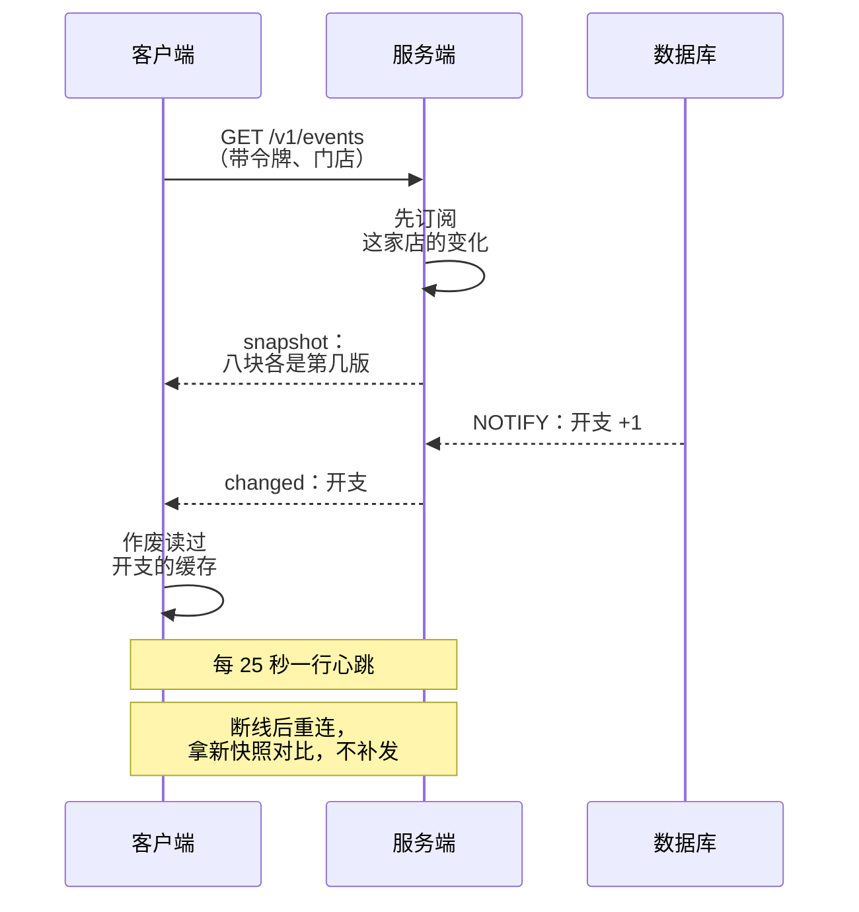

# 实时推送

用户 A 在电脑上改了一笔账，用户 B 开着的手机页面要不要跟着变？大多数时候答案是「要，但不用毫秒级」。这一章讲怎么让服务端把「有东西变了」告诉客户端：先分清需求是哪一种，再在轮询、SSE、WebSocket 之间选，然后讲一个容易被忽略但最关键的设计问题：**推什么**。主线案例是 hatch-counter 的 `/v1/events`，它推的是版本号而不是数据，断线后不补发，这两个决定让整套推送简单了一个数量级。

## 先分清需求

「实时」这个词底下其实是三种很不一样的需求：

| 需求 | 例子 | 数据方向 | 延迟要求 |
|---|---|---|---|
| 通知「变了」 | 别人改了数据，我这页该刷新 | 服务端 → 客户端 | 秒级 |
| 推送数据流 | 大模型逐字输出、任务进度、日志尾巴 | 服务端 → 客户端 | 亚秒级 |
| 双向协作 | 多人同时编辑、聊天、游戏 | 双向 | 亚秒级，还要处理冲突 |

一个人做的业务系统，绝大多数需求是第一种。它最简单，也最容易被做复杂：一上来就选 WebSocket、设计一套消息协议、在客户端打补丁，最后发现要处理的是重连、丢消息、乱序、鉴权过期这一堆问题。

## 几种技术

| 技术 | 原理 | 优点 | 缺点 |
|---|---|---|---|
| 短轮询 | 客户端每隔 N 秒请求一次 | 最简单，无状态 | 延迟 = 间隔；大部分请求是白跑 |
| 长轮询 | 请求挂起，有变化或超时才返回 | 延迟低，仍是普通 HTTP | 每次变化后要重新发请求 |
| SSE | 一个不结束的 HTTP 响应，服务端持续写事件 | 普通 HTTP、经过所有中间层、鉴权和普通请求一样 | 只能服务端 → 客户端 |
| WebSocket | 升级成双向的帧协议 | 双向、低开销 | 要单独处理鉴权、心跳、代理配置；不是 HTTP 语义 |
| 移动推送（APNs、FCM、国内厂商通道） | 经由系统通道推到设备 | App 在后台、没运行也能收到 | 不可靠、有延迟、有频率限制，只适合通知 |

选择很直接：

- 只要服务端往下推 → **SSE**
- 真要双向（客户端高频往上发） → WebSocket
- App 不在前台也要提醒用户 → 移动推送，但它只负责「叫醒」，数据照样走接口取
- 延迟要求是分钟级、用户量小 → 短轮询完全够，别犹豫

hatch-counter 选了 SSE，文档里的理由很干脆：只要往下推、不要双向，所以是 SSE 不是 WebSocket；它就是一个普通的 HTTP 回包，鉴权、版本守卫、维护开关都跟别的请求一样过。

## 推什么：版本号，而不是数据

这是整章最重要的一个设计决定。

**推数据**（「第 42 行的金额改成了 85」）看起来高效，实际上要客户端处理：

- 这一行影响了哪些算出来的数？客户端要重算一遍，等于写第二份业务口径
- 断线期间漏了几条？要补发，就要事件序号、要服务端存历史
- 消息乱序了怎么办？要按版本比较
- 这个用户有没有权限看这一行？推之前要按权限过滤每一条

**推版本号**（「这家店的『开支』那一块现在是第 1307 版」）把这些问题全部消掉了：

- 客户端只需要知道「我手上读过开支的那几份缓存旧了」，作废它们，下次照常调接口取。数据仍然走那个带鉴权、按权限裁剪过的接口
- 版本号一个字的业务数据都不带，所以**不用按权限过滤**：没有工资权限的人收到「工资换版了」也没关系
- 断线了不用补发：重连时拿一份最新的版本快照，跟手上的比，不一样的块整块作废



hatch-counter 的文档把「断了不补发」列为推版本号的**主要原因**：合盖睡一晚、断网半小时、服务端重启，都走同一条路，不需要事件序号，不需要「从第几条接着推」。

这个思路可以推广到大多数「通知变了」的需求：**推一个粗粒度的信号，让客户端用已有的读接口自己去取**。代价是偶尔多取一次，换来的是推送层不需要懂任何业务。

## 服务端：一条 SSE 连接

NestJS 有 `@Sse()` 装饰器，返回一个 Observable 即可。但它对心跳、断开清理、写之前先订阅这些细节控制得不够细，hatch-counter 直接用底层的响应对象手写。完整的端点代码和为什么不用 `@Sse()`，见[《NestJS 后端架构》为什么 hatch-counter 不用 @Sse()](../nestjs-backend/08-realtime.md#为什么-hatch-counter-不用-sse)。从设计的角度，只需要看清其中的顺序：

```typescript
// 先订阅、再读快照：读快照期间提交的变化先攒着，发完快照再补，一条不漏
const buffered: string[][] = [];
let ready = false;
const unsubscribe = hub.subscribe(storeId, (domains) =>
  ready ? send("changed", { domains }) : buffered.push(domains));

send("snapshot", await versions.snapshot(storeId));
ready = true;
for (const domains of buffered) send("changed", { domains });
```

几个要点：

- **先订阅、再读快照**：反过来的话，读快照和开始订阅之间提交的变化会丢
- **心跳**：比中间所有代理的空闲超时都短。nginx 那边要单独给这个路径关缓冲、调大读超时，具体配置和 hatch-counter 那段 location 的逐行拆解见[《Nginx 与反向代理》](../nginx-gateway/)的长连接一章
- **断开时清理**：不清理订阅，每断一次泄漏一个回调

### 服务端主动断开

长连接是在建立的那一刻过的鉴权。之后令牌过期了、用户被移出门店了，连接还挂着。hatch-counter 的处理是**服务端主动断开，断之前说一句为什么**：

- 令牌到期前 5 秒断开，原因 `token`：客户端续一张新令牌再连
- 这家店的权限那一块换版了，先推 `changed`，200 毫秒后断开，原因 `access`：重连时重新过一遍鉴权，被移出的人、停用的店就连不回来了
- 服务端监听数据库的那条连接断过，原因 `resync`：断开期间的通知可能丢了，让所有客户端重连拿新快照

这比在长连接里做「实时鉴权」简单得多：**把鉴权留给连接建立那一刻，需要重新鉴权时就断开**。

## 扇出：变化从哪来

服务端要知道「哪家店的哪一块变了」。最可靠的来源是数据库本身。

### 单实例：进程内订阅表

```typescript
type Listener = (domains: string[]) => void;

export class Hub {
  private listeners = new Map<string, Set<Listener>>();

  subscribe(storeId: string, fn: Listener): () => void {
    let set = this.listeners.get(storeId);
    if (!set) this.listeners.set(storeId, (set = new Set()));
    set.add(fn);
    return () => {
      set!.delete(fn);
      if (set!.size === 0) this.listeners.delete(storeId);
    };
  }

  publish(storeId: string, domains: string[]) {
    for (const fn of this.listeners.get(storeId) ?? []) fn(domains);
  }
}
```

### 用 Postgres 的 LISTEN / NOTIFY 驱动

变化如果只在 service 里手动 `hub.publish()`，漏一个写接口就漏一种变化，而且后台改数据、脚本修数据、迁移回填都不经过 service。hatch-counter 的做法是让**数据库触发器**在事务提交时发 `NOTIFY`，服务端用一条专门的连接 `LISTEN`：

```sql
-- 在触发器或提交时调用的函数里
PERFORM pg_notify('store_versions', json_build_object(
  'store', store_id_value,
  'domains', changed_domains
)::text);
```

```typescript
import postgres from "postgres";

// postgres.js 的 listen 会自己占一条专用连接，不占业务连接池
const sql = postgres(process.env.DATABASE_URL!);

await sql.listen("store_versions", (payload) => {
  const { store, domains } = JSON.parse(payload) as { store: string; domains: string[] };
  hub.publish(store, domains);
});
```

`NOTIFY` 有两个性质特别适合这个场景：

- **它是事务性的**：通知在事务提交时才发出，回滚的事务不发。推出去的一定是真写成了的
- **同一事务里相同的通知会合并**：一次导入八千行，不会推八千次

需要注意的是：`LISTEN` 的连接断开期间的通知会丢，而且丢了哪些无从知道。所以重新监听上的那一刻，要让所有客户端断开重连（上面的 `resync`）。另外 NOTIFY 的载荷有大小上限（默认配置下约 8000 字节），只放标识符，不放数据。

### 多实例

`LISTEN/NOTIFY` 天然支持多实例：每个实例各自 `LISTEN`，数据库的通知会发给所有监听者，每个实例推给自己身上的连接。**不需要 Redis pub/sub**，直到通知的频率高到给数据库带来压力。

## 客户端：读流、重连、看门狗

浏览器原生的 `EventSource` 有个限制：**不能带自定义请求头**，没法加 `Authorization`。hatch-counter 因此用 `fetch` 拿到响应体，按空行切出一条条事件，读流的代码见[《NestJS 后端架构》客户端：为什么不用 EventSource](../nestjs-backend/08-realtime.md#客户端为什么不用-eventsource)。

重连逻辑决定了这套东西在真实网络下好不好用。hatch-counter 的客户端做了这几件事：

| 机制 | 做法 | 为什么 |
|---|---|---|
| 退避重连 | 1、2、4、8、15、30 秒，带随机抖动；连上一次就从头数 | 服务端一重启，别让所有客户端在同一秒涌回来 |
| 尊重 `Retry-After` | 回 503 带这个头就照它等 | 服务端在维护时能控制节奏 |
| 看门狗 | 70 秒没收到任何字节就当连接死了，主动断开重连 | 服务端 25 秒一次心跳，留两次多的余量；死连接不一定会报错 |
| 醒来重连 | 页签藏了一分钟以上再切回来、网络恢复（`online` 事件）时立刻重连 | 浏览器没有「睡醒」事件，合盖醒来时连接多半已经死了 |
| 区分状态 | 连上并对过快照才算 `live`，**只有 `live` 才用缓存** | 没连上推送时，缓存失效没人通知，只能每次都取 |

最后一条是整个缓存方案的安全阀：推送断了，缓存就不用了，退回到每次都请求。宁可慢，不能错。

退避和抖动的算法在第 6 章细讲。

## 移动端

App 切到后台时，系统很快就会挂起它，长连接随之断开。所以移动端的推送策略和网页不同：

- **前台时连 SSE**，和网页一样
- **回到前台时**：重连并拿快照对比，不要指望后台期间的消息
- **需要在后台提醒用户**（比如「有一张待审批的单据」）：用系统推送服务。Expo 项目里一般通过 `expo-notifications` 接 APNs，推送内容只是一句提醒，点开 App 后照常从接口取数据

不要试图在后台保持长连接，系统不允许，耗电也不划算。

### Android 和国内厂商通道

> [!WARNING]
> 本小节按 2026 年 11 月各平台开发者文档的公开说明整理（华为 Push Kit 的消息分类按华为开发者联盟文档）。各家的消息分类、每日条数上限、申请流程经常调整，接入前以 Firebase、Expo、华为、荣耀、小米、OPPO、vivo 各自开发者平台的最新文档为准。

iOS 只有 APNs 一条路，Android 则分两种情况：

| 用户在哪 | 系统推送通道 | 说明 |
|---|---|---|
| 海外，或装了 Google 服务的手机 | **FCM**（Firebase Cloud Messaging） | 服务端用 FCM 的 HTTP v1 接口，凭服务账号密钥鉴权；`expo-notifications` 配上 FCM 凭据就能用 Expo 的推送服务统一发 iOS 和 Android |
| 国内的 Android 手机 | **各厂商自己的通道**：华为、荣耀、小米、OPPO、vivo 等 | 国内手机大多没有 Google 服务，FCM 收不到；App 被杀后能把消息送到的，只有厂商系统级的通道 |

国内这条路麻烦在三处：

- **要一家一家接**。每个厂商一个开发者账号、一套 SDK 和服务端接口，App 启动时按机型注册对应通道。一人项目通常用第三方聚合服务（如极光、个推、友盟）统一接入，服务端只调一个接口，代价是多一个依赖和一份隐私政策里要写明的第三方 SDK
- **消息要分类，营销类有条数上限**。以华为为例，通知分成「服务与通讯」和「资讯营销」两类，没申请自分类权益的应用默认全部算资讯营销，每台设备每天只能收到很少几条，超出的直接丢弃。其他厂商也有类似的分类和限额。所以「有一张待审批的单据」这种提醒要按服务类申请和标注，别和促销消息混在一起发
- **Expo 的推送服务不覆盖国内厂商通道**。要接厂商通道得用原生 SDK（或聚合服务的 React Native 封装）加 config plugin，也就意味着必须用 dev client 构建，Expo Go 里测不了

不论走哪条通道，这一章的原则不变：**推送只负责叫醒，数据回到前台后照常从接口取**。厂商通道丢消息、延迟、被限额都很常见，推送没到不能影响数据的正确性。Android 13 起发通知还要用户授权（`POST_NOTIFICATIONS` 运行时权限），和 iOS 一样，在用户第一次需要提醒的时候再申请，比启动就弹窗的通过率高。

## 连接数与资源

每条 SSE 连接在服务端是一个打开的 socket 和几个闭包，Node 的事件循环挂着它们几乎不花 CPU。对一人项目的规模，连接数基本不会成为瓶颈。真正要注意的是：

- **不要每条连接占一个数据库连接**：订阅走进程内的 Hub，数据库只有一条 `LISTEN` 连接
- **一个用户开多个页签就是多条连接**：一般没问题；真成了问题，可以用浏览器的 `BroadcastChannel` 让几个页签共用一条
- **合并短时间内的多次通知**：一次提交常常动好几块，紧接着写接口的回包也会带着新版本号；客户端攒 30 毫秒合成一次，界面只重取一轮

## 本章要点

- 先分清是「通知变了」「推数据流」还是「双向协作」；业务系统多是第一种
- 只要服务端往下推就用 SSE，它是普通 HTTP，鉴权和中间层都不用特殊处理；分钟级延迟用轮询就够
- 推版本号而不是数据：客户端作废缓存后用已有接口重取，不用重算口径、不用按权限过滤、断线不用补发
- 服务端先订阅再发快照；心跳短于中间层空闲超时；令牌过期、权限变化时主动断开让客户端重新鉴权
- 变化来源交给数据库触发器 + `NOTIFY`：事务性、自动合并，多实例天然支持
- 客户端用 `fetch` 读流以便带令牌；退避加抖动、看门狗、醒来重连；推送没连上时不用缓存
- 移动端后台不保持长连接，回到前台重连对快照；后台提醒交给系统推送：iOS 走 APNs，海外 Android 走 FCM，国内 Android 要接各厂商通道，营销类消息有条数上限

## 动手练习

1. **手写一条 SSE**：把下面的代码存成 `sse.mjs` 运行，另开终端 `curl -N localhost:8787`，看一会儿后按 Ctrl+C 断开 curl。

   ```javascript
   import http from "node:http";
   let version = 0;
   http.createServer((req, res) => {
     res.writeHead(200, { "Content-Type": "text/event-stream", "Cache-Control": "no-store" });
     res.write(`event: snapshot\ndata: ${JSON.stringify({ expenses: version })}\n\n`);
     const change = setInterval(() => res.write(`event: changed\ndata: ${JSON.stringify({ expenses: ++version })}\n\n`), 2000);
     const heartbeat = setInterval(() => res.write(": ping\n\n"), 5000);
     req.on("close", () => { clearInterval(change); clearInterval(heartbeat); console.log("closed"); });
   }).listen(8787);
   ```

   验证：curl 先打出一条 `event: snapshot`，之后每 2 秒一条 `event: changed`，中间夹着 `: ping` 心跳行；断开 curl 后服务端打印 `closed`。

   参考答案：SSE 就是一个不结束的普通 HTTP 响应，冒号开头的行是注释，可以当心跳用。把 `req.on("close", ...)` 删掉再连、断几次，定时器会一直跑下去，这就是本章说的「断开时不清理会泄漏」。

2. **顺序反了会丢什么**（分析题）：有人把服务端改成先读版本快照、发出去，再订阅这家店的变化。画一条时间线，说明在什么时刻提交的写入会被这个客户端错过，以及后果。

   验证：时间线上标出「读快照」「另一个请求提交」「开始订阅」三个点的先后。

   参考答案：在读完快照之后、开始订阅之前提交的变化，既不在快照里，也收不到 `changed`；客户端会一直用着那块旧缓存，直到下一次那块再变或者断线重连，而且不报任何错。先订阅、把期间的通知攒着、发完快照再补，就合上了这个缝。

3. **选推送方式**（分析题）：一个门店应用有四个需求：A. 别人改了开支，我开着的页面要跟上；B. 让大模型生成经营周报，要逐字显示；C. 有待审批的单据时提醒店主，即使 App 没打开；D. 一个汇率看板，十分钟更新一次。各用什么技术。

   验证：对照「通知变了 / 推数据流 / 双向协作」三种需求先归类，再选技术。

   参考答案：A 用 SSE 推版本号；B 用 SSE 推数据流（周报生成是一次性的，断了重新生成即可）；C 用系统推送只负责叫醒，数据照样走接口取；D 短轮询就够。如果 A 改成「两个人同时编辑同一张单据、要看到对方的光标」，就成了双向协作，才轮到 WebSocket 和冲突处理。
