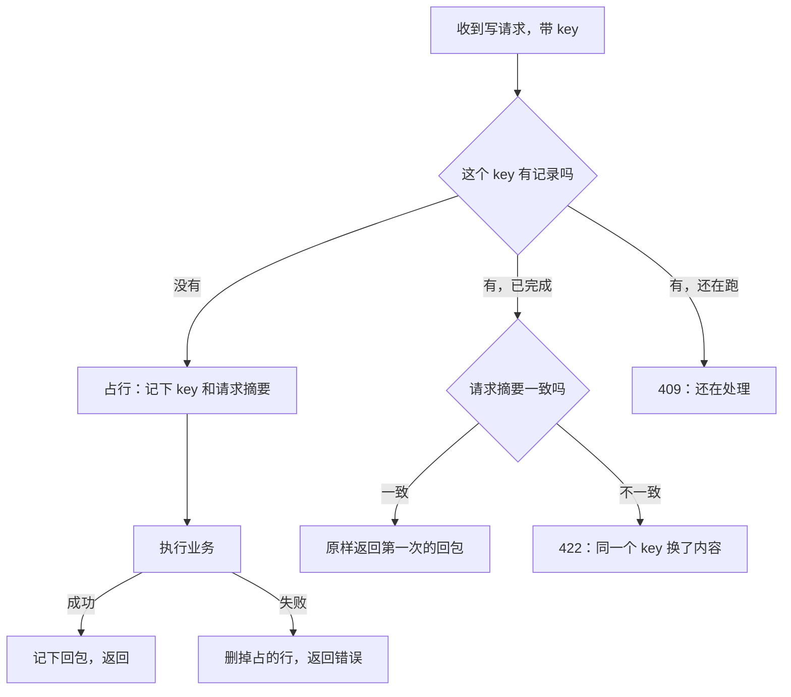
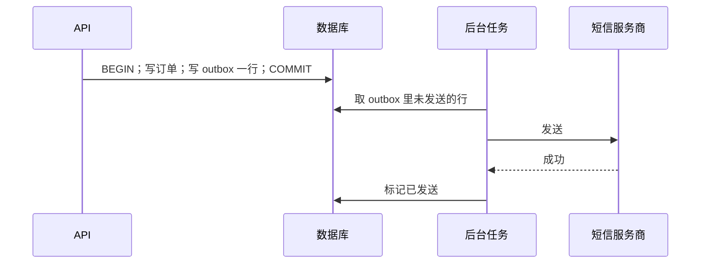

# 幂等、重试与一致性

店主在信号不好的地方点「记一笔」，转圈、超时，他又点了一次。服务端收到了几次？记了几笔？这个问题没有一个能靠「小心写代码」解决的答案，因为网络请求除了成功和失败，还有第三种结果：**不知道**。这一章从这第三种结果出发，讲幂等键怎么设计、哪些错误该重试、怎么重试，以及当一次操作要同时改数据库和外部世界时，怎么保证不出现半截状态。

## 网络的第三种结果

客户端发出一个请求，可能的结局：

| 结局 | 客户端看到 | 服务端实际 |
|---|---|---|
| 成功 | 收到 200 | 做了 |
| 明确失败 | 收到 4xx / 5xx | 没做（或回滚了） |
| **不知道** | 超时、连接断开 | 可能没收到，可能做了一半，可能做完了只是回包丢了 |

第三种情况下，客户端只有两个选择：不重试（可能少做一次），或者重试（可能多做一次）。**幂等**就是让「重试」变得安全：同一个操作执行一次和执行多次，效果一样。

「按钮点了就变灰」只能挡住手抖。hatch-counter 的文档说得很准：它挡不住「请求到了服务端、回包丢在半路」。

## 天然幂等的操作

先看哪些操作本来就是幂等的，能用这些写法就优先用：

| 写法 | 例子 | 为什么幂等 |
|---|---|---|
| 设置为某个值 | `UPDATE items SET name = '拿铁' WHERE id = $1` | 执行几次结果都是「名字是拿铁」 |
| 按 id 删除 | `DELETE FROM items WHERE id = $1` | 第二次删不到东西，结果一样 |
| 带唯一键的插入 | `INSERT ... ON CONFLICT (external_id) DO NOTHING` | 第二次撞约束，什么都不做 |
| 条件更新（状态机） | `UPDATE orders SET status = 'paid' WHERE id = $1 AND status = 'pending'` | 第二次条件不满足，影响 0 行 |
| 条件写（乐观锁） | `PUT` 带 `If-Match: <etag>` | 版本对不上就拒绝 |

HTTP 方法本身也有约定：GET、PUT、DELETE 应该是幂等的，POST 不是。所以「改名、改值、排序、删除」这类操作天然安全，**真正危险的是「新增一条」和「在原值上加减」**：记一笔账、扣一次库存、发一次短信。

## 幂等键

对于不天然幂等的写操作，标准做法是**幂等键**：客户端为每一次提交生成一个唯一的 key，放在请求头里；服务端记下每个 key 的处理结果，同一个 key 再来就原样返回第一次的结果，不再执行。

hatch-counter 的实现值得逐条看，每一条都是踩过的坑：

### key 跟着「这一次提交」走

- 客户端在用户点「提交」那一刻生成 key
- 网络失败后用户点「再交一次」，**用同一个 key**
- 用户改了内容再点提交，就是新的一次，**换新 key**
- 401 续令牌后自动重发的请求，用同一个 key（生成 key 的位置在续期重发那层外面）

把 key 和「这次提交」绑定，而不是和「这个请求」绑定，这是最容易搞错的地方。每次发请求都生成新 key，等于没有幂等。

### 服务端的规矩



- **按「店 + 设备 + key」唯一**：不同设备撞了同一个 key 也各记各的
- **同一个 key 换了内容再来，回 422**：方法、路径、门店、请求体摘要任何一项对不上，都是客户端的 bug，不能拿上一次的回包冒充
- **跑失败的不记**：处理函数抛错就删掉占的那一行，业务事务已经回滚，下次重试应该真跑一遍
- **占行、记回包各是一个短事务，和业务事务分开**：如果塞进业务事务，业务回滚时「还在跑」那一行也跟着没了，并发的第二次请求会以为没人在跑
- **24 小时后作废**：过期的行在下一次占行时顺手清掉，不另起定时任务

### 最难的那个缝

占行、业务、记回包是三个事务。如果业务提交了、记回包之前进程被杀了，那一行就一直停在「还在跑」。hatch-counter 的处理：

- 两分钟内再来，回 409「还在处理，等几秒」
- 超过两分钟，回 409「没等到结果，先去看看记上了没有」，客户端要换新 key 才能再提交

文档里的原则是：**宁可让人去看一眼，也不悄悄再执行一遍**。这是一个诚实的设计：分布式系统里总有一个缝是技术上合不上的，那就把它暴露给人，而不是假装它不存在。

### 表和拦截器的骨架

```sql
CREATE TABLE idempotent_requests (
  store_id     uuid        NOT NULL,
  device_id    text        NOT NULL,
  key          text        NOT NULL,
  fingerprint  text        NOT NULL,          -- 方法 + 路径 + 请求体的摘要
  status_code  int,                            -- NULL 表示还在跑
  response     jsonb,
  created_at   timestamptz NOT NULL DEFAULT now(),
  PRIMARY KEY (store_id, device_id, key)
);
```

```typescript
import { CallHandler, ExecutionContext, Injectable, NestInterceptor } from "@nestjs/common";
import { Observable, catchError, from, mergeMap, of, throwError } from "rxjs";

// AppError、hash、statusCodeFor、IdempotencyRepo 是项目里自己的东西，这里只看骨架
@Injectable()
export class IdempotencyInterceptor implements NestInterceptor {
  constructor(private repo: IdempotencyRepo) {}

  async intercept(ctx: ExecutionContext, next: CallHandler): Promise<Observable<unknown>> {
    const req = ctx.switchToHttp().getRequest();
    const key = req.headers["idempotency-key"];
    if (req.method === "GET" || !key) return next.handle();

    const scope = { storeId: req.storeId, deviceId: req.deviceId, key };
    const fingerprint = hash(`${req.method} ${req.path} ${JSON.stringify(req.body)}`);

    const existing = await this.repo.claim(scope, fingerprint); // 短事务：插入或读出已有行
    if (existing) {
      if (existing.fingerprint !== fingerprint) throw new AppError("同一个提交换了内容", 422);
      if (existing.statusCode === null) throw new AppError("还在处理，等几秒", 409);
      ctx.switchToHttp().getResponse().status(existing.statusCode);
      return of(existing.response);
    }

    return next.handle().pipe(
      // 成功：记回包（另一个短事务）
      mergeMap(async (body) => {
        await this.repo.complete(scope, statusCodeFor(req), body);
        return body;
      }),
      // 失败：删掉占的行，让下次重试真跑
      catchError((err) => from(this.repo.release(scope)).pipe(mergeMap(() => throwError(() => err)))),
    );
  }
}
```

`statusCodeFor(req)` 这个细节也有坑：在拦截器里读 `res.statusCode` 拿到的还是默认的 200，Nest 回包时才按 `@HttpCode()` 定（没标的 POST 是 201）。要按同一条规则自己算出来。

## 重试

### 哪些错误该重试

「失败了就重试三次」是最常见的错误写法。hatch-counter 的单据识别有一条服务商降级链，它把错误分成四类，每类处置不同：

| 类别 | 例子 | 处置 | 理由 |
|---|---|---|---|
| 忙 | 429、5xx、超时、连不上 | 退避后重试同一家，几次不行换下一家 | 等一会儿就好；立刻重试 429 几乎必然还是 429 |
| 服务商的问题 | key 被拒、额度用完、模型不存在 | **不重试**，记下原因，换下一家 | 填错的 key 永远不会突然变对 |
| 内容读不出来 | 模型没按格式输出、读不出表头 | 不重试同一家，但换一家试试 | 同一个模型问三遍不会突然会了，换个模型可能行 |
| 输入的问题 | 400、413、415：图太大、格式不收 | **整条链立刻停** | 换谁都一样，让用户重拍 |

推广到一般情况：**重试之前先问，再试一次结果可能不同吗？** 只有「暂时性」的错误值得重试。降级链和多服务商切换的完整设计见《LLM 应用上线》。

### 退避与抖动

重试要等，而且每次等得更久（指数退避），还要加随机抖动，否则一批同时失败的客户端会在同一时刻一起重试，再次把服务端打垮。


上图是 hatch-counter 推送重连用的退避序列：1、2、4、8 秒翻倍，之后封顶在 15、30 秒，六次累计一分钟。每次实际等待在基准值附近随机浮动（图里的 ±25% 只是示意）。另一种常见做法是 full jitter：在 0 到基准值之间均匀随机，下面的代码用的就是它，分散得更开，平均等待更短。两种都行，关键是别让所有客户端踩着同一个节拍。

### 总时限

光有次数上限不够，还要有**总时限**。hatch-counter 的识别链：单次调用 90 秒超时，同一家最多 3 次，链上可能两家，不加总时限的话 3 × 2 × 90 秒就是九分钟，用户那头只是一个转了很久的圈。所以整条链有 150 秒的总时限，剩下的时间不够再打一次就不开头，直接把最后一个错误交出去。

总时限还要和外层对齐：nginx 上这个路径的读超时配成了 180 秒，因为默认 60 秒会在链没跑完时回 504，用户看到的是一句和真实原因毫无关系的错误。

```typescript
export async function retry<T>(
  fn: (signal: AbortSignal) => Promise<T>,
  opts: {
    isRetryable: (err: unknown) => boolean;
    maxAttempts: number;
    baseMs: number;
    capMs: number;
    deadlineMs: number;
    attemptTimeoutMs: number;
  },
): Promise<T> {
  const deadline = Date.now() + opts.deadlineMs;
  let lastErr: unknown;

  for (let attempt = 1; attempt <= opts.maxAttempts; attempt++) {
    const remaining = deadline - Date.now();
    if (remaining < opts.attemptTimeoutMs) break; // 不够打完一次就别开头

    try {
      return await fn(AbortSignal.timeout(opts.attemptTimeoutMs));
    } catch (err) {
      lastErr = err;
      if (!opts.isRetryable(err) || attempt === opts.maxAttempts) break;
      // full jitter：在 [0, 退避上限] 之间随机等待
      const ceiling = Math.min(opts.capMs, opts.baseMs * 2 ** (attempt - 1));
      const wait = Math.random() * ceiling;
      if (Date.now() + wait + opts.attemptTimeoutMs > deadline) break;
      await new Promise((r) => setTimeout(r, wait));
    }
  }
  throw lastErr;
}
```

### 重试会层层放大

客户端重试 3 次，网关重试 3 次，服务端调第三方再重试 3 次，最坏情况下一个用户操作变成 27 次第三方调用。规则：**只在一层重试**，通常是离失败最近的那一层；其他层要么不重试，要么只重试明确的连接错误。

## 一致性：事务能解决的就用事务

一个人的系统只有一个 Postgres，这是巨大的优势：**同一个库里的多处写入，一个事务就能保证要么全成要么全不成**。很多「分布式一致性」问题，在单库里根本不存在。

真正的问题出在事务**外面**的副作用：存图到对象存储、发短信、调第三方、推送通知。数据库事务管不到它们。

### 先做可撤销的，再做不可撤销的

hatch-counter 存图的顺序：

1. 先把图存到对象存储
2. 再写数据库，记下文件名
3. 数据库写失败，把刚存的图删掉；删不掉就留个孤儿文件

文档里的原则是：**宁可留个孤儿文件，不能让库里指向一张不存在的图**。孤儿文件可以定期清理，悬空引用会让页面报错。删除时反过来：先删库里的行，再删图，删不掉只记日志。

这些对象存储操作都**排在数据库事务外面**：那是一次网络往返，业务连接池一共就十条，放在事务里等于让一条连接干等着。第 7 章还会展开。

### Outbox 模式

对于「数据库写成了就一定要通知外部」的场景（发短信、推 webhook），用 **outbox**：把「要发的消息」作为一行，和业务数据写在**同一个事务**里，再由后台任务读出来发送。



- 业务和消息同生共死：事务回滚，消息也不存在
- 发送失败可以重试，因为消息还在表里
- 发送可能重复（发成功了、标记前进程挂了），所以**接收方要幂等**，或者带上消息 id 让对方去重

第 4 章用 Postgres 表当队列时，入队就是写 outbox，这个模式是免费的。hatch-counter 的推送也是同一个思路的变体：触发器在事务里记下「这个事务动了哪几块」，提交时才加版本号并发 `NOTIFY`，而 `NOTIFY` 本身就是事务性的。

## 乐观并发控制

两个人同时编辑同一条记录，后保存的会覆盖先保存的。解决办法是**带版本号的条件写**：

```sql
UPDATE items
SET name = $1, version = version + 1
WHERE id = $2 AND version = $3;
-- 影响 0 行，说明别人先改了：返回 409，让用户刷新后再改
```

recordwall 的曲库用的是 HTTP 层面的同一个思路。手机和电脑都能往曲库里加歌，目录是几份 JSON 文件，读-改-写会互相覆盖。所以 Worker 的 `PUT` 认两种条件：

- `If-Match: <etag>`：桶里还是这一版才写（交给 R2 原子地判断）
- `If-None-Match: *`：还没有才写

对不上回 412，撞了的那一方重读、重新合并、再写：

```typescript
async function updateCatalog(mutate: (c: Catalog) => Catalog) {
  for (let i = 0; i < 5; i++) {
    const res = await vaultGet("index/manifest.json");
    const etag = res.headers.get("ETag")!;
    const next = mutate(await res.json());
    const put = await vaultPut("index/manifest.json", next, { "If-Match": etag });
    if (put.status !== 412) return put;
    // 412：别人先写了，重读重来
  }
  throw new Error("目录被并发修改太多次，稍后再试");
}
```

## 读自己的写

用户刚改完数据，页面却还显示旧值，这是缓存和推送系统里常见的体验问题。hatch-counter 的解法：**写接口的回包头上直接带着写完之后的版本号**，客户端自己刚改完不用等推送，回包一到就知道哪几块变了，立刻作废相应缓存。客户端也就不需要知道「补仓会顺带影响开支」这种业务细节。

另一条相关的规矩是**不做乐观更新**：点了保存不先当成功画上去。钱和库存的数，服务端说成了才算成了。

## 本章要点

- 网络请求有第三种结果「不知道」，幂等让重试变得安全
- 优先用天然幂等的写法：设置值、按 id 删、`ON CONFLICT`、带状态条件的更新、带版本的条件写
- 幂等键跟着「这一次提交」走，不跟着请求走；换内容回 422，失败的不记，占行和记回包与业务事务分开
- 合不上的缝要暴露给人：宁可让人看一眼，不悄悄再执行一遍
- 只重试暂时性错误；指数退避加抖动；要有总时限并和外层超时对齐；只在一层重试
- 单库事务能解决的就用事务；事务外的副作用先做可撤销的，宁可留孤儿文件不留悬空引用
- 数据库写成了必须通知外部时用 outbox，接收方要幂等
- 并发编辑用版本号条件写；写接口回包带新版本号，解决读自己的写
