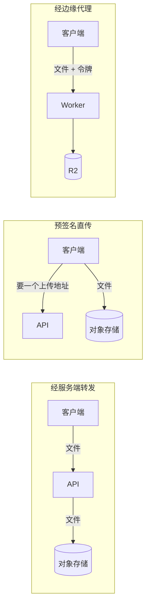

# 文件与对象存储

用户上传的单据照片、导出的 zip、App 里的封面和音频，这些「文件」该放在哪里？放数据库、放服务器磁盘、还是放对象存储？这一章讲为什么业务文件应该放对象存储，怎么设计存储抽象和对象键，上传下载的三种路径各有什么取舍，以及文件和数据库之间怎么保持一致。案例来自 hatch-counter 的单据原图和 recordwall 架在 R2 前面的 Worker。

## 文件放哪里

| 放法 | 优点 | 问题 |
|---|---|---|
| 数据库（`bytea`） | 和业务数据同一个事务、同一份备份 | 库迅速膨胀，备份和恢复变慢；读文件占用数据库连接和内存 |
| 服务器本机磁盘 | 简单，零依赖 | 换机器要搬；容器可写层里的文件重启就没；多实例时各有各的 |
| 对象存储（S3 / R2 / OSS） | 容量几乎无限、按量计费、和计算分离、自带冗余 | 多一次网络往返；和数据库之间没有事务 |

结论很明确：**业务文件放对象存储，数据库里只存指向它的名字**。本机磁盘只在开发时用。

hatch-counter 在启动时就拦住了这个错误：生产环境如果配置的是本机存储，`assertProductionReady()` 直接让服务起不来，理由是图落在容器里，重启就没了。

## 对象存储的模型

对象存储看起来像文件系统，其实不是：

- **扁平的键值**：`store-1/rcp-20261102-a8f3.jpg` 里的斜杠只是键的一部分，没有真正的目录。控制台里看到的「文件夹」是按前缀模拟出来的
- **对象整体读写**：不能修改一个对象的中间几个字节，只能整个覆盖；可以按范围读（HTTP Range）
- **自带元数据**：`Content-Type`、`ETag`、自定义元数据
- **访问控制在桶和请求签名上**：桶可以是私有或公共读；私有桶的访问要么用密钥签名，要么经过一个持有密钥的服务

几家主流服务（AWS S3、Cloudflare R2、阿里云 OSS 等）都提供 S3 兼容的接口，用同一套 SDK 就能操作，只是 endpoint 和区域不同。具体兼容程度以各家文档为准。

## 存储抽象和对象键

第 2 章讲过：选哪家存储只在一个地方判。hatch-counter 的 `createStorage()` 是唯一读存储配置的地方，开发时写本机目录，生产时写对象存储。另外两条规矩同样重要：

**库里只存文件名，不存路径或 URL**。文件名由存储层生成：前缀表示用途（`rcp-` 单据原图、`exp-` 开支凭证、`tpl-` 模板样张），后面是时间和随机串。对象键是「门店 id / 文件名」，本机开发那版是一家店一个子目录，形状相同。所以**换存储不用动数据**。

如果库里存的是完整 URL，换一个 CDN 域名、换一家服务商，就要改几万行数据。

**对象键按租户分前缀**。好处有三个：

- 整店导出、整店删除时按前缀列举即可
- 排查时一眼看出是哪个租户的文件
- 对象存储的访问策略可以按前缀写

键的设计原则：

| 原则 | 例子 |
|---|---|
| 带租户前缀 | `{storeId}/rcp-...` |
| 文件名由服务端生成，不用用户上传的原名 | 原名可能含 `../`、特殊字符、重名 |
| 内容不可变：改了就换新键 | 缩略图重新生成就用新文件名，CDN 缓存不用清 |
| 键是确定性的，相同内容算出相同的键（需要去重时） | recordwall 用 `audio/yt_<videoId>.m4a`，同一首歌在谁手机上算出来都是同一个键 |

## 上传：三种路径



| 路径 | 优点 | 缺点 | 适合 |
|---|---|---|---|
| 经服务端转发 | 服务端能检查内容、压缩、识别；钥匙只在服务端 | 文件流量全过 API 服务器，占带宽和内存 | 文件小、上传后服务端要立刻处理（如识别单据） |
| 预签名直传 | API 不过文件流量 | 服务端看不到内容，要另外确认上传完成；CORS 要配 | 大文件、上传后不需要立刻处理 |
| 边缘代理（Worker） | 钥匙在边缘，客户端只持有令牌；换后端不用发版 | 多一个要部署的服务 | 没有传统后端、或客户端是 App 的场景 |

hatch-counter 的单据照片走第一条：上传后服务端要立刻调视觉模型识别，文件本来就要经过服务端。recordwall 走第三条：它没有传统后端，Worker 就是那个持有钥匙的服务端。

### 预签名 URL

预签名直传的流程：客户端问 API「我要传一个文件」，API 检查权限后用自己的密钥签一个短期有效的上传地址，客户端直接 PUT 到对象存储。

```typescript
import { S3Client, PutObjectCommand } from "@aws-sdk/client-s3";
import { getSignedUrl } from "@aws-sdk/s3-request-presigner";
import { randomBytes } from "node:crypto";

const s3 = new S3Client({
  region: "auto", // R2 用 auto；其他服务商填实际区域
  endpoint: process.env.S3_ENDPOINT,
  credentials: {
    accessKeyId: process.env.S3_ACCESS_KEY_ID!,
    secretAccessKey: process.env.S3_SECRET_ACCESS_KEY!,
  },
});

export async function createUploadUrl(storeId: string, contentType: string) {
  if (!["image/jpeg", "image/png", "image/webp"].includes(contentType)) {
    throw new AppError("只收 JPG、PNG、WebP 图片");
  }
  const name = `rcp-${Date.now()}-${randomBytes(6).toString("hex")}`;
  const url = await getSignedUrl(
    s3,
    new PutObjectCommand({ Bucket: process.env.S3_BUCKET, Key: `${storeId}/${name}`, ContentType: contentType }),
    { expiresIn: 300 }, // 5 分钟内有效
  );
  return { name, url };
}
```

几个容易漏的地方：

- **客户端传完要再告诉 API 一声**，API 用 `HeadObject` 确认文件确实在、大小合理，再写库。不要相信客户端说「传好了」
- **签名里绑定 `ContentType`**，客户端上传时必须带相同的头，否则签名校验失败
- **大小限制**：简单的预签名 PUT 很难限制文件大小，需要的话改用预签名 POST 策略（支持大小范围条件），或者上传后检查、超限就删
- S3 兼容服务对 SDK 新版本的某些默认行为（如请求校验和）支持程度不一，遇到签名或校验错误，先查服务商关于 SDK 兼容性的说明

## 下载与访问控制

**桶默认私有**。recordwall 的 README 专门写了为什么不把桶设成公共读：

- 公共读等于谁拿到地址谁都能下，也挡不住被人当图床盗刷流量
- 把桶的 AccessKey 打进 App 里发出去，等于把钥匙给出去，安装包能被反编译

所以钥匙留在 Worker 里，打进 App 的是一串只读令牌，丢了换一把（要发一版新 App）。还有一条更要紧的：**客户端只认 Worker 的地址，永远不直连存储**。这样「后面挂 R2 还是国内的对象存储」不用现在赌准，换后端是 Worker 里改一处的事，不用发版。

一个最小的鉴权读取 Worker：

```typescript
interface Env {
  VAULT: R2Bucket;
  READ_TOKEN: string;
}

async function digest(s: string): Promise<Uint8Array> {
  return new Uint8Array(await crypto.subtle.digest("SHA-256", new TextEncoder().encode(s)));
}

// 比较摘要而不是直接用 ===：后者在第一个不同的字节就返回，理论上能靠计时逐字节试出令牌
async function safeEqual(a: string, b: string): Promise<boolean> {
  const [x, y] = await Promise.all([digest(a), digest(b)]);
  let diff = 0;
  for (let i = 0; i < x.length; i++) diff |= x[i] ^ y[i];
  return diff === 0;
}

export default {
  async fetch(request: Request, env: Env): Promise<Response> {
    if (!env.READ_TOKEN) return new Response("未配置", { status: 503 }); // 宁可不干活，也别默默敞着
    const token = request.headers.get("Authorization")?.replace(/^Bearer /, "") ?? "";
    if (!(await safeEqual(token, env.READ_TOKEN))) return new Response("unauthorized", { status: 401 });

    const url = new URL(request.url);
    if (!url.pathname.startsWith("/v1/o/")) return new Response("not found", { status: 404 });
    const key = decodeURIComponent(url.pathname.slice("/v1/o/".length));

    const object = await env.VAULT.get(key);
    if (!object) return new Response("not found", { status: 404 });

    const headers = new Headers();
    object.writeHttpMetadata(headers);
    headers.set("ETag", object.httpEtag);
    return new Response(object.body, { headers });
  },
};
```

真实的 recordwall 还要支持 Range 请求（下载那头总是带着 `Range` 头来），它的 README 记了一个坑：按 R2 返回对象上的范围字段算 `Content-Range` 会得到 `NaN`，要按自己解析出来的范围算。这类细节以实测为准。

### 绕过鉴权的几种方式

recordwall 的 README 里有一条用大写强调的警告：**千万别给桶绑自定义域**。R2 的自定义域是把桶直接挂上 CDN，绑上之后桶里每个对象对全世界公开可读，Worker 连同两把令牌整个被绕过，而且一声不响，从 App 那头看一切正常。它真的为了测速绑过一次，后来摘掉了。

类似的「一声不响的绕过」还有：

- 桶策略里给了匿名读权限
- 预签名 URL 的有效期设成了几天甚至几周，被转发出去
- 生成的下载链接被搜索引擎收录

### 短期钥匙

需要把文件交给用户下载时，给一把短期钥匙，而不是永久链接。hatch-counter 的整店导出：

- 包放在私有桶里，7 天后由每日清理任务删除
- 店主点下载时，服务端换一把 **10 分钟有效**的钥匙，再流式回传，同时计数、记时间线

预签名 GET 是同样的思路，`expiresIn` 设成分钟级。

### 不同用途的桶和钥匙分开

hatch-counter 有两个桶：单据原图的私有桶（服务端写，钥匙在服务器上），装机包的公共读桶（发版流水线写，钥匙在 CI 的 secret 里）。文档规定**两边的桶和子账号都不许复用**：跑在别人机器上的 CI 那把钥匙一旦泄漏，泄的就不只是安装包，而是全部店主的单据原图。

这是最小权限原则在存储上的体现：**一把钥匙只能碰一个桶的一种操作**。recordwall 的只读令牌和写令牌分开、写令牌不进任何安装包，也是同一个道理。

## 文件和数据库的一致性

文件在对象存储，元数据在数据库，两者之间没有事务。第 6 章讲过 hatch-counter 的顺序，这里补全：

| 操作 | 顺序 | 失败时 |
|---|---|---|
| 新增 | 先存文件，再写库 | 写库失败就删文件；删不掉留孤儿 |
| 删除 | 先删库里的行，再删文件 | 删文件失败只记日志，留孤儿 |
| 替换 | 存新文件（新键）→ 更新库指向新键 → 删旧文件 | 任何一步失败，库里指向的文件都存在 |
| 读取 | 读库拿到名字，再取文件 | 文件取不到就当没有，不抛错 |

所有这些对象存储操作都**放在数据库事务外面**。存一张图是一次网络往返，可能几百毫秒；如果放在事务里，这条数据库连接在这段时间里什么也干不了，而连接池总共就那么几条。

规律是：**任何时候库里引用的文件都必须存在；反过来，存在没被引用的文件（孤儿）可以接受**。孤儿用一个低频任务清理：列出某个前缀下的对象，和库里的名字比对，删掉超过一天且没被引用的。

「读不到就当没有」这条也值得注意：hatch-counter 的原则是少一张图不该让整页打不开。

## 处理文件：放进异步任务

上传后的处理（生成缩略图、压缩、转码、识别）如果不需要立刻给用户结果，就放进第 4 章的任务队列：

1. 上传完成，写库，状态 `processing`，入队一个 `make_thumbnail` 任务（同一个事务）
2. worker 取文件、处理、存新对象（新键）、更新库
3. 客户端看到 `processing` 时显示占位图

图片处理通常要用 sharp 这类带原生依赖的库，CPU 也重，是第一个值得拆成独立 worker 进程的东西。

## 生命周期与成本

- **生命周期规则**：大多数对象存储支持按前缀设置过期自动删除。临时导出、上传暂存区可以交给它，不用写清理任务
- **流量费**：不同服务商的出口流量计费差别很大（R2 的卖点之一就是出口流量的计费方式），具体以官方价格页为准。下载量大的场景，这一项可能比存储费高得多
- **缓存在前面挡流量**：公开的、反复读的小文件（封面、头像）走 CDN 缓存，见第 3 章的取用形状分析
- **备份**：对象存储自带多副本冗余，但冗余不是备份，误删、被人用泄漏的钥匙删掉都救不回来。重要文件开启版本控制或定期复制到另一个账号的桶，见《一人运维手册》的备份一章

## 本章要点

- 业务文件放对象存储，库里只存服务端生成的文件名；本机磁盘只用于开发，生产启动时就拦下
- 对象键带租户前缀、内容不可变、换存储不用改数据；选哪家存储只在一处判
- 上传三条路：经服务端（要立刻处理时）、预签名直传（大文件）、边缘代理（没有后端或客户端是 App）；直传后服务端要再确认
- 桶默认私有；钥匙不进客户端，客户端只认自己的服务；令牌比较走摘要
- 小心一声不响的绕过：桶绑自定义域、匿名读策略、长期预签名链接
- 不同用途的桶和钥匙分开，一把钥匙只碰一个桶的一种操作
- 库里引用的文件必须存在，孤儿可以接受、定期清理；对象存储操作放在数据库事务外面
- 文件处理放进异步任务；生命周期规则自动清理临时文件；冗余不是备份
