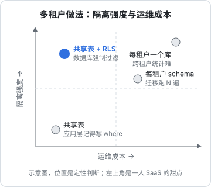

# 多租户

一人公司做 SaaS，几乎一定是多租户：一套代码、一个部署，服务很多家客户，每家只能看到自己的数据。多租户最可怕的 bug 不是崩溃，而是**A 家看到了 B 家的数据**，而且这种 bug 往往不报任何错、测试照样绿。这一章比较三种隔离模型，然后详细拆解 hatch-counter 的方案：共享表 + Postgres 行级安全（RLS）+ 三个数据库角色，以及怎么用测试守住「新加一张表忘了开 RLS」这类静默错误。

## 租户是什么

先定义清楚租户是谁。hatch-counter 里**租户就是门店**：一个账号可以属于多家店，切店就是换租户。其他常见的定义：一个公司、一个工作区、一个团队。

定义租户时要想清楚两件事：

- **用户和租户是多对多吗**：一个人能不能属于多个租户？能的话，「当前租户」就是请求上下文的一部分，不能从用户推出来。hatch-counter 用一个请求头（`x-store-id`）指定当前门店，切店只换这一个头
- **有没有跨租户的东西**：账号本身、套餐、全平台配置。这些表不属于任何一个租户，要单独处理

## 三种隔离模型

| 模型 | 做法 | 隔离强度 | 运维成本 | 跨租户运营 |
|---|---|---|---|---|
| 共享表 | 所有租户的数据在同一组表里，每行带 `tenant_id` | 取决于怎么强制过滤 | 低：一份 schema、一次迁移 | 容易 |
| 每租户一个 schema | 同一个库，每个租户一组表 | 中 | 中：迁移要跑 N 遍，表数量随租户线性增长 | 要拼 N 个 schema |
| 每租户一个库 | 每个租户一个独立数据库（或一个 SQLite 文件） | 高 | 高：N 个库的迁移、备份、监控 | 最难 |



注意共享表那一行的隔离强度是「取决于怎么强制过滤」。同样是共享表，**靠应用层每条查询记得写 `where tenant_id = ?`**，和**靠数据库的 RLS 强制过滤**，隔离强度完全不同。前者漏一个 `where` 就泄露；后者漏了也查不到别人的数据。

对一个人维护的 SaaS，**共享表 + RLS** 通常是最好的平衡点：运维成本和普通单租户应用一样，隔离由数据库强制保证。

### 为什么不是每家一个 SQLite

每租户一个 SQLite 文件（或 libSQL / Turso 这类托管方案）听起来很诱人：隔离天然完美，删租户就是删文件。hatch-counter 的文档专门记了为什么没选：迁移最省事，但**跨租户的运营看板、计费、用量统计全得自己攒**，国内也没有像样的托管，省下的成本会在运营阶段连本带利还回去。

这个判断背后是一个容易被忽略的事实：SaaS 的运营者需要经常跨租户看数据（谁活跃、谁快到期、哪家数据异常），每租户一个库会让这些需求都变得很贵。

## RLS：让数据库来过滤

Postgres 的行级安全（Row Level Security）让你给表加一条策略，**数据库在执行每条查询时自动加上过滤条件**。应用代码里不写任何 `where tenant_id`，也查不到别人的数据。

### 策略怎么写

```sql
ALTER TABLE expenses ENABLE ROW LEVEL SECURITY;

CREATE POLICY expenses_tenant ON expenses
  USING (store_id = nullif(current_setting('app.store_id', true), '')::uuid)
  WITH CHECK (store_id = nullif(current_setting('app.store_id', true), '')::uuid);
```

- `USING`：读、改、删的时候，只能看到满足条件的行
- `WITH CHECK`：插入和更新的时候，新行必须满足条件，防止往别的租户里写
- `current_setting('app.store_id', true)`：读一个自定义的会话变量，第二个参数 `true` 表示没设置时返回 NULL 而不是报错

那个 `nullif` 是踩坑踩出来的，hatch-counter 的文档要求「别删」：事务级的设置在事务结束后，值会回到**空字符串**而不是 NULL，而 `''::uuid` 会直接报错。结果是「没有上下文」在新连接上是干净地查不到，在用过的连接上却是报错，连接池化之后变成随机行为。用 `nullif` 把空串抹成 NULL，`store_id = NULL` 恒为假：**没有上下文就一行都看不见**，这正是要的默认值。

### 上下文只在一处设，而且必须是事务级的

```typescript
import { sql } from "drizzle-orm";

@Injectable()
export class DbService {
  constructor(@Inject(APP_DB) private db: AppDatabase) {}

  /** 租户数据的读写一律经过这里 */
  withStore<T>(storeId: string, fn: (tx: AppTransaction) => Promise<T>): Promise<T> {
    return this.db.transaction(async (tx) => {
      // 第三个参数 true = 只在本事务内有效（等价于 SET LOCAL）
      await tx.execute(sql`select set_config('app.store_id', ${storeId}, true)`);
      return fn(tx);
    });
  }
}
```

为什么必须是事务级的：连接是池化的。如果用会话级的 `SET`，这个设置会留在连接上，被下一个借到这条连接的请求捡到，**那就是跨租户泄露本身**。事务级的设置在事务结束时自动清掉。

为什么只在一处设：如果 handler 可以自己开连接、自己设上下文，迟早有一处写错。所有租户数据的访问都通过 `withStore()`，上下文的正确性就只需要在一个函数里保证。

hatch-counter 的 controller 用一个参数装饰器 `@StoreId()` 取当前门店，它内部一并判断这家店还能不能用（停用、到期），业务代码拿到的 `storeId` 一定是合法且可用的。

### 应用连接不能是表的 owner

这是 RLS 最隐蔽的坑：**表的 owner 和超级用户默认绕过 RLS**。如果应用用建表的那个角色连库，策略写得再好也等于没开，而且不报任何错、测试照样绿。

hatch-counter 用三个数据库角色、三条连接串：

| 角色 | 谁用 | 能碰什么 |
|---|---|---|
| `counter` | 迁移、种子脚本 | 表的 owner，DDL 全开 |
| `counter_app` | 业务接口 | public 下的业务表，受 RLS 管；后台的 schema 连 USAGE 权限都没有 |
| `counter_admin` | 管理后台接口 | 后台 schema 和门店档案；业务表一行都碰不到 |

```sql
CREATE ROLE counter_app LOGIN PASSWORD '...';  -- 不是 owner，没有 BYPASSRLS
GRANT USAGE ON SCHEMA public TO counter_app;
GRANT SELECT, INSERT, UPDATE, DELETE ON ALL TABLES IN SCHEMA public TO counter_app;
-- 以后新建的表自动授权，不用每次迁移都记得写 GRANT
ALTER DEFAULT PRIVILEGES FOR ROLE counter IN SCHEMA public
  GRANT SELECT, INSERT, UPDATE, DELETE ON TABLES TO counter_app;
```

而且**启动时检查三条连接串的用户名必须互不相同**，指重了直接起不来。理由同样是：放过去的后果全是静默的。业务连接指到 owner 上，RLS 被绕过；后台连接和业务连接用同一个角色，隔离就白分了。

这里还有一个反向的推论：既然 public 下新建的表会自动授权给业务角色，那么**后台的敏感表（员工密码哈希、服务商 key）就不能放在 public 下**。hatch-counter 把它们放在单独的 `admin` schema，业务角色连这个 schema 的 USAGE 都没有。靠「记得在迁移里写 REVOKE」挡不住，迟早有一次忘了，而且忘了不报错；单独一个 schema，闸门只有一道。

### 不受 RLS 管的表

有些表必须在选定租户之前读：账号、租户本身、成员关系、令牌。鉴权要先查它们才知道你能进哪家店。这些表不加 RLS，**每条查询自己带条件**。

hatch-counter 文档里点名的是成员表：业务代码里每一条查成员的语句都要带上门店条件，漏一个就是把别人店里的人列出来，而且不报错。这几张表数量少，可以在代码评审时重点盯。

## 用测试守住静默错误

RLS 方案有一个致命弱点：**新加一张表，忘了写策略，所有租户互相看得见，跑起来一个错都不报**。drizzle-kit 这类工具生成的迁移只有建表，不管 RLS。

解决办法是写一个测试，扫描数据库里所有带租户列的表，检查它们都开了 RLS、都有策略：

```sql
-- 带 store_id 列、却没开 RLS 或没有策略的表
SELECT c.relname
FROM pg_class c
JOIN pg_namespace n ON n.oid = c.relnamespace
JOIN pg_attribute a ON a.attrelid = c.oid
  AND a.attname = 'store_id' AND NOT a.attisdropped
WHERE n.nspname = 'public'
  AND c.relkind = 'r'
  AND (
    NOT c.relrowsecurity
    OR NOT EXISTS (
      SELECT 1 FROM pg_policies p
      WHERE p.schemaname = 'public' AND p.tablename = c.relname
    )
  );
```

```typescript
import { describe, it, expect } from "vitest";

const EXEMPT = new Set(["store_members", "devices"]); // 每加一个豁免都要写清为什么

describe("RLS", () => {
  it("所有带 store_id 的表都开了 RLS 且有策略", async () => {
    const rows = await ownerSql<{ relname: string }[]>`/* 上面那条 SQL */`;
    const missing = rows.map((r) => r.relname).filter((t) => !EXEMPT.has(t));
    expect(missing).toEqual([]);
  });

  it("没有上下文时一行都查不到", async () => {
    const rows = await appSql`SELECT * FROM expenses`;
    expect(rows).toHaveLength(0);
  });

  it("A 店的上下文看不到 B 店的数据", async () => {
    await seedExpense(storeB);
    const rows = await withStore(storeA, (tx) => tx`SELECT * FROM expenses`);
    expect(rows.every((r) => r.store_id === storeA)).toBe(true);
  });
});
```

hatch-counter 的 `rls.test.ts` 就是这个思路：扫 public 下每张带 `store_id` 的表，豁免名单写明，再加一张豁免要说清为什么。同样的模式它还用在了别处：每张业务表都挂了版本号触发器、都挂了变更流水触发器，各有一个扫描测试守着。

**这是一个通用的技巧**：凡是「新加一个 X 时必须记得做 Y，忘了不报错」的规矩，都写一个扫描全部 X 的测试。这比文档里的提醒可靠得多，对编码 agent 尤其有效，测试红了它自己就会去补。

## 跨租户的运营

RLS 把租户隔开了，但运营者需要跨租户看一些东西：每家店有多少数据、最后一次活动是什么时候、谁快到期了。

最省事的做法是给后台连接 `BYPASSRLS` 权限，但那等于后台能读所有业务数据。hatch-counter 开了一个更窄的口子：一个 `SECURITY DEFINER` 函数，以属主身份运行，**只返回每家店各表的行数和最后改动时间，一行业务数据都不返回**：

```sql
CREATE FUNCTION admin.store_usage()
RETURNS TABLE (store_id uuid, row_count bigint, last_change timestamptz)
LANGUAGE sql
SECURITY DEFINER
SET search_path = public, pg_temp
AS $$
  SELECT store_id, count(*), max(updated_at) FROM expenses GROUP BY store_id
  -- 实际要 UNION 所有业务表
$$;

-- SECURITY DEFINER 的函数默认人人可调，必须显式收回
REVOKE EXECUTE ON FUNCTION admin.store_usage() FROM PUBLIC;
GRANT EXECUTE ON FUNCTION admin.store_usage() TO counter_admin;
```

两个细节：

- **`REVOKE ... FROM PUBLIC` 不能省**：不收的话业务角色也能调，等于把跨租户的口子开给了业务接口
- **`SET search_path`**：`SECURITY DEFINER` 函数要固定搜索路径，防止调用者通过自己的 schema 里的同名对象劫持函数

文档还提到这比 `BYPASSRLS` 更现实的一点：托管型 Postgres 上经常申请不到这个属性。

## 租户维度渗透到每一层

租户隔离不只是数据库的事。其他每一层都要带上租户维度：

| 层 | 要注意的 | 后果 |
|---|---|---|
| 缓存 | 缓存键带租户 id；切租户时清缓存 | 漏了：A 看到 B 的缓存数据 |
| 对象存储 | 键带租户前缀（第 7 章） | 漏了：整店导出、删除时找不全 |
| 任务队列 | payload 带租户 id，worker 用 `withStore()` 处理 | 漏了：worker 用错上下文或没上下文 |
| 日志 | 每条日志带租户 id | 漏了：排障时不知道是哪家 |
| 推送 | 订阅按租户分组 | 漏了：推到了别家的连接上 |
| 限流和配额 | 按租户计数 | 漏了：一家大客户拖慢所有人 |

最后一条叫**吵闹邻居**问题：共享资源的系统里，一个租户的大量请求会影响其他租户。一人项目的规模下，通常按租户限流（nginx 或应用层）、给重任务排队（一次跑一家）就够了。

## 租户的生命周期

### 停用和到期：拦在业务上，不拦在登录上

hatch-counter 的一条大前提：门店停用、到期**照样能登录，拦在业务接口上**，返回明确的错误码。文档里的理由是：做成登录失败，店主会以为系统坏了。能登录进来、看到一句「这家店已到期，请联系续费」，才知道该干什么。

### 开户

租户的创建要么走自助注册，要么走后台开户。hatch-counter 只能从管理后台开户，登录时凭证对不上直接拒绝。开户时顺手种一份预置数据（默认分类、内置格式、班次），这份种子只在开户那一刻跑，**已经开了的店不会自己补上**，所以以后加新的预置数据要写进迁移里回填。

### 导出和删除

客户要走时，应该能把自己的数据带走。hatch-counter 的「整店导出」（第 4 章）就是为此设计的：停用、到期的店照样能下载，因为要导账的多半是不用了的店。导出的内容只包含他自己的账，不包含平台内部的运营事件和变更流水。

删除租户时，带 `store_id` 的业务表用外键级联删除，对象存储按前缀删除，别忘了缓存、队列里还没处理的任务和日志里的数据保留期。

## 本章要点

- 先定义清楚租户是谁、用户和租户是否多对多、哪些表是跨租户的
- 三种模型：共享表、每租户 schema、每租户库；一人 SaaS 通常选共享表 + RLS，运维像单租户、隔离由数据库强制
- 每租户一个库会让跨租户的运营、计费、统计变得很贵
- RLS 策略用 `nullif(current_setting(...), '')` 让「没有上下文」稳定地查不到；上下文只在一个函数里用事务级 `set_config` 设
- 应用连接不能是 owner 或超级用户；迁移、业务、后台三个角色分开，启动时检查；敏感表放单独的 schema
- 不受 RLS 管的表每条查询自己带条件
- 「新加 X 必须做 Y、忘了不报错」的规矩，用扫描测试守住
- 跨租户运营用只返回汇总的 `SECURITY DEFINER` 函数，记得 `REVOKE FROM PUBLIC` 和固定 `search_path`
- 缓存、对象存储、队列、日志、推送、限流都要带租户维度；停用拦在业务上不拦在登录上；租户要能导出自己的数据
