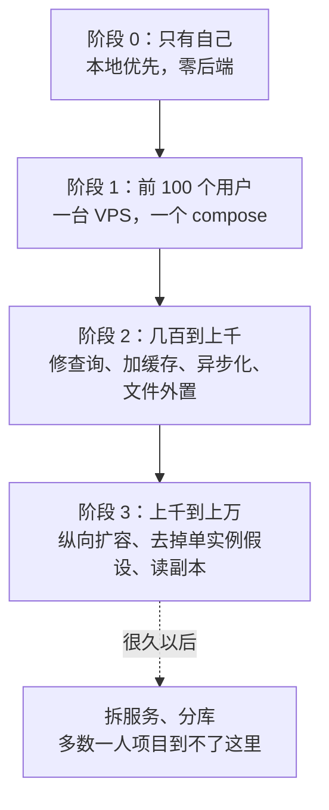
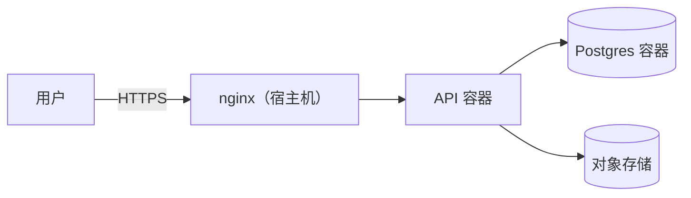

# 从 1 到 1 万用户的演进

前面八章各讲了一块。这一章把它们串起来，推演一个系统从只有你自己在用，长到有一万个用户的过程：每个阶段真正的风险是什么，该做什么，更重要的是**不该做什么**。贯穿全章的观点是：架构应该跟着真实的信号演进，而不是跟着想象中的规模提前建设；一个人维护的系统，最贵的不是服务器，是你的注意力。

## 先说清楚：用户数不是指标

「一万用户」是个方便的说法，但它本身不决定架构。真正决定架构的是这几个数：

| 指标 | 为什么重要 | 去哪看 |
|---|---|---|
| 峰值并发请求 | 决定 CPU、连接池、事件循环的压力 | nginx 访问日志、指标 |
| 写入速率 | 决定锁竞争、WAL、索引维护的压力 | `pg_stat_statements` |
| 数据量和增长速度 | 决定查询计划、备份时长、磁盘 | 表大小趋势 |
| 单个请求的最重操作 | 一个导出能不能拖垮所有人 | 慢请求日志 |
| 租户之间的差异 | 一个大客户是不是别人的一百倍 | 按租户的用量统计 |

一万个每天打开一次、看一眼就走的用户，可能还没有一百个整天开着页面、频繁导入数据的门店压力大。下面各阶段的用户数只是**数量级上的粗略标记**，判断要看自己系统的实测数据。如何测量和估算容量，见《可观测性与性能》的容量规划一章。

## 全景

## 阶段 0：只有自己

很多个人项目的第一个用户就是自己。这时最好的架构可能是**没有后端**。

hatch-shelf 就是这样：书写在电脑上，通过 AirDrop 或局域网传到手机，App 不联网、没有账号、没有服务器。它的 README 里「非目标」那一栏写得很清楚：不做云同步、不做账号、不做热更新。架构上的几个关键决定都服务于这个前提：

- **文件即真相**：书的原文只存在设备的文件目录里，SQLite 只存索引（可重建）和用户数据（不可丢）
- **单一导入管线**：AirDrop、局域网上传，所有通道只负责把文件交给同一条管线
- **索引可重建**：这让以后加任何同步通道都不用改阅读器

这里面有一个值得记住的设计：**把数据分成「可重建的」和「不可丢的」两类**。书、章节、搜索索引都能从文件重建，丢了重扫一遍；阅读进度、高亮、设置不能重建，要认真保护。任何阶段的系统都可以这样分，备份和迁移的重点立刻清楚了。

本地优先和服务端为准是两种不同的选择，不是谁比谁先进。hatch-counter 走的是另一边：**数据只在服务端一份**，客户端是薄客户端。它的文档详细记了为什么不做两边各存一份再同步：派生的数（库存是流水重放的）不能同步、一次导入要整批到、删除不止一种形状、两边各建同名档案要合并、按修改时间判胜负又得指望店里电脑的钟是准的。多人协作、数据是账本的场景，服务端为准简单得多。

## 阶段 1：前 100 个用户

这时的标准配置：**一台 VPS，Docker Compose 起一个 Postgres 和一个 API，宿主机上一个 nginx**。hatch-counter 线上就是这个形状，compose 文件里只有两个服务：数据库不暴露端口，API 只绑本机回环地址给 nginx，数据放在命名卷里。

**这个阶段真正的风险不是性能，是数据丢失和你自己的失误。** 一台 2 核 4G 的机器跑一个 NestJS 和一个 Postgres，对一百个用户来说负载很低。要花精力的地方：

| 做 | 为什么 |
|---|---|
| 自动备份，并且**真的恢复过一次** | 没恢复过的备份不算备份；见《PostgreSQL 运维》 |
| 迁移只往前、每个迁移兼容上一版代码 | 回滚只能换镜像，库回不去；hatch-counter 的规矩是删列、改类型、加 NOT NULL 一律拆成两版发 |
| 文件放对象存储 | 换机器时不用搬文件（第 7 章） |
| 错误监控和探活 | 出事时你先知道，而不是用户先知道 |
| 模块边界和决策记录 | 现在代码少，是立规矩最便宜的时候（第 1、2 章） |
| 多租户隔离一开始就做对 | 以后再加 RLS 要迁移所有数据、改所有查询（第 8 章） |

**不做的事**：Redis、消息队列、Kubernetes、多实例、读写分离、微服务。每一样都是要养的东西，而这个阶段它们解决的问题都还不存在。

最后两条「做」值得强调：**模块边界和租户隔离是少数应该提前做的事**，因为它们的改造成本随数据量和代码量增长，而且出错的后果（大泥球、数据泄露）很难事后补救。性能优化则相反，越晚做越准。

## 阶段 2：几百到上千

开始出现「有时候有点慢」。这个阶段的工作是**找到真正的瓶颈，按从便宜到贵的顺序处理**：

| 信号 | 先做 | 而不是 |
|---|---|---|
| 某些页面慢 | `pg_stat_statements` 找最贵的 SQL，加索引、消灭 N+1 | 上 Redis |
| 连接池等待 | 查长事务、把网络调用移出事务（第 6、7 章） | 把池子开大 |
| 某个操作卡住整个服务 | 移进异步任务（第 4 章） | 加机器 |
| 切页都要重新加载、体验差 | 客户端按版本号缓存（第 3 章） | 服务端到处加缓存 |
| 别人改了我看不到 | SSE 推版本号（第 5 章） | 上 WebSocket 推数据 |
| 网络不稳时重复提交 | 写接口幂等（第 6 章） | 只靠按钮变灰 |
| 静态资源慢 | 带哈希的文件名 + 长缓存 + CDN | 加带宽 |
| CPU 持续偏高 | profile 找热点（《可观测性与性能》） | 直接升配 |

注意左右两列的模式：**左边是改正确的地方，右边是加东西**。加东西常常也能缓解症状，但会把真正的问题埋起来，同时增加运维面。

这个阶段大概率还是一台机器。如果需要，**先纵向升级**：从 2 核 4G 换到 4 核 8G，往往是最便宜、最快、风险最小的扩容，一次停机几分钟就做完了。

## 阶段 3：上千到上万

一台机器开始吃紧，或者你开始在意「这台机器挂了全部停服」。

### 先继续纵向

在加第二台机器之前，先确认纵向空间用完了。单台云服务器的配置可以升得很高，而一台机器上的 Postgres 能扛住的负载，远超大多数一人 SaaS 的需要。把数据库和 API 分到两台机器上（数据库独占一台），是比「API 多实例」更早、更简单的一步。

### 去掉单实例假设

真要跑第二个 API 实例时，问题不在部署，而在**代码里那些默认只有一个进程的地方**。这些假设在单实例时完全正确，多实例时会静默出错。把它们列出来，是这个阶段最有价值的一件事。

以本书各章的方案和 hatch-counter 的实现为例：

| 单实例时的做法 | 多实例时的问题 | 改法 |
|---|---|---|
| 进程内的配置缓存，改动时顺手清掉（第 3 章） | 只清了自己那个实例，别的实例要等 TTL 过期 | 接受 TTL 的延迟；或改动时 `NOTIFY` 让各实例清 |
| 进程标记（epoch）：服务端起一次换一个，客户端见变就清缓存 | 客户端在两个实例之间来回，会反复清空 | hatch-counter 文档已写明：换成「这一版部署」的标识 |
| 进程内队列，一次跑一家（整店导出） | 两个实例各自捡起「没跑完的」，同一个任务跑两遍 | 换成 `SKIP LOCKED` 的表队列（第 4 章） |
| 进程内定时任务 | 两个实例各跑一遍 | `job_runs` 的唯一约束抢占（第 4 章） |
| 推送的订阅表在进程内 | 不受影响：各实例各自 `LISTEN`，推给自己身上的连接（第 5 章） | 无需改 |
| 内存里的限流计数 | 每个实例各数各的，实际限额翻倍 | 放 Postgres 或 Redis；或移到 nginx 前置一层 |
| 本机磁盘上的临时文件 | 上传落在 A，处理请求打到 B | 一律走对象存储（第 7 章） |
| 幂等回执在数据库里 | 不受影响 | 无需改 |

hatch-counter 在 epoch 那一条的文档里就预先写了「开多台的话这个标记得换成这一版部署」。这是一个好习惯：**写单实例假设的代码时，顺手在旁边记下多实例时要改什么**。到时候不用重新考古。

### 读副本和连接池

数据库的读压力大到一台扛不住时，加一个流复制的只读副本，把报表、分析这类重读查询路由过去。连接数成为问题时，前面加 PgBouncer。两者的配置和坑（比如事务模式下 `SET` 和预备语句的问题）见《PostgreSQL 运维》。注意 RLS 方案用的是事务级 `set_config`，和 PgBouncer 的事务模式是兼容的，这也是第 8 章坚持事务级上下文的另一个好处。

### 何时引入 Redis

到这个阶段，Redis 可能开始值得：多个实例需要共享高频读写的状态（限流、会话、热点缓存），而放在 Postgres 里已经带来明显压力。引入时只让它承担**丢了能重建的东西**，真相仍然在 Postgres。

## 一直不做的事（大概率）

| 技术 | 解决的问题 | 什么时候才考虑 |
|---|---|---|
| 微服务 | 多团队独立开发和发布 | 有了多个团队 |
| Kubernetes | 大量服务的调度、自愈、扩缩容 | 服务数量多到 compose 管不过来，并且有人专职运维 |
| 分库分表 | 单库的写入或容量到顶 | 纵向扩容、归档、读副本都用尽之后 |
| 事件溯源 / CQRS 全家桶 | 复杂领域的审计和多视图 | 业务真的需要完整的事件历史，并且你愿意承担复杂度 |
| 多区域部署 | 全球低延迟、区域级容灾 | 用户真的分布在多个大洲，且有明确的可用性承诺 |

这些技术都是真实问题的真实答案，只是那些问题大多不会出现在一个人维护的系统里。如果出现了，通常意味着业务已经大到可以雇人了，那时候的架构决策应该和团队一起做。

## 演进的方法

最后，比任何具体技术都重要的是演进的方法：

1. **测量，再动手**：每一次架构调整都应该有一个数据上的理由，「感觉会慢」不是理由
2. **先改正确，再加东西**：修查询优先于加缓存，移出事务优先于加连接
3. **先纵向，再横向**：升配是最便宜的扩容
4. **把假设写下来**：单实例假设、决策的失效条件，写在代码和文档旁边
5. **让静默错误变成响亮的错误**：启动检查、扫描测试、依赖注入报错，越多越好
6. **保留退路**：迁移兼容上一版、对象存储前面隔一层、模块边界清楚，每一个今天的决定都给明天留了改的余地

一个人的系统能走多远，很大程度上取决于它是否一直保持「一个人改得动」。简单不是起点的权宜之计，而是要一直守住的东西。

## 本章要点

- 用户数只是方便的说法，决定架构的是峰值并发、写入速率、数据量、最重操作和租户差异
- 阶段 0 可以没有后端；把数据分成可重建和不可丢的两类，备份和迁移的重点就清楚了
- 阶段 1 的风险是数据丢失和自己的失误，不是性能；模块边界和租户隔离是少数该提前做的事
- 阶段 2 按从便宜到贵的顺序处理瓶颈：先改正确的地方，再加东西；先纵向升配
- 阶段 3 加实例之前先列出单实例假设：进程内缓存、进程标记、进程内队列和定时任务、内存限流、本机临时文件
- 微服务、Kubernetes、分库分表解决的问题大多不会出现在一人系统里
- 测量再动手、先改正确再加东西、先纵向再横向、把假设写下来、让静默错误变响亮、保留退路

## 接下来读什么

架构把系统的骨架搭好了，但一个人的系统还有一个没人替你兜底的维度：安全。认证方案怎么选、权限模型怎么设计、密钥和供应链怎么管，接下来读《应用安全》。

如果你的系统已经上线，想把本书里反复提到的「测量」落地，读《可观测性与性能》；想把备份、容灾、事故处理这些「阶段 1 真正的风险」管起来，读《一人运维手册》。
