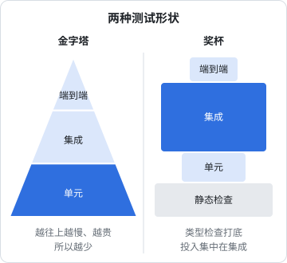

# 测什么、不测什么

一个人做产品，时间是最紧的资源。测试写少了，每次改动都提心吊胆，上线前要手点一遍所有页面；写多了，改一行代码要修二十条测试，测试反而成了不敢重构的理由。这一章不讲任何工具，只回答一个问题：**有限的时间里，测试应该花在哪儿**。先看两种流行的「形状」（金字塔和奖杯），再说明为什么形状应该由代码的性质决定，最后给出一套按风险挑选测试对象的办法。

## 测试买的是什么

测试不是为了证明代码没有 bug，这件事测试做不到。测试买的是**改动的信心**：改完代码，跑一条命令，几十秒后知道「原来能用的东西还能用」。

这份信心有三笔成本：

| 成本 | 什么时候付 | 容易被低估的地方 |
|---|---|---|
| 写 | 一次 | 构造测试数据往往比写断言费事 |
| 维护 | 每次改动被测代码时 | 测试绑死了实现细节，重构就要跟着改 |
| 运行 | 每次跑 | 慢的测试没人愿意跑，不跑的测试等于没有 |

第二笔最容易被忽略，也最贵。一条测试如果在**行为没变、只是实现变了**的时候也会红，它就在持续收费却不提供任何信息。测试多到让人不敢重构，是写测试写错了方向。

所以评价一条测试，要同时问两件事：代码真坏了的时候它会不会红；代码没坏的时候它会不会乱红。

## 好测试的四个性质

Vladimir Khorikov 在《Unit Testing Principles, Practices, and Patterns》里把好测试拆成四个性质，这个框架很适合用来做取舍：

| 性质 | 含义 | 反例 |
|---|---|---|
| 能抓回归 | 被测代码真坏了，测试会红 | 断言 `toBeDefined()`，什么都能过 |
| 抗重构 | 只改实现、不改行为时，测试不红 | 断言「内部调用了 `repo.save` 一次」 |
| 快 | 几秒内给出结果 | 每条测试都起浏览器、登录、建数据 |
| 好懂 | 红了以后一眼看出违反了什么规则 | 测试名叫 `test 1`，断言信息是 `expected true` |

前三条之间有张力：越接近真实环境的测试越能抓回归、越抗重构，但越慢；越孤立的测试越快，但越容易绑死实现。没有哪条测试能四项全满，**测试策略就是在不同的地方做不同的取舍**。第四条没有代价，应该永远做到。

## 测试金字塔

测试金字塔来自 Mike Cohn，流传最广的版本分三层：底层大量单元测试，中间一些服务（集成）测试，顶上少量 UI 测试。

它的道理很朴素：下层的测试快、稳、便宜，上层的测试慢、脆、贵，所以**能在下层测的就别放到上层**。一个「金额按分取整」的边界情况，单元测试里一行断言就能覆盖；放到端到端测试里，要登录、建数据、点开页面、读 DOM，慢一百倍还更容易因为网络抖动失败。

金字塔的问题出在「单元」这个词上。如果把「单元」理解成「一个类」，为了让每个类单独可测，就得把它所有的依赖都替换成 mock。结果是大量测试只在验证「A 调用了 B」，这正是上一节说的不抗重构的测试。改一下类之间的分工，几十条测试同时红，但用户看到的行为一点没变。

## 测试奖杯

Kent C. Dodds 提出的测试奖杯是对金字塔的修正。它从下到上是四层：

1. **静态检查**（底座）：TypeScript、ESLint。拼写错误、类型不匹配、忘了 `await`，在写代码时就被拦下
2. **单元测试**：纯函数、独立的逻辑
3. **集成测试**（最大的一块）：几个模块一起跑，尽量少替换依赖
4. **端到端测试**（顶上一小块）：真浏览器、真服务端

奖杯把最大的投入放在集成测试上，理由是：用户不关心你的类怎么拆，只关心功能能不能用；几个真实模块一起跑的测试，既能抓到模块之间的接缝问题，又不会因为内部重构而红。



两种形状其实不冲突：金字塔强调「越往上越贵，所以越少」，奖杯强调「别为了孤立而 mock 一切」。真正该问的是另一个问题。

## 形状由代码的性质决定

与其争论哪种形状正确，不如看**被测的逻辑住在哪里**。逻辑住在哪一层，就在哪一层测：

| 逻辑住在哪里 | 例子 | 该用的测试 |
|---|---|---|
| 纯函数 | 解析、计算、格式化、状态转换 | 单元测试，大量 |
| 数据库 | 约束、触发器、行级安全、事务 | 连真数据库的集成测试 |
| 请求管线 | 鉴权顺序、校验、错误映射 | 起真服务打 HTTP |
| 两端之间的约定 | 请求格式、消息类型、版本兼容 | 契约测试 |
| 用户流程 | 登录、导入、下单 | 少量端到端 |

拿本书反复出现的三个项目对照一下，它们的测试形状完全不同，而且各自都合理：

**hatch-shelf**（Expo 离线书架）接近金字塔。它最复杂的逻辑是「判断一个压缩包是不是合法的书」：容错解析 `book.yaml`、扩展名白名单、zip slip 检查、链接校验。这些全部写在不依赖 Node 和 React Native 的 `@shelf/spec` 包里，是纯函数，用 Vitest 测，每条毫秒级。局域网传书的 HTTP 服务也一样，请求解析器 `RequestParser` 是纯的，可以喂字节流直接测；真正碰文件系统的那层壳很薄，不写自动化测试。

**hatch-counter**（NestJS + Postgres 门店 SaaS）接近倒过来的形状。它的业务规则大量住在数据库里：行级安全、触发器维护的版本号、可延迟外键。服务端有四百多条测试，绝大部分起真进程、连真 Postgres、用 HTTP 打。纯业务口径（毛利、库存、工资）放在 `@counter/core`，用单元测试覆盖。详见[《NestJS 后端架构》的测试一章](../nestjs-backend/09-testing.md)。

**hatch-recordwall**（Expo / Electron / Worker 播放器）几乎只有底座：`pnpm typecheck`、`pnpm lint`、`pnpm format:check`，外加一个能在跑着的 App 里执行 JS 的 `pnpm eval` 工具做手动验证。它是一个人自用的播放器，坏了自己最先发现，损失是听不了歌。这不是偷懒，是按风险做的决定，[第 10 章](10-solo-strategy.md)会细说。

## 静态检查是第一层测试

奖杯的底座常被当成「不算测试」，但对一人项目来说，它是性价比最高的一层：写一次配置，之后每一行代码都自动受检，零维护成本。

几个值得开的检查：

- **TypeScript 严格模式**，再加上 `noUncheckedIndexedAccess`：`arr[0]` 的类型带上 `undefined`，逼你处理空数组
- **`@typescript-eslint/no-floating-promises`**：忘了 `await` 的 Promise 不会报错，失败被静默吞掉。hatch-shelf 的规范明确要求不许用注释绕过：确实不等就写 `void promise`，要处理失败就加 `.catch`
- **用类型守边界**：hatch-counter 网页端的测试专用 `tsconfig.test.json` 只给 Node 类型、不给 DOM，测试代码里一旦碰 `window` 就编译不过
- **穷尽检查**：联合类型的 `switch` 在 `default` 分支里把值赋给 `never`，新增一种消息类型时，所有没处理它的地方都会编译失败

```typescript
function assertNever(x: never): never {
  throw new Error(`未处理的分支：${JSON.stringify(x)}`);
}

function handle(msg: FromReader) {
  switch (msg.type) {
    case "ready":
      return onReady();
    case "toc":
      return setToc(msg.items);
    // ……其余分支
    default:
      return assertNever(msg); // 新增消息类型却忘了处理，这里编译失败
  }
}
```

一条原则：**能让编译器报错的，就别写测试去测**。类型能表达的约束，用类型表达；类型表达不了的（数值范围、时序、数据库行为），才轮到测试。

## 不测什么

和「测什么」同样重要的是一份明确的「不测」清单。下面这些地方，写测试的收益通常抵不上成本：

| 不测 | 理由 | 替代 |
|---|---|---|
| 第三方库本身 | 库有自己的测试 | 测你怎么用它，或者干脆不测 |
| 实现细节 | 私有函数、调用次数、内部状态，一重构就红 | 测公开行为 |
| 纯样式 | 颜色、间距的断言维护成本极高 | 肉眼看，或少量截图对比 |
| 薄胶水层 | 只是把 A 的输出传给 B | 把逻辑挤出去，让胶水薄到不需要测 |
| 文案 | 文案常改 | 断言错误码，不断言整句文案 |
| 一次性脚本 | 跑一次就删 | 跑完核对结果 |
| 大而全的快照 | 一改就整片更新，没人细看 | 只对小而稳定的输出做快照 |

「薄胶水层」值得多说一句。它和测试策略是一回事的两面：**你的代码结构决定了哪些部分好测**。hatch-shelf 的局域网服务器里，`lan-server.ts` 要碰文件系统、要监听端口，难测；所以它只做路由分发，真正复杂的「HTTP 请求怎么切、multipart 怎么拆、请求体超限怎么拒」全在纯函数 `http.ts` 里，那里有完整的测试。[第 3 章](03-test-doubles.md)会把这个结构讲透。

## 按风险挑选测试对象

剩下的代码都「值得测」，但时间不够全测。按两个维度排序：

- **出错的代价**：钱算错、数据丢失、别人看到不该看的数据、不可逆的操作，排在最前；页面错位、提示语有错别字，排在最后
- **出错的概率**：分支多、边界多（日期、时区、空值、并发）、刚改过、以前出过 bug 的代码，出错概率高；三行的映射函数，出错概率低

两个维度都高的，必须有自动化测试；都低的，可以不测。hatch-shelf 的 `README` 里有一句原则：SQLite 里的索引可以重建，但阅读进度和设置是「不可丢」的用户数据。于是备份格式的解析、恢复计划的生成都有测试，而书架的排序动画没有。

hatch-counter 的高风险区更明显：

| 风险 | 为什么代价高 | 怎么测 |
|---|---|---|
| 一家店看到另一家店的数据 | 信任一旦丢了找不回 | 元测试扫描所有租户表的行级安全 |
| 记账重复 | 弱网下重试会造成重复记账 | 幂等的 e2e 测试 |
| 工资算错 | 直接关系到员工 | 核心口径的单元测试 + 一套手工核对过的样例账 |
| 老版本客户端调新接口 | 店里的手机不一定会升级 | 版本闸门的 e2e 测试 |

## 测试名写规则，不写步骤

不管测哪一层，测试名都应该写成一句**规则加理由**，而不是描述步骤。对比：

```typescript
it("test upload", () => {});
it("上传超过上限的请求在读完头部时就回 413，不等请求体传完", () => {});
```

第二条红了的时候，你不用读代码就知道违反了什么、为什么重要。hatch-counter 的测试名大多是这种风格，比如「库连不上就回 503，不是 200 带一句 ok:false」，后半句说明了探活程序只看状态码这个理由。

测试名也是给编码 agent 读的。把规则写进测试名，agent 改坏时看到的是一句人话，而不是一个文件名加行号。

## 覆盖率是手电筒，不是目标

覆盖率能告诉你**哪些代码一次都没被执行过**，这是有用的信息：一个处理导入失败的分支覆盖率为零，说明你从没验证过失败路径。

但它不能告诉你测试有没有检查正确的东西。一条只调用、不断言的测试能把覆盖率刷到很高。把覆盖率定成指标（「必须 80%」），得到的就是为了数字而写的测试。

比较健康的用法：偶尔跑一次覆盖率报告，在高风险模块里找红色的未覆盖分支，问一句「这条路径坏了会怎样」，觉得会出事再补测试。

## 本章要点

- 测试买的是改动的信心；成本有写、维护、运行三笔，维护最贵也最容易被忽略
- 好测试四个性质：能抓回归、抗重构、快、好懂；前三条要取舍，第四条永远要做到
- 金字塔说「越往上越贵所以越少」，奖杯说「别为了孤立而 mock 一切」，两者不冲突
- 形状由逻辑住在哪里决定：纯函数用单元测试，数据库逻辑连真库，两端约定用契约测试，用户流程用少量端到端
- 静态检查是性价比最高的一层；能让编译器报错的就别写测试
- 列一份「不测」清单：第三方库、实现细节、纯样式、薄胶水层、文案、一次性脚本
- 按出错代价乘出错概率挑选测试对象；测试名写规则和理由
- 覆盖率用来发现盲区，不要当目标

## 动手练习

1. **让编译器替你测空数组**：在一个空目录里写 `a.ts`，内容是 `const xs: number[] = []; const first: number = xs[0]; console.log(first);`，先用 `npx -p typescript tsc --strict --noEmit a.ts` 检查，再加上 `--noUncheckedIndexedAccess` 检查一次。

   验证：第一次没有报错；第二次报 `error TS2322`，提示 `number | undefined` 不能赋给 `number`。

   参考答案：打开这个选项后，下标访问的类型带上 `undefined`，空数组这类边界在写代码时就被拦下，不需要为它单独写测试。改成 `const first = xs[0] ?? 0;` 之类显式处理即可通过。

2. **穷尽检查拦住新消息类型**：把本章 `assertNever` 的例子补全成可编译的文件（`type FromReader = { type: "ready" } | { type: "toc"; items: string[] }`，`switch` 处理这两种），确认能通过 `tsc --strict --noEmit`；然后给联合类型加一个 `{ type: "progress"; percent: number }`，不改 `switch`，再检查一次。

   验证：第二次报 `error TS2345`，位置在 `assertNever(msg)` 这一行，提示 `{ type: "progress"; ... }` 不能赋给 `never`。

   参考答案：`default` 分支里 `msg` 的类型是「没处理掉的那些成员」，全部处理完时它是 `never`；新增成员后它不再是 `never`，调用就编译失败。这条规则不用写任何测试。

3. **按风险给一个小项目排序**：一个人做的记账小程序有这些功能：金额四舍五入到分、首页图表的配色、导出 CSV 给会计、按月份分组的列表、登录页的提示文案、删除账户（不可恢复）。用本章「出错代价 × 出错概率」给它们分成「必须自动化测试 / 可以不测」两组，并说出每项用哪一层测试。

   验证：自己的分组能对每一项说出「坏了会怎样」和「为什么容易坏或不容易坏」。

   参考答案：必须测的是金额取整（钱算错，边界多，单元测试表格驱动）、导出 CSV（交给别人用，转义和编码容易错，单元测试加一条小的内联快照）、按月分组（时区和月末边界，单元测试并把「现在」作为参数）、删除账户（不可逆，起真服务的集成测试确认删的是自己的数据）。配色和提示文案代价低，肉眼看即可。
