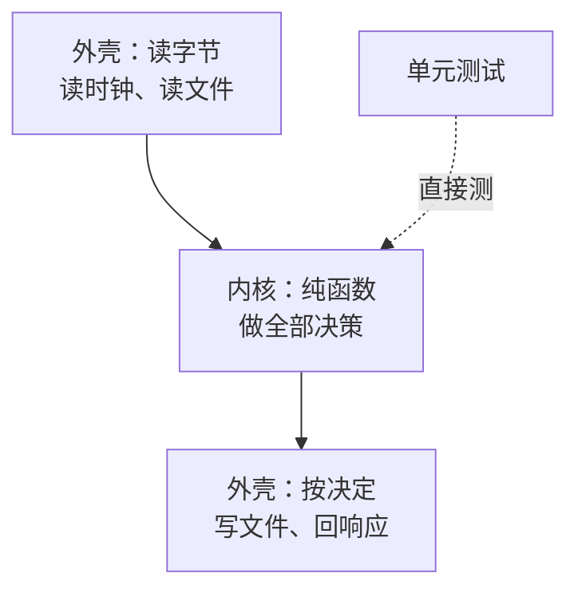

# 测试替身与依赖注入

被测代码总有依赖：数据库、文件系统、时钟、短信服务、支付网关。测试里把依赖换成一个假的，就叫**测试替身**（test double）。替身用对了，测试又快又稳；用错了，测试只是在验证「我调用了我以为该调用的东西」，代码真坏了它照样绿。这一章先分清替身的种类，再讲一条判断「哪些依赖该替换」的规则，最后讲怎么组织代码，让大部分逻辑根本不需要替身。

## 五种替身

Gerard Meszaros 在《xUnit Test Patterns》里给替身分了五类。日常说的「mock」往往混指其中好几种，分清楚有助于想明白自己到底要什么：

| 种类 | 做什么 | 例子 |
|---|---|---|
| Dummy | 占位，从不被真正使用 | 构造函数要一个 logger，这条测试用不到 |
| Stub | 返回预设的值 | 「汇率服务」永远返回 7.1 |
| Spy | 记录自己被怎么调用，事后检查 | 记下发了哪些短信 |
| Mock | 预先设定期望的调用，不符合就失败 | 期望 `send` 被调用一次、参数是某某 |
| Fake | 一个能用的简化实现 | 用 `Map` 实现的内存仓库，内存文件系统 |

在 Vitest 里，`vi.fn()` 同时能当 stub（`mockReturnValue`）和 spy（`toHaveBeenCalledWith`）；fake 通常是你自己写的一个类。

更重要的区分是两个方向：

- **Stub 和 fake 喂给被测代码输入**。断言它们「被调用了」没有意义，你只关心被测代码拿到输入后输出了什么
- **Spy 和 mock 检查被测代码的输出**，也就是它对外界产生的副作用：发了什么短信、调了什么支付接口

一个常见的错误是对 stub 做调用断言：「断言汇率服务被调用了一次」。这把实现细节锁死了：以后加了一层缓存、调用次数变了，行为没变，测试却红了。

## 哪些依赖该替换

这是本章最重要的一条规则，同样来自 Khorikov：按「谁能看到这个依赖上发生了什么」，把进程外的依赖分成两类。

| 类别 | 定义 | 例子 | 测试里怎么办 |
|---|---|---|---|
| 托管依赖 | 只有你的应用会访问，外界只能通过你的应用看到它 | 自己的 Postgres、自己的文件目录 | **用真的** |
| 非托管依赖 | 外界能直接观察到的副作用 | 短信、邮件、支付、第三方 API、消息推送 | **替换掉**，并断言调用 |

理由是：托管依赖的内部状态是实现细节。你的数据库里存成一张表还是两张表，用户看不到，那么测试也不该锁死它，直接用真的数据库，测试只看应用对外的行为。非托管依赖不一样，「给用户发了一条短信」本身就是对外可见的行为，必须验证它发了、发对了；同时你又不能真的在每次跑测试时给人发短信，所以替换掉。

hatch-counter 的服务端测试完全符合这条规则：

- **Postgres 用真的**。行级安全、触发器、可延迟外键全是数据库行为，替换掉就什么都没验。下一章细讲
- **短信替换掉**，但替换的方式很巧：开发模式下验证码不发短信，而是打在日志里。测试起的是真服务进程，从子进程的标准输出里捞出验证码完成登录。这是一个靠配置启用的 fake，不需要在代码里到处注入

```typescript
// tests/helpers/server.ts
export function codeFromLog(server: TestServer, phone: string): string {
  const matches = [...server.log().matchAll(new RegExp(`给 ${phone} 的验证码是 (\\d{6})`, "g"))];
  const last = matches.at(-1);
  if (!last) throw new Error(`日志里没找到 ${phone} 的验证码`);
  return last[1];
}
```

取最后一条匹配，是因为同一个手机号在一条测试里可能先后要过好几次验证码。

## 最好的替身是不需要替身

比「怎么 mock」更值得花心思的问题是：**能不能把逻辑组织成根本不需要 mock 的样子**。

一种很有效的结构叫「函数式内核，命令式外壳」（functional core, imperative shell）：

- **内核**：所有决策逻辑，写成纯函数。输入是数据，输出是数据（或者是「要做什么」的描述）
- **外壳**：负责读输入（文件、网络、时钟）、调用内核、执行内核给出的决定。外壳尽量薄，薄到几乎没有分支



hatch-shelf 的局域网传书服务就是这个结构：

| 文件 | 角色 | 依赖 | 测试 |
|---|---|---|---|
| `server/http.ts` | 内核：切请求、拆 multipart、判断超限 | 无 | 完整的单元测试 |
| `@shelf/spec` 的 `prepareImport` | 内核：判断压缩包是不是合法的书、该写哪些文件 | 无 | 完整的单元测试 |
| `server/lan-server.ts` | 外壳：监听端口、按路径分发、调导入管线 | 文件系统、TCP | 不写自动化测试，手动验证 |

外壳里还剩一点逻辑（比如 PIN 错误几次后关闭服务），但已经少到可以靠肉眼和手动验证兜住。复杂的、容易出错的部分全在内核，测试不需要任何替身。

导入管线也是这样分的：`prepareImport` 只返回「要写哪些文件、每个文件的字节」，真正写进 `documentDirectory/books/` 的是另一个很薄的函数。判断与执行分开，判断就可测了。

## 依赖注入：不需要框架

内核挤干净之后，外壳里仍然有需要测的部分。这时用依赖注入：**被测代码不自己去拿依赖，而是由调用方传进来**。

TypeScript 里最简单的依赖注入就是函数参数：

```typescript
export interface Clock {
  now(): number;
}

export interface Sms {
  send(phone: string, text: string): Promise<void>;
}

export interface ReminderDeps {
  clock: Clock;
  sms: Sms;
  findExpiring(beforeMs: number): Promise<{ storeId: string; phone: string; expiresAt: number }[]>;
}

/** 到期前 7 天提醒一次 */
export async function sendExpiryReminders(deps: ReminderDeps): Promise<number> {
  const horizon = deps.clock.now() + 7 * 86_400_000;
  const stores = await deps.findExpiring(horizon);
  for (const s of stores) {
    const days = Math.ceil((s.expiresAt - deps.clock.now()) / 86_400_000);
    await deps.sms.send(s.phone, `你的门店服务将在 ${days} 天后到期`);
  }
  return stores.length;
}
```

测试里，时钟用 stub，短信用 spy，查询直接给数据：

```typescript
import { expect, it, vi } from "vitest";
import { sendExpiryReminders } from "./expiry";

it("提醒里的天数向上取整：还剩 2.5 天说 3 天", async () => {
  const now = Date.UTC(2026, 10, 4);
  const sms = { send: vi.fn().mockResolvedValue(undefined) };
  const sent = await sendExpiryReminders({
    clock: { now: () => now },
    sms,
    findExpiring: async () => [{ storeId: "s1", phone: "13600000001", expiresAt: now + 2.5 * 86_400_000 }],
  });

  expect(sent).toBe(1);
  expect(sms.send).toHaveBeenCalledWith("13600000001", expect.stringContaining("3 天"));
});
```

注意断言的对象：短信是非托管依赖，所以断言它被怎么调用；`findExpiring` 是给输入的 stub，不对它做任何调用断言。

真实代码里，`findExpiring` 会连数据库。它的正确性（「到期前 7 天」的 SQL 写对没有）交给下一章的集成测试，这里只测提醒文案和天数的计算。

### NestJS 的依赖注入

用 NestJS 时，依赖注入由框架完成，测试里用 `Test.createTestingModule` 加 `overrideProvider` 换掉某个 provider，用法见[《NestJS 后端架构》的测试一章](../nestjs-backend/09-testing.md)。原则不变：换掉的应该是短信、支付这类非托管依赖，而不是你自己的数据库层。

## 模块 mock：能不用就不用

> [!WARNING]
> 本节 `clearMocks` 的默认值按 2026 年 11 月 Vitest 5 迁移指南整理（Vitest 5 起默认开启），以 Vitest 官方文档为准。

Vitest 的 `vi.mock` 可以替换整个模块，被测代码完全不用改：

```typescript
import { expect, it, vi } from "vitest";
import { notifyOwner } from "./notify";

vi.mock("./sms-client", () => ({
  sendSms: vi.fn().mockResolvedValue(undefined),
}));

import { sendSms } from "./sms-client";

it("通知店主时发一条短信", async () => {
  await notifyOwner("s1");
  expect(sendSms).toHaveBeenCalledOnce();
});
```

工厂里的 `vi.fn()` 是模块级的，同一个文件里的所有测试共用它。Vitest 5 起 `clearMocks` 默认开启，每条测试开始前清空调用记录、保留 `mockResolvedValue` 这类实现，所以第二条测试里的 `toHaveBeenCalledOnce` 不会把前一条的调用算进来。Vitest 4 及更早没有这个默认，要在配置里打开 `clearMocks`，或者在 `beforeEach` 里调 `vi.clearAllMocks()`。

它方便，但有几个代价：

- **`vi.mock` 会被提升到文件顶部**，在所有 `import` 之前执行。工厂函数里引用文件里的变量会出错，要用 `vi.hoisted` 包一层。这种「代码写在下面却先执行」的行为让测试更难读
- **依赖关系被藏起来了**。读 `notifyOwner` 的签名看不出它会发短信，读测试才知道
- **按模块路径替换，重构就会红**。把 `sendSms` 挪到另一个文件，被测行为没变，测试却失效了

所以把 `vi.mock` 当成改不动代码时的退路：测试一段遗留代码、替换一个第三方库的全局副作用。新写的代码，用参数注入。

## Fake 也会说谎

Fake 是能用的简化实现，比如用 `Map` 写的内存仓库。它比 stub 好用，可以跑完整的业务流程。但它有一个隐患：**fake 和真实实现的行为会慢慢分叉**。

内存仓库不会违反唯一约束，不会因为外键报错，事务回滚时也不会撤销写入。测试在 fake 上全绿，上了真数据库就出问题。

两个对策：

1. **托管依赖不用 fake**。数据库就用真的，下一章讲怎么让它足够快
2. **非用 fake 不可时，给 fake 和真实实现跑同一套测试**。把一组描述「仓库应该怎样表现」的测试写成一个函数，分别传入两个实现：

```typescript
import { describe, expect, it } from "vitest";
import type { BookStore } from "./book-store";

export function bookStoreContract(name: string, create: () => Promise<BookStore>) {
  describe(`${name} 满足 BookStore 约定`, () => {
    it("同 id 再次写入即为更新，不产生第二本", async () => {
      const store = await create();
      await store.put({ id: "demo", title: "旧" });
      await store.put({ id: "demo", title: "新" });
      expect(await store.list()).toEqual([{ id: "demo", title: "新" }]);
    });

    it("删除不存在的书不报错", async () => {
      const store = await create();
      await expect(store.remove("nope")).resolves.toBeUndefined();
    });
  });
}

// memory-book-store.test.ts
bookStoreContract("内存实现", async () => new MemoryBookStore());
// sqlite-book-store.test.ts（在能跑 SQLite 的环境里）
bookStoreContract("SQLite 实现", async () => openSqliteBookStore(":memory:"));
```

这样 fake 的每一个行为都被真实实现背书过。这个思路在[第 5 章](05-api-contract.md)还会再出现：两个实现、一份约定，就是契约测试。

## HTTP 依赖：在网络层替换

> [!WARNING]
> 本节 MSW 的 API（`http.post`、`HttpResponse`、`setupServer`）按 MSW 2.x 整理，1.x 的写法完全不同，后续大版本也可能调整，以 MSW 官方文档为准。

调用第三方 HTTP API 的代码（OCR 服务、支付网关），可以不注入客户端，而是在网络层拦截请求。Node 和浏览器里常用 MSW（Mock Service Worker）：

```typescript
import { http, HttpResponse } from "msw";
import { setupServer } from "msw/node";
import { afterAll, afterEach, beforeAll, expect, it } from "vitest";
import { recognizeReceipt } from "./ocr";

const server = setupServer(
  http.post("https://ocr.example.com/v1/recognize", () =>
    HttpResponse.json({ lines: [{ text: "五花肉 12.5kg", confidence: 0.93 }] }),
  ),
);

beforeAll(() => server.listen({ onUnhandledRequest: "error" }));
afterEach(() => server.resetHandlers());
afterAll(() => server.close());

it("服务商超时时换下一家，而不是直接报错", async () => {
  server.use(http.post("https://ocr.example.com/v1/recognize", () => HttpResponse.error()));
  const r = await recognizeReceipt(imageBytes, { providers: ["example", "backup"] });
  expect(r.provider).toBe("backup");
});
```

`onUnhandledRequest: "error"` 很重要：测试里任何没被拦截的请求都直接失败，防止测试悄悄打到真实的第三方服务上。

网络层替换的好处是被测代码一行不用改，连 `fetch` 的参数拼接、响应解析都被测到了；缺点是你写的假响应可能和真服务的响应对不上。对付这个问题，靠的是保存一份真实响应作为样本，见[第 8 章](08-test-data.md)。

## 常见的替身误用

| 误用 | 后果 | 改法 |
|---|---|---|
| mock 自己的数据库层 | 只验了「调用了 save」，SQL 写错照样绿 | 用真数据库 |
| 断言 stub 被调用了几次 | 加缓存、合并请求后测试红，行为没变 | 只断言输出 |
| 断言调用顺序 | 调整无关的执行顺序后测试红 | 只对有业务意义的顺序做断言 |
| mock 不属于你的类型 | 第三方库升级换了签名，mock 还是旧的 | 包一层自己的接口，mock 自己的接口 |
| 一条测试里 mock 五六个依赖 | 准备段比被测代码还长 | 说明这个单元职责太多，拆分或改成集成测试 |

最后一条是一个信号：**准备替身的代码很长，往往是设计问题，不是测试问题**。

## 本章要点

- 替身分五类：dummy、stub、spy、mock、fake；stub 和 fake 喂输入，spy 和 mock 查输出
- 不对 stub 做调用断言，那是在锁死实现
- 托管依赖（自己的数据库）用真的，非托管依赖（短信、支付、第三方 API）替换掉并断言调用
- 最好的替身是不需要替身：函数式内核做决策，命令式外壳做执行，外壳尽量薄
- 依赖注入不需要框架，函数参数就够；`vi.mock` 留给改不动的代码
- Fake 会和真实实现分叉；非用不可时，给两者跑同一套约定测试
- 第三方 HTTP 在网络层拦截，并让未拦截的请求直接失败
