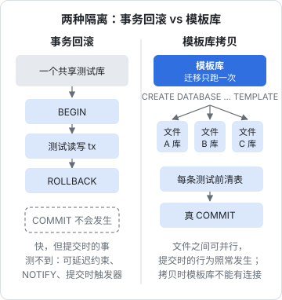

# 集成测试与真实数据库

上一章的规则说：自己的数据库是托管依赖，测试里用真的。这句话说起来容易，做起来有三个现实问题：测试从哪儿拿到一个数据库；几百条测试共用数据库时怎么互不干扰；连真库的测试怎么才能不慢。这一章逐个回答，案例是 hatch-counter 的服务端测试：四百多条测试，全部连真 Postgres，在开发机上并行跑完。

## 为什么非要真数据库

先把理由说清楚，否则遇到麻烦时很容易退回去 mock。

数据库不只是存东西的地方。一个认真设计的 Postgres 库里有大量**行为**：

| 数据库行为 | 写错了会怎样 | mock 能不能测 |
|---|---|---|
| 唯一约束、外键、检查约束 | 脏数据写进去 | 不能 |
| 行级安全（RLS） | 一家店看到另一家店的数据 | 不能 |
| 触发器 | 版本号不涨，客户端缓存永远不刷新 | 不能 |
| 事务隔离级别 | 并发下扣库存扣成负数 | 不能 |
| SQL 本身 | 条件写反、`join` 漏了租户条件 | 不能 |

最后一行最常见。一个 `findExpiring` 函数，把 `<` 写成了 `>`，mock 掉数据库的测试照样绿。**用 ORM 也一样**：Drizzle 帮你拼 SQL，但 `where` 条件是你写的。

当然，数据库的测试也不是越多越好。纯计算的业务口径（毛利、工资）放在不碰数据库的模块里做单元测试；集成测试只覆盖「这件事必须由数据库来保证」的部分。

## 测试从哪儿拿到数据库

| 方式 | 怎么做 | 优点 | 缺点 |
|---|---|---|---|
| 本机常驻 | 开发机上一直跑着一个 Postgres（Docker Compose 或 Homebrew） | 最快，测试零启动成本 | 要记得先起；版本可能和生产不一致 |
| Testcontainers | 测试启动时自动拉起一个容器，跑完删掉 | 一条命令就能跑，版本钉死 | 每次多几秒启动；需要 Docker |
| CI 的 services | GitHub Actions 在 job 旁边起容器 | 配置简单 | 只在 CI 里有 |

hatch-counter 的选择是前一种加最后一种：开发机上用 Docker Compose 起一个 Postgres（和生产同一个主版本），CI 里用 `services`。测试只通过环境变量拿连接串，不关心库是怎么来的。CI 那部分的配置见[《部署与 CI/CD》的 CI/CD 一章](../deploy-release/05-ci-cd.md)。

如果不想要求自己「记得先起数据库」，Testcontainers 是更省心的选择。

### Testcontainers + Vitest

> [!WARNING]
> 本节 Vitest 的 `globalSetup` / `project.provide` / `inject` 按 Vitest 5.0 的类型定义核对过（`TestProject` 从 `vitest/node` 导入）；`@testcontainers/postgresql` 的 API 按 2025 年前后的版本整理。两者都在快速演进，以 Testcontainers for Node.js 和 Vitest 的官方文档为准。

思路是：在 Vitest 的全局准备阶段起一个容器、跑一次迁移，把连接串传给所有测试文件；全部跑完后关掉容器。

```typescript
// test/global-setup.ts
import { PostgreSqlContainer, type StartedPostgreSqlContainer } from "@testcontainers/postgresql";
import type { TestProject } from "vitest/node";
import { migrate } from "../src/db/migrate";

let container: StartedPostgreSqlContainer;

export async function setup(project: TestProject) {
  container = await new PostgreSqlContainer("postgres:16-alpine")
    .withTmpFs({ "/var/lib/postgresql/data": "rw" })
    .start();
  const url = container.getConnectionUri();
  await migrate(url);
  project.provide("databaseUrl", url);
}

export async function teardown() {
  await container?.stop();
}
```

```typescript
// vitest.config.ts
import { defineConfig } from "vitest/config";

export default defineConfig({
  test: {
    globalSetup: ["./test/global-setup.ts"],
    hookTimeout: 60_000, // 第一次要拉镜像
  },
});

// test/provided.d.ts：给 inject 补上类型
declare module "vitest" {
  export interface ProvidedContext {
    databaseUrl: string;
  }
}
```

```typescript
// 某个测试文件
import { inject } from "vitest";
import postgres from "postgres";

const sql = postgres(inject("databaseUrl"));
```

镜像标签要写死到主版本（`postgres:16-alpine`），并和生产保持一致。用 `latest` 意味着某天测试突然换了大版本，失败原因和你的代码毫无关系。

## 测试之间怎么隔离

一个库，几百条测试轮流写。不隔离的话，前一条测试留下的数据会让后一条莫名其妙地失败，而且失败与否取决于执行顺序。常见的隔离方式有四种：

| 方式 | 做法 | 速度 | 主要限制 |
|---|---|---|---|
| 每条测试前清表 | `truncate ... restart identity cascade` | 中 | 文件之间不能并行，否则互相死锁 |
| 事务回滚 | 每条测试在一个事务里跑，结束时回滚 | 快 | 提交时才发生的事测不到；被测代码必须用同一个连接 |
| 每个文件一个库 | 从模板库拷贝 | 快，可并行 | 拷贝要求模板库没有活动连接 |
| 每条测试一个新租户 | 不清理，靠唯一的租户 id 互不可见 | 最快 | 全局查询（统计、后台）会互相看到 |

这几种可以组合。hatch-counter 用的是「每个文件一个库，文件内每条测试前清表」。下面分别说事务回滚和模板库这两种，因为它们的取舍最有意思。



### 事务回滚：快，但有盲区

思路是每条测试开一个事务，被测代码在这个事务里做所有事情，测试结束时回滚，数据库回到原样。用 postgres.js 可以这样写：

```typescript
import postgres from "postgres";
import { inject, it as base } from "vitest";

const sql = postgres(inject("databaseUrl"), { max: 4 });

class Rollback extends Error {}

/** 每条测试拿到一个事务连接 tx，测试结束时整体回滚 */
export const it = base.extend<{ tx: postgres.TransactionSql }>({
  tx: async ({}, use) => {
    await sql
      .begin(async (tx) => {
        await use(tx);
        throw new Rollback();
      })
      .catch((e) => {
        if (!(e instanceof Rollback)) throw e;
      });
  },
});
```

```typescript
import { expect } from "vitest";
import { it } from "./db-fixture";
import { createStore, findExpiring } from "../src/stores/repo";

it("到期查询只返回 7 天内到期、仍在营业的店", async ({ tx }) => {
  const now = new Date("2026-11-04T00:00:00Z");
  await createStore(tx, { name: "甲", expiresAt: new Date("2026-11-08T00:00:00Z") });
  await createStore(tx, { name: "乙", expiresAt: new Date("2026-11-20T00:00:00Z") });
  await createStore(tx, { name: "丙", expiresAt: new Date("2026-11-06T00:00:00Z"), status: "suspended" });

  const rows = await findExpiring(tx, now, 7);
  expect(rows.map((r) => r.name)).toEqual(["甲"]);
});
```

`test.extend` 是 Vitest 的测试夹具（fixture）机制：测试函数参数里写了 `tx`，夹具就会为这条测试准备一个，用完自动清理。[第 8 章](08-test-data.md)会再用到它。

这个方案很快，但有三个盲区，必须清楚：

1. **被测代码必须接受外部传入的连接**。如果仓库函数自己 `import` 了一个全局连接池，它写的数据不在测试的事务里，回滚不掉。这又是依赖注入的问题
2. **测不了「起真进程打 HTTP」**。服务进程有自己的连接池，测试没法把事务塞给它
3. **提交时才发生的事永远不会发生**。可延迟约束（`DEFERRABLE INITIALLY DEFERRED`）在提交时才检查；`AFTER ... DEFERRABLE` 的约束触发器在提交时才执行；`LISTEN/NOTIFY` 的通知在提交后才发出。测试一回滚，这些全都跳过了，测试是绿的，生产里却会报错

第三条对设计里依赖提交时行为的系统影响很大。另外，事务回滚还会测不到这类机制：由触发器在**事务提交时**维护的版本号、靠 `NOTIFY` 发出的推送、可延迟的外键。如果你的系统依赖它们，用回滚隔离就等于把最关键的行为排除在测试之外。hatch-counter 恰好用到了这几样，它选择的隔离方式见下一节。

被测代码自己也开事务的时候，postgres.js 和大部分驱动会把内层事务变成保存点（savepoint），行为和独立事务也不完全相同，这是另一个小盲区。

### 每个文件一个库：从模板拷贝

hatch-counter 的方案：

1. 测试开始前（`pretest`）建一个模板库，迁移只在它身上跑一次
2. 每个测试文件启动时，用 `CREATE DATABASE ... TEMPLATE` 拷出自己的库
3. 文件内每条测试前清表

```typescript
export function testDbName(): string {
  // node --test 一个文件一个子进程，argv[1] 就是测试文件路径
  const stem = basename(process.argv[1] ?? "").replace(/\.test\.[cm]?[jt]s$/, "");
  const slug = stem.replace(/[^a-zA-Z0-9]+/g, "_").toLowerCase().slice(0, 40);
  return slug ? `counter_test_${slug}` : "counter_test";
}

export async function openTestDb() {
  const admin = postgres(adminUrl, { max: 1 });
  await admin.unsafe(`drop database if exists ${TEST_DB} with (force)`);
  await admin.unsafe(`create database ${TEST_DB} template ${TEMPLATE_DB}`);
  await admin.end();
  // ……返回连到 TEST_DB 的连接
}
```

库名从测试文件名算出来，而不是一串随机字符，出问题时连上去一看就知道是哪个文件留下的。

hatch-counter 采用这个方案的原因，源码注释里写得很清楚：原来所有测试文件共用一个库，各自清表会互相死锁，只能串行跑，整套测试要 52 秒，CPU 有一半时间在等锁。改成每个文件一个库之后，这道锁就没了。

`CREATE DATABASE ... TEMPLATE` 是文件级的拷贝，比跑一遍迁移快得多。它要求模板库当时**没有任何活动连接**，所以准备完模板后要把连接关干净。

### 清表要清对

文件内每条测试前清表，看上去最简单，也有讲究。hatch-counter 的 `resetDb` 用一条 `truncate` 列出所有业务表，带上 `restart identity cascade`（自增序列归零、级联清依赖表）。还有两张特殊的单行表：

- 短信配置表：服务端假设这一行永远存在，所以清法是「删掉，再插回默认那一行」
- 审核登录表：默认没有行，「没配」就代表「这条路不存在」，所以只删不插

这两张表如果按普通表处理，上一条测试切换的短信通道、打开的审核后门，会留给下一条测试。**清理逻辑要知道每张表的「干净」是什么样子**，这不总是「空」。

新加一张表时忘了加进 `truncate` 列表，是这个方案最常见的漏洞。可以用一条元测试兜住：查出 `public` 下所有的表，断言每一张都在清理列表或者明确的豁免名单里。元测试的写法见[《NestJS 后端架构》的测试一章](../nestjs-backend/09-testing.md)。

## 并发数按连接数算

文件之间隔离之后，就可以并行跑了。并行数开多少？直觉是「按 CPU 核数」，但对连数据库的测试来说，**瓶颈通常是连接数**。

hatch-counter 把并发钉死在 4，源码注释里算了一笔账：每个并行的测试文件最多占 19 条连接（服务端进程的业务池 10、后台池 4、推送监听 1，测试自己 4），Postgres 默认 `max_connections` 是 100。4 个并行是 76 条，还有余量；开到 8 个就是 152 条，超了。

超了的表现不是一条清楚的报错，而是**偶发的连接失败**：有时候红，重跑又绿。这就是[第 9 章](09-ci-flaky.md)要讲的不稳定测试的典型来源之一。把账算在注释里，下一个想「调大并发提速」的人（包括编码 agent）就知道为什么不能改。

## 让测试库更快

测试数据是一次性的，不需要持久性保证。下面这些设置**只能用在测试库上**，能明显加快写入：

```bash
docker run -d --name pg-test -p 55432:5432 \
  -e POSTGRES_PASSWORD=test \
  --tmpfs /var/lib/postgresql/data:rw \
  postgres:16-alpine \
  -c fsync=off -c synchronous_commit=off -c full_page_writes=off
```

- `--tmpfs`：数据目录放在内存盘上，清表、建库都不碰磁盘
- `fsync=off`：不强制刷盘。断电会损坏数据库，所以生产环境绝对不能这么设
- `synchronous_commit=off`：提交时不等 WAL 落盘

> [!CAUTION]
> `fsync=off` 和 `full_page_writes=off` 在崩溃时会造成不可恢复的数据损坏。把这几个参数写在测试专用的启动命令里，不要写进可能被生产复用的配置文件。

## 迁移本身也要测

测试库通常是「从零跑一遍全部迁移」得到的。这能验证迁移在空库上能跑通，但生产库不是空的：它是从上一个版本迁移过来的，表里有数据。

两类迁移问题，空库测试发现不了：

- **加了 `NOT NULL` 列但没给默认值**：空表上成功，有数据的表上失败
- **加唯一约束**：空表上成功，生产数据里已经有重复值

对付它们，可以在测试准备阶段多加一步：先迁移到上一个发布版本，用种子数据填一些行，再跑本次新增的迁移。更省事的做法是在发布前，把生产库的备份恢复到一个临时库上，跑一遍新迁移，这同时也演练了恢复流程。迁移的写法和回滚策略见[《数据库原理与实战》的 Drizzle 与迁移一章](../database-practice/06-drizzle-migrations.md)。

## 不是 Postgres 的时候

hatch-shelf 用的是设备上的 SQLite（`expo-sqlite`），它只能在 App 里跑，不能在 Node 测试里直接 import。它的做法是让 SQLite 里只放**可以重建的索引**和少量用户数据，复杂的判断不写在 SQL 里，而是在 TypeScript 的纯函数里：比如书籍占用空间的缓存对账 `reconcileSizes`，接收书单和缓存，返回哪些需要重新统计，完全可以在 Node 里测。

如果确实有复杂的 SQL 需要测，可以把 SQL 语句集中在一个不依赖 Expo 的模块里，测试时用 Node 自带的 SQLite 或者 `better-sqlite3` 执行同样的语句。要注意两边的 SQLite 版本和编译选项不一定相同（比如是否启用了 FTS5、JSON 函数），用到这些扩展的语句仍然要在设备上验证。

## 本章要点

- 约束、RLS、触发器、隔离级别和 SQL 本身都是数据库的行为，mock 测不到
- 数据库来源：本机常驻、Testcontainers、CI services；测试只认连接串
- 隔离方式有四种：清表、事务回滚、每文件一个库、每测试一个租户，可以组合
- 事务回滚最快，但测不到提交时的行为（可延迟约束、提交时触发器、NOTIFY），也测不了起真进程的场景
- 模板库拷贝让每个文件有自己的库，可以并行；库名用文件名，方便排查
- 清表要知道每张表的「干净」是什么；用元测试防止新表漏清
- 并发数按数据库连接数算，并把这笔账写在注释里
- 测试库可以关掉 `fsync`、放在内存盘上，但只能用于测试
- 迁移要在有数据的库上测，空库测试发现不了加约束和加非空列的问题

## 动手练习

1. **亲眼看回滚隔离的盲区**：用本章的 `docker run ... pg-test` 命令起测试库，`docker exec -it pg-test psql -U postgres`，执行：

   ```sql
   create table parent (id int primary key);
   create table child (pid int references parent deferrable initially deferred);
   begin; insert into child values (1); rollback;
   begin; insert into child values (1); commit;
   ```

   验证：第一个事务没有任何报错；第二个在 `commit` 时报 `insert or update on table "child" violates foreign key constraint`。

   参考答案：可延迟约束在提交时才检查。用事务回滚隔离的测试永远走第一条路径，测试是绿的，生产里第一次提交就报错。

2. **模板库不能有活动连接**：在同一个容器里 `create database tpl;`，开一个终端 `psql -U postgres -d tpl` 保持连接，在另一个终端执行 `create database t1 template tpl;`，然后退出第一个终端再执行一次。

   验证：第一次报 `source database "tpl" is being accessed by other users`；关掉连接后成功。

   参考答案：`CREATE DATABASE ... TEMPLATE` 是文件级拷贝，要求模板库静止。所以准备完模板要把连接关干净，测试文件只连自己拷出来的库。

3. **把连接耗尽变成一条清楚的报错**：另起一个容器，启动参数加 `-c max_connections=10`。用 `for i in $(seq 10); do docker exec -d <容器名> psql -U postgres -c "select pg_sleep(60)"; done` 占住连接，再执行一次 `docker exec <容器名> psql -U postgres -c "select 1"`。然后算一笔账：每个并行测试文件占 19 条连接、`max_connections` 是 100 时，最多能开几个并行。

   验证：最后那条命令报 `sorry, too many clients already`。

   参考答案：连接满了以后，新连接是直接失败的；放到测试里，就表现为偶发的红。100 条里默认给超级用户保留 3 条，97 ÷ 19 取整是 5，刚好贴着上限。本章把并发钉在 4，是给 psql、迁移脚本这些别的连接留出余量。
