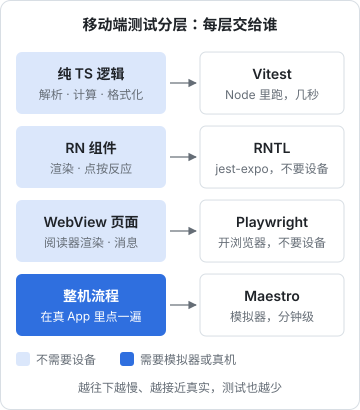

# 移动端与桌面端测试

网页的测试工具链已经很成熟：Vitest 跑逻辑，Playwright 开浏览器。到了手机 App 和桌面应用，情况复杂得多：代码跑在原生壳里，要编译、要模拟器，一次构建几分钟；界面由原生控件渲染，浏览器那一套定位方式用不上；还有 WebView、文件系统、系统权限这些网页里没有的东西。这一章按「能不能离开设备测」把移动端和桌面端的测试分层，分别讲 React Native Testing Library、Maestro 和 Electron 的做法，案例是 hatch-shelf 和 hatch-recordwall。

## 先把逻辑挪出原生壳

移动端测试最有效的一招，和前几章一样：**让大部分逻辑不需要设备就能测**。

hatch-shelf 是一个 Expo App，但它有测试的文件几乎全是纯 TypeScript：

| 模块 | 内容 | 依赖 |
|---|---|---|
| `packages/spec` | 书的结构判断、导入安全、链接校验 | 无（规范要求不得依赖 Node 或 RN 专有 API） |
| `app/src/server/http.ts` | 局域网服务的请求解析 | 无 |
| `app/src/notes/export.ts` | 阅读笔记导出成 Markdown | 无 |
| `app/src/backup/format.ts` | 备份文件的格式与校验 | 无 |
| `app/src/search/snippet.ts` | 搜索结果的摘要截取 | 无 |
| `app/reader-web/src/callouts.ts` | 阅读器的提示块渲染 | markdown-it |

这些全部用 Vitest 在 Node 里跑，`pnpm test` 几秒钟。App 的 `test` 脚本是 `vitest run src`，它只会碰到 `src` 下这些纯模块的测试文件。

hatch-counter 的手机端也是同样的思路：毛利、库存、工资这些口径在 `@counter/core` 里，网页端、服务端、手机端共用，在 core 里测一次，几端都覆盖了。

能挪出去的挪干净之后，剩下的才是真正需要移动端工具的部分：

| 层 | 测什么 | 工具 | 需要设备吗 |
|---|---|---|---|
| 纯逻辑 | 解析、计算、格式化 | Vitest | 不需要 |
| 组件 | 一个界面在不同状态下渲染得对不对、点了有没有反应 | Jest + jest-expo + RN Testing Library | 不需要 |
| WebView 里的页面 | 阅读器的渲染和消息收发 | Vitest 或 Playwright | 不需要 |
| 流程 | 在真 App 里点完一条路径 | Maestro | 需要模拟器 |
| 发布前检查 | 真机、真网络、系统权限弹窗 | 手动清单 | 需要真机 |



越往下一层越慢、越接近用户真实看到的样子，能放在上层测的就不要往下放。

## 组件测试：jest-expo 与 RN Testing Library

> [!WARNING]
> 本节的工具组合（jest-expo 预设、`@testing-library/react-native` 的 API）按 Expo SDK 5x 时期的官方文档整理。React Native 的源码需要经过 Babel 转换，Vitest 对它的支持一直不如 Jest 成熟；具体能否改用 Vitest、需要哪些额外配置，以 Expo 官方文档 Unit testing 一节和 RN Testing Library 文档为准。

React Native 组件在测试里不会真的渲染成原生控件，而是渲染成一棵 JavaScript 描述的树，测试在这棵树上查找元素、触发事件。Expo 官方推荐的组合是 Jest 加 `jest-expo` 预设，它处理了 RN 源码的转换，并为常用的原生模块准备了替身。

```bash
npx expo install jest-expo jest @testing-library/react-native
```

```json
{
  "scripts": { "test:ui": "jest" },
  "jest": { "preset": "jest-expo" }
}
```

查询方式和网页版的 Testing Library 一致，优先按角色和可访问名称查找：

```tsx
import { render, screen, userEvent } from "@testing-library/react-native";
import { PinPad } from "./pin-pad";

test("输满 4 位才触发提交", async () => {
  const user = userEvent.setup();
  const onSubmit = jest.fn();
  render(<PinPad length={4} onSubmit={onSubmit} />);

  for (const d of ["1", "2", "3"]) await user.press(screen.getByRole("button", { name: d }));
  expect(onSubmit).not.toHaveBeenCalled();

  await user.press(screen.getByRole("button", { name: "4" }));
  expect(onSubmit).toHaveBeenCalledWith("1234");
});
```

`getByRole("button", { name: "4" })` 能找到元素的前提是组件设置了 `accessibilityRole` 和可访问的标签。和网页一样，测试顺带检查了 VoiceOver 能不能读出这个按钮。

组件测试的难点在原生模块：组件里用了 `expo-sqlite`、`expo-file-system`，测试环境里没有这些原生实现，要么用 jest-expo 带的替身，要么自己 `jest.mock`。一个组件需要 mock 的原生模块越多，测试就越接近在测替身本身。

**hatch-shelf 目前没有组件测试**，这是有意的。它的界面逻辑很薄：书架列表、设置页、阅读页的外壳，复杂度都在 `@shelf/spec` 和阅读器里。为了几个薄组件引入第二个测试框架（Jest 和 Vitest 并存），维护两套配置，收益不够。组件里出现了值得测的状态逻辑时，更常见的做法是把它抽成一个纯函数或者一个不依赖 RN 的 hook 逻辑，回到 Vitest 里测。

## WebView 里的页面单独测

hatch-shelf 的阅读器是一个跑在 WebView 里的网页（markdown-it、highlight.js、KaTeX、Mermaid），打包成一个 HTML 文件。React Native 和它之间只通过 `postMessage` 通信，消息类型定义在 `bridge.ts` 里（见[第 5 章](05-api-contract.md)）。WebView 双向桥接本身的设计见[《React Native 与 Expo》的 WebView 一章](../rn-expo/07-webview-bridge.md)。

这个边界让阅读器可以**完全脱离 App 测试**：

- **渲染逻辑用 Vitest 测**。阅读器的 markdown-it 插件是普通函数，hatch-shelf 现在就这么测提示块：

```typescript
import MarkdownIt from "markdown-it";
import { describe, expect, it } from "vitest";
import { calloutPlugin } from "./callouts";

const md = new MarkdownIt().use(calloutPlugin);

describe("calloutPlugin", () => {
  it("标记独占一行：去掉标记，加上标题", () => {
    const html = md.render("> [!WARNING]\n> 以官方最新规定为准。");
    expect(html).toContain('<blockquote class="callout callout-warning">');
    expect(html).toContain("<span>警告</span>");
    expect(html).not.toContain("[!WARNING]");
  });
});
```

- **消息收发用 Playwright 测**。打包好的 `index.html` 在普通浏览器里也能打开。测试里先在页面上挂一个假的 `window.ReactNativeWebView`，记录阅读器发出的每条消息，再调用阅读器暴露的 `window.__shelf.receive(...)`，模拟 RN 发来的 `load`：

```typescript
import { expect, test } from "@playwright/test";
import { pathToFileURL } from "node:url";
import type { FromReader, ToReader } from "../src/reader/bridge";

test("加载一章后回报 ready、toc 和 rendered，目录取 H1–H3", async ({ page }) => {
  await page.addInitScript(() => {
    (window as any).__sent = [];
    (window as any).ReactNativeWebView = {
      postMessage: (s: string) => (window as any).__sent.push(JSON.parse(s)),
    };
  });
  await page.goto(pathToFileURL("assets/reader/index.html").href);

  const load: ToReader = {
    type: "load",
    markdown: "# 第一章\n\n## 小节甲\n\n正文\n\n### 更小的节\n\n#### 不进目录",
    bookBaseUrl: "file:///tmp/book/",
    theme: "light" as never,
    chapterNo: 1,
    highlights: [],
  };
  await page.evaluate((m) => (window as any).__shelf.receive(m), load);

  await expect.poll(() => page.evaluate(() => (window as any).__sent.map((m: FromReader) => m.type))).toContain("rendered");
  const toc = await page.evaluate(() => (window as any).__sent.find((m: FromReader) => m.type === "toc"));
  expect(toc.items).toHaveLength(3);
});
```

> 这条测试是建议的写法，hatch-shelf 目前没有它。`theme` 等字段的真实类型以 `bridge.ts` 为准。

WebView 和浏览器毕竟不是同一个环境（iOS 上是 WKWebView，安全策略、字体、`file://` 的访问规则都可能不同），所以这一层测的是阅读器自己的逻辑和协议，最终的显示效果仍然要在模拟器上看一眼。

## Maestro：在模拟器里走一遍流程

> [!WARNING]
> 本节 Maestro 的命令和 YAML 语法按 2025 年前后的版本整理，安装方式、命令名和对 iOS 版本的支持可能变化，以 Maestro 官方文档为准。

组件测试和 WebView 测试都不需要设备，代价是它们都不是真的 App。要验证「从书架点进一本书、翻到下一章、切换主题」这样的完整流程，需要在模拟器里驱动真 App。

Maestro 是目前在 React Native 社区里用得比较多的移动端流程测试工具。测试写成 YAML，按「用户看到的文字」或 `testID` 定位元素，自带等待和重试：

```yaml
# app/maestro/open-sample-book.yaml
appId: com.jarvis.shelf.dev
---
- launchApp:
    clearState: true
- assertVisible: "书架"
- tapOn: "Markdown 速查"
- assertVisible:
    text: ".*第 1 章.*"
- swipe:
    direction: LEFT
- tapOn:
    id: "reader-settings"
- tapOn: "深色"
- takeScreenshot: open-sample-book-dark
```

```bash
# 先用 dev client 构建并装到模拟器，再跑流程
pnpm app ios
maestro test app/maestro/
```

> 书名、按钮文字和 `testID` 是示意，以 App 的真实界面为准。

几个要点：

- **`appId` 用 dev client 的包名**。hatch-shelf 的开发版是 `com.jarvis.shelf.dev`，不会覆盖手机上的正式版
- **`clearState: true`** 让每个流程从全新安装的状态开始，不受上一次运行留下的书和进度影响。这对应网页测试里「每条测试一个新租户」
- **给关键控件加 `testID`**。图标按钮没有文字，按位置点击会随布局变化而失效
- **WebView 里的内容**：Maestro 通过系统的无障碍树看到 WebView 的内容，大多数情况下可以按文字定位，但不如原生控件可靠。阅读器内部的行为尽量在上一节的浏览器测试里覆盖，Maestro 只确认「点进去之后正文出来了」

Maestro 流程需要先构建 App，一次几分钟，不适合每次提交都跑。比较合理的节奏是：发布 TestFlight 之前跑一遍，或者改了导航、启动流程这类牵一发动全身的地方之后跑一遍。

## 在跑着的 App 里执行代码

hatch-recordwall 有一个很有意思的工具，介于自动化测试和手动验证之间：`pnpm eval`，**在模拟器里正在运行的 App 中执行一段 JavaScript，把结果打印出来**。

```bash
pnpm eval 'mod("src/lib/player.ts").player.get()'
pnpm eval 'mod("src/nav/hooks.ts").navigationRef.navigate("Tabs", { screen: "Settings" })'
```

它的原理是连上 Metro 的调试通道（React Native DevTools 用的那条 Chrome DevTools Protocol 连接），用 `Runtime.evaluate` 在 Hermes 里求值。源码注释记录了两个踩过的坑：Metro 只接受来自本机特定 Origin 的连接，Node 自带的 WebSocket 设不了 Origin，所以用了 `ws` 包；Hermes 的 `Runtime.evaluate` 不支持等待 Promise，异步结果要由注入的代码塞进一个全局变量，再轮询取回。

它为什么存在，注释里也写了：那台机器上的模拟器是无头运行的，没法点；而 App 里的每一条路径（解锁、上传、下载、播放、切换页面）都是普通函数，从这里调用就等于在真机器上真跑了一遍。配上 `xcrun simctl io <udid> screenshot` 截图，就能把每一屏拍下来对照设计稿。

这个工具给出一个通用的思路：**如果界面上的每个操作背后都是一个可以直接调用的函数，验证就不一定要经过点击**。它不是断言式的测试，但对一个人维护、主要靠自己验证的 App 来说，它把「手动点一遍」变成了「跑一行命令」，而且这一行命令可以写进脚本、交给编码 agent 去跑。

## Electron：主进程、渲染进程、通道

Electron 应用有两个进程（见[《Electron 桌面应用》的进程模型一章](../electron-desktop/01-process-model.md)），测试也按进程分：

| 部分 | 怎么测 |
|---|---|
| 主进程里的纯逻辑（文件格式、更新判断、路径处理） | Vitest，`environment: "node"` |
| 渲染进程的界面 | 和网页一样：Vitest 组件测试，或者在浏览器里跑 |
| preload 暴露的通道 | 元测试：类型里声明的每条通道都有实现 |
| 整个应用的启动和关键流程 | Playwright 的 Electron 支持 |

### 通道表的元测试

渲染进程通过 preload 暴露的 `window.api` 调用主进程。常见的错误是：类型里声明了一条通道，实现那边忘了注册，编译照样通过，调用时才报错。

hatch-counter 网页端保留了这种「通道表」的结构（`window.api` 背后是一张按名字注册的处理函数表），它用一条元测试守住这件事：从源码里读出类型声明 `IpcMap` 的所有通道名，再扫描处理函数目录里所有 `handle("域:动作", ...)` 的调用，断言两者一致。

```typescript
describe("IPC 通道", () => {
  it("IpcMap 里每一条都有实现", () => {
    const handled = handledChannels();
    const missing = typedChannels().filter((c) => !handled.has(c));
    assert.deepEqual(missing, [], `这些通道声明了却没有实现：${missing.join("、")}`);
  });
});
```

用正则扫源码看起来粗糙，但它准确地守住了一条编译器守不住的约定，而且不需要启动任何东西。Electron 应用的 IPC 设计见[《Electron 桌面应用》的 IPC 一章](../electron-desktop/02-ipc.md)。

### 用 Playwright 启动 Electron

> [!WARNING]
> Playwright 对 Electron 的支持（`_electron`）在官方文档中一直标注为实验性，API 名称带下划线前缀，可能调整；支持的 Electron 版本范围以 Playwright 官方文档为准。

```typescript
import { _electron as electron, expect, test } from "@playwright/test";

test("启动后主窗口显示唱片柜，主进程报告的版本号和 package.json 一致", async () => {
  const app = await electron.launch({
    args: ["out/main/index.js"],
    env: { ...process.env, NODE_ENV: "test" },
  });

  const window = await app.firstWindow();
  await expect(window.getByRole("heading", { name: "唱片柜" })).toBeVisible();

  // 在主进程里求值
  const version = await app.evaluate(({ app }) => app.getVersion());
  expect(version).toBe(process.env.npm_package_version);

  await app.close();
});
```

> 标题文字是示意。

`firstWindow()` 拿到的是第一个打开的窗口。hatch-recordwall 的 eval 工具注释里提醒过一个坑：主进程还开了一个不显示的窗口（地址是外部站点），「第一个 page」不一定是你要的那个。按 URL 挑选窗口更可靠：

```typescript
const main = app.windows().find((w) => /^(http:\/\/localhost|file:)/.test(w.url()));
```

hatch-recordwall 的桌面端用的是另一条路：带着 `RECORDWALL_CDP_PORT` 环境变量启动 Electron，打开调试端口，`EVAL_TARGET=desktop pnpm eval '...'` 就能在渲染进程里执行代码，加上 `EVAL_SHOT=文件.png` 还能顺手截图。手机端和桌面端用同一个工具、同一种思路验证，这对一个人维护的多端项目很省心。

## 发布前的手动清单

自动化测试覆盖不到的部分，用一份写下来的清单兜住。它不是「随便点点」，而是一份固定的、每次发版都逐条打勾的列表：

```markdown
## 发版前检查（iOS）

- [ ] 全新安装：首次启动、示例书出现在书架上
- [ ] 覆盖安装：旧版本的阅读进度、高亮、设置都还在
- [ ] 传书：电脑浏览器上传一本书、`shelf-pack push` 推一本书
- [ ] 打开一本带 Mermaid、KaTeX、代码块的书，深色主题下都看得清
- [ ] 飞行模式下打开、翻章、搜索
- [ ] 小屏设备（iPhone SE 尺寸）上书架和阅读页不溢出
```

第二条「覆盖安装」尤其重要：模拟器和自动化测试几乎总是从全新安装开始，而用户永远是从旧版本升级。数据库迁移、存储格式变化导致的问题，只在这一步暴露。

签名、TestFlight 和上架流程见[《React Native 与 Expo》的最后一章](../rn-expo/10-signing-testflight.md)和[《部署与 CI/CD》的移动端与桌面端发版一章](../deploy-release/08-mobile-desktop-release.md)。

## 本章要点

- 移动端测试的第一招是把逻辑挪出原生壳，在 Node 里用 Vitest 测
- 组件测试用 jest-expo 加 RN Testing Library；界面很薄时，不必为它引入第二套测试框架
- WebView 里的页面可以脱离 App 测：渲染逻辑用 Vitest，消息协议用 Playwright 模拟 RN 一端
- Maestro 在模拟器里驱动真 App，用 dev client 的包名、`clearState` 和 `testID`；适合发版前跑
- 如果每个界面操作背后都是可调用的函数，可以在跑着的 App 里直接执行代码来验证
- Electron 按进程分层；通道表用元测试守住，整体启动用 Playwright 的实验性 Electron 支持，按 URL 挑窗口
- 自动化覆盖不到的写成固定的发版清单，覆盖安装那一条最不能省
