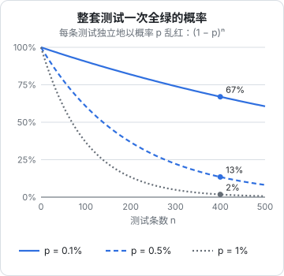

# CI 里的测试与不稳定测试治理

测试写好了，下一个问题是：什么时候跑、在哪里跑、红了怎么办。一个人的项目没有同事帮你盯着，测试要么自动地在该跑的时候跑，要么就会在某个赶时间的晚上被跳过。另一方面，测试一旦开始「有时红、有时绿」，你很快就会学会无视它，而一套被无视的测试比没有测试还糟，因为它给人一种虚假的安全感。这一章讲测试在流水线里的安排，再讲不稳定测试（flaky test）从哪里来、怎么发现、怎么处理。

GitHub Actions 的基本写法、需要数据库的 job 怎么配、发版流水线的结构，在[《部署与 CI/CD》的 CI/CD 一章](../deploy-release/05-ci-cd.md)里已经讲过，这里只讲和测试相关的部分。

## 什么时候跑哪些测试

不同的测试成本差别很大，不该在同一个时机全部跑。按「离写代码有多近」排一下：

| 时机 | 跑什么 | 时间预算 | 例子 |
|---|---|---|---|
| 编辑器里 | 类型检查、lint | 即时 | TypeScript 语言服务 |
| 保存时 | 相关的单元测试 | 几秒 | `vitest` 监听模式 |
| 提交前 | 类型检查、lint、全部单元测试 | 半分钟内 | git hook 或手动命令 |
| 推送后 / 合并前 | 全部单元和集成测试 | 几分钟 | CI |
| 发版前 | 上面全部，加端到端和移动端流程 | 十几分钟 | 发版流水线 |
| 定期 | 第三方 API 冒烟、依赖升级检查 | 不限 | 定时任务 |

原则是**越靠前的越快、越频繁**。提交前的检查如果要跑三分钟，你会开始用 `--no-verify` 跳过它。

本书三个项目的安排各不相同：

- **hatch-counter** 有 CI。服务端的发版流水线先在一个带 Postgres 服务容器的 job 里跑 `@counter/core` 和服务端的全部测试，通过后才构建镜像。测试没过，镜像不会生成，更不会部署
- **hatch-shelf** 没有 CI。它的规范要求声明任务完成前必须通过 `pnpm typecheck`、`pnpm test` 和 `pnpm lint`，这条规矩写在给编码 agent 读的 `CLAUDE.md` 里
- **hatch-recordwall** 也没有 CI，提交前跑 `format`、`lint`、`typecheck`，它的说明文件里写着：没有 CI，这三条是唯一的早期反馈

没有 CI 不是问题，只要「提交前一定会跑」这件事有保障。一个人的项目，最可靠的保障是把检查写成一条命令，并且让它足够快。

### 本地的守门人

不上 CI 时，可以用 git hook 在推送前自动跑一遍：

```yaml
# lefthook.yml
pre-push:
  parallel: true
  commands:
    typecheck:
      run: pnpm typecheck
    test:
      run: pnpm test
    lint:
      run: pnpm lint
```

放在 `pre-push` 而不是 `pre-commit`：提交可以很频繁、可以是半成品，推送才意味着「这个版本我认可」。`pre-commit` 上只放毫秒级的检查（格式化）。

## 让 CI 里的测试快

> [!WARNING]
> 下面的 `--shard` 参数在 Vitest 和 Playwright 中都存在，但分片的粒度（按文件还是按测试）、和覆盖率合并的配合方式可能随版本变化，以两者官方文档为准。GitHub Actions 的矩阵语法以 GitHub 官方文档为准。

CI 慢的代价不只是等待：慢到十分钟以上，你就会在它跑完之前切去做别的事，回来时已经忘了刚才改了什么。几个常用的提速手段：

- **缓存依赖**：pnpm 的 store、Playwright 下载的浏览器，按锁文件的哈希缓存
- **并行 job**：类型检查、lint、单元测试、集成测试拆成几个 job 同时跑，总时间取最慢的那个
- **分片**：测试多到一个 job 跑不完时，按文件分成几份，在几台机器上同时跑

```yaml
jobs:
  e2e:
    runs-on: ubuntu-latest
    strategy:
      fail-fast: false
      matrix:
        shard: [1, 2, 3]
    steps:
      # ……安装依赖、起数据库
      - run: pnpm exec playwright test --shard=${{ matrix.shard }}/3
```

- **只跑受影响的部分**：monorepo 里改了一个包，只跑它和依赖它的包。pnpm 的过滤语法 `pnpm --filter "...[origin/main]" test` 会选出相对主分支有改动的包以及依赖它们的包

不过对一人项目，最有效的提速往往不是这些技巧，而是**前几章的结构调整**：逻辑挪到纯函数里，单元测试多、集成测试精、端到端少。hatch-counter 把数据库测试从串行改成「每个文件一个库、并发 4」，就是一次结构性的提速。

## 失败要能看懂

> [!WARNING]
> 本节示例中 `actions/upload-artifact` 的主版本号和参数按 2025 年前后整理，旧的主版本会被 GitHub 停用，以 GitHub Actions 官方文档和该 action 的仓库说明为准。

CI 里的失败比本地难查：没法打断点，没法重跑一下看看。所以测试和流水线都要为「事后排查」做准备：

- **断言信息写清楚**：带上实际的响应体、相关的 id、违反的规则。[第 5 章](05-api-contract.md)的 `assert.equal(first.status, 201, JSON.stringify(first.body))` 就是一例
- **保存现场**：Playwright 的 trace、截图，服务端子进程的日志，作为 CI 产物上传。用 `if: failure()` 只在失败时上传，省空间
- **打印随机种子和时间**：如果测试里有任何随机或依赖时间的东西，失败时把种子和「当时的时间」打出来，才有可能在本地复现
- **让服务端日志可取**：hatch-counter 的测试辅助函数把子进程的标准输出和标准错误收集起来，通过 `server.log()` 取用（[第 3 章](03-test-doubles.md)从里面取验证码用的就是它）。在此基础上再加一步：测试失败时把这段日志打印出来或写进文件，服务端那边抛了什么异常一眼可见

```yaml
- name: 上传失败现场
  if: failure()
  uses: actions/upload-artifact@v4
  with:
    name: test-results
    path: |
      apps/web/test-results/
      apps/api/test-logs/
    retention-days: 7
```

## 不稳定测试的数学

不稳定测试是指**代码没变，有时通过有时失败**的测试。单看一条，乱红的概率可能很低，比如千分之一。问题在于测试是成套跑的。

假设每条测试独立地以概率 $p$ 乱红，整套 $n$ 条测试一次全绿的概率是：

$$
P(\text{全绿}) = (1 - p)^n
$$



按这个公式算：

| 每条乱红概率 | 100 条 | 200 条 | 400 条 |
|---|---|---|---|
| 0.1% | 90% | 82% | 67% |
| 0.5% | 61% | 37% | 13% |
| 1% | 37% | 13% | 2% |

hatch-counter 服务端有四百多条测试。如果每条有千分之一的概率乱红，三次运行里就有一次会无故失败；如果是百分之一，几乎每次都红。这时候「红了」已经不携带任何信息，你只会点重跑。

这张表说明了一件事：**不稳定测试不能容忍，哪怕单条的概率很低**。测试越多，标准就要越严。

## 不稳定从哪里来

几乎所有不稳定测试都能归到下面几类：

| 来源 | 典型表现 | 对策 |
|---|---|---|
| 异步等待 | 固定 `sleep` 不够长；没等请求返回就断言 | 等具体条件，不等固定时间 |
| 共享状态 | 单独跑通过，和别的测试一起跑失败 | 每条测试自己的数据，不依赖执行顺序 |
| 时间和日期 | 月末、跨年、半夜跑时失败 | 时间作为参数，或用假时钟 |
| 时区和区域设置 | 本地通过，CI 上失败 | 固定 `TZ`，并显式测试时区相关的逻辑 |
| 资源竞争 | 并发高时偶发连接失败、端口冲突 | 按资源上限定并发数；向系统要空闲端口 |
| 外部依赖 | 第三方服务偶尔超时 | 测试里替换掉，单独做冒烟 |
| 测试残留 | 假时钟没恢复、全局 mock 没撤销 | `afterEach` 里恢复；用框架的自动恢复选项 |
| 环境干扰 | 本地开着的开发服务影响测试 | 测试用独立的端口、库、目录 |

其中几条在本书前面的章节里已经出现过，这里补几个细节。

**时区**。GitHub Actions 的 Ubuntu 运行器默认时区是 UTC，你的开发机大概是 `Asia/Shanghai`。一条测试在本地断言「2026-11-04 08:30 属于 11 月 4 日的营业日」，在 CI 上 `new Date()` 的本地日期是 11 月 4 日 00:30，可能还落在前一个营业日里。两个对策要同时做：所有测试进程固定一个时区（`TZ=Asia/Shanghai`，写在 `test` 脚本里，本地和 CI 一致）；业务里需要时区的地方显式传时区，不依赖进程默认值，并在测试里专门测一条跨时区的边界。

**端口**。hatch-counter 的测试一次要起二十多个服务端进程。辅助函数向内核要空闲端口（`listen(0)`，拿到端口号后关掉），而不是自己在某个区间里随机抽。随机抽撞车只是时间问题，而且常用的随机区间正好落在 Linux 的临时端口范围里，会和系统分配给出站连接的端口撞上。

**环境干扰**。hatch-counter 记录过一个很难查的问题：开发命令是 `tsc --watch`，测试的 `pretest` 也要跑 `tsc`，两者同时往 `dist/` 里写文件。表现是一次红几十条、再跑一遍全绿，报错里一个字都不提开发服务。解决办法是一条写进文档的纪律：跑测试前停掉开发服务。更彻底的办法是让测试编译到另一个目录。

**资源**。[第 4 章](04-integration-db.md)讲过的连接数上限也是这一类：并发开到 8，数据库连接超过 `max_connections`，表现是偶发的连接被拒，而不是一条说得清的报错。

## 主动把不稳定揪出来

> [!WARNING]
> 本节 Vitest 的 `--sequence.shuffle` 和 `--repeat` 参数名按 Vitest 3 前后的版本整理（`--repeat` 在较早的版本里可能只能在测试代码里通过 `{ repeats }` 选项设置），以 Vitest 官方 CLI 文档为准。

等不稳定测试自己暴露，往往要等很久。可以主动去找：

```bash
# Vitest：打乱测试的执行顺序，暴露依赖顺序的测试
pnpm vitest run --sequence.shuffle

# Vitest：把每条测试重复跑多次
pnpm vitest run src/server --repeat 20

# Playwright：每条测试重复跑 10 次
pnpm exec playwright test --repeat-each=10

# 换一个时区跑一遍
TZ=America/Los_Angeles pnpm test
```

新写了一批集成测试或端到端测试后，用 `--repeat-each` 跑上十遍再合并，比合并后再慢慢发现便宜得多。换时区跑一遍可以放进定期任务里。

## 发现之后怎么办

一条测试被确认不稳定后，处理方式按优先级：

1. **立刻修**：大部分不稳定的原因在上面那张表里，定位后通常不难修
2. **修不了就隔离**：把它从主测试套件里移出去，标上原因、日期和要修的人（一个人的项目就是你自己），不让它继续污染每一次运行
3. **隔离太久就删掉**：隔离了一个月还没修，说明这条测试的价值不值得修它的成本。删掉它，并想一想它原本守护的规则要不要换一种方式守

```typescript
// 隔离：说明原因和日期，而不是悄悄 skip
it.skip("另一台设备改了数据，这台一两秒内跟上 [flaky 2026-11-04：CI 上推送偶发超过 5 秒，待查]", async () => {
  // ……
});
```

Playwright 有 `test.fixme`，语义是「已知有问题，待修」，比 `skip` 更清楚。

### 重试：只在最外层，只当信号

很多 CI 配置会给测试加自动重试，失败了再跑一次，通过就算过。它能让流水线变绿，也能把问题藏起来。

几条规矩：

- **单元测试和集成测试不重试**。它们应该是确定的，重试只会掩盖问题
- **端到端测试最多重试 1 次**，因为真浏览器、真网络的确有一些无法消除的抖动
- **重试后通过的测试要被看见**。Playwright 会把这类测试单独标成 flaky 并在报告里列出来。把它们当成待办事项，而不是「反正过了」

### 宁红勿假绿

不稳定测试的反面同样危险：**本该红却绿了**的测试。它不会打扰你，所以更难发现。几种典型情况：

- 断言写在异步回调里，测试函数已经返回了，断言才执行（或根本没执行）
- `await expect(...).rejects` 漏了 `await`
- 循环里的断言，因为数据为空，一次都没执行。[《NestJS 后端架构》的测试一章](../nestjs-backend/09-testing.md)里有一个例子：扫描所有租户表的元测试，先断言「找到的表多于 20 张」，防止查询写错返回空数组、循环一次都不跑、测试照样绿
- 测试过滤器配错了，某个目录下的测试根本没被跑到

最后一条可以用测试数量来防：在 CI 日志里留意测试总数，突然少了一大截就该警觉。也可以加一个简单的检查，测试数量低于某个下限时让流水线失败。

[《部署与 CI/CD》](../deploy-release/05-ci-cd.md)里讲发版流水线时也提到了同样的原则：宁可流水线红着，也不要让它在没有真正验证的情况下变绿。

## 本章要点

- 按时机安排测试：越靠近写代码的越快越频繁；提交前的检查要在半分钟内
- 没有 CI 也可以，但要保证「推送前一定会跑」：把检查写成一条命令，用 `pre-push` 钩子兜底
- CI 提速靠缓存、并行、分片和只跑受影响的部分，但最有效的是测试结构本身
- 失败要能事后看懂：断言带上下文，保存 trace 和日志，打印种子和时间
- 整套全绿的概率是 $(1-p)^n$，测试越多，对单条不稳定的容忍度越低
- 不稳定的来源：异步等待、共享状态、时间、时区、资源竞争、外部依赖、测试残留、环境干扰
- 主动用打乱顺序、重复运行、换时区把不稳定揪出来
- 发现后先修，修不了就带说明隔离，隔离太久就删；重试只用在端到端，并把重试通过的当成信号
- 警惕假绿：漏 `await`、空循环、测试没被跑到
