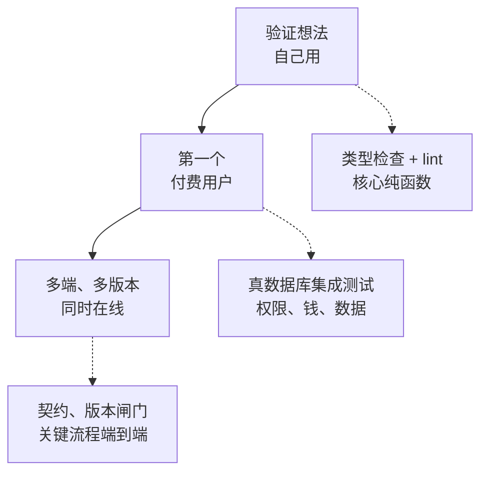

# 一个人的测试策略

前面九章讲了每一层测试怎么写。这一章把它们收拢成一套策略：一个人、几个项目、有限的时间，测试应该怎么分配，什么时候加，什么时候删，又怎么和编码 agent 配合。没有一套适用于所有项目的标准答案，本书的三个项目就给出了三种完全不同、但各自合理的选择。理解它们为什么不同，比记住任何一条规则都有用。

## 三个项目，三种选择

| | hatch-shelf | hatch-counter | hatch-recordwall |
|---|---|---|---|
| 是什么 | 自用的离线书架 App | 给门店用的 SaaS | 自用的音乐播放器 |
| 谁会被坑 | 自己 | 付费的店主和员工 | 自己 |
| 最贵的错误 | 阅读进度、笔记丢失；导入恶意压缩包 | 一家店看到另一家店的账；钱算错 | 听不了歌 |
| 测试框架 | Vitest | `node:test` | 无 |
| 测试重点 | 纯函数：书的结构判断、HTTP 解析、导出格式 | 真 Postgres 上的 API 测试、核心口径、元测试 | 类型检查、lint、在跑着的 App 里执行代码验证 |
| CI | 无，靠完成前必须通过的三条命令 | 有，测试不过不出镜像 | 无，提交前三条检查 |

几个对比值得细看：

**hatch-counter 的测试远多于另外两个**，不是因为它的代码更多，而是因为**错误的代价落在别人身上**。店主信任你保管他的账，一次数据串店就足以失去这个客户，而且你可能很久都不会知道。自用的工具出了错，你自己第一时间就发现了，修了就好。

**hatch-shelf 虽然自用，测试却不少**，集中在两处：导入安全（它要解开任意来源的压缩包，zip slip 检查写错就可能覆盖 App 的其他文件）和用户数据（阅读进度、笔记、备份恢复，规范里明确写着「不可丢」）。界面层几乎没有测试。这正是[第 1 章](01-what-to-test.md)说的按风险挑选测试对象。

**hatch-recordwall 几乎没有自动化测试**，但它不是没有验证。它有严格的类型检查（包括专门防止类型静默退化成 `any` 的配置），有 `pnpm eval` 能在模拟器和桌面端里直接调用任何一条业务路径并截图。它把验证的成本降到了「跑一行命令」，只是没有把这一行命令写成断言。

## 风险决定投入

把[第 1 章](01-what-to-test.md)的两个维度画成一张图：


四个格子对应四种处理：

- **右上，必须自动化**：记账、幂等、权限、备份恢复。出错代价高、出错概率也高（逻辑复杂、经常改动）。这里的测试要覆盖边界，要在每次改动后自动跑
- **左上，写测试**：导入安全、权限模型。逻辑可能很久不改，但一旦出错后果严重。写一套测试守住它，以后改动时它就是安全网
- **右下，顺手的单元测试**：格式化、解析、文案拼接。出错不严重，但容易错。这类代码通常是纯函数，测试写起来几分钟，顺手写
- **左下，可以不测**：设置页布局、排序动画。肉眼看一下就够

同一个功能在不同的项目里可能落在不同的格子。「数据导出」在 hatch-counter 里是右上（店主要拿去报税），在 hatch-recordwall 里可能是左下。

## 测试什么时候加

时间有限时，把写测试的时机集中在收益最高的几个点上：

**修 bug 的时候，一定加**。拿到一个 bug，先写一条能复现它的测试，看着它红，修完看着它绿。这条测试的价值很确定：同一个地方已经错过一次，说明它的出错概率不低。而且写测试的过程本身常常帮你定位问题。

**写规则复杂的新功能时，先写测试**。规则有很多分支和边界（工资计算、摊销、权限组合），先把规则写成一张 `it.each` 的表格，再写实现。这时测试同时是需求文档。

**重构之前，先补测试**。要大改一段没有测试的代码，先给它的当前行为写几条测试（这叫特征测试，characterization test：不判断行为对不对，只记录它现在是什么样），重构后这些测试还绿，就说明行为没变。

**发现自己在反复手动验证同一件事的时候**。第三次手动点同一条流程时，就是把它写成测试或脚本的时候。

反过来，**不必为了「补测试」专门花时间**。给一段跑了一年、没出过问题、近期也不打算改的代码补测试，收益很低。

## 测试什么时候删

测试也有生命周期。下面这些测试应该删掉或重写：

- **长期隔离、没人修的不稳定测试**（[第 9 章](09-ci-flaky.md)）
- **只在测实现细节的测试**：每次重构都要跟着改，从没抓到过真正的问题
- **被更好的测试覆盖了的测试**：加了一条元测试扫描所有租户表的行级安全，原来逐表写的那几条就多余了
- **守护的功能已经删除了，测试还在**：靠豁免名单反查可以发现一部分，见[《NestJS 后端架构》的测试一章](../nestjs-backend/09-testing.md)

删测试时问一句：它原本守护的规则还需要守吗？需要的话，换一种更好的方式守。

## 用元测试守约定

一个人的项目里，有大量「约定」只存在于你的脑子里，或者写在某份文档里：每张租户表都要开行级安全、每个 IPC 通道都要有实现、每个接口都要标权限。这些约定最容易在你自己（或者编码 agent）赶时间时被打破，而打破它们不会让任何东西报错。

**元测试把约定变成会报错的断言**：不测某一个具体的东西，而是扫描全集，断言所有同类的东西都满足某个条件。本书出现过的几个：

| 元测试 | 守住的约定 | 出处 |
|---|---|---|
| 扫描所有带 `store_id` 的表 | 每张租户表都开了行级安全 | [NestJS 后端架构](../nestjs-backend/09-testing.md) |
| 扫描通道类型声明和处理函数 | 每个声明的 IPC 通道都有实现 | [第 7 章](07-mobile-desktop.md) |
| 扫描所有表和清理列表 | 测试清理时不漏表 | [第 4 章](04-integration-db.md) |
| `shelf-pack check books/` | 每本书都符合写书规范 | [第 8 章](08-test-data.md) |

元测试的投入产出比很高：写一次，之后新加的每一张表、每一个通道都自动受检。它的写法有几个要点：对扫描结果本身做健全性检查（防止扫了个空）、豁免名单要反查、断言信息写后果。

## 测试与编码 agent

用 Claude Code 这类编码 agent 写代码之后，测试的角色发生了变化：**它是 agent 判断自己做没做对的客观信号，也是你审核 agent 工作的主要依据**。

几条实践：

**把测试写进完成的定义**。hatch-shelf 的 `CLAUDE.md` 写着：声明任务完成前必须通过 `pnpm typecheck`、`pnpm test` 和 `pnpm lint`。这让 agent 在每次任务结束时都跑一遍，而不是由你记得去跑。

**测试要快**。agent 在一次任务里可能跑十几遍测试。单元测试几秒跑完，它就会频繁地用测试验证自己；要跑五分钟，它就倾向于少跑或者只跑一部分。

**保护钉死的值**。agent 看到测试失败，一个常见的「修法」是把期望值改成实际值。hatch-counter 的开发文档里明确写着：分析测试的断言是钉死的对照值，不要为了让测试通过顺手改；口径确实要改，就连测试一起改。这条规矩写进 agent 读的文档，并在测试文件开头重复一遍，就能挡住大部分这类「修复」。

**让 agent 先写会失败的测试**。修 bug 时让 agent 先写复现测试并确认它失败，再改代码。这能防止它写出一条「怎么都会通过」的测试，也能防止它改了测试让测试通过。

**审核 agent 写的测试**。agent 写的测试有几个常见问题：mock 过度（把被测逻辑依赖的东西全替换了），断言太弱（`toBeDefined`、只检查不抛错），测试名描述步骤而不是规则。审核时重点看断言：如果把被测代码改坏，这条测试会红吗？

**用测试名和注释传递规则**。hatch-counter 的测试名和测试文件开头的注释，写的都是规则和理由：「同一个请求号再来，原样回第一次那份，账上只有一笔」「版本闸门必须排在鉴权前面，否则旧客户端听到的是登录过期」。agent 改坏这些地方时，看到的是一句它能理解的话，而不只是一个失败的断言，它更可能做出正确的修复而不是绕过去。

## 生产环境也是测试的一部分

再好的测试也只能覆盖你想到的情况。一个人维护的系统，还需要**出了问题能尽快知道**：

- **错误监控**：未捕获的异常、接口的 5xx 自动上报，你在用户反馈之前就知道
- **健康检查**：hatch-counter 的健康检查接口在数据库连不上时回 503，探活程序据此报警。它自己也有测试守着：「库连不上就回 503，不是 200 带一句 ok:false」
- **客户端崩溃上报**：网页端、手机端的崩溃带上版本号和操作路径
- **用户反馈的入口**：一个人的产品，用户的一句「这里不对」往往比任何监控都早

能快速发现、快速回滚，就可以在一些低风险的地方少写测试。反过来，回滚越难的地方（手机 App 的旧版本会在用户手上留几个月、数据库迁移不可逆），发布前的测试越要充分。监控和告警的做法见[《可观测性与性能》](../observability-performance/)，回滚见[《部署与 CI/CD》的回滚一章](../deploy-release/07-rollback.md)。

产品里有大模型功能时，它的输出没有确定的对错，前面讲的断言式测试不够用，需要专门的评估方法，见[《评测与质量》](../llm-evals/)。

## 测试策略随项目演进

测试的投入应该跟着项目的阶段走，而不是一开始就铺满：



- **验证想法、自己用的阶段**：类型检查和 lint 打底，核心的纯函数逻辑写单元测试。hatch-recordwall 和 hatch-shelf 在这个阶段
- **有了第一个付费用户**：涉及钱、权限、用户数据的地方必须有真数据库的集成测试；开始有发版流程，测试接进去
- **多个客户端、多个版本同时在线**：服务端和客户端之间的契约、旧版本的兼容、几条关键流程的端到端测试。hatch-counter 在这个阶段

过早投入的测试，会在产品方向还在频繁变化时成为负担；过晚投入，会在第一次出事时发现所有地方都没有保护。比较稳妥的信号是：**当错误的代价开始落在别人身上时，测试的投入就要跟上**。

## 一份检查清单

新开一个项目，或者审视一个已有项目时，可以逐条对照：

| 检查项 | 说明 |
|---|---|
| 类型检查是严格模式，`no-floating-promises` 打开 | 最便宜的一层 |
| 有一条命令跑完所有检查，并写进项目说明 | `pnpm typecheck && pnpm test && pnpm lint` |
| 复杂逻辑在纯函数里，有单元测试 | 外壳尽量薄 |
| 自己的数据库在测试里用真的 | 非托管依赖才替换 |
| 测试之间隔离，可以并行，并发数按资源上限算 | 见第 4 章 |
| 涉及钱、权限、用户数据的规则有测试 | 按风险挑 |
| 约定用元测试守住 | 扫描全集 |
| 测试名写规则和理由 | 给人和 agent 读 |
| 测试固定时区，时间作为参数 | 防止不稳定 |
| 不稳定测试有处理流程，没有被默默重试掉 | 见第 9 章 |
| 有一份发版前的手动清单，含覆盖安装 | 自动化覆盖不到的部分 |
| 线上出错能尽快知道，能回滚 | 测试之外的安全网 |

## 本章要点

- 三个项目三种选择：错误的代价落在谁身上，决定测试投入的多少
- 按出错代价和出错概率分四格：必须自动化、写测试、顺手的单元测试、可以不测
- 测试的最佳时机：修 bug 时、写复杂规则时、重构前、第三次手动验证同一件事时
- 测试也要删：长期隔离的、只测实现细节的、被更好的测试覆盖的
- 元测试把脑子里的约定变成会报错的断言，投入产出比最高
- 编码 agent 时代，测试是完成的定义；要快，要保护钉死的值，要审核 agent 写的断言
- 监控和回滚是测试之外的安全网；回滚越难的地方，发布前测得越充分
- 测试投入随项目阶段演进：错误的代价开始落在别人身上时，投入就要跟上

## 动手练习

1. **重构前先写特征测试**：下面是一段要重构的旧代码。先用 `toMatchInlineSnapshot()` 给 `"Rust Ownership"`、`" Hello, World! "`、`"中文标题"`、`"a--b"` 四个输入各写一条测试，运行一次让 Vitest 填进实际值；然后把实现改写成你觉得更清楚的样子，再跑。

   ```typescript
   export function slug(s: string): string {
     return s.trim().toLowerCase().replace(/[^a-z0-9]+/g, "-").replace(/^-|-$/g, "");
   }
   ```

   验证：填进去的值依次是 `"rust-ownership"`、`"hello-world"`、`""`、`"a-b"`；重构后四条仍然全绿。

   参考答案：特征测试只记录现状，不判断对错。`"中文标题"` 得到空字符串明显是个问题，但它应该作为单独的一次改动去修，并同步更新那一条快照，不要和重构混在一起。

2. **给元测试加健全性检查**：建一个 `docs/` 目录放两个以 `# ` 开头的 `.md` 文件，写一条元测试：`readdirSync("docs").filter((f) => f.endsWith(".MD"))` 得到文件列表，循环断言每个文件以 `# ` 开头。运行后，再在循环前加一句 `expect(files.length).toBeGreaterThan(0)` 运行一次。

   验证：第一次测试是绿的，但实际一个文件都没检查；加了健全性检查后变红，把 `.MD` 改成 `.md` 才变绿。

   参考答案：扩展名大小写写错，扫描结果为空，循环一次都没跑，测试照样通过，这就是假绿。元测试先断言「扫到了东西」，再断言「每一样都满足约定」。

3. **审核一条测试时，确认它会因为 bug 而红**：在一个 git 仓库里修一个 bug，同时加一条复现测试，两者分在不同文件。提交前运行 `git stash push -- <被修的源文件>` 暂时撤掉修复，跑测试；再 `git stash pop` 恢复修复，跑一次。

   验证：撤掉修复时这条新测试是红的，恢复后是绿的。

   参考答案：一条在没修复时也能通过的测试，什么都没证明。审核编码 agent 交来的修复，这样做最快：只撤掉实现，看测试能不能抓住原来的 bug。
