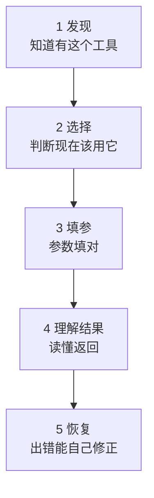
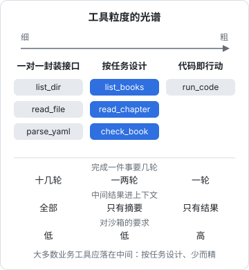

# 好工具的标准

[《Agent 原理与设计》第 3 章](../agent-principles/03-tools-and-actions.md)说过：工具是 agent 的手，也是模型和外部世界之间唯一的接口。那一章讲了工具调用的协议、副作用分级和通用工具与专用工具的取舍；这本书往下挖一层，回答一个更实际的问题：**我要给 agent 写工具，怎么写才算写好？**

## 这本书讲什么、适合谁、怎么读

这本书面向已经在用 Claude Code 这类编码 agent、开始想「让 agent 能碰到我自己的系统」的开发者。你会写 TypeScript，知道 JSON Schema 和 HTTP 是什么，读过[《Agent 原理与设计》](../agent-principles/)或者对 agent loop 有基本概念。

全书七章，分成三段：

| 段落 | 章节 | 解决的问题 |
|---|---|---|
| 工具设计 | 1 好工具的标准 · 2 描述与参数 · 3 错误返回 | 和协议无关的设计方法，写函数调用、写 MCP、写 CLI 都适用 |
| MCP | 4 MCP 协议 · 5 写一个 MCP server · 6 权限与认证 | 把工具做成标准协议的服务，接进任何 agent |
| 组织 | 7 工具集的组织 | 工具多了以后怎么分组、加载、演进 |

全书贯穿一个例子：给 hatch-shelf 的书库写一个 MCP server，让 agent 能列出书、分页读章节、按写书规范校验一本书，最后再加一个「推送到手机」的写操作，用它讲权限。第 5 章给出完整可运行的代码。

第 1–3 章建议按顺序读；如果你只想尽快把一个 server 跑起来，可以先读第 5 章，回头再补设计。

**版本说明**：MCP 协议和 SDK 演进很快。本书以 2026-07-28 版 MCP 规范和官方 TypeScript SDK 2.x（`@modelcontextprotocol/server` 2.4.0）为准，写作时间 2026 年 11 月。动手时请先对照官方文档确认版本。

## 工具是写给模型用的接口

传统 API 的读者是程序员：他看文档、读类型、写调用代码，一次写对之后程序就一直这样调用。工具的读者是模型：它**每一轮**都要重新读一遍工具定义，根据当前的对话决定用不用、用哪个、参数填什么，然后读返回结果决定下一步。

这带来几个根本差别：

| 维度 | 给程序员的 API | 给模型的工具 |
|---|---|---|
| 读文档的频率 | 写代码时读一次 | 每一轮都读，文档就是 prompt |
| 调用方式 | 确定性的代码 | 概率性的生成，可能填错、选错 |
| 返回值的消费者 | 代码解析结构化字段 | 模型阅读，占用上下文窗口 |
| 出错时 | 抛异常，程序员调试 | 模型读错误信息，决定重试、换路还是放弃 |
| 组合方式 | 程序员写循环、写胶水 | 模型一轮一轮调用，每轮都有成本 |
| 好坏的衡量 | 类型安全、性能、一致性 | 模型能不能**用对**、用几轮完成任务 |

Anthropic 的工程团队把这件事叫作 ACI（agent-computer interface）：既然我们愿意花大量精力设计人机界面（HCI），也应该同样认真地设计「agent 与计算机的界面」。一个直观的检验方法是：**把工具定义和返回结果交给一个聪明但完全不了解你项目的新同事，他能不能只看这些就把事情做对？** 如果他需要来问你，模型多半也会犯错。

## 一次工具调用要过的五道关

从模型的视角看，一次成功的工具调用要连续过五道关，每一关对应工具设计的一个方面：

| 关卡 | 失败的样子 | 主要靠什么 | 本书章节 |
|---|---|---|---|
| 发现 | 工具太多被淹没，或者按需加载时搜不到 | 名称、一句话简介、工具集组织 | 第 7 章 |
| 选择 | 两个相近的工具选错；该用工具时不用 | 描述里写清「何时用 / 何时不用」 | 第 2 章 |
| 填参 | 填了不存在的 id、格式不对、漏必填 | 参数命名、类型约束、枚举、示例 | 第 2 章 |
| 理解结果 | 返回太长挤爆上下文；返回 uuid 看不懂 | 输出体积控制、语义化字段 | 第 2 章 |
| 恢复 | 报错后反复重试同一个错误参数，或直接放弃 | 可行动的错误信息 | 第 3 章 |

还有一道贯穿始终的关：**安全**。工具能做的事就是 agent 能做的事，权限设计在第 6 章展开。

## 好工具的七条标准

把上面的关卡展开，一个好工具大致满足下面七条。后面几章会逐条细讲，这里先建立整体印象。

### 1. 对应一个任务，而不是一个接口

模型调用工具是有成本的：每一轮都要重新读完整上下文，产生延迟和 token 费用；中间结果都会进入上下文。所以工具的粒度应该贴合「用户想完成的事」，而不是底层系统的接口。

以书库为例，底层能力是「读目录」「读文件」「解析 YAML」。如果一对一包成 `list_dir`、`read_file`、`parse_yaml` 三个工具，模型要找出「人工智能/Agent 分类下有哪些书」，得先列目录，再逐个读 `book.yaml`，再逐个解析，十几轮调用，还把每个 `book.yaml` 的原文都塞进了上下文。一个 `list_books(category)` 一次就能返回所需信息。

光谱最右端是「代码即行动」：不给专用工具，给一个代码执行环境，让模型写脚本一次干完。表达力最强，但需要可靠的沙箱。大多数业务工具落在中间：**按任务设计、少而精**。

### 2. 名字和描述让模型选得对

模型选工具几乎只看名称和描述。描述要回答五个问题：做什么、什么时候用、什么时候**不**用（以及该用哪个代替）、返回什么、有什么限制。第 2 章会给出模板。

### 3. 参数让模型难以填错

能用枚举就不用自由字符串，能给默认值就不让模型猜，能接受人类可读的名字就不要求内部 id。参数越少、越扁平、越语义化，填错的概率越低。

### 4. 返回值对模型有用、体积可控

返回模型做下一步判断所需的信息，不多不少。返回语义化字段（书名）而不是不透明标识（uuid）；大结果默认截断或分页，并告诉模型怎么拿剩下的部分。Claude Code 对单次 MCP 工具输出有默认上限（第 2 章给出具体数字），超过就会被截断或转存成文件。

### 5. 错误信息让模型能自己恢复

`Error 400` 对模型没有任何帮助。好的错误说清哪里错了、为什么、下一步怎么做，比如「没有 id 为 "agnet-principles" 的书，先调用 list_books 查看可用的 id」。第 3 章专门讲。

### 6. 副作用明确、可控

只读工具可以放心让模型随便调；会写、会对外发送、不可逆的工具，需要在描述里写清后果、在协议里标注（MCP 的 `annotations`）、在宿主侧配置确认。写操作还要尽量**幂等**：模型因为超时重试一次，不应该导致重复推送、重复扣款。

### 7. 行为确定、可测试

同样的输入得到同样的输出，列表按固定顺序返回。确定性不仅方便你写测试，也有利于宿主缓存工具列表、提高 prompt cache 命中率。2026-07-28 版 MCP 规范明确建议 `tools/list` 按确定的顺序返回工具，理由正是缓存。

## 设计工具之前先问的三个问题

在动手写任何工具之前，先回答这三个问题，能省掉很多返工。

**第一，真的需要一个新工具吗？** 如果 agent 本来就能跑 shell，而这件事一条现成命令就能完成（`gh pr list`、`psql -c`、`pnpm shelf-pack check`），直接让它用命令行往往更简单，模型对常见 CLI 也非常熟悉。专用工具的价值在于：输出更可控、权限更细、更好审计、能封装多步逻辑。hatch-shelf 的 CLAUDE.md 里已经写了 `pnpm --filter shelf-pack start check books/<id>`，Claude Code 在这个仓库里校验书根本不需要 MCP。那为什么还要写书库 server？因为它要服务的场景是**没有 shell 的 agent**：手机上的聊天客户端、只开放了 MCP 的桌面应用，或者你不想给 shell 权限的自动化流程。

**第二，模型在什么场景下会用它？** 写下三五个真实的任务描述，比如「帮我看看 人工智能/Agent 分类下哪本书还没写完」「这本书推送前还有格式问题吗」。工具应该让这些任务用最少的轮数完成。

**第三，最坏情况是什么？** 模型填错参数、被注入的内容诱导、连续调用一百次，会发生什么？这决定了需要哪些校验、哪些确认、哪些速率限制。

## 怎么知道工具好不好用

工具设计没有标准答案，只能靠**观察模型实际怎么用**来迭代：

1. **准备评测任务**：从真实需求里挑十几个任务，最好包含需要多次调用、需要从错误中恢复的情况
2. **让 agent 跑**：用你的目标客户端（比如 Claude Code）实际执行，保留完整的对话记录
3. **读记录**：重点看模型在哪里犹豫、选错了哪个工具、哪次参数填错、哪次重试了同样的错误、哪次返回内容太长
4. **改描述和参数，再跑一遍**

读记录时常见的信号和对应的修法：

| 记录里看到的现象 | 可能的原因 | 修法 |
|---|---|---|
| 该用工具 A 时用了 B | 两者描述重叠 | 在两边都写清边界，或者合并 |
| 同一个参数反复填错 | 命名歧义或格式没说明 | 改名、加枚举、在描述里给示例 |
| 连续调用很多次才拼出答案 | 粒度太细 | 合并成按任务的工具 |
| 返回后模型开始「忘事」 | 返回太长挤掉了上下文 | 截断、分页、精简字段 |
| 报错后原样重试 | 错误信息不可行动 | 写清原因和下一步 |
| 完全不用某个工具 | 描述没说清用途，或者用不上 | 改描述，或者删掉 |

评测方法本身在[《评测与质量》](../llm-evals/)里有系统讲解。这里只强调一点：**你自己在 Inspector 里点一点觉得好用，不代表模型会用对**。最终的裁判是模型的实际行为。

## 本章要点

- 工具的读者是模型：定义每轮都会被重读，就是 prompt 的一部分
- 一次成功的调用要过五关：发现、选择、填参、理解结果、恢复，外加贯穿始终的安全
- 好工具的七条标准：贴合任务、描述清楚、参数难填错、返回有用且可控、错误可行动、副作用明确且幂等、行为确定
- 动手前先问：真的需要新工具吗、模型在什么场景用、最坏情况是什么
- 用真实任务让 agent 跑、读记录、迭代，模型的实际行为是唯一的裁判
