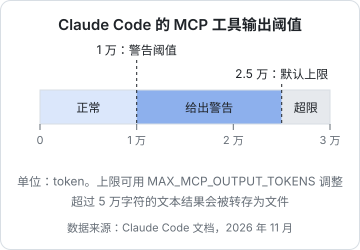

# 工具描述与参数设计

上一章说工具定义就是 prompt。这一章把这句话落到具体的字段上：名字怎么起、描述怎么写、参数怎么设计、返回值怎么组织。这些决定了模型能不能**选对**工具、**填对**参数、**读懂**结果，是工具设计里投入产出比最高的部分。

## 一个工具定义的组成

以 MCP 为例，一个工具定义包含这些字段（函数调用 API 的字段大同小异）：

| 字段 | 谁看 | 作用 |
|---|---|---|
| `name` | 模型、权限规则 | 唯一标识，模型输出调用时引用它 |
| `title` | 人 | 界面上显示的名字，可以是中文 |
| `description` | 模型 | 决定**要不要用、什么时候用** |
| `inputSchema` | 模型、SDK 校验 | JSON Schema，决定**怎么填参数** |
| `outputSchema` | 客户端、SDK 校验 | 可选，描述结构化返回值 |
| `annotations` | 宿主 | 行为提示：只读、破坏性、幂等、是否触达外部 |

注意 `title` 和 `annotations` 主要给宿主和人看，模型真正依赖的是 `name`、`description` 和 `inputSchema` 里每个参数的 `description`。

## 起名字

### 用动词开头，说清动作和对象

`list_books`、`read_chapter`、`check_book`、`push_book`。动词让模型一眼区分读和写：`get_` / `list_` / `search_` / `read_` 是读，`create_` / `update_` / `delete_` / `push_` / `send_` 是写。

避免含糊的名字：`books`（做什么？）、`handle_book`（处理什么？）、`book_tool`（等于没说）。

### 名字要能和别人的工具共存

宿主会把多个 server 的工具放进同一个列表。Claude Code 会把 MCP 工具命名成 `mcp__<server>__<tool>` 的形式，比如 `mcp__shelf-books__list_books`，所以不同 server 的同名工具不会冲突。但模型看到的是一长串工具，如果你的 server 叫 `shelf-books`、工具叫 `search`，另一个 server 也有 `search`，模型仍然可能混淆。工具名本身最好带上领域：`search_books` 比 `search` 好。

MCP 规范对工具名的建议：1–128 个字符，区分大小写，只用 ASCII 字母、数字、下划线、连字符和点。一个 server 内保持风格一致，`snake_case` 或 `camelCase` 选一种。

## 写描述

### 描述模板

一个好的工具描述回答五个问题。可以按这个顺序写：

```text
<一句话：做什么>。
<范围与行为：作用于什么、怎么匹配、默认值、上限>。
<返回什么>。
<何时不该用，应该用哪个工具代替>。
<限制或副作用：只读 / 会修改什么 / 耗时 / 需要先调用什么>。
```

对比两个版本：

```text
差：获取书籍信息。

好：列出 books/ 下所有能通过解析的书：id、书名、分类、难度、章节数。
可按分类前缀过滤（如 人工智能/Agent 会匹配 人工智能/Agent 及其子分类）。
只读元数据，不读正文；要读正文用 read_chapter，要查格式问题用 check_book。
```

好的版本让模型知道：它返回的是**元数据**，不包含正文；过滤是**前缀匹配**；相邻的两个工具各管什么。最后一点最重要，模型最常见的选择错误就发生在功能相近的工具之间。

### 写给「没有上下文的新人」

你脑子里有大量隐含知识，模型没有：

- **术语**：「书」指 `books/` 下有 `book.yaml` 的目录；「章节」指 `chapters` 列表里的文件，而不是目录里所有 `.md`
- **id 的来源**：`bookId` 从哪来？写明「来自 list_books」
- **格式**：日期是 `YYYY-MM-DD` 还是时间戳？文件名要不要带 `.md`？
- **前置条件**：要不要先调别的工具？

把这些写进描述，比事后在错误信息里纠正便宜得多。

### 不要写什么

- **营销语言**：「强大的」「智能的」「全面的」对模型毫无信息量
- **实现细节**：「使用 fs.readdir 递归遍历」，模型不需要知道
- **对模型下命令的长篇 prompt**：「你必须……永远不要……」。描述是说明书，不是 system prompt；过度强调会让模型在不该用的时候也去用
- **会变化的数字**：「目前有 18 本书」很快就过时，而且改描述会让宿主的 prompt 缓存失效

### 描述的长度

没有硬性上限，但每个字都会在每一轮占用上下文，工具数量多时成本累积很快。经验上，常用工具三到五句话足够；复杂工具可以更长，但优先把信息放进参数描述里，而不是堆在工具描述里。

## 设计参数

### 参数描述同样是 prompt

用 zod 定义 schema 时，`.describe()` 的内容会变成 JSON Schema 里参数的 `description`，这是模型理解这个参数的唯一依据：

```typescript
import * as z from 'zod/v4';

const inputSchema = z.object({
  bookId: z.string().describe('书的 id，来自 list_books，如 agent-principles'),
  file: z.string().describe('章节文件名，必须在 book.yaml 的 chapters 中，如 03-tools-and-actions.md'),
  offset: z.number().int().min(0).default(0).describe('从第几行开始（0 起），用于分页'),
});
```

SDK 会把它转成模型看到的 JSON Schema：

```json
{
  "$schema": "https://json-schema.org/draft/2020-12/schema",
  "type": "object",
  "properties": {
    "bookId": { "type": "string", "description": "书的 id，来自 list_books，如 agent-principles" },
    "file": { "type": "string", "description": "章节文件名，必须在 book.yaml 的 chapters 中，如 03-tools-and-actions.md" },
    "offset": { "type": "integer", "minimum": 0, "default": 0, "description": "从第几行开始（0 起），用于分页" }
  },
  "required": ["bookId", "file"]
}
```

### 让参数难以填错的几条规则

| 规则 | 反例 | 正例 |
|---|---|---|
| 有限取值用枚举 | `level: string` | `level: z.enum(['beginner', 'intermediate', 'advanced'])` |
| 能给默认值就给 | 要求必填 `limit` | `limit` 默认 20 |
| 用人能读懂的标识 | `bookUuid: "7f3a…"` | `bookId: "agent-principles"` |
| 名字带单位或格式 | `timeout` | `timeoutMs`、`since`（写明 `YYYY-MM-DD`） |
| 保持扁平 | `{ filter: { meta: { category } } }` | `{ category }` |
| 参数要少 | 十几个可选开关 | 三五个参数覆盖主要用法 |
| 不让模型传它不该决定的东西 | `booksDir: string` | 根目录由启动配置决定 |

最后一条值得展开。书库 server 的 `books/` 根目录路径是**部署配置**，应该从环境变量读，绝不能作为工具参数让模型传：一旦可以传，模型（或者诱导它的注入内容）就能让 server 读任意目录。同理，设备 IP、PIN、API key 都属于配置，不属于参数。

### 用 schema 约束，但不要只靠 schema

schema 能挡住类型错误、范围错误和漏填，SDK 会在你的处理函数运行之前就拒绝不合法的参数，并以工具错误的形式告诉模型哪里不对（第 3 章细讲）。

但 schema 挡不住语义错误：`bookId` 格式正确却不存在、`file` 格式正确却不在章节列表里、路径里藏着 `..`。这些必须在处理函数里校验。规则是：**schema 做形状检查，代码做语义和安全检查**。

### 用参数控制返回的详细程度

当一个工具有时需要简要结果、有时需要详细结果，与其拆成两个工具，不如加一个参数让模型选择：

```typescript
const inputSchema = z.object({
  query: z.string(),
  detail: z.enum(['brief', 'full']).default('brief')
    .describe('brief 只返回书名和 id；full 额外返回每本书的章节列表'),
});
```

默认给简要版，模型需要时再要详细的。这比默认返回大而全的结果省得多。

## 设计返回值

### 只返回模型下一步需要的

问自己：模型拿到这个结果后要做什么？`list_books` 的下一步通常是「选一本书去读或校验」，所以需要 id（用于后续调用）、书名（用于判断和回复用户）、分类、章节数。`book.yaml` 的 `created` 日期、标签数组对这一步没用，就不返回。

### 语义化，而不是原始

```text
差：{"id":"7f3a9c","s":2,"t":1730505600}
好：agent-principles  Agent 原理与设计  人工智能/Agent  10 章
```

模型拿不透明的 id 和数字状态码做不了判断，也没法在回复里引用。必须返回内部 id 时，把人能读懂的字段一起返回。

### 控制体积：截断、分页，并告诉模型

> [!WARNING]
> 下图的阈值按 2026 年 11 月 code.claude.com 的 MCP 文档整理：超过 1 万 token 给警告（阈值固定），默认上限 2.5 万 token，用 `MAX_MCP_OUTPUT_TOKENS` 环境变量调整；另外，没有声明 `anthropic/maxResultSizeChars` 的工具，纯文本结果超过 5 万字符会被存成文件而不是直接放进上下文。以 Claude Code 最新文档为准。

工具返回的内容会原样进入上下文。一个返回整本书全文的工具，一次就可能吃掉几万 token，挤掉之前的对话。宿主也会设上限：



所以大结果要主动截断或分页，并在结果里明确说明还剩多少、怎么继续：

```text
[agent-principles/03-tools-and-actions.md 共 135 行，本次 1-135 行，已到结尾]
```

```text
[llm-fundamentals/03-attention.md 共 412 行，本次 1-200 行，还有 212 行，用 offset=200 继续]
```

这行头部信息看似啰嗦，却让模型确切知道自己看到的是不是全部，以及下一次调用该填什么。没有它，模型可能把截断的内容当成完整内容来回答。

列表类的结果同理：设默认上限，结果被截断时说「共 57 条，显示前 20 条，可用 category 缩小范围」。

### content 与 structuredContent

MCP 的工具结果有两个通道：

| 通道 | 内容 | 主要消费者 |
|---|---|---|
| `content` | 文本、图片、音频、资源链接等内容块 | 模型阅读 |
| `structuredContent` | 符合 `outputSchema` 的 JSON 值 | 客户端代码、程序化处理 |

规范建议：返回 `structuredContent` 的工具，也在 `content` 里放一份文本，以兼容不处理结构化结果的客户端。两份不必一模一样：`content` 可以是面向模型的可读摘要，`structuredContent` 是完整的机器可读数据。

```typescript
const books = await listBooks();
return {
  content: [{ type: 'text', text: books.map((b) => `${b.id}\t${b.title}`).join('\n') }],
  structuredContent: { books },
};
```

声明了 `outputSchema` 后，SDK 会在结果离开 server 之前校验 `structuredContent`，客户端也可以据此校验。这相当于给返回值加上了类型检查。

### 返回格式：给模型读的文本怎么写

- 列表用一行一条、制表符或固定分隔符，比嵌套的 JSON 省 token，也更好读
- 层级不深的结构可以用 Markdown 小标题或缩进列表
- 需要模型精确引用的值（id、文件名）原样出现，不要加修饰
- 空结果也要说清楚：「没有分类以 "人工智能/RAG" 开头的书。现有分类：人工智能/Agent, 人工智能/大模型, 使用指南」，而不是返回空字符串

空结果那个例子顺便给了模型下一步的线索，这其实已经是错误设计的思路了，下一章展开。

## 工具注解（annotations）

MCP 允许给工具加行为提示，宿主可以据此决定是否需要用户确认：

| 注解 | 含义 | 书库 server 的取值 |
|---|---|---|
| `readOnlyHint` | 不修改任何状态 | `list_books`、`read_chapter`、`check_book` 为 true |
| `destructiveHint` | 可能做破坏性修改（仅在非只读时有意义） | `push_book` 覆盖手机上的同名书，为 true |
| `idempotentHint` | 相同参数重复调用没有额外效果 | `push_book` 推送同一版本结果相同，为 true |
| `openWorldHint` | 会触达外部世界（网络、第三方系统） | 读本地文件为 false；推送到手机为 true |

两点要记住。第一，注解只是**提示**，SDK 不会因为你写了 `readOnlyHint` 就阻止写操作。第二，规范明确要求客户端把注解视为**不可信**，除非来自可信的 server：恶意 server 完全可以把删库工具标成只读。所以注解帮宿主做更好的默认决策，但不能代替权限控制（第 6 章）。

## 本章要点

- 模型依赖的是 `name`、`description` 和每个参数的 `description`；`title`、`annotations` 主要给人和宿主
- 名字用动词开头、带领域，避免和其他 server 的工具混淆
- 描述回答五个问题：做什么、范围、返回什么、何时不用（用哪个代替）、限制与副作用
- 参数：有限取值用枚举、给默认值、用可读标识、保持扁平；**配置不是参数**，根目录、密钥绝不让模型传
- schema 做形状检查，代码做语义和安全检查
- 返回值只给下一步需要的、语义化、控制体积；截断时明确告诉模型还剩多少、怎么继续
- `content` 给模型读，`structuredContent` + `outputSchema` 给程序用；注解是不可信的提示
