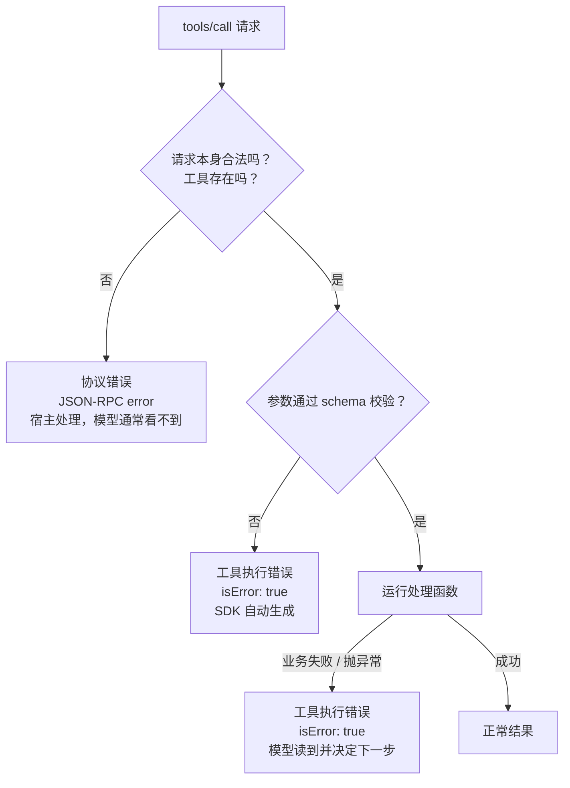

# 错误返回

工具一定会出错：参数填错、资源不存在、网络超时、权限不够、上游服务挂了。对程序员写的代码来说，错误是要抛给人去调试的异常；对 agent 来说，错误信息是**模型下一步决策的输入**。同样一次失败，错误写得好，模型下一轮就自己修正了；写得差，模型会原样重试、编一个答案糊弄过去，或者干脆放弃。

这一章讲错误的分类、MCP 里两种报错通道的区别、怎么写可行动的错误信息，以及重试和幂等。

## 错误是给谁看的

一次工具调用失败，可能的读者有三个：

| 读者 | 关心什么 | 例子 |
|---|---|---|
| 模型 | 我能不能换个参数、换个工具继续 | 「没有这一章，可用章节：01…、02…」 |
| 宿主程序 | 协议是否正常、要不要断开或重连 | JSON-RPC 错误码 `-32602` |
| 人（开发者 / 用户） | 出了什么事、要不要介入 | server 日志里的堆栈 |

设计错误返回，第一步是想清楚**这个错误该给谁**。模型能自己修正的，就让模型看到并且看懂；模型修不了、需要程序处理的，走协议错误；需要人排查的细节写进日志，而不是塞给模型。

## MCP 的两种报错通道

MCP 规范把工具相关的错误分成两类：



**协议错误**是标准的 JSON-RPC 错误响应，表示请求本身有问题：调用了不存在的工具、请求格式不符合规范、server 内部故障。

```json
{
  "jsonrpc": "2.0",
  "id": 3,
  "error": { "code": -32602, "message": "Unknown tool: list_book" }
}
```

**工具执行错误**是一个正常的结果，只是带了 `isError: true`。它表示「调用流程没问题，但这件事没做成」：参数语义不对、资源不存在、上游 API 失败、业务规则不允许。

```json
{
  "jsonrpc": "2.0",
  "id": 4,
  "result": {
    "resultType": "complete",
    "content": [
      { "type": "text", "text": "没有 id 为 \"agnet-principles\" 的书。先调用 list_books 查看可用的 id" }
    ],
    "isError": true
  }
}
```

规范对两者的态度很明确：客户端**应该**把工具执行错误交给模型，让它自我修正；协议错误**可以**交给模型，但模型从中恢复的可能性低。所以经验法则是：**凡是模型有可能修正的失败，都用 `isError: true` 返回，而不是抛协议错误。**

（上面的 `resultType` 字段是 2026-07-28 版规范新增的，所有结果都要带，SDK 会自动填写。第 4 章会讲。）

### TypeScript SDK 怎么处理

官方 TypeScript SDK 2.x 在工具处理函数这一侧做了很实用的约定：

| 情况 | SDK 的行为 | 模型看到 |
|---|---|---|
| 参数不符合 `inputSchema` | 处理函数不运行，自动返回 `isError: true` | `Input validation error: ... bookId: Invalid input: expected string, received undefined` |
| 处理函数返回 `{ isError: true, content }` | 原样返回 | 你写的错误文本 |
| 处理函数抛出异常 | 捕获并转成 `isError: true`，异常的 `message` 作为文本 | 异常消息 |
| 调用不存在的工具 | 协议错误 | 通常看不到 |

也就是说，工具处理函数里**抛异常也会变成工具错误**，不会搞垮 server。但这不意味着可以随便抛：异常消息常常是给程序员看的（`ENOENT: no such file or directory, open '/Users/…/books/x/book.yaml'`），既不可行动，还泄露了服务器路径。更好的做法是区分「可预期的业务错误」和「意外故障」：

```typescript
/** 可预期、模型能修正的输入错误 */
export class ToolInputError extends Error {}

function toolError(e: unknown) {
  if (e instanceof ToolInputError) {
    return { content: [{ type: 'text' as const, text: e.message }], isError: true };
  }
  throw e; // 意外故障：交给 SDK 兜底，同时应该写进 stderr 日志
}
```

资源（resources）和提示模板（prompts）的回调没有 `isError` 通道，因为它们由宿主或用户发起，而不是模型。那里的失败应该抛 `ProtocolError`（SDK 2.x 中替代了 v1 的 `McpError`），比如资源不存在用 `ResourceNotFoundError`，错误码是 `-32602`。

## 可行动的错误信息

### 一条好错误的三个部分

```text
<哪里错了>：<为什么>。<下一步可以怎么做>。
```

| 场景 | 差 | 好 |
|---|---|---|
| id 不存在 | `Not found` | `没有 id 为 "agnet-principles" 的书。先调用 list_books 查看可用的 id` |
| 文件不在章节列表 | `ENOENT` | `《Agent 原理与设计》没有章节 "99.md"。可用章节：01-what-is-agent.md, 02-agent-loop.md, …` |
| 格式非法 | `Invalid input` | `bookId 只能包含小写字母、数字和连字符，收到 "../etc"` |
| 范围过大 | `Too many results` | `匹配到 3200 行，超过上限 200。请加上 bookId 缩小范围` |
| 上游失败 | `fetch failed` | `连接手机失败：传书页面是否打开？确认后可以重试` |
| 权限不足 | `403` | `PIN 错误，已停止推送。请让用户在手机上确认 PIN 后重新配置，不要重试` |

好的错误信息有几个共同点：

- **引用模型传入的值**：模型能对照发现自己的拼写错误
- **给出候选项或下一个工具**：可用章节列表、`先调用 list_books`
- **说清能不能重试**：网络抖动可以重试；PIN 错误不要重试
- **用模型的语言**：说「章节」「书」，不说「ENOENT」「errno 2」

### 列出候选项要有分寸

把可用选项附在错误里非常有效，模型几乎总能在下一轮选对。但要控制数量：十几个章节可以全列；几千个用户名就不行了，应该改成「用 search_users 按名字搜索」。

### 别把内部信息交给模型

错误信息会进入模型上下文，有时还会被模型复述给用户。不要包含：

- 服务器上的绝对路径、主机名、内网地址
- 数据库连接串、SQL 原文、堆栈
- 密钥、令牌，哪怕是部分

这些写进 stderr 日志给开发者看。stdio 传输下尤其要注意：**stdout 是协议通道，日志只能写 stderr**，`console.log` 一行就会破坏 JSON-RPC 消息流。

## 不是错误的「失败」

有些情况不该用 `isError`：

- **空结果**：搜索没有匹配项是正常结果。返回「没有匹配的书，现有分类：……」，不标错误
- **部分成功**：批量推送 5 本成功 4 本。返回正常结果，逐条列出成功与失败，让模型决定是否只重试失败的那本
- **带警告的成功**：校验通过但有提示。`check_book` 返回 `ok: true` 并附上 warnings

`isError` 留给「这次调用的目的没有达成」。把空结果标成错误，会让模型以为是自己用错了工具，转而去尝试别的路径。

## 重试、幂等与超时

模型看到错误后常见的反应是重试。工具设计要让重试**安全**、**有意义**。

### 告诉模型能不能重试

错误分三类，在信息里写清楚：

| 类型 | 例子 | 给模型的提示 |
|---|---|---|
| 参数错误 | id 不存在、格式不对 | 改参数再试 |
| 暂时性故障 | 超时、上游 503、网络抖动 | 可以稍后重试 |
| 永久性拒绝 | 认证失败、权限不足、业务规则禁止 | 不要重试，告诉用户 |

hatch-shelf 的 `shelf-pack push` 有一个很好的现实例子：PIN 错误时立即停止整个推送，因为连续用错误 PIN 请求可能触发手机端传书服务的保护而被锁定。把它做成 MCP 工具时，PIN 错误必须写成「不要重试」，否则模型很可能好心地连试几次。

### 写操作要幂等

模型可能因为超时没收到结果而重试一个其实已经成功的写操作。如果工具不是幂等的，就会重复执行。几种做法：

- **天然幂等的语义**：「把这本书的当前版本推送到手机」，推两次结果一样；「给计数器加一」就不是
- **先比较再写**：`shelf-pack push --changed` 先比对手机上书的内容指纹，没变化就跳过
- **幂等键**：创建类操作接受一个客户端生成的 `requestId`，server 记住处理过的键

做到了幂等，就在注解里标上 `idempotentHint: true`，并在描述里写明「重复调用是安全的」。

### 设超时，并在超时信息里说清状态

工具执行必须有超时，否则一次挂起就卡住整个 agent loop。超时后的错误信息要说明**操作是否可能已经生效**：

```text
推送 agent-principles 超时。手机可能已经收到，
请让用户在手机上确认后再决定是否重试。
```

宿主一侧也有超时设置，比如 Claude Code 支持给单个 MCP server 配置 `timeout`（毫秒）。server 自己的超时应该比宿主的短，这样模型能收到你写的可读错误，而不是宿主的通用超时提示。

## 错误信息也要测试

错误路径和正常路径一样需要测试，而且更容易被忽略。第 5 章的测试里会专门断言：

- 非法 `bookId` 返回 `isError: true`，文本里引用了传入的值
- 不存在的章节返回可用章节列表
- 缺少必填参数时，SDK 生成的校验错误能到达模型

然后在真实 agent 里故意制造错误（比如让它读一本不存在的书），看它下一轮能不能自己恢复。这是检验错误信息质量最直接的办法。

## 本章要点

- 错误信息是模型下一步决策的输入；先想清楚每个错误该给模型、宿主还是人
- MCP 两种通道：**协议错误**（JSON-RPC error，宿主处理）和**工具执行错误**（`isError: true`，交给模型）；模型可能修正的失败都用后者
- SDK 2.x 中参数校验失败和处理函数抛出的异常都会变成 `isError` 结果；资源和提示模板的失败抛 `ProtocolError`
- 好的错误 = 哪里错 + 为什么 + 下一步；引用传入的值、给候选项、说清能否重试
- 不要把路径、堆栈、密钥放进错误；stdio 下日志只写 stderr
- 空结果、部分成功、带警告的成功不是错误
- 写操作要幂等，执行要有超时，超时信息要说明操作是否可能已生效

## 动手练习

1. **把四条报错改成可行动的**：按「哪里错 + 为什么 + 下一步」改写：A. `Error: ENOENT: no such file or directory, open '/srv/books/agnet-principles/book.yaml'`；B. `Invalid date`（模型传了 `since: "上周"`）；C. `429 Too Many Requests`；D. `Forbidden`（PIN 错误）。

   验证：每条改写都引用了模型传入的值（或说明了收到什么）、给出了下一步，并明确能否重试；A 的改写里不再出现服务器绝对路径。

   参考答案：A「没有 id 为 "agnet-principles" 的书，先调用 list_books 查看可用的 id」；B「since 要求 YYYY-MM-DD 格式，收到 "上周"，请换算成具体日期」；C「请求过于频繁，等 30 秒后可以重试」（等待时间以上游返回为准）；D「PIN 错误，已停止，不要重试，请让用户在手机上确认 PIN」。

2. **哪些该标 isError**：判断下面五种结果要不要 `isError: true`，以及给模型的文本里该写什么：① 搜索「RAG」没有匹配；② 批量推送 5 本成功 4 本；③ `check_book` 通过但有 2 条提示；④ 推送超时；⑤ 参数 `limit` 传了 `-1`。

   验证：只有 ④ 和 ⑤ 标 `isError`；①、②、③ 都是正常结果，但文本分别给出了现有分类、逐条的成败、警告内容。

   参考答案：`isError` 只表示「这次调用的目的没达成」。④ 的文本要说明手机可能已经收到；⑤ 在 schema 里加 `.min(1)` 就会由 SDK 自动生成错误，不用进处理函数。

3. **用幂等键挡住重复执行**：写一个 `createOrder(requestId, item)`，同一个 `requestId` 第二次调用时返回第一次的结果而不新建记录。连续用同一个 `requestId` 调用两次，再用新的 `requestId` 调用一次。

   验证：订单总数是 2，前两次调用返回的订单号相同。

   参考答案：真实服务里 `done` 要放在数据库里（带唯一约束），并设过期时间；内存版只用来看清语义。

   ```ts
   const done = new Map<string, { orderId: string }>();
   let seq = 0;
   function createOrder(requestId: string, item: string) {
     const hit = done.get(requestId);
     if (hit) return hit;                    // 重试：原样返回上次的结果
     const r = { orderId: `o${++seq}` };     // 这里才真正写入
     done.set(requestId, r);
     return r;
   }
   ```
