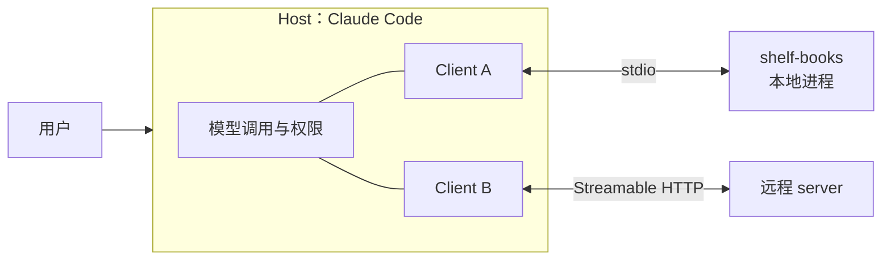
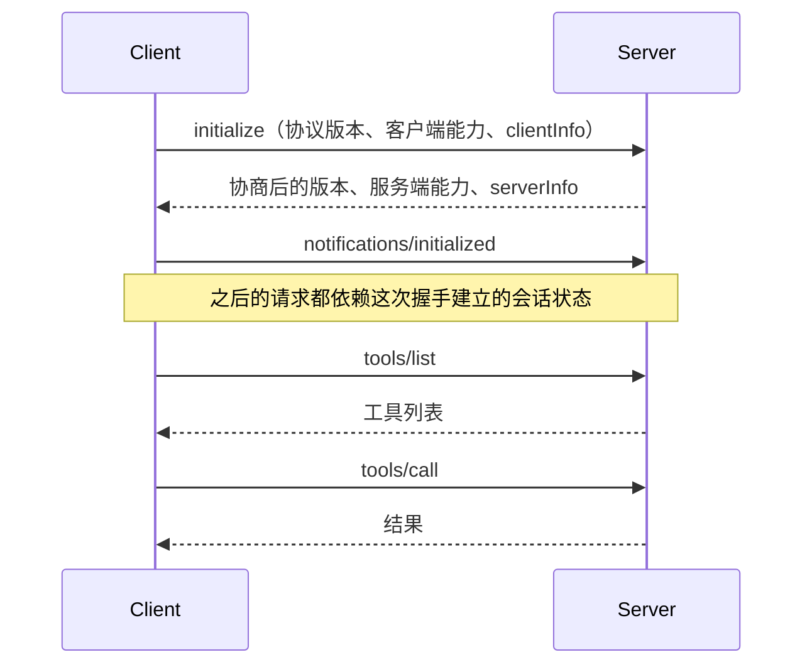
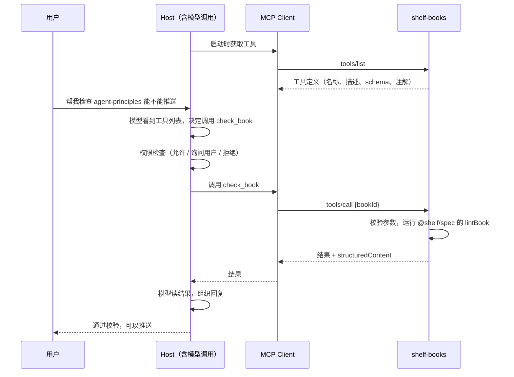

# MCP 协议

前三章讲的设计方法对任何形式的工具都适用。从这一章开始进入 MCP（Model Context Protocol）：怎么把工具做成一个独立的服务，让 Claude Code、桌面客户端、IDE 里的各种 agent 都能接入。

[《Agent 原理与设计》第 8 章](../agent-principles/08-mcp-and-skills.md)已经讲了 MCP 解决什么问题（M×N 变 M+N）和三种原语的定位。这一章深入协议本身：消息长什么样、一次调用经过哪些步骤、两种传输方式的差别，以及 2026-07-28 这一版规范带来的重大变化：**MCP 变成了无状态协议**。理解这些，第 5 章写 server、第 6 章做认证时才知道 SDK 在背后替你做了什么。

## 架构回顾

| 角色 | 是什么 | 例子 |
|---|---|---|
| Host（宿主） | 用户直接使用的 AI 应用，负责调用模型、管理权限和界面 | Claude Code、VS Code、桌面聊天客户端 |
| Client（客户端） | 宿主内部的连接器，每个 client 对接一个 server | Claude Code 为 `.mcp.json` 里每个 server 建一个 |
| Server（服务端） | 暴露能力的程序 | 本书的 `shelf-books` |



一个关键点：**模型从不直接和 server 说话**。模型只看到宿主转交的工具列表，输出「想调用什么」；宿主检查权限后，由 client 向 server 发请求，再把结果交还模型。这意味着权限、确认、审计都发生在宿主这一层（第 6 章）。

MCP 的设计参考了 LSP（Language Server Protocol）：LSP 让任何编辑器都能接入任何语言的补全和跳转，MCP 让任何 AI 应用都能接入任何外部能力。

## 三种服务端原语

| 原语 | 由谁控制 | 典型交互 | 书库 server 里的例子 |
|---|---|---|---|
| Tools | 模型 | 模型根据对话自动决定调用 | `list_books`、`read_chapter`、`check_book` |
| Resources | 应用 / 用户 | 用户在界面里选择附加，或宿主自动附加 | `shelf://books/{bookId}/book.yaml` |
| Prompts | 用户 | 以斜杠命令或菜单项出现 | `review-book`：审读一本书的工作流 |

区分「由谁控制」很重要。Tools 是模型主动调用的，所以要考虑模型会不会误用；Resources 是被动的数据，由人决定读不读；Prompts 是人主动触发的模板。同一份数据，比如一个章节的正文，既可以做成工具（模型自己决定去读），也可以做成资源（用户在 Claude Code 里用 `@` 引用后附加进上下文）。

客户端也可以向 server 提供能力。2026-07-28 版规范中，核心的客户端能力是 **Elicitation**：server 在执行过程中向用户索要额外信息（比如确认、补充一个参数）。早期版本里的 Roots（告诉 server 可以访问哪些目录）、Sampling（server 借用客户端的模型做生成）和 Logging 在这一版被标记为**弃用**，规范建议的替代方案分别是：通过工具参数或配置传目录、直接对接模型 API、日志写 stderr 或用 OpenTelemetry。新写的 server 不要再依赖它们。

## 消息格式：JSON-RPC 2.0

MCP 的所有消息都是 JSON-RPC 2.0，分三种：

| 类型 | 有 `id` | 需要回复 | 例子 |
|---|---|---|---|
| 请求 | 有 | 是 | `tools/list`、`tools/call`、`resources/read` |
| 响应 | 有（与请求相同） | 否 | `result` 或 `error` 二选一 |
| 通知 | 无 | 否 | `notifications/tools/list_changed`、`notifications/progress` |

MCP 在 JSON-RPC 之上加了两条约束：请求的 `id` 不能是 `null`，同一发送方未完成的请求 `id` 不能重复。

## 2026-07-28：MCP 变成无状态协议

这一版是 MCP 发布以来变化最大的一次。理解它需要先看旧版本怎么工作。

### 旧版：先握手，再对话

2025-11-25 及更早的版本（规范称为 legacy 版本）要求每个连接先做一次初始化握手：



在 HTTP 上，握手之后 server 会发一个 `Mcp-Session-Id`，客户端之后每个请求都带上它。这个设计在本地 stdio 下没什么问题，但对远程部署很不友好：server 要记住每个会话，多实例部署需要会话亲和或共享存储，负载均衡器得理解 MCP 会话。

### 新版：每个请求自带上下文

2026-07-28 版去掉了 `initialize` 握手和协议层的会话。每个请求在 `_meta` 里自带协议版本和客户端能力：

```json
{
  "jsonrpc": "2.0",
  "id": 2,
  "method": "tools/call",
  "params": {
    "name": "check_book",
    "arguments": { "bookId": "agent-principles" },
    "_meta": {
      "io.modelcontextprotocol/protocolVersion": "2026-07-28",
      "io.modelcontextprotocol/clientCapabilities": {},
      "io.modelcontextprotocol/clientInfo": { "name": "claude-code", "version": "x.y.z" }
    }
  }
}
```

其中 `protocolVersion` 和 `clientCapabilities` 是必填的，缺了 server 必须返回 `-32602`（HTTP 下是 400）；`clientInfo` 建议每次都带。server 在结果的 `_meta` 里报上自己的身份。下面是本书的书库 server（用 SDK 2.4.0 运行）对一个不存在的书 id 的真实响应：

```json
{
  "jsonrpc": "2.0",
  "id": 2,
  "result": {
    "content": [{ "type": "text", "text": "没有 id 为 \"nope\" 的书。先调用 list_books 查看可用的 id" }],
    "isError": true,
    "resultType": "complete",
    "_meta": { "io.modelcontextprotocol/serverInfo": { "name": "shelf-books", "version": "0.1.0" } }
  }
}
```

注意新增的 `resultType` 字段：所有结果都必须带。`"complete"` 表示普通结果；`"input_required"` 表示 server 需要更多输入才能完成（见下文的多轮请求）。

想事先知道 server 支持哪些版本和能力，可以调用新增的 `server/discover`。server 必须实现它：

```json
{
  "result": {
    "supportedVersions": ["2026-07-28"],
    "capabilities": {
      "tools": { "listChanged": true },
      "resources": { "listChanged": true },
      "prompts": { "listChanged": true }
    },
    "resultType": "complete",
    "ttlMs": 0,
    "cacheScope": "private",
    "_meta": { "io.modelcontextprotocol/serverInfo": { "name": "shelf-books", "version": "0.1.0" } }
  },
  "jsonrpc": "2.0",
  "id": 1
}
```

如果请求的版本 server 不支持，它返回 `UnsupportedProtocolVersionError`（错误码 `-32022`），并在 `data.supported` 里列出支持的版本，客户端换一个版本重试。

### 无状态对工具设计意味着什么

规范说得很直接：server **不能**依赖同一连接上之前的请求来建立上下文；一个打开的 stdio 进程也**不是**一个会话，客户端可能在同一条连接上穿插不相关的请求。

所以如果你的工具需要跨调用的状态，比如一个打开的浏览器页面、一个数据库事务、一个购物车，就必须用**显式句柄**：一个创建工具返回 id，后续工具把这个 id 当作普通参数接收。

```text
create_draft({ bookId })          → { draftId: "drf_8f2c…" }
append_section({ draftId, text }) → 追加内容
publish_draft({ draftId })        → 写入 books/
```

规范对句柄给了几条建议：认证过的 server 每次调用都要校验调用者对该句柄的权限（句柄只是名字，不是凭证）；未认证的 server 用足够随机的值（比如 UUIDv4）并设有效期；句柄保持不透明，不要编码内部结构；过期规则写进创建工具的描述里；对过期或未知的句柄返回可行动的工具错误，让模型能重新创建。

这其实和第 1 章的「行为确定」一脉相承：工具的结果只取决于参数，不取决于隐藏的连接状态。

### 新旧版本怎么共存

| 客户端 \ 服务端 | 仅新版 | 新旧都支持 | 仅旧版 |
|---|---|---|---|
| 仅新版 | 正常 | 正常 | 失败 |
| 新旧都支持 | 正常 | 正常 | 正常（探测后回落到 `initialize`） |
| 仅旧版 | 失败 | 正常 | 正常 |

结论是：**写 server 时同时支持新旧两代**最稳妥，因为你无法控制用户的客户端升级到了哪一版。官方 TypeScript SDK 2.x 的 `serveStdio` 和 `createMcpHandler` 默认就是双代兼容的：收到 `initialize` 走旧版语义，收到带 `_meta` 的请求走新版语义。本书的书库 server 用旧版 `initialize` 连接时，SDK 协商出的版本是 `2025-11-25`；用新版请求时则按 `2026-07-28` 处理。你写的工具代码完全不用区分。

### 这一版的其他变化

| 变化 | 内容 |
|---|---|
| 多轮请求（MRTR） | server 不再主动向客户端发请求，而是返回 `resultType: "input_required"` 和需要的输入（如 elicitation）；客户端带上 `inputResponses` 重试原请求 |
| 订阅 | 去掉 HTTP 的 GET 通道和 `resources/subscribe`，统一用 `subscriptions/listen` 打开一条长连接接收变更通知 |
| 删除 | `ping`、`logging/setLevel`、SSE 断点续传 |
| 缓存提示 | `tools/list` 等列表结果必须带 `ttlMs` 和 `cacheScope`，客户端据此缓存 |
| 确定顺序 | `tools/list` 应按确定顺序返回，方便缓存和提高 prompt cache 命中率 |
| JSON Schema | `inputSchema` / `outputSchema` 默认 2020-12 方言，可用任何关键字；不得自动解引用网络上的 `$ref` |
| Tasks | 长时间运行的异步任务移出核心协议，成为官方扩展 |
| 扩展机制 | 能力里新增 `extensions` 字段，Tasks、MCP Apps（在对话里渲染交互界面）等以扩展形式提供 |

协议还在快速演进。实际开发时以官方规范的 changelog 为准，并依赖 SDK 处理这些细节。

## 一次工具调用的完整过程

把上面的内容串起来，看 Claude Code 通过书库 server 校验一本书时发生了什么：



## 传输方式

协议消息需要一个载体。MCP 定义了两种标准传输：

| | stdio | Streamable HTTP |
|---|---|---|
| 形态 | 宿主把 server 作为子进程启动，用 stdin / stdout 通信 | server 是一个独立的 HTTP 服务，宿主发 POST 请求 |
| 适合 | 本地工具：读本地文件、调本地命令 | 远程服务、多用户、SaaS |
| 生命周期 | 由宿主管理，宿主退出进程就结束 | 独立部署，长期运行 |
| 认证 | 不走 OAuth，凭证从环境变量读取 | 规范定义了基于 OAuth 2.1 的授权 |
| 典型配置 | `command` + `args` + `env` | `url` + 认证 |

### stdio

消息以换行分隔，每行一个 JSON-RPC 消息，消息内部不能有换行。server 从 stdin 读请求，往 stdout 写响应。由此得出写 stdio server 最重要的一条规则：

> **stdout 只能写协议消息。日志、调试输出、启动提示一律写 stderr。**

一行 `console.log('server started')` 就会让宿主读到一行不是 JSON-RPC 的内容，导致连接失败。SDK 文档专门强调了这一点，这也是新手写 MCP server 最常踩的坑。

### Streamable HTTP

server 暴露一个 HTTP 端点（通常是 `/mcp`），客户端用 POST 发送每个请求。server 可以直接返回一个 JSON 响应，也可以把响应升级成 SSE 流，在最终结果之前先推送进度等通知。2026-07-28 版去掉了会话之后，每个请求独立处理，server 可以像普通无状态 Web 服务一样横向扩展，部署到 Cloudflare Workers 这类平台也很自然。

这一版还要求 HTTP 请求带上标准头 `Mcp-Method`、`Mcp-Name`（以及 `MCP-Protocol-Version`），让负载均衡器、网关不解析请求体也能按方法路由和限流。工具的参数还可以用 `x-mcp-header` 标注，把某个参数值镜像到 `Mcp-Param-*` 请求头上。注意不要给密码、令牌这类敏感参数加这个标注，因为请求头对中间设备可见。

旧的 HTTP+SSE 传输（2024 年的最初设计）已经弃用，新项目不要使用。

## 工具相关的消息

最后看一下与工具直接相关的几个方法，第 5 章写代码时会对应上：

| 方法 / 通知 | 方向 | 作用 |
|---|---|---|
| `tools/list` | 客户端 → 服务端 | 获取工具列表，支持分页，结果带缓存提示 |
| `tools/call` | 客户端 → 服务端 | 调用工具，`params` 含 `name` 和 `arguments` |
| `notifications/tools/list_changed` | 服务端 → 客户端 | 工具列表变了，客户端应重新获取 |
| `resources/list` / `resources/templates/list` / `resources/read` | 客户端 → 服务端 | 列出和读取资源 |
| `prompts/list` / `prompts/get` | 客户端 → 服务端 | 列出和获取提示模板 |

规范还规定 `tools/list` 返回的工具集合**不能因连接而异**，但可以因请求所带的授权而异，比如只返回调用者权限范围内的工具。这条规则在第 6 章讲权限时会用到。

## 本章要点

- Host 负责模型调用和权限，Client 是连接器，Server 暴露能力；模型从不直接和 server 通信
- 三种服务端原语：Tools（模型控制）、Resources（应用控制）、Prompts（用户控制）；Roots、Sampling、Logging 在 2026-07-28 版已弃用
- 消息格式是 JSON-RPC 2.0：请求、响应、通知
- 2026-07-28 版去掉了 `initialize` 握手和会话：每个请求在 `_meta` 里自带版本和能力，所有结果带 `resultType`，新增 `server/discover`
- 无状态意味着跨调用的状态要用显式句柄作为工具参数传递
- 新旧两代通过探测共存；SDK 2.x 的 server 默认双代兼容
- 传输：stdio 用于本地子进程，**stdout 只写协议消息**；Streamable HTTP 用于远程服务，现在可以无状态横向扩展
