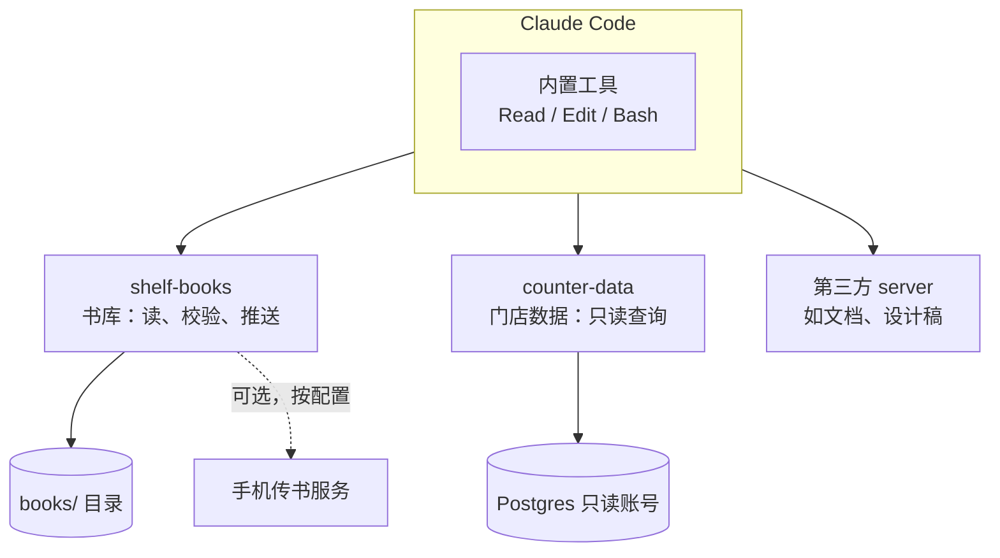

# 工具集的组织

前六章关注的是单个工具和单个 server。真实使用时，agent 面对的是一整套工具：宿主内置的读写文件、shell，你自己写的几个 MCP server，再加上从社区装的若干个。工具一多，新问题就出现了：上下文被工具定义占满，模型在几十个相似的工具里选错，改一个描述导致缓存失效，一个 server 升级后旧的调用全部报错。

这一章讲工具多了以后怎么组织：怎么分组、怎么控制数量、怎么按需加载、怎么在 MCP、命令行和 Skills 之间分工，以及工具怎么演进而不破坏使用者。

## 工具多了会发生什么

### 上下文开销

每个工具的完整定义（名字、描述、参数 schema、输出 schema）在每一轮都会发给模型。以本书的书库 server 为例，用 SDK 2.4.0 实测 `tools/list` 返回的 JSON 大小：

| 工具 | 描述（字节） | 输入 schema（字节） | 输出 schema（字节） | 定义总计（字节） |
|---|---|---|---|---|
| `list_books` | 270 | 190 | 460 | 1079 |
| `read_chapter` | 245 | 403 | 0 | 784 |
| `check_book` | 280 | 184 | 286 | 903 |
| `push_book` | 342 | 184 | 0 | 707 |

四个工具加起来约 3.5 KB（中文描述按 UTF-8 计，每个汉字 3 字节）。单看不多，但一个功能丰富的第三方 server 动辄几十个工具，接上五六个 server，工具定义就可能占掉可观的上下文，而且是**每一轮**都占。

### 选择准确率

工具越多，功能相近的工具越多，模型选错的概率越高。比如同时接了 GitHub 的 MCP server 和能跑 `gh` 命令的 shell，「列出 PR」就有两条路径；接了两个都有 `search` 工具的 server，模型就得靠描述区分。

### 缓存与稳定性

宿主通常会对系统提示和工具定义做 prompt 缓存。工具列表的顺序变了、某个描述改了一个字，缓存前缀就失效了。这也是 2026-07-28 版规范建议 `tools/list` 按确定顺序返回、并要求列表结果带缓存提示（`ttlMs`、`cacheScope`）的原因。

## 原则一：少而精

控制工具数量最直接的办法是**合并**。

### 用参数代替工具

```text
差：list_ai_books、list_tech_books、list_guide_books
好：list_books(category)

差：get_book_brief、get_book_full
好：get_book(bookId, detail: "brief" | "full")
```

判断标准：如果几个工具的描述只差一个名词，它们应该是一个工具加一个参数。

### 按任务合并多步操作

第 1 章讲过：`list_dir` + `read_file` + `parse_yaml` 合成一个 `list_books`。再比如 `push_book` 内部做了「校验 → 打包 → 比对指纹 → 上传」四步，模型只需要一次调用。合并的前提是这几步**总是一起发生**，并且中间结果模型用不上。

### 删掉没人用的工具

读 agent 的使用记录（第 1 章），某个工具几十次会话里从来没被调用过，要么是描述没写清楚，要么是真的用不上。用不上的就删掉，它每一轮都在白白占用上下文。

## 原则二：按领域分 server

一个 server 对应一个**领域**（一个系统、一类数据），而不是一个技术层，也不是「我写的所有工具」：



按领域分的好处：

- **权限边界清晰**：每个 server 只持有自己领域的凭证。`counter-data` 用一个只读的数据库账号，即使被诱导也写不了数据
- **可以按项目启用**：在 hatch-shelf 仓库里只启用 `shelf-books`，在 hatch-counter 仓库里只启用 `counter-data`，用项目级的 `.mcp.json` 管理
- **命名天然带前缀**：Claude Code 里是 `mcp__shelf-books__*`、`mcp__counter-data__*`，权限规则也能按 server 写

### 读写要不要拆成两个 server

一种做法是把只读工具和写工具拆成两个 server（比如 `shelf-books` 和 `shelf-push`），只读的随处启用，写的只在需要时启用。第 6 章用的是另一种做法：同一个 server，写工具只在配置了凭证时注册。两种都可以，关键是**默认状态下写能力不出现**。

## 原则三：按需加载

工具数量控制不住时（比如必须接很多第三方 server），就要靠按需加载：平时只让模型看到工具的名字和一句话简介，需要时再加载完整定义。

这和[《Agent 原理与设计》第 8 章](../agent-principles/08-mcp-and-skills.md)讲的 Skills 渐进式披露是同一个思路。Claude Code 对 MCP 工具默认启用了**工具搜索**：MCP 工具的完整定义不会一次性全部放进上下文，模型先搜索、再加载需要的工具（按 2026 年 11 月的 Claude Code MCP 文档，工具搜索默认开启，可以用 `ENABLE_TOOL_SEARCH=false` 关闭；具体行为以官方文档为准）。

按需加载对 server 作者提出了新要求：**模型要能搜到你的工具**。这意味着：

- 工具名要能望文生义：`check_book` 比 `cb` 或 `run_lint` 更容易被「校验书」这样的搜索命中
- 描述的第一句最重要，因为它最可能出现在简介里，要直接说清「做什么」
- 领域词要出现在名字或描述开头：书、章节、推送

### 另一种按需：让模型写代码调用工具

当工具非常多、或者一个任务要调用很多次工具时，还有一种思路：把工具当作代码里的 API，让模型写一段脚本在沙箱里执行，脚本内部调用工具、处理中间结果，只把最终结果交回上下文。比如「统计每个分类下的书和总章节数」，模型写一段循环调用 `list_books` 的代码，而不是在对话里一轮一轮地调。代价是需要可靠的代码执行沙箱，[《Agent 原理与设计》第 3 章](../agent-principles/03-tools-and-actions.md)「代码即行动」讲过这一点。

## MCP、命令行和 Skills 怎么分工

给 agent 扩展能力有好几种方式。在编码 agent 的场景下，它们的分工大致如下：

| 方式 | 本质 | 适合 | 书库的例子 |
|---|---|---|---|
| 命令行（经由 shell） | 模型直接跑现成的命令 | 已有成熟 CLI、agent 有 shell 权限 | `pnpm shelf-pack check books/<id>` |
| MCP server | 标准化的工具服务 | 没有 shell 的宿主；需要细粒度权限、结构化输出；要给多个 agent 共用 | `shelf-books` 的四个工具 |
| Skill | 打包的做事方法和脚本 | 多步流程、需要领域知识的任务 | 「写一本新书」：按 `books/AGENTS.md` 的规范起草、配图、自检 |
| 项目记忆（CLAUDE.md） | 每次都加载的约定 | 每次都要知道的规则 | 「改了 reader-web 要重新 build:assets」 |

几个判断：

- **已经有 CLI 且 agent 能跑 shell 时，先用 CLI**。模型对常见命令很熟悉，零开发成本。hatch-shelf 仓库里，Claude Code 校验书直接跑 `shelf-pack check` 就够了
- **需要跨宿主、跨设备复用时，做成 MCP**。同一个 `shelf-books` 可以给 Claude Code、桌面客户端、自己写的 agent 用
- **需要「方法」而不只是「能力」时，写 Skill**。Skill 可以调用 MCP 工具或 CLI，告诉模型按什么顺序、遵守什么规范来用它们
- **MCP 和 Skill 可以组合**：MCP 提供 `check_book`、`push_book`，Skill 描述「改完书后先 check、通过了再 push、push 前告诉用户」的流程

MCP 生态里也有把 Skills 通过 MCP 分发的官方扩展 Skills over MCP（写作时处于 Beta，见[第 4 章](04-mcp-protocol.md#扩展与-mcp-apps)），两者的边界会继续变化。

## 原则四：给不同角色不同的工具集

在多 agent 或子 agent 的场景下，不同角色应该拿到不同的工具：

| 角色 | 工具集 | 理由 |
|---|---|---|
| 审读书稿的子 agent | `list_books`、`read_chapter`、`check_book` | 只需要读，给写工具只会增加风险 |
| 写书的主 agent | 内置文件编辑 + `check_book` | 写文件用宿主的编辑工具，校验用 MCP |
| 发布流程 | `check_book`、`push_book` | 只做校验和推送 |

最小工具集既降低风险，也提高选择准确率，还节省上下文。Claude Code 的子 agent 可以在定义里限定可用工具，具体做法见[《编码 Agent 实战》](../coding-agents/)；编排模式本身在[《多 Agent 编排》](../multi-agent/)里展开。

## 工具的演进

工具一旦被使用，就有了「用户」：模型的使用习惯、宿主的权限规则、其他人写的 Skill 和脚本。改动时要像改公开 API 一样小心。

### 什么算破坏性变更

| 变更 | 是否破坏 | 影响 |
|---|---|---|
| 新增可选参数 | 否 | 旧调用照常工作 |
| 新增工具 | 否，但要注意 | 会被宽泛的 allow 规则自动放行（第 6 章） |
| 改描述措辞 | 不破坏调用，但有成本 | 宿主缓存失效；模型行为可能变化，要重新评测 |
| 新增必填参数 | 是 | 旧的调用方式失败 |
| 改参数名或类型 | 是 | 同上 |
| 改工具名 | 是 | 权限规则、Skill 里的引用全部失效 |
| 改返回结构 | 视情况 | `outputSchema` 的使用者会受影响 |
| 删除工具 | 是 | 依赖它的流程失败 |

### 平滑演进的做法

- **加参数时给默认值**，让旧调用的行为不变
- **改名时保留旧名一段时间**：旧工具的描述写「已弃用，请用 X」，调用时返回结果的同时提示新名字；或者干脆返回一个可行动的错误「此工具已更名为 X」
- **工具列表变化时发通知**：声明了 `listChanged` 能力的 server 在工具增删时发 `notifications/tools/list_changed`，客户端会重新获取
- **server 版本号遵循语义化版本**：`McpServer` 构造时的 `version` 会出现在 `serverInfo` 里，便于排查「用户装的是哪个版本」
- **改描述后重新跑评测**：第 1 章的评测任务这时就派上用场了

## 工具设计检查清单

把全书的要点汇总成一张清单，新写或评审一个工具时逐条过一遍：

| 方面 | 检查项 |
|---|---|
| 必要性 | 这个能力用现成 CLI 能否完成？真的需要通过 agent 做吗？ |
| 粒度 | 对应一个用户任务，而不是一个底层接口？能和别的工具合并吗？ |
| 命名 | 动词开头、带领域词、和其他 server 的工具不易混淆？ |
| 描述 | 说清做什么、范围、返回、何时不用、限制和副作用？第一句能独立说明用途？ |
| 参数 | 枚举、默认值、可读标识、扁平、数量少？配置和凭证没有出现在参数里？ |
| 校验 | schema 做形状检查，代码做语义和安全检查？路径用 `realpath` 校验？ |
| 返回 | 只给下一步需要的？语义化？大结果有截断和分页提示？ |
| 错误 | 可预期的错误用 `isError` 返回？信息含「哪里错 + 为什么 + 下一步」？说清能否重试？不泄露内部信息？ |
| 副作用 | 注解如实？写操作幂等？有超时？写工具默认不出现？ |
| 权限 | 宿主侧只读工具 allow、写工具 ask？凭证最小范围、来自环境变量？远程 server 有认证并校验 Host？ |
| 测试 | 正常路径和错误路径都有测试？在真实宿主里看过模型怎么用？ |
| 演进 | 变更是否破坏兼容？列表顺序固定？改描述后重新评测？ |

## 本章要点

- 工具多了会占上下文、降低选择准确率、影响缓存；工具定义每一轮都在消耗
- 少而精：用参数代替相似工具，按任务合并多步操作，删掉没人用的工具
- 按领域分 server，每个 server 只持有自己领域的凭证，按项目启用
- 工具多到控制不住时按需加载；工具名和描述第一句要能被搜到
- 已有 CLI 且有 shell 时先用 CLI；跨宿主复用做成 MCP；需要方法时写 Skill；三者可以组合
- 不同角色拿最小工具集
- 工具演进像公开 API：加参数给默认值，改名保留过渡期，改描述后重新评测

## 接下来读什么

这本书讲的是 agent「手」的设计。按书架导读的 AI 纵深路线，接下来可以读[《RAG 与知识系统》](../rag-systems/)，把书库从「按 id 读章节」升级到「按语义检索内容」，它本身就很适合做成一个 MCP 工具；然后读[《评测与质量》](../llm-evals/)，把第 1 章「读记录、改描述、再跑一遍」变成系统化的评测流程。

如果想继续深入 agent 方向：《多 Agent 编排》讲如何给不同角色分配工具和上下文，[《动手构建 Agent》](../build-your-agent/)会从零写一个 agent loop 并接入本书的 MCP server，[《Agent 安全》](../agent-safety/)系统地讲提示注入、沙箱和权限边界。
