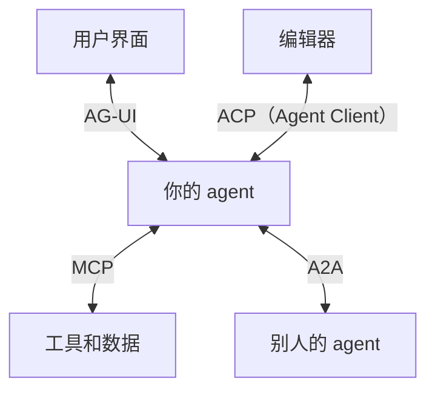
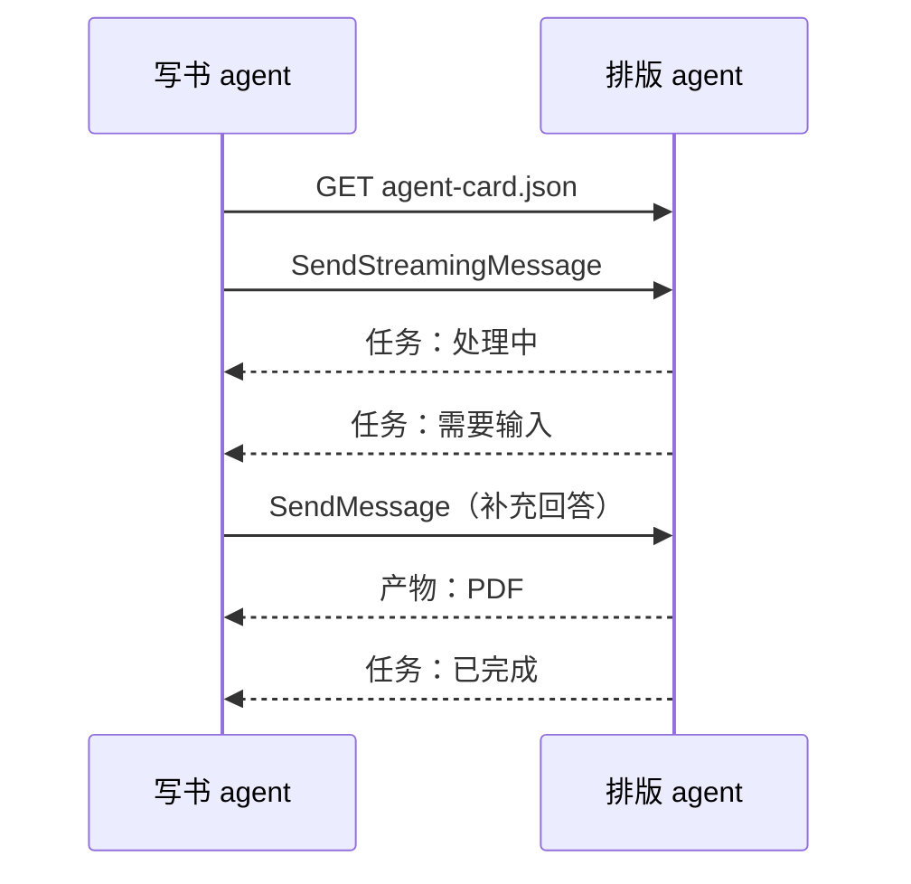

# Agent 互操作协议

前七章只看了 agent 系统里的一条边：**agent 和工具之间**，MCP 管的就是这一条。真实系统里还有别的边：一个 agent 把活儿委托给另一家公司的 agent；网页前端要实时显示 agent 正在想什么、调了哪个工具；编辑器想接入任意一个编码 agent。这几条边上各自长出了协议，名字又很像：A2A、ACP、AG-UI、A2UI、MCP Apps。

这一章不教怎么实现它们，只回答三个问题：**每个协议连接的是哪两方、解决什么问题、现在是什么状态**，以及做自己的项目时什么时候该用哪个。

> [!WARNING]
> 本章各协议的版本、治理归属和采用情况按 2026 年 11 月各协议官方规范与仓库（a2a-protocol.org、github.com/a2aproject/A2A、agentclientprotocol.com、docs.ag-ui.com、github.com/google/A2UI、modelcontextprotocol.io）以及 Linux Foundation、Agentic AI Foundation 的公告整理。这一领域合并、改名都很快，动手前以各协议官方最新文档为准。

## 先把地图画出来

把一个 agent 产品拆开，能找到四条需要「说同一种话」的边：



| 协议 | 连接的两方 | 发起方 | 治理（2026-11） | 状态 |
|---|---|---|---|---|
| MCP | agent ↔ 工具、数据 | Anthropic | Agentic AI Foundation（Linux Foundation 旗下） | 2026-07-28 版规范，见[第 4 章](04-mcp-protocol.md) |
| A2A | agent ↔ agent | Google | 2025 年捐给 Linux Foundation，2026-08-17 成为 AAIF 托管项目 | 2026-03-12 发布 1.0.0，5 月发布 1.0.1 |
| ACP（Agent Communication Protocol） | agent ↔ agent | IBM（BeeAI） | 2025 年 8 月并入 A2A | 已停止独立演进，官方指向 A2A 迁移指南 |
| ACP（Agent Client Protocol） | 编辑器 ↔ 编码 agent | Zed | Zed 与 JetBrains 共同推进 | 开源（Apache 2.0），已有官方 agent 注册表 |
| AG-UI | agent 后端 ↔ 用户前端 | CopilotKit | CopilotKit 主导，MIT 许可 | 持续发布，事件类型仍在增加 |
| MCP Apps | MCP server → 宿主里的交互界面 | MCP 社区 | MCP 官方扩展 | Stable，见[第 4 章](04-mcp-protocol.md#扩展与-mcp-apps) |
| A2UI | agent → 声明式界面描述 | Google | Google 开源项目 | v0.9 为当前稳定系列，1.0 处于候选阶段 |

先记住一个最常见的误解：**这些协议大多不是 MCP 的竞争者**，它们各自占一条边。真正有过竞争、后来合并的，是两个 agent 之间的协议（IBM 的 ACP 并进了 A2A）。

## A2A：agent 和 agent 之间

### 它解决什么问题

假设你的写书 agent 想请出版社的排版 agent 把一章排成 PDF。用 MCP 可以吗？可以把对方包装成一个工具 `typeset_chapter`，但这会遇到几件 MCP 不擅长的事：

- **对方是不透明的**。排版 agent 有自己的模型、记忆和工具，你看不到也不该看到。它不是一个「函数」，而是一个会自己做决定的同行
- **任务可能很长**。排一本书可能要几十分钟，中途还会反过来问你「这张图要不要跨页」
- **产出是一组文件**，不是一段文本结果

A2A 就是按「同行协作」来设计的：双方只交换消息和产物，不共享内部状态。规范附录里对两者关系的说法是：MCP 管 agent 怎么使用一个具体能力，A2A 管独立的 agent 之间怎么作为对等方沟通协作。

### 核心概念

| 概念 | 是什么 |
|---|---|
| Agent Card | agent 的「名片」，一份 JSON：名字、能力（是否支持流式、推送）、技能列表、认证方式、支持哪些传输。公开名片放在 `https://<域名>/.well-known/agent-card.json` |
| Task | 一次委托的工作单元，有生命周期：已提交、处理中、需要输入、需要认证、已完成、失败、已取消、被拒绝 |
| Message / Part | 双方往来的一条消息，由若干 Part 组成（文本、文件、结构化数据） |
| Artifact | 任务的产出物，比如生成的 PDF |

一张最小的 Agent Card 大致长这样（示意，字段以规范为准）：

```json
{
  "name": "排版助手",
  "description": "把 Markdown 章节排成 A5 PDF",
  "capabilities": { "streaming": true, "pushNotifications": true },
  "skills": [
    {
      "id": "typeset-chapter",
      "name": "排版一章",
      "description": "输入一章 Markdown 和图片，输出 PDF",
      "tags": ["pdf", "typesetting"]
    }
  ]
}
```

1.0 版定义的操作包括 `SendMessage`、`SendStreamingMessage`、`GetTask`、`ListTasks`、`CancelTask`、`SubscribeToTask`，以及一组推送通知配置的增删查。它们可以绑定到三种传输上：JSON-RPC、gRPC、HTTP+JSON（REST），名片里声明自己支持哪几种。长任务有两种跟进方式：流式（SSE 推送状态和产物的增量），或者让对方完成后往你的 webhook 发 POST。

一次委托的典型过程：



### 现状

A2A 由 Google 在 2025 年 4 月发布，同年捐给 Linux Foundation。2026 年 3 月 12 日发布 1.0.0，这是第一个稳定版，加入了多协议绑定、多租户、更新后的安全流程和**签名 Agent Card**（用 JWS 签名，证明名片确实出自声称的那一方）。Linux Foundation 2026 年 4 月的公告称支持组织超过 150 家，微软、AWS 都在自家 agent 平台里接入了它。2026 年 8 月 17 日，A2A 成为 Agentic AI Foundation 的托管项目，和 MCP 同在一个基金会下，但各自保留维护者和发版节奏。

## ACP：同一个缩写，两个协议

搜索「ACP」会同时看到两个不相关的协议，读资料时先确认说的是哪一个。

### Agent Communication Protocol：已并入 A2A

IBM Research 在 2025 年 3 月推出 Agent Communication Protocol，作为 BeeAI 平台里 agent 之间通信的协议，基于普通的 REST 约定。它和 A2A 定位重叠，2025 年 8 月宣布并入 A2A，原仓库归档，文档指向 A2A 的迁移指南，IBM 的人也进入了 A2A 的技术指导委员会。新项目不需要再考虑它；看到 2025 年上半年「A2A vs ACP vs MCP」之类的对比文章，知道其中的 ACP 已经不存在了即可。

### Agent Client Protocol：编辑器和编码 agent 之间

Zed 在 2025 年提出的 Agent Client Protocol 解决的是另一条边：**编辑器怎么接入任意编码 agent**。思路和 LSP（语言服务器协议）一样：以前每个编辑器要为每种语言写一遍补全、跳转，LSP 让语言服务器只写一次；现在每个编辑器要为每个编码 agent 写一遍集成，ACP 让 agent 只实现一次。

- 本地 agent 作为编辑器的子进程运行，通过 stdio 上的 JSON-RPC 通信；远程 agent 走 HTTP 或 WebSocket，官方说这部分仍在完善
- 尽量复用 MCP 的 JSON 表示，另加编码场景特有的类型，比如显示 diff
- JetBrains 在 2025 年 10 月宣布加入，2026 年 1 月两家联合推出 ACP Agent Registry，编辑器里可以一键安装注册表里的 agent

对你的影响：如果你在**做**一个编码 agent，实现 ACP 就能进入多个编辑器；如果你只是**用**编码 agent，它决定了你能在哪些编辑器里用上哪些 agent。

> 还有第三个 ACP：电商场景的 Agentic Commerce Protocol，讲的是 agent 代用户下单付款，和上面两个都无关。

## AG-UI：agent 和用户界面之间

### 它解决什么问题

用 Claude Code 时，你能看到它在读哪个文件、跑哪条命令、还要不要你确认。自己做一个带网页前端的 agent 时，这些都得自己设计：后端怎么把「开始调工具」「工具参数生成到一半」「状态变了」推给前端？前端怎么把「用户点了批准」送回去？每个团队各写一套，前端组件也没法复用。

AG-UI 把这条边标准化成**一串事件**。它的官方介绍把自己和另外两个协议放在不同的层：MCP 连接工具和数据，A2A 连接 agent 和 agent，AG-UI 连接 agent 和用户。

### 事件长什么样

事件按类别分组（名字以官方 Events 页面为准）：

| 类别 | 例子 | 前端拿它做什么 |
|---|---|---|
| 生命周期 | `RunStarted`、`RunFinished`、`RunError`、`StepStarted` | 显示「正在运行」、出错提示 |
| 文本消息 | `TextMessageStart`、`TextMessageContent`、`TextMessageEnd` | 逐字显示回复 |
| 工具调用 | `ToolCallStart`、`ToolCallArgs`、`ToolCallEnd`、`ToolCallResult` | 显示「正在查书库」，参数边生成边显示 |
| 状态 | `StateSnapshot`、`StateDelta`、`MessagesSnapshot` | 同步共享状态，比如一张正在被 agent 填写的表单 |
| 推理 | `ReasoningStart`、`ReasoningMessageContent` 等 | 显示思考摘要 |
| 子 agent | `SubagentStarted`、`SubagentFinished` | 显示派出去的子任务 |

人在回路用**中断**表达：`RunFinished` 可以带一个 interrupt 结果，表示 run 停下来等人；前端收集用户的决定后，发起一次新 run，在输入里带上 `resume` 逐条回应。传输层就是 Web 的基础设施：HTTP 上的 SSE 或 WebSocket。

AG-UI 本身**不规定界面长什么样**，它只负责把事件送到前端。界面的形状由下一节的两种规范来描述，AG-UI 可以承载它们。

## MCP Apps 与 A2UI：界面从哪来

两者都想让 agent 在对话里给出「一张能操作的界面」，而不是一段文字，但做法相反。

| | MCP Apps | A2UI |
|---|---|---|
| agent 给出的是 | 一份 HTML（含 JS、CSS） | 一份声明式 JSON：用哪些组件、怎么排、绑定什么数据 |
| 谁来渲染 | 宿主在沙箱 iframe 里运行这份 HTML | 宿主用**自己的原生组件**渲染（官方有 Web、React、Flutter、Angular 等渲染器） |
| 表达力 | 任何网页能做的都能做 | 只能用宿主提供的组件目录 |
| 风险 | 第三方代码在用户眼前运行，靠沙箱和 CSP 约束 | 传的是数据不是代码，攻击面小 |
| 外观一致性 | 每个 server 各是各的样子 | 跟宿主应用的风格一致 |
| 适合 | 地图、图表、复杂编辑器这类自定义交互 | 表单、卡片、列表这类常规界面，尤其跨平台的原生 App |

MCP Apps 的机制见[第 4 章](04-mcp-protocol.md#mcp-apps-怎么工作)。A2UI 是 Google 的开源项目，GitHub 仓库写明当前生产版本是 v0.9 系列，1.0 处于候选阶段；它不绑定传输，可以走 A2A、AG-UI 或别的通道。

拿 hatch-shelf 举例：如果有一天想让 agent 在手机上弹一张「选择要推送的章节」的界面，A2UI 这种「只传描述、用 App 自己的组件画」的思路更合适，因为手机 App 是原生界面，而且不需要在 App 里运行别人的网页代码。

## 怎么选

按「你在做什么」来对号入座：

| 你在做什么 | 用什么 |
|---|---|
| 让 agent 能用你的系统、数据、API | MCP（前七章） |
| 在对话里给工具结果配一个交互界面，宿主是 Claude 这类通用客户端 | MCP Apps |
| 自己写了 agent 后端，要配一个网页前端，实时显示过程、支持中途批准 | AG-UI |
| 要在自己的 App 里渲染 agent 生成的界面，而且不想运行第三方代码 | A2UI |
| 写了一个编码 agent，想让它进入多个编辑器 | ACP（Agent Client Protocol） |
| 你的 agent 要把任务委托给**别人运营的** agent，或者要开放给别家 agent 调用 | A2A |
| 自己的几个 agent 在同一个进程或同一台机器上协作 | 通常不需要协议，见[《多 Agent 编排》](../multi-agent/) |

最后一行值得多说一句。A2A 的价值在于跨组织、跨框架：双方互不知道对方内部怎么实现。如果几个 agent 都是你自己写的、跑在同一个编排器里，用函数调用、子 agent 或者共享文件协调就够了，加一层网络协议只会多出序列化、认证和部署的成本。[《多 Agent 编排》](../multi-agent/)讲的都是这种情况。

对个人项目，现实的路径通常是：**先只用 MCP**；要给 agent 做网页前端时再看 AG-UI；只有在真的要和外部 agent 打交道时才考虑 A2A。

## 每多一条边，就多一条信任边界

协议解决的是「能不能说上话」，不解决「该不该信」。这几条新边各有自己的风险，思路和[第 6 章](06-auth-and-permissions.md#工具返回的内容也是攻击面)讲的一样：

- **A2A 对方的消息和产物都是不可信内容**。另一个 agent 返回的文字可能含有注入指令，进入你的上下文后和网页内容没有区别。把它当作[《Agent 安全》](../agent-safety/02-prompt-injection.md#注入在-agent-loop-里怎样传播)里的不可信输入处理
- **Agent Card 可以造假**。只在 HTTPS 下获取名片，能验签就验签（1.0 支持签名名片），不要因为名片里写了「官方」就信
- **委托出去的权限要收紧**。对方要求认证时（任务进入「需要认证」状态），给它的应该是只覆盖这一个任务的最小凭证，而不是你的主账号令牌
- **界面也是攻击面**。MCP Apps 的 HTML 是第三方代码；AG-UI 里前端执行的「批准」要在后端再校验一次，不能只信前端发来的事件

## 本章要点

- MCP 只管 agent 和工具之间这一条边；agent 和 agent（A2A）、agent 和用户界面（AG-UI）、编辑器和编码 agent（Agent Client Protocol）各有自己的协议，大多不是 MCP 的竞争者
- A2A 把对方当作不透明的同行：Agent Card 发现、Task 生命周期、消息和产物，支持流式和推送；2026 年 3 月发布 1.0，8 月成为 AAIF 托管项目，和 MCP 同属一个基金会
- 「ACP」有两个：IBM 的 Agent Communication Protocol 已并入 A2A；Zed 的 Agent Client Protocol 是编辑器接入编码 agent 的标准
- AG-UI 用事件流把 agent 的运行过程送到前端，用中断实现人在回路；它不规定界面长什么样
- MCP Apps 传 HTML、在沙箱里运行；A2UI 传声明式描述、用宿主的原生组件渲染
- 自己的 agent 之间协作通常不需要网络协议；个人项目先用 MCP，按需再加
- 每条新边都是信任边界：对方 agent 的输出是不可信内容，名片要验证，委托的凭证要最小

## 动手练习

1. **读一张真实的 Agent Card**：打开 A2A 官方仓库的示例（或 a2a-protocol.org 的 Quickstart），找到一个示例 agent 的 Agent Card，回答：它支持哪几种传输？是否支持流式和推送？声明了几个技能？要求什么认证？

   验证：四个问题都能在名片的 JSON 字段里找到答案，不需要读示例 agent 的源码。

   参考答案：这正是 Agent Card 的设计目的：调用方只看名片就能决定能不能、怎么委托，不需要了解对方的实现。对应字段分别是支持的接口列表、`capabilities`、`skills` 和安全方案相关字段。

2. **给场景选协议**：为下面五个需求各选一个协议（或「不需要协议」）：(a) 让 Claude 能查询你公司的工单系统；(b) 给自己写的客服 agent 做网页前端，要实时显示「正在查订单」，退款前要客服点批准；(c) 你的采购 agent 要向供应商运营的报价 agent 询价，对方要十几分钟才能回复；(d) 你的写书流水线里，主 agent 派三个子 agent 并行审校三章；(e) 你写了一个命令行编码 agent，想让 JetBrains 和 Zed 的用户都能在编辑器里用。

   验证：五个答案各不相同，且每个都能说出「连接的是哪两方」。

   参考答案：(a) MCP，agent 和工具之间；(b) AG-UI，agent 和用户界面之间，批准用中断实现，后端再校验；(c) A2A，跨组织的 agent 之间，长任务用流式或推送跟进；(d) 不需要协议，同一编排器里的子 agent；(e) Agent Client Protocol，编辑器和编码 agent 之间。

3. **找出过时的说法**：搜一篇 2025 年上半年写的「MCP vs A2A vs ACP」对比文章，列出其中至少两处按本章已经不成立的说法。

   验证：至少能指出「ACP 是独立的 agent 间协议」这一处，以及一处与 A2A 版本或治理归属有关的变化。

   参考答案：常见的过时点有：IBM 的 ACP 已并入 A2A；A2A 已发布 1.0 并转到 AAIF；MCP 已捐给 AAIF；文中的 ACP 可能和 Zed 的 Agent Client Protocol 混为一谈。读协议类资料先看写作日期，再对照官方仓库的发版记录。

## 接下来读什么

这本书讲的是 agent「手」的设计。按书架导读的 AI 纵深路线，接下来可以读[《RAG 与知识系统》](../rag-systems/)，把书库从「按 id 读章节」升级到「按语义检索内容」，它本身就很适合做成一个 MCP 工具；然后读[《评测与质量》](../llm-evals/)，把第 1 章「读记录、改描述、再跑一遍」变成系统化的评测流程。

如果想继续深入 agent 方向：[《多 Agent 编排》](../multi-agent/)讲如何给不同角色分配工具和上下文，[《动手构建 Agent》](../build-your-agent/)会从零写一个 agent loop 并接入本书的 MCP server，[《Agent 安全》](../agent-safety/)系统地讲提示注入、沙箱和权限边界。
