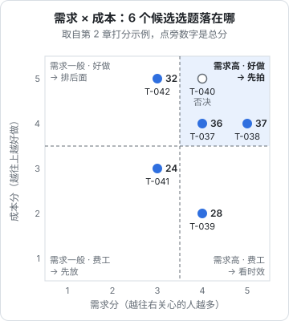

# 选题库与打分

上一章收集来的素材，如果只躺在手机备忘录里，到了周末要拍的时候还是会对着空白发呆，或者拍了「最近想到的」而不是「最值得拍的」。这一章把它们收进一张表，用一套简单的打分规则排出先后，并且在发布后回填数据，让打分越来越准。

## 选题库要解决的三件事

| 问题 | 没有选题库时 | 有选题库后 |
|---|---|---|
| 拍什么 | 临时想，容易拍成自己想拍的 | 从排好序的候选里挑 |
| 为什么拍这条 | 说不清，凭感觉 | 每条有分数和来源，可以事后对照 |
| 拍得对不对 | 爆了不知道为什么，扑了也不知道为什么 | 发布后回填数据，看打分和结果是否一致 |

第三点最重要。选题库不只是待办清单，它是你的**选题判断力的训练记录**。半年后回头看，你会知道自己在哪类选题上判断准、在哪类上总是高估。

## 用什么工具

不需要专门的软件。按你的习惯选一个：

| 工具 | 适合 | 注意 |
|---|---|---|
| 飞书多维表格 / 腾讯文档智能表 | 手机电脑都要编辑，想做筛选视图 | 字段一开始别建太多 |
| Notion 数据库 | 已经在用 Notion | 国内访问速度看网络 |
| 本地 Markdown 或 CSV + Git | 开发者习惯，想用脚本统计 | 手机上随手记不方便，可以先记备忘录再搬 |

本书用表格形式示意，字段在哪个工具里都能建。

## 选题库表格模板

建一张表，每行一个选题。字段分三组：**登记时填**、**打分时填**、**发布后回填**。

| 字段 | 填什么 | 示例 |
|---|---|---|
| 编号 | 自增，方便引用 | T-037 |
| 一句话选题 | 谁 + 场景 + 问题 + 看完得到什么 | 开完会 10 分钟出纪要：用 AI 把 40 分钟录音整理成 5 条待办 |
| 来源 | 用户问题 / 评论区 / 搜索 / 对标 / 热点 / 经历 | 评论区（T-021 下的追问） |
| 原话或证据 | 用户原话、联想词、对标链接 | 「开会录音太长了有没有办法快速出纪要」 |
| 栏目 | 属于哪个固定栏目（见第 9 章） | 「打工人 AI 急救」 |
| 结构 | 计划用的结构模板（见第 6 章） | 问题-解决 |
| 钩子草稿 | 第一句话 | 「老板说十分钟后要会议纪要，我只有一段 40 分钟的录音」 |
| 需求分 | 1–5 | 4 |
| 能力分 | 1–5 | 5 |
| 相关分 | 1–5 | 5 |
| 成本分 | 1–5（越容易拍分越高） | 4 |
| 时效 | 常青 / 有时效（写截止日） | 常青 |
| 总分 | 公式算 | 见下文 |
| 状态 | 素材 / 待拍 / 已拍 / 已发 / 放弃 | 待拍 |
| 发布日期、平台 | 发布后填 | 2026-11-10 抖音 |
| 播放、完播、互动、涨粉 | 发布 72 小时后回填 | 见第 8 章 |
| 结果 | 高于基线 / 持平 / 低于基线 | 高于基线 |
| 一句复盘 | 为什么 | 搜索流量持续进来，标题里的「会议纪要」被搜到 |

字段看着多，但登记时只需要填前四个，花不了一分钟。打分在每周整理时集中做。

## 打分规则

### 四个维度

| 维度 | 5 分 | 3 分 | 1 分 |
|---|---|---|---|
| **需求**：有多少人关心 | 搜索联想里有，评论区反复问，对标同题多条高于均值 | 有人问过，但不多 | 只是自己觉得有意思 |
| **能力**：你能讲多好 | 有亲身经历或实测，能讲出别人没讲过的 | 能讲清楚，但和别人差不多 | 要现学，靠资料拼 |
| **相关**：和账号定位多贴 | 正中目标观众的核心需求 | 沾边，能吸引一部分目标观众 | 会吸引来另一群人 |
| **成本**：多容易做出来 | 一次拍完，素材现成 | 要准备素材或实测 1–2 小时 | 要外出、借设备、做大量实测 |

打分要有依据，不能凭感觉。「需求 5 分」至少要能指出一条联想词、一组评论或一条对标爆款作为证据，写在「原话或证据」那一列。

### 计算总分

需求最重要，所以加权：

$$
\text{总分} = \text{需求} \times 3 + \text{能力} \times 2 + \text{相关} \times 2 + \text{成本} \times 1
$$

满分 40。在表格工具里写成公式列，比如飞书多维表格：

```text
[需求] * 3 + [能力] * 2 + [相关] * 2 + [成本]
```

再加两条一票否决，命中任意一条直接标「放弃」，不管分数多高：

1. 涉及第 3 章列出的不能追的热点类型（灾难、刑案、未经证实的消息等）
2. 需要夸大、编造或违反广告法才能讲得精彩（比如「用了这个工具月入过万」）

### 一组打分示例

「阿洲的 AI 工具课」本周整理出 6 个候选：

| 编号 | 一句话选题 | 需求 | 能力 | 相关 | 成本 | 总分 |
|---|---|---|---|---|---|---|
| T-037 | 开完会 10 分钟出纪要：用 AI 把 40 分钟录音整理成 5 条待办 | 4 | 5 | 5 | 4 | 36 |
| T-038 | 同事发来一份乱表，我用 AI 三步理干净 | 5 | 4 | 5 | 4 | 37 |
| T-039 | 某新发布的大模型评测：和我常用的比哪个好 | 4 | 3 | 4 | 2 | 28 |
| T-040 | 程序员 35 岁危机我怎么看 | 4 | 3 | 1 | 5 | 25 |
| T-041 | AI 生成的 PPT 配图能不能商用 | 3 | 2 | 4 | 3 | 24 |
| T-042 | 我用 AI 写了 3 个月周报，复盘一下 | 3 | 5 | 4 | 5 | 32 |

计算第一行：$4\times3 + 5\times2 + 5\times2 + 4 = 36$。

决策：本周拍 T-038 和 T-037；T-042 排下周；T-039 有时效，如果周三前能做完实测就插队，否则放弃；T-040 相关分 1，即使能爆也不拍；T-041 能力分低，先去查清楚版权规则（见[《自媒体与短剧合规财税》](../media-compliance/)）再说。

只看需求和成本两个维度，把这 6 个选题放进四个象限（以 3.5 分为界），和上面的决策基本对得上：需求高又好做的先拍，好做但需求一般的排后面，需求高但费工的看时效。T-040 落在「先拍」象限，却因为相关分只有 1 被否决，这说明象限只是粗筛，最终还要看总分和一票否决。



## 打分的常见误差

| 误差 | 表现 | 校正方法 |
|---|---|---|
| 高估自己喜欢的 | 技术细节类选题总是给需求 4–5 分，结果都扑 | 需求分必须写证据，没证据最高 3 分 |
| 低估「太简单」的 | 觉得「这谁不会」，结果这类最爆 | 记住你的观众不是开发者，问一个非技术朋友 |
| 成本估少了 | 「随便测一下」，结果花了一整个周末 | 发布后回填实际耗时，对比估计 |
| 被单次结果带偏 | 一条爆了就连拍十条同类 | 一个方向至少拍 3 条再下结论 |

## 发布后回填：让打分变准

每条视频发布 72 小时后（大部分短视频的推荐流量在头几天），回填数据列和「结果」列。判断「高于基线」需要先有基线：

```text
基线 = 最近 10 条视频播放量的中位数
高于基线：播放 ≥ 基线 × 2
低于基线：播放 ≤ 基线 × 0.5
其余：持平
```

用中位数而不是平均数，是因为一条爆款会把平均数拉得很高。具体怎么读完播、互动、搜索数据，第 8 章展开。

每个月做一次「打分校准」：把当月已发的选题按总分排序，看分数高的是否大多高于基线。

| 情况 | 说明 | 调整 |
|---|---|---|
| 高分多数高于基线 | 打分基本准 | 保持 |
| 高分和低分结果差不多 | 打分没区分度 | 检查是不是每条都打 4 分；逼自己拉开差距 |
| 某个维度总是不准 | 比如需求分高的反而扑 | 回头看这些选题的证据，是不是证据来源（比如某个群）不代表目标观众 |
| 低分的反而爆 | 有你没看到的需求 | 研究这些选题，补充到来源清单 |

如果用 CSV 管理选题库，可以写个小脚本做校准：

```python
import csv
from statistics import median

rows = [r for r in csv.DictReader(open("topics.csv", encoding="utf-8")) if r["状态"] == "已发"]
for r in rows:
    r["总分"] = int(r["需求"]) * 3 + int(r["能力"]) * 2 + int(r["相关"]) * 2 + int(r["成本"])
    r["播放"] = int(r["播放"])

base = median(r["播放"] for r in rows[-10:])
high = [r for r in rows if r["总分"] >= 32]
low = [r for r in rows if r["总分"] < 32]

def hit_rate(group):
    if not group:
        return 0.0
    return sum(1 for r in group if r["播放"] >= base * 2) / len(group)

print(f"基线 {base:.0f}，高分组命中率 {hit_rate(high):.0%}，低分组命中率 {hit_rate(low):.0%}")
```

高分组命中率明显高于低分组，打分就是有用的。分界线 32 只是示例，按你自己的分数分布调整。

## 选题库的日常维护

| 频率 | 动作 |
|---|---|
| 随时 | 新素材写成一句话进库，只填前四列 |
| 每周 | 给新素材打分；从「待拍」里挑下周 2–3 条；清理有时效且已过期的 |
| 每条发布后 72 小时 | 回填数据和一句复盘 |
| 每月 | 打分校准；看哪个来源产出的选题命中率最高，多花时间在那个来源上 |

库存保持在 20–40 条「待拍」比较合适。太少容易断更，太多说明你收集多、拍得少，该先提高产出。

## 建几个常用视图

选题多了以后，一张大表很难用。在表格工具里建几个筛选视图，每次只看需要的部分：

| 视图 | 筛选条件 | 排序 | 什么时候看 |
|---|---|---|---|
| 待整理 | 状态 = 素材 | 登记时间倒序 | 每周整理时 |
| 下周拍什么 | 状态 = 待拍 | 总分倒序 | 每周排期时 |
| 快过期 | 时效 = 有时效，截止日在 7 天内 | 截止日正序 | 每周排期时，先看这个 |
| 待回填 | 状态 = 已发，发布超过 72 小时，结果为空 | 发布日期正序 | 每两三天 |
| 按栏目 | 分组：栏目 | 总分倒序 | 规划系列时（第 9 章） |
| 放弃区 | 状态 = 放弃 | — | 偶尔回看，防止重复踩坑 |

## 一次整理的示范

周日晚上，「阿洲」的备忘录里攒了这样一周的素材：

```text
- 评论：「Word 里的会议记录能用吗」
- 评论：「表格那期，合并单元格怎么处理」
- 联想词：AI 做 PPT 免费
- 自己：周三用 AI 写了个正则，被同事问怎么写的
- 对标：某账号「AI 做思维导图」点赞是它平时 5 倍
- 热榜：某办公软件发布 AI 新功能
```

整理成选题库的行（只列前几列）：

| 编号 | 一句话选题 | 来源 | 需求 | 能力 | 相关 | 成本 | 总分 |
|---|---|---|---|---|---|---|---|
| T-043 | Word 里的会议记录也能用 AI 整理成待办 | 评论区 | 4 | 5 | 5 | 5 | 37 |
| T-044 | 带合并单元格的乱表，AI 整理前先做这一步 | 评论区 | 3 | 4 | 5 | 4 | 31 |
| T-045 | 免费做 PPT 的 AI 工具，我实测了一圈 | 搜索联想 | 5 | 3 | 4 | 2 | 31 |
| T-046 | 不会写正则？把需求说给 AI，三次对话就够 | 经历 | 3 | 5 | 3 | 5 | 30 |
| T-047 | 开会时用 AI 现场画思维导图 | 对标 | 4 | 3 | 5 | 4 | 32 |
| T-048 | 某办公软件 AI 新功能实测 | 热点 | 4 | 3 | 4 | 3 | 29 |

T-043 直接进下周排期；T-048 写上截止日（发布后两周内），过期放弃；T-046 相关分只有 3，因为「正则」对非技术观众偏难，可以改写成「不会写公式？把需求说给 AI」再打一次分。整理一次大约 15 分钟。

## 常见的坑

- **只登记不打分**：选题库变成了收藏夹，挑选的时候还是凭感觉
- **字段建太多**：第一周兴致勃勃建了 30 个字段，第三周就不想填了。先用上面的模板，用一个月再加
- **不回填**：没有回填的选题库无法校准，打分永远停在感觉层面
- **舍不得放弃**：相关分低、要编造才精彩的选题，不管分多高都放弃，并写清原因，防止下次又想拍

## 本章要点

- 选题库是选题判断力的训练记录：登记、打分、发布后回填，三步缺一不可
- 打分四个维度：需求（×3）、能力（×2）、相关（×2）、成本（×1），满分 40；需求分必须写证据
- 两条一票否决：不能追的热点、要夸大编造才精彩的
- 基线用最近 10 条播放量的中位数；高于两倍算高于基线
- 每月校准一次：高分选题是否真的更常高于基线，不准就调整打分方式
- 字段从少开始，待拍库存保持 20–40 条
