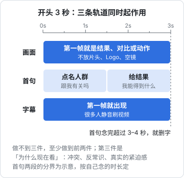

# 开头 3 秒与钩子

选题决定有没有人关心，开头决定关心的人会不会留下来。短视频是滑动浏览的，观众用一两秒判断「这条跟我有没有关系」，不相关就划走。这一章讲开头怎么写：先澄清「黄金 3 秒」到底是什么，再给出 14 种钩子类型，每种两个正例、一个反例。

## 「黄金 3 秒」是经验，不是平台规则

「黄金 3 秒」「前 3 秒决定生死」是行业里流传很广的说法。需要分清：

- **它是经验总结，不是平台公开的算法口径**。没有平台公开说过「3 秒」是一个算法阈值
- **平台公开过的是原理层面**：抖音 2025 年 3 月底上线「安全与信任中心」网站，并在 4 月的算法开放日上介绍，推荐系统会预估用户对内容的多种行为，综合考虑完播、评论、点赞、分享、对作者的长期消费等多个目标来排序（据新华网 2025-04-16 报道）。也就是说，观众「看没看完」「有没有互动」是被预估和学习的对象
- **创作者后台给了开头相关的数据**：抖音创作者中心的作品分析里有类似「2 秒跳出率」「5 秒完播率」这类开头留存指标（名称和口径以后台当前提示为准），B 站、视频号也有观看留存曲线

所以合理的理解是：开头流失的人越多，后面的完播和互动就越难看；开头几秒是观众决定去留的阶段，具体是 2 秒还是 5 秒，看你自己后台的留存曲线（第 5、8 章）。本书沿用「开头 3 秒」这个说法，指的是「第一句话加第一个画面」。

## 开头要完成的三件事

在极短的时间里，开头要让观众知道：

| 要回答的问题 | 做法 |
|---|---|
| 这跟我有关吗？ | 点名人群或场景：「做表格的打工人」「开完会要写纪要」 |
| 我能得到什么？ | 给出结果、好处或悬念 |
| 为什么要现在看？ | 冲突、反常识、紧迫感（真实的） |

不是每个开头都能三件全做到，但至少要做到前两件。

还有两条执行层面的原则：

- **画面和第一句话同时起作用**：第一帧就是最有信息量的画面（结果、对比、动作），不要用片头、Logo、空镜
- **第一句话不铺垫**：「大家好，我是阿洲，今天给大家分享一个……」这种开场，在观众判断去留的那几秒里没有提供任何信息

把画面、第一句话和字幕当成三条并行的轨道，下图画出它们在前 3 秒里各自要做的事：画面和字幕从第一帧就到位，第一句话先点名人群、再给结果。



## 14 种钩子

下面每种钩子给两个正例（以「阿洲的 AI 工具课」和其他垂类为例）和一个反例。反例大多是两类问题：**太空**（没有具体信息），或**过头**（夸大、欺骗，正文兑现不了）。后者不仅效果差，还会触碰平台对标题党、诱导互动的治理规则。

### 1. 结果前置

先展示最终结果，再讲怎么做到的。适合教程、改造、测评。

```text
正例：（画面：一份整齐的表格）这份表 5 分钟前还是这个样子（切到乱表），我只做了三步。
正例：（画面：做好的菜）这道红烧肉没放一滴水，45 分钟出锅，我把步骤拆给你。
反例：今天教大家一个超级实用的表格技巧，学会了效率翻倍！
```

反例的问题：没有展示任何结果，「效率翻倍」是空话。

### 2. 痛点场景

描述观众正在经历的具体麻烦，让他觉得「说的就是我」。

```text
正例：老板说十分钟后要会议纪要，你手里只有一段 40 分钟的录音。
正例：周日晚上十一点，PPT 还差 8 页配图，你已经在图库翻了一个小时。
反例：你是不是经常觉得工作效率很低？
```

反例的问题：场景太泛，谁都能对号入座，等于谁都不会对号入座。

### 3. 提问

抛出一个观众想知道答案的具体问题。

```text
正例：同样用 AI 写周报，为什么有人写的老板看完直接点赞，有人的一眼就被看穿？
正例：一万块以内的预算，第一台拍视频的相机到底该不该买？
反例：你知道 AI 吗？
```

反例的问题：问题没有悬念，答案不重要。

### 4. 反常识

说出一个和观众直觉相反的观点，前提是你能用证据支撑。

```text
正例：让 AI 写会议纪要，最不该给它的就是完整录音。
正例：新手拍视频，第一个该花钱的不是相机，是麦克风。
反例：99% 的人都用错了 AI，看完你会感谢我！
```

反例的问题：「99%」是编的，「感谢我」是空洞的情绪诱导。

### 5. 数字清单

用具体数字告诉观众内容的量和结构，适合清单类结构。

```text
正例：用了半年 AI 工具，我只留下了这 3 个，每个都每天在用。
正例：搬家前一周要做的 5 件事，第 4 件最多人忘。
反例：100 个 AI 神器，一个视频全给你！
```

反例的问题：一条短视频讲不完 100 个，数字大但兑现不了，观众收藏了也不会看。

### 6. 对比

两种做法、前后状态、两个工具并排摆出来。

```text
正例：同一份需求，左边是我自己写的，右边是 AI 写的，你猜老板选了哪个？
正例：同样 30 块钱，便利店早餐和自己做的早餐，营养差多少？
反例：AI 和人类到底谁更厉害？
```

反例的问题：对比对象太大太虚，没有可比的具体东西。

### 7. 悬念 / 留扣子

开头抛出一个结果但不说原因，让观众为了答案看下去。

```text
正例：我用 AI 改了一个月简历，投了 30 家，最后拿到 offer 的那家，用的是我手写的版本。
正例：这台二手相机我 1500 块收的，用了一周，发现了一个卖家没说的问题。
反例：最后的结果我真的没想到……（全片没有交代结果）
```

反例的问题：吊胃口不兑现，就是欺骗观众，评论区会骂，也属于诱导完播的套路。

### 8. 身份 / 人群点名

直接叫出目标观众的身份，帮他快速判断「这条是给我的」。

```text
正例：做行政、HR、财务的朋友，这个表格功能你每周至少能用上三次。
正例：租房的年轻人注意，退租前拍这 6 个地方，押金能少扯皮。
反例：所有人都必须看！
```

反例的问题：点名所有人等于没点名。

### 9. 评论回复

把一条真实评论放在画面上，以回答它开头。还能顺便告诉其他观众「这个账号会回应你」。

```text
正例：（画面：评论截图）上期有人问 Excel 数据能不能也这么处理，能，而且更简单。
正例：（画面：评论截图）有人说这个方法要付费，我用免费版从头做了一遍给你看。
反例：（画面：一条自己编的评论）好多粉丝问我……
```

反例的问题：伪造评论是虚假内容，被识破就失去信任。评论截图要隐去他人头像和昵称。

### 10. 亲身经历 / 故事开场

用一个具体的、真实的经历片段开头，适合故事结构。

```text
正例：入职第一周，组长让我整理三年的客户反馈，一共 4000 多条。
正例：去年我在剪辑上花了 200 个小时，今年同样的量只用了 60 个，变化只有一个。
反例：从前有一个程序员，他很努力……
```

反例的问题：没有时间、数字、细节，听起来像编的。

### 11. 犯错 / 避坑

从「错误做法」或「踩过的坑」切入，人对损失比对收益更敏感。

```text
正例：我用 AI 写 SQL，一条语句删掉了测试库一整张表，后来定了三条规矩。
正例：第一次拍口播，我录了 40 遍都不满意，问题出在一个没人告诉我的细节。
反例：千万别再这样做了！后果很严重！
```

反例的问题：只有恐吓没有信息，什么事、什么后果都没说。

### 12. 演示动作

开头直接是一个视觉上有冲击的操作过程，让画面本身说话。适合工具类、手工类。

```text
正例：（画面：拖进一个文件，三秒后表格自动分好类）就这一个动作。
正例：（画面：一刀下去，西瓜皮完整剥下）这个切法我教你。
反例：（画面：打开软件，加载画面 5 秒）好，现在我们打开软件……
```

反例的问题：最有冲击力的画面没放在开头，开头是等待。

### 13. 争议立场

鲜明地表达一个有理有据的立场，吸引同意和不同意的人来讨论。只用于你真的这么认为、并且能讲出道理的观点。

```text
正例：我不建议新人用 AI 写周报，不是因为会被发现，是因为你会失去一个复盘自己的机会。
正例：小户型别装吊柜，我住了三年拆掉了，说说为什么。
反例：XX 地方的人都这样，评论区说说你遇到过没有？
```

反例的问题：地域、性别、职业等群体对立是平台重点治理的「挑动对立」类内容，也会招来大量负面互动。

### 14. 承诺 + 期限

明确告诉观众看完能做到什么、要多久。适合教程。

```text
正例：给我 60 秒，你就能学会让 AI 按你的格式输出表格，不用再手动调。
正例：今晚照着做，明天早上上班就能用上这个自动日报。
反例：看完这条视频，你的人生会彻底改变。
```

反例的问题：承诺无法兑现，夸大到可笑。

## 钩子组合

一个开头常常是两三种钩子叠加：

```text
人群点名 + 痛点场景 + 结果前置：
「做财务的朋友，月底对账对到半夜？（画面：对好的表）这是我用 AI 五分钟对出来的。」

评论回复 + 反常识：
「（评论截图）有人问录音太长怎么办——其实最不该给 AI 的就是完整录音。」

犯错 + 悬念：
「我用 AI 改简历投了 30 家，拿到 offer 的那家用的是手写版。问题出在哪？」
```

## 写开头的流程

1. **先写正文，再写开头**：正文写完，你才知道这条视频最有价值的点是什么
2. **从正文里找最强的一个点**：结果、数字、反常识结论、最戏剧的画面
3. **用 3 种不同钩子各写一个版本**
4. **大声念出来并计时**：第一句话念完超过 3–4 秒，就删字
5. **问三个问题**：观众知道这跟他有关吗？知道能得到什么吗？正文能兑现吗？
6. **选一个**，其余两个记在选题库的「钩子草稿」列，以后做 A/B 用（第 7 章）

## 开头自查表

| 检查项 | 不合格的表现 |
|---|---|
| 第一句话有具体信息 | 「大家好」「今天分享」「你知道吗」 |
| 第一帧是有信息的画面 | 片头、Logo、黑屏、加载画面 |
| 点出了人群或场景 | 「所有人」「每个人」 |
| 数字是真实的 | 「99%」「100 个」「月入过万」无依据 |
| 正文能兑现开头的承诺 | 结尾才发现开头说的东西没讲 |
| 不靠引战、恐吓、伪造 | 群体对立、「后果很严重」、编的评论 |
| 字幕在第一帧就出现 | 很多人静音刷视频，没有字幕等于没说 |

## 本章要点

- 「黄金 3 秒」是行业经验说法；平台公开的是「预估完播、点赞、评论等多目标」的原理，以及后台的开头留存类指标，具体看自己的留存曲线
- 开头要回答：跟我有关吗、我能得到什么、为什么现在看
- 14 种钩子：结果前置、痛点场景、提问、反常识、数字清单、对比、悬念、人群点名、评论回复、亲身经历、犯错避坑、演示动作、争议立场、承诺加期限；常组合使用
- 反例两大类：太空（没有具体信息）和过头（夸大、伪造、吊胃口不兑现、挑动对立）
- 先写正文再写开头，写 3 个版本，念出来计时，选一个，其余留作 A/B
- 怎么把开头写进逐句口播稿和分镜表，见[《短视频脚本与分镜》](../video-script-storyboard/)
