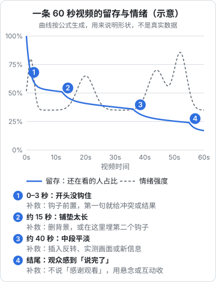

# 情绪曲线与留存

开头把观众留了下来，接下来的每一秒他都可能划走。一条视频的完播率，不是靠开头一次「钩住」决定的，而是靠中间不断给观众继续看的理由。这一章讲两条曲线：**留存曲线**（还有多少人在看）和**情绪曲线**（观众的情绪强度如何起伏），以及怎么在设计脚本时让它们配合。

## 两条曲线

**留存曲线**是平台后台给你的数据：横轴是视频时间，纵轴是此刻还在看的人占比。它只会往下走（除非有人拖回去重看），区别在于下降得快还是慢、在哪里突然下降。抖音、B 站、视频号的创作者后台都有作品的观看留存或类似分析，入口和名称以当前版本为准。

**情绪曲线**是你在脚本阶段设计的：观众在每个时刻的情绪强度，包括好奇、紧张、惊讶、认同、好笑、爽快。它没有后台数据，是你写稿时心里要有的一张图。

两者的关系：**情绪平的地方，留存容易掉**。观众划走，往往发生在「接下来不会有新东西了」的那一刻。



图里的曲线是按公式画的示意，用来说明形状，不是某条真实视频的数据。你自己的视频，去后台看真实曲线。

## 四个典型流失点

### 流失点 1：开头 0–3 秒

几乎所有视频都在开头掉得最快，因为大量观众只是滑过。这里的下降无法消灭，只能减小。补救方法见第 4 章：钩子前置、第一帧给信息、第一句不铺垫。

判断开头是否合格，不看绝对数，而是跟你自己的其他视频比：同样时长、同类结构的视频，这一条开头掉得比平时多，就是开头的问题。

### 流失点 2：铺垫段（约 10–20 秒）

开头钩住了人，接下来很多人会开始「交代背景」：这个工具是什么、我为什么要做这件事、先说一下前提……观众在这里意识到「还没到正题」，于是走了。

补救：

- **删背景**：问自己，这段背景不讲，观众能看懂吗？能，就删
- **背景压缩成一句**：「这是一个免费工具，网页版就能用」，然后直接进操作
- **在这里放第二个钩子**：「但第一步就有个坑，大部分人都踩了」

### 流失点 3：中段平台期（约 60% 进度）

中段最容易「平」：一样的画面、一样的语速、一样的信息密度持续了太久。观众觉得「我大概知道后面讲什么了」。

补救：

- **插入反转或意外**：「到这里看起来都很顺，但我导出的时候发现……」
- **切换信息形式**：从口播切到实测画面，从操作切到前后对比
- **给阶段性结果**：「现在已经有一个能用的版本了，接下来让它更好看」
- **预告后面的价值**：「最后一步最关键，它决定了这张表别人能不能直接用」

### 流失点 4：结尾

很多视频在最后几秒掉得很陡，因为观众收到了「说完了」的信号：「好了，今天就分享到这里」「感谢观看」「我们下期见」。他知道没有新信息了，就不等了。

补救：

- **最后一个信息点放在最后**：把最有用或最有意思的一点留到结尾，而不是先讲完再总结
- **不说结束语**：讲完最后一句就结束，或者用一个问题、一个下期预告收尾
- **回扣开头**：「所以开头那个问题的答案是……」，让结尾成为开头钩子的兑现

## 情绪曲线怎么设计

### 情绪的种类

短视频里常用的情绪，按强度和用途分：

| 情绪 | 怎么触发 | 适合放在 |
|---|---|---|
| 好奇 | 问题、悬念、不完整的信息 | 开头、每段开头 |
| 认同 | 说出观众的痛点、经历 | 开头、铺垫段 |
| 紧张 | 有风险、有代价、会失败 | 中段 |
| 惊讶 | 反常识、意外结果、反转 | 中段、结尾前 |
| 爽快 | 问题被干净利落地解决、前后对比 | 高潮 |
| 好笑 | 自嘲、反差、意外 | 任何位置，用来调节节奏 |
| 获得感 | 学会了一个能用的东西 | 结尾 |

### 起伏的节奏

情绪曲线不是越高越好，而是**有起有伏**。一直高强度，观众会疲劳；一直平，观众会走。经验上（行业经验，不是平台口径）：

- 短于 30 秒的视频：一个钩子、一个高潮就够
- 30–90 秒：开头一个钩子，中段至少一次「再钩一下」，结尾一个兑现
- 2 分钟以上（如 B 站、视频号横屏长视频）：大约每 20–40 秒要有一个新的信息点或情绪点

### 一条视频的情绪设计表

写脚本前，先填一张简单的表，规划每段要让观众有什么情绪。下面是「阿洲」一条 60 秒视频的设计：

| 时间 | 内容 | 目标情绪 | 防流失手法 |
|---|---|---|---|
| 0–3s | 「老板说十分钟后要会议纪要，你只有一段 40 分钟录音」 | 认同、紧张 | 痛点场景钩子 |
| 3–8s | 画面：最终的 5 条待办；「这是我 3 分钟弄出来的」 | 好奇 | 结果前置 |
| 8–12s | 「但第一步千万别把整段录音直接扔给 AI」 | 惊讶 | 反常识，跳过背景 |
| 12–30s | 实操：先转文字，再分段，再让 AI 只提取决定和待办 | 获得感 | 每一步都有画面变化 |
| 30–40s | 「到这里会遇到一个问题：AI 把没定的事也写成了待办」 | 紧张 | 中段反转 |
| 40–52s | 解决：在提示词里加一句限制，演示前后对比 | 爽快 | 前后对比 |
| 52–60s | 「提示词我放评论区第一条了，下期讲怎么让它直接生成日程」 | 获得感、期待 | 不说「感谢观看」，用预告收 |

这张表写完，再写逐句口播稿或分镜。逐句稿和分镜表的写法见《短视频脚本与分镜》。

## 节奏手法

除了内容上的起伏，执行层面也有很多防流失的手法。这些更多属于剪辑范畴，这里列出和脚本相关的部分，完整剪辑方法见《拍摄与剪辑实务》。

| 手法 | 做法 | 注意 |
|---|---|---|
| 删气口 | 口播的停顿、口头禅、重复全部剪掉 | 不要剪到喘不过气，信息密度太高观众也会走 |
| 画面变化 | 每隔几秒换一个景别、角度或切到素材画面 | 变化要有理由，不是乱切 |
| 字幕强调 | 关键词放大、变色 | 一屏只强调一两个词 |
| 进度提示 | 「第 2 步」「最后一个」 | 让观众知道还剩多少，减少「什么时候结束」的焦虑 |
| 音效点 | 转折、结果出现时加一个提示音 | 别太密，否则像综艺 |
| 承上启下的句子 | 「但是」「问题来了」「这还不是最关键的」 | 这是口播稿里最便宜的钩子 |

## 用留存曲线改稿：一次前后对比

情绪设计表是事前规划，留存曲线是事后验证。两者对照着看，才能知道设计有没有生效。做法：

1. 打开后台这条视频的留存曲线，找出比前后下降明显更快的时间段
2. 打开视频（或脚本），定位到那个时间段在讲什么、画面是什么
3. 对照情绪设计表：这一段原本设计的目标情绪是什么？实际做到了吗？
4. 写下原因和改法，用到下一条同结构的视频上

「阿洲」一条讲表格整理的视频，曲线在 15–22 秒掉得明显比平时快。对照脚本：

```text
改前（15–22 秒）：
「先说一下为什么表格会乱。一般是因为大家从不同系统导出数据，
格式不统一，有的日期是文本，有的是数字，还有合并单元格……」
画面：口播，人物中景，没有切换

诊断：这是背景解释，观众已经知道自己的表是乱的，不需要知道为什么乱；
      画面 7 秒没变化，情绪曲线是平的
```

```text
改后（下一条同类视频的对应位置）：
「第一步，先别急着让 AI 整理。（切到画面：表格里标红的三处）
这三种格式不统一的地方，AI 最容易弄错，先看一眼有没有。」
画面：切到屏幕录制，三处问题依次标红

变化：背景解释压缩成一句并变成操作步骤；画面每 2 秒有变化；
      用「AI 最容易弄错」制造一点紧张
```

下一条视频发布后，再看同一位置的曲线有没有变平。一次改一个地方，才知道是哪个改动起了作用。

## 常见的坑

| 坑 | 表现 | 怎么改 |
|---|---|---|
| 好东西放最前面讲完 | 开头 10 秒把结论说完，后面都是补充 | 开头给结果，原因和关键细节分散在后面 |
| 假悬念 | 「最后有惊喜」，结尾什么都没有 | 只预告真实存在的内容 |
| 强行拉长 | 为了「时长更长」塞了大量无关内容 | 时长服从内容，能 40 秒讲完就别拍 90 秒 |
| 一直高能 | 每句话都是大字幕、音效、夸张语气 | 留出平的段落让观众喘气，高潮才显得高 |
| 只看完播率 | 为了完播率把视频剪到 7 秒 | 完播率要和时长、互动一起看（第 8 章） |

关于「强行拉长」和「假悬念」再强调一次：诱导观众看完而不兑现，短期也许能骗到一些完播，但观众的负反馈（划走、不感兴趣、举报）同样会被平台学到。抖音公开的算法介绍里，就提到用户可以通过「不感兴趣」等方式反馈，算法据此调整（据新华网 2025-04-16 报道）。

## 本章要点

- 留存曲线是后台数据，情绪曲线是你在脚本阶段的设计；情绪平的地方留存容易掉
- 四个典型流失点：开头 0–3 秒、铺垫段、中段平台期、结尾
- 补救：钩子前置、删背景、中段放反转或切换形式、把最后一个信息点留到最后、不说结束语
- 情绪要有起有伏，30–90 秒视频中段至少再钩一次；这是经验，不是平台口径
- 写稿前先填情绪设计表：时间、内容、目标情绪、防流失手法
- 不用假悬念和强行拉长，负反馈同样会被平台学到
