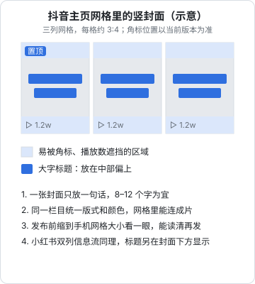

# 标题与封面

在推荐流里，观众一刷就进入你的视频，开头 3 秒最重要；但在搜索结果、账号主页、双列信息流里，观众先看到的是**封面和标题**，点不点开由它们决定。这一章讲各平台的差异、标题和封面的写法公式、怎么做 A/B 对比，以及不能越过的线。

## 各平台的差异

不同平台的内容是怎么被看到的，决定了标题和封面的权重：

| 平台 | 主要浏览方式 | 封面的作用 | 标题/文案的作用 |
|---|---|---|---|
| 抖音、快手 | 单列全屏推荐为主；也有搜索、主页、双列入口 | 推荐流里观众直接看视频，封面作用小；搜索结果和主页网格里封面决定点击 | 推荐流里是补充信息；搜索场景下标题和文案里的关键词影响能否被搜到 |
| 小红书 | 双列信息流 + 搜索 | 极重要，是点击的第一决定因素 | 标题显示在封面下方，和封面一起决定点击；正文关键词影响搜索 |
| 视频号 | 推荐、社交（朋友赞过）、搜一搜 | 在双列入口和主页里重要 | 描述文字在社交场景里会被朋友看到 |
| B 站 | 双列推荐 + 搜索，横屏为主 | 极重要，横版封面 | 标题信息量大，观众习惯读完整标题再决定 |

各平台标题字数上限、封面比例和像素要求会调整，以发布页的提示和裁切框为准。可以确定的几点：

- 小红书图文笔记支持竖版 3:4、方形 1:1、横版 4:3 等比例，一篇笔记里的图片比例需要统一；竖版在双列信息流里占的面积最大（据 Canva 中国的小红书封面设计指南，非官方文档）
- 抖音主页作品以三列网格展示竖封面，搜索结果也会展示封面
- B 站以横版封面为主，手机端和电脑端的显示比例可能不同，重要文字放在画面中间

平台推荐和搜索机制的细节见《抖音与快手》《小红书、视频号与 B 站》。

## 标题

### 标题要做的两件事

1. **让目标观众点进来**：具体、对他有用、有一点悬念
2. **让搜索的人找到你**：包含观众会搜的词

第二点经常被忽略。观众搜「会议纪要 AI」，你的标题是「打工人的救命神器」，就不会被找到。第 1 章说过，搜索流量可以持续很久，这部分流量由标题和文案里的关键词决定。

### 标题公式

| 公式 | 结构 | 示例 |
|---|---|---|
| 人群 + 问题 + 方法 | 谁 + 遇到什么 + 怎么办 | 行政人必看：乱表格用 AI 三步理干净 |
| 结果 + 用时 | 做到了什么 + 花了多久 | 40 分钟会议录音，3 分钟整理出待办清单 |
| 数字清单 | 数字 + 筛选标准 + 品类 | 用了半年 AI 工具，我只留下这 3 个 |
| 对比 | A vs B + 结论预告 | 自己写 vs AI 写需求文档：评审时谁被挑刺多 |
| 提问 | 观众心里的问题 | AI 写的周报，老板能看出来吗？ |
| 避坑 | 错误做法 + 后果 | 别把整段录音扔给 AI，这样整理纪要才对 |
| 经历 | 我 + 具体事件 + 结果 | 我用 AI 分类了 4000 条客户反馈，错了 11 条 |
| 关键词前置（搜索型） | 核心搜索词 + 具体场景 | AI 会议纪要｜录音转待办的完整流程 |

### 写标题的步骤

1. 写出这条视频的**一句话选题**（第 1 章）
2. 圈出观众会搜的**核心词**：「会议纪要」「AI」「录音」
3. 用 3 个不同公式各写一版
4. 检查：核心词在不在？有没有具体数字或场景？正文能兑现吗？
5. 按平台调整：小红书标题要短，信息尽量放封面；B 站可以更长、更完整；抖音把关键词写进文案描述

```text
一句话选题：开完会 10 分钟出纪要：用 AI 把 40 分钟录音整理成 5 条待办
核心词：会议纪要、AI、录音

版本 A（结果 + 用时）：40 分钟会议录音，AI 帮我 3 分钟整理成待办
版本 B（避坑）：别再让 AI「总结会议」了，会议纪要应该这样做
版本 C（搜索型）：AI 整理会议纪要｜录音转文字到待办清单全流程

小红书：选 B，封面大字「别让 AI 总结会议」
B 站：选 C，加副标题「附提示词」
抖音：文案描述写 A，带上 #会议纪要 #AI工具 话题
```

### 不能写的标题

标题党在平台规则和监管层面都有风险。中央网信办 2023 年的《关于加强"自媒体"管理的通知》要求自媒体发布信息不得无中生有、断章取义、歪曲事实；各平台也把夸大误导、诱导互动列为治理对象。具体来说：

| 不要写 | 例子 | 问题 |
|---|---|---|
| 夸大承诺 | 「学会这招月入过万」「彻底告别加班」 | 无法兑现；涉及收益承诺时还有广告法风险 |
| 编造数字 | 「99% 的人不知道」「全网最全」 | 没有依据；「最」字在广告场景里是广告法明确限制的用语 |
| 伪造身份 | 「大厂 HR 告诉你」（你不是） | 虚假信息 |
| 恐吓 | 「再不看就晚了」「后果很严重」 | 制造焦虑，没有信息 |
| 文不对题 | 标题说「怎么做」，正文是感想 | 观众被骗，负反馈 |
| 诱导互动 | 「不转不是中国人」「点赞好运连连」 | 平台明确治理的诱导行为 |

一个检验标准沿用《文案与内容》第 4 章的说法：**标题许下的承诺，正文兑现了吗？**

## 封面

### 封面的三个要素

| 要素 | 作用 | 做法 |
|---|---|---|
| 主体 | 让人一眼看出是什么 | 人脸（有表情）、操作结果、前后对比、产品实物 |
| 大字 | 一句话说清卖点 | 8–12 个字为宜（经验值），字号大到手机网格里能读清 |
| 统一视觉 | 让人在网格里认出你 | 同一栏目固定配色、字体、版式 |

### 安全区

封面会在不同位置以不同尺寸、不同裁切出现。最常见的问题是大字被角标、播放数遮挡，或者被裁掉。



实操检查：做完封面后，把它和你账号主页上已有的几张封面一起，缩小到手机网格的大小看。看不清字，就是字太小或太多。

### 封面公式

| 类型 | 构图 | 大字示例 | 适合 |
|---|---|---|---|
| 结果展示 | 结果画面占满，大字在上方 | 「3 分钟出会议纪要」 | 教程、问题-解决 |
| 前后对比 | 左右或上下分屏 | 「乱表 → 整齐表」 | 对比、改造 |
| 人物 + 表情 | 半身人像，表情配合情绪 | 「AI 写的周报被发现了」 | 故事、观点 |
| 清单 | 数字特别大 | 「只留这 3 个」 | 清单 |
| 问题 | 大字问句 | 「老板能看出来吗？」 | 提问、测评 |

### 封面的反例

- **字太多**：把整个标题搬上封面，网格里一片字，什么都看不清
- **和视频无关的美女帅哥、夸张表情**：点击率可能高，但打开后不符合预期，观众马上划走，开头跳出率会很高
- **用未授权的图**：影视截图、明星照片、别人的作品，有版权和肖像权风险
- **每条风格都不一样**：主页看起来很乱，观众记不住你

## A/B 对比的思路

大多数国内平台没有给普通创作者提供标准的封面/标题 A/B 测试功能（如有，以平台当前功能为准）。可以用这些近似方法：

### 方法一：发布前小范围投票

把 2–3 个封面/标题版本发到粉丝群、朋友圈或问几个目标观众：「你会点哪个？」样本小，只能排除明显差的版本。

### 方法二：系列内轮换变量

同一栏目（第 9 章）连续发多条时，**一次只改一个变量**，和栏目基线比：

```text
栏目：打工人 AI 急救（每周两条，结构相同）
第 1–4 条：封面用「结果画面 + 大字」→ 记下平均点击、播放
第 5–8 条：封面改为「人物表情 + 大字」，其他不变 → 对比
结论：哪种封面的播放中位数更高，保留哪种
注意：每组至少 4 条，排除单条选题差异带来的偶然
```

### 方法三：多平台差异化

同一条视频发到不同平台，本来就要按平台调整标题和封面。可以有意用不同风格，观察各平台的差异。注意平台用户不同，这只能当参考，不是严格对比。

### 方法四：小额投流测素材

用 DOU+、薯条等小额加热，给两个版本各投同样的金额和人群，对比点击和完播。这能得到比较干净的对比，但要花钱。投流的方法和 ROI 计算见《投流与数据分析》。

### 记录

不管用哪种方法，把结果记进选题库（第 2 章）。积累 20–30 条记录后，你会知道自己账号的观众对哪类封面、哪类标题反应更好，这比任何通用公式都准。

## 发布前检查表

```text
标题
[ ] 包含 1–2 个观众会搜的核心词
[ ] 有具体的数字、场景或结果
[ ] 正文能兑现标题的承诺
[ ] 没有夸大、编造数字、伪造身份、恐吓、诱导互动
[ ] 按平台调整了长度和写法

封面
[ ] 一句话大字，手机网格里能读清
[ ] 主体和视频内容一致
[ ] 文字避开了角标和播放数区域
[ ] 用的图片和人像都有授权
[ ] 和同栏目的其他封面风格统一
```

## 本章要点

- 推荐流里开头最重要；搜索、主页、双列信息流里封面和标题决定点击
- 小红书和 B 站的封面权重最高；抖音的封面主要在搜索和主页里起作用；具体尺寸和字数以发布页为准
- 标题做两件事：让目标观众想点、让搜索的人找得到；核心词要在标题和文案里
- 8 种标题公式，写 3 版再选；不写夸大、编造、伪造身份、恐吓、诱导互动的标题
- 封面三要素：主体、一句话大字、统一视觉；大字放在不被遮挡的区域
- 没有平台 A/B 工具时：小范围投票、系列内轮换变量、多平台差异化、小额投流测试，结果记进选题库
