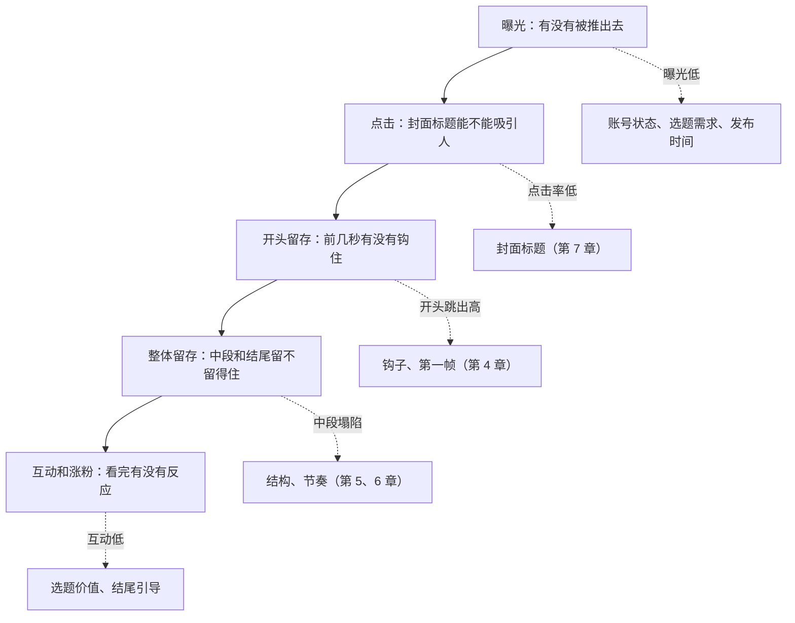
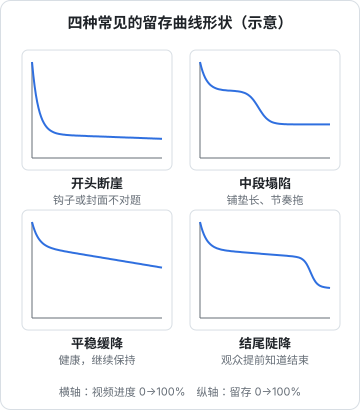

# 用数据倒推选题

前面几章讲的都是「发之前」怎么想。这一章讲「发之后」：从后台数据里读出这条视频是选题的问题、开头的问题、结构的问题还是封面标题的问题，再把结论反馈到选题库，决定下一条拍什么。

本章只讲从内容创作角度怎么读数据。各平台后台的指标定义、流量池机制见《抖音与快手》《小红书、视频号与 B 站》；投流后的数据和 ROI 见《投流与数据分析》。

## 先看哪些数据

各平台创作者后台的指标名称不同、经常调整，但大体能看到这几类。指标的准确口径以后台的说明为准：

| 类别 | 常见指标 | 回答的问题 |
|---|---|---|
| 曝光与点击 | 曝光量（展现量）、点击率（双列平台） | 封面标题能不能让人点进来 |
| 开头留存 | 2 秒跳出率、5 秒完播率、留存曲线开头一段 | 开头有没有钩住人 |
| 整体留存 | 完播率、平均播放时长、平均播放进度、留存曲线 | 结构和节奏能不能留住人 |
| 互动 | 点赞、评论、收藏、分享（以及它们除以播放量的比率） | 内容对观众有没有价值、能不能引起反应 |
| 转化 | 涨粉、主页访问 | 观众是否想看你更多内容 |
| 流量来源 | 推荐、搜索、关注、主页、其他 | 流量从哪来，能不能持续 |

### 算比率，不看绝对数

播放量差别很大时，绝对数没法比。把互动换算成比率：

$$
\text{点赞率} = \frac{\text{点赞数}}{\text{播放量}}, \quad
\text{收藏率} = \frac{\text{收藏数}}{\text{播放量}}, \quad
\text{涨粉率} = \frac{\text{新增粉丝}}{\text{播放量}}
$$

评论率、分享率同理。各比率多少算「好」，网上流传很多数字，大多没有可靠出处，而且不同垂类、不同时长差别很大。**唯一可靠的参照是你自己账号的历史中位数**。

### 完播率要按时长分组比

一条 15 秒的视频和一条 3 分钟的视频，完播率天然不可比。比较时：

- 按时长分组：比如 30 秒以内、30–90 秒、90 秒以上，组内比
- 同时看平均播放时长和平均播放进度：完播率低但平均播放进度高，说明多数人看到了后面，只是没看完最后几秒
- 不要为了完播率把视频剪到极短，第 5 章说过，时长服从内容

## 用数据定位问题

一条视频没达到预期，按「漏斗」的顺序找出问题出在哪一层：



**从上往下找第一个明显低于你自己基线的环节**，那里就是主要问题。下游的数据差，常常是上游问题的连带结果。

### 留存曲线的四种形状

后台的留存曲线是诊断结构问题最直接的工具。常见形状：



| 形状 | 说明 | 对应改法 |
|---|---|---|
| 开头断崖 | 前几秒掉了一大半，之后平稳 | 换钩子；检查封面标题和开头是否一致（封面说 A，开头讲 B） |
| 中段塌陷 | 前面还行，某个时间点突然掉一截 | 找到那个时间点对应的内容，通常是背景交代、重复信息或画面长时间不变 |
| 平稳缓降 | 一直缓慢下降，没有明显断点 | 健康，保持；想更好就加强中段的二次钩子 |
| 结尾陡降 | 最后几秒掉很多 | 删掉结束语；把最后一个信息点留到最后（第 5 章） |

## 搜索流量的判读

流量来源里的**搜索占比**值得单独看，它告诉你这个选题有没有长期价值：

| 情况 | 说明 | 选题上的结论 |
|---|---|---|
| 搜索占比高，且发布几周后还有新增播放 | 这是一个有人持续在找的问题 | 同类问题多做；做成系列（第 9 章）；把标题改得更利于搜索 |
| 推荐流量高，搜索几乎为零 | 内容有吸引力，但没人会主动找 | 适合用来拉新，但不能指望长尾 |
| 两者都低 | 选题需求不足或关键词没写对 | 回到第 1 章检查需求证据；检查标题和文案里有没有核心词 |

如果后台能看到观众通过哪些搜索词找到这条视频，把这些词抄进选题库。它们是观众用自己的语言告诉你的需求，比你自己想的关键词准。

## 复盘表

每条视频发布 72 小时后填一行。字段和第 2 章选题库的回填列对应，可以直接建在同一张表里：

| 字段 | 示例 |
|---|---|
| 编号 / 标题 | T-037 / 40 分钟会议录音，AI 帮我 3 分钟整理成待办 |
| 平台 / 发布时间 | 抖音 / 2026-11-10 周二 20:30 |
| 时长 / 结构 / 钩子类型 | 58 秒 / 问题-解决 / 痛点场景 + 结果前置 |
| 播放量 / 基线 | 8200 / 2600 |
| 5 秒完播率 / 基线 | 后台数值 / 自己的中位数 |
| 完播率 / 平均播放进度 | 后台数值 |
| 点赞率 / 收藏率 / 评论率 / 分享率 | 按公式算 |
| 涨粉 / 涨粉率 | 后台数值 / 按公式算 |
| 搜索流量占比 | 后台数值 |
| 留存曲线形状 | 平稳缓降，40 秒处小塌陷 |
| 诊断 | 主要问题在哪一层（曝光/点击/开头/中段/互动） |
| 评论区高频问题 | 「Word 里的会议记录能用吗」「提示词在哪」 |
| 结论 | 选题对、开头对；40 秒处的提示词展示太快，收藏率高说明有人想留着用 |
| 下一步 | 新增选题 T-048「Word 会议记录怎么用 AI 整理」；同栏目下期把提示词放大展示 |

最后两行最重要。**复盘的产出是下一条拍什么、怎么拍**，不是一份漂亮的数据报表。

## 一次完整的复盘示例

下面是「阿洲」某一周 4 条视频的复盘（虚构数据，用来说明方法）。账号基线：播放中位数 2600。

| 编号 | 选题 | 结构 | 播放 | 相对基线 | 收藏率 | 搜索占比 | 曲线 |
|---|---|---|---|---|---|---|---|
| T-037 | 会议录音整理成待办 | 问题-解决 | 8200 | 3.2 倍 | 高 | 高 | 平稳缓降 |
| T-038 | 乱表三步理干净 | 教程 | 5300 | 2.0 倍 | 高 | 中 | 结尾陡降 |
| T-039 | 新模型发布实测 | 测评 | 1900 | 0.7 倍 | 低 | 低 | 开头断崖 |
| T-042 | AI 写周报三个月复盘 | 故事 | 2400 | 0.9 倍 | 低 | 低 | 中段塌陷 |

读法：

1. **T-037 和 T-038 都高于基线**，共同点是「具体办公场景 + 能照着做」，收藏率高，搜索有流量。结论：这个方向是账号的主线，继续做，考虑做成固定栏目
2. **T-038 结尾陡降**：回看视频，最后说了「好了，以上就是今天的三步」。下一条删掉结束语
3. **T-039 开头断崖**：封面写「XX 新模型实测」，开头却先讲了 10 秒发布会背景。问题在开头，不一定是选题。但搜索占比低、收藏率低，说明这类热点测评对这个账号的观众吸引力一般。结论：热点测评降低优先级，如果做，开头直接上实测结果
4. **T-042 中段塌陷**：故事结构里经过部分太长，讲了三个月里每个月的变化。结论：故事结构暂时不适合这个账号的观众，或者需要大幅压缩经过部分；先不放弃，再试一条压缩版

然后把结论落到选题库：调高「办公场景实操」类选题的需求分权重，新增评论区里出现的 3 个问题，热点测评类选题下调优先级。

## 复盘的节奏

| 频率 | 做什么 | 用时 |
|---|---|---|
| 每条发布 72 小时后 | 填复盘表一行，抄评论区高频问题 | 10 分钟 |
| 每周 | 看本周所有视频，找共同点；更新选题库的分数和优先级 | 30 分钟 |
| 每月 | 第 2 章的打分校准；按结构、钩子类型、选题来源分组，看哪组的中位数最高 | 1 小时 |

月度复盘时可以按维度分组统计。如果复盘表是 CSV，一段脚本就能做：

```python
import csv
from collections import defaultdict
from statistics import median

rows = list(csv.DictReader(open("review.csv", encoding="utf-8")))
for key in ("结构", "钩子类型", "来源"):
    groups = defaultdict(list)
    for r in rows:
        groups[r[key]].append(int(r["播放"]))
    print(f"按{key}：")
    for name, plays in sorted(groups.items(), key=lambda kv: -median(kv[1])):
        print(f"  {name}: {len(plays)} 条，播放中位数 {median(plays):.0f}")
```

样本少于 3–4 条的组，结论只能当线索，不能当规律。

## 常见的误读

| 误读 | 问题 | 正确的做法 |
|---|---|---|
| 一条爆了，以为找到了规律 | 单条结果受偶然因素影响很大 | 同方向至少 3 条再下结论 |
| 一条扑了，马上换方向 | 同上 | 先定位是哪一层的问题，不一定是选题 |
| 只看播放量 | 播放高但涨粉、收藏都低，可能吸引了错的人 | 播放、留存、互动、涨粉一起看 |
| 跨时长比完播率 | 15 秒和 3 分钟没法比 | 按时长分组 |
| 迷信网传的「合格线」 | 「完播率必须 30% 以上」之类数字多数没有可靠来源 | 用自己账号的中位数做基线 |
| 只复盘失败的 | 不知道成功的为什么成功 | 高于基线的更要复盘，那是可以复制的东西 |

## 本章要点

- 指标分六类：曝光点击、开头留存、整体留存、互动、转化、流量来源；口径以后台说明为准
- 互动换算成比率比较；完播率按时长分组比；参照物是自己账号的中位数，不是网传的合格线
- 按漏斗从上往下，找第一个明显低于基线的环节，那里是主要问题
- 留存曲线四种形状：开头断崖、中段塌陷、平稳缓降、结尾陡降，各有对应改法
- 搜索占比高、长尾有新增的选题有长期价值，适合系列化
- 复盘的产出是「下一条拍什么、怎么拍」，并回写到选题库；每条、每周、每月三个节奏
