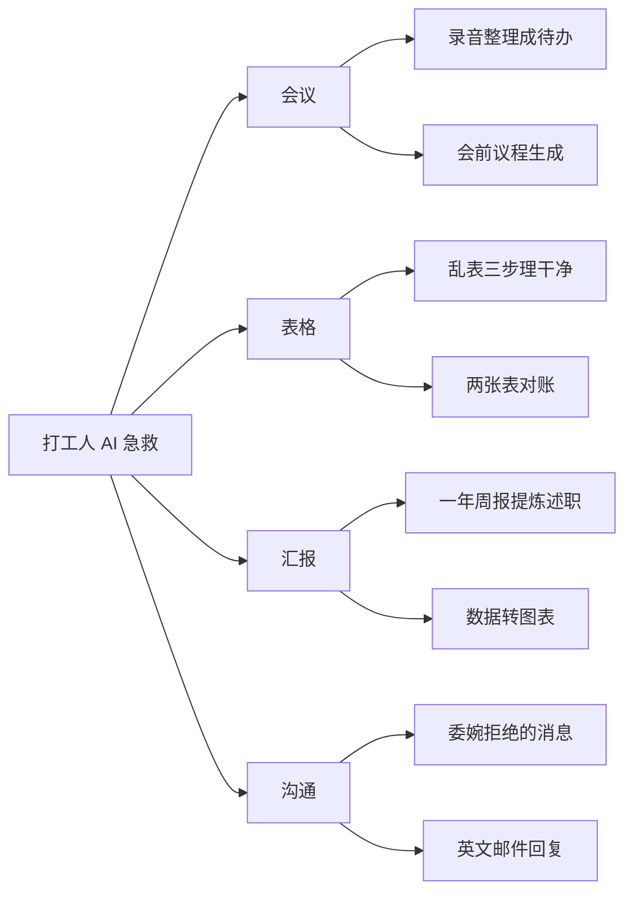
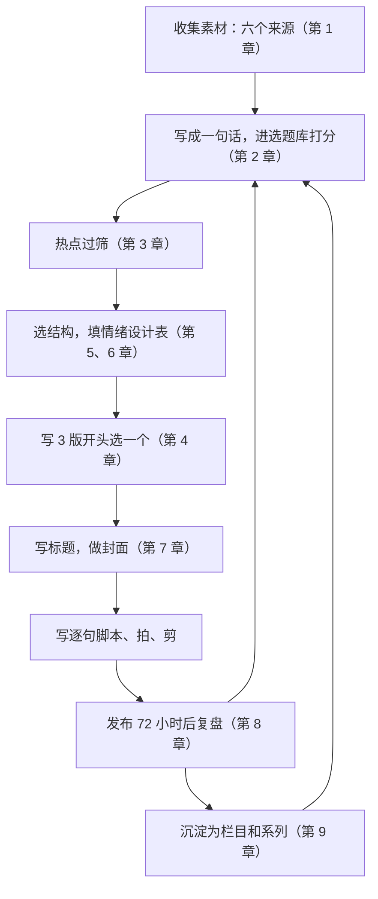

# 选题的长期主义

前面八章讲的大多是「一条视频」：怎么选、怎么开头、怎么搭结构、怎么复盘。但账号不是单条视频的堆积。一个账号一年后还能稳定涨粉、接到合作、卖出东西，靠的是观众记得你、期待你的下一条。这一章讲怎么把单条选题组织成**系列**和**栏目**，让选题从「每次重新想」变成「沿着一条线往下走」。

## 为什么要系列化

| 只做单条 | 做系列和栏目 |
|---|---|
| 每次都要从零想选题 | 栏目定了，选题沿着栏目往下拆 |
| 观众看完一条就走 | 看完一条会去找同系列的其他条 |
| 观众记住的是某条视频 | 观众记住的是你和你的栏目 |
| 爆一条是一条 | 一条爆了，会带动同系列的旧视频 |
| 每条的结构、封面都要重新设计 | 结构和封面模板固定，生产更快 |

对下班才有时间的副业创作者，最后一点尤其重要：**固定的栏目就是固定的生产线**，能把每条视频的制作时间压下来。

## 系列和栏目的区别

| | 系列 | 栏目 |
|---|---|---|
| 定义 | 围绕一个主题的有限条数，有始有终 | 固定形式、长期更新、没有预设终点 |
| 例子 | 「AI 办公入门 7 天」「年终述职三部曲」 | 「打工人 AI 急救」「每周一个工具实测」 |
| 优势 | 观众有完整学习路径，容易被整组收藏 | 观众形成期待，账号有辨识度 |
| 适合 | 有体系的知识、季节性主题 | 账号的主线内容 |

一个成熟的账号通常有 1–3 个长期栏目，再穿插一些系列。

## 设计一个栏目

### 栏目卡

每个栏目写一张卡片，固定下来，以后每条都照着做：

```text
栏目名：打工人 AI 急救
一句话：职场人遇到一个具体的急活，用 AI 在 10 分钟内搞定
目标观众：行政、运营、财务等非技术岗位的职场人
更新频率：每周二、周五各一条
固定结构：问题-解决（第 6 章模板 1）
固定开头：「老板说 / 同事发来 / 下班前要……」的痛点场景 + 结果前置
固定时长：45–70 秒
固定封面：浅蓝底色，左上角栏目角标，中部大字写结果，右下角放结果截图
固定结尾：提示词放评论区第一条 + 一句下期预告
选题来源：评论区追问（主要）、搜索联想、自己工作里的真实场景
不做：需要付费工具才能完成的；涉及公司内部数据的（只用脱敏或虚构数据）
停止条件：连续 8 条播放中位数低于账号基线的 0.7 倍
```

### 栏目名怎么起

- **说清内容，不玩概念**：「打工人 AI 急救」比「阿洲的奇妙工具箱」更能让人知道看了能得到什么
- **能放进封面角标**：4–6 个字为宜
- **能被搜到**：如果栏目名里有观众会搜的词更好

### 选题怎么沿着栏目拆

栏目定了以后，选题可以系统地拆出来，而不是每周凭灵感。一个方法是画一张**选题地图**：栏目 → 场景 → 具体问题。



每个叶子节点就是一条视频的候选，进选题库打分（第 2 章）。评论区追问、搜索联想不断给地图添新叶子。

### 新栏目的前 6 条怎么排

新栏目上线时，观众还不知道它是什么。前几条的选择会决定观众对栏目的第一印象：

| 顺序 | 选什么 | 原因 |
|---|---|---|
| 第 1 条 | 选题库里需求分最高、最能代表栏目的一条 | 第一条就是栏目的样板 |
| 第 2–3 条 | 和第 1 条同场景的相邻问题 | 让观众确认「这个栏目就是讲这类事」 |
| 第 4 条 | 换一个场景 | 展示栏目的覆盖范围 |
| 第 5 条 | 回答前几条评论区的追问 | 告诉观众「你的问题会被回答」，鼓励留言 |
| 第 6 条 | 综合前 5 条数据，选表现最好的方向再做一条 | 开始用数据调整栏目 |

前 6 条结构、开头、封面严格按栏目卡执行，不要中途改，否则无法判断栏目本身行不行。6 条之后再按第 8 章的方法复盘，决定继续、改版还是停。

## 合集与系列编号

各平台大多提供「合集」类功能，把同一系列的视频归在一起，观众看完一条可以顺着看下一条。具体功能名称、入口和条件以平台当前版本为准。使用时注意：

- **一个合集只放一个栏目或系列**，不要把所有视频都塞进一个合集
- **合集名和栏目名一致**，封面角标也一致
- **系列加编号**：「AI 办公入门 3/7」，观众知道还有前后
- **新视频里提一句旧视频**：「上期讲了会议录音，这期讲会前议程」，把流量引回旧视频

## 选题配比

长期来看，选题按用途分成几类，保持一个大致比例：

| 类型 | 占比（参考） | 作用 |
|---|---|---|
| 主线栏目 | 60–70% | 账号的根基，稳定的观众预期，主要的涨粉来源 |
| 系列 | 10–20% | 有体系的内容，高收藏，适合季节性主题 |
| 实验 | 10–20% | 试新结构、新钩子、新方向，为下一个栏目找候选 |
| 热点 | 不超过 20% | 借势，见第 3 章 |

比例是参考值，不是规则。关键是**实验必须有**：所有栏目都会衰退，没有实验就不会有下一个栏目。实验内容表现好（比如连续 3 条高于基线），就考虑升级成栏目。

## 内容日历

把栏目和系列排进日历，一个月看一次。下面是「阿洲」12 月的日历（每周 3 条）：

| 周 | 周二 | 周五 | 周日 |
|---|---|---|---|
| 第 1 周 | 栏目：两张表对账 | 栏目：会前议程生成 | 系列：年终述职 1/3 一年周报提炼成果 |
| 第 2 周 | 栏目：英文邮件回复 | 栏目：数据转图表 | 系列：年终述职 2/3 述职 PPT 结构 |
| 第 3 周 | 栏目：委婉拒绝的消息 | 实验：一条故事结构（压缩版） | 系列：年终述职 3/3 现场答辩准备 |
| 第 4 周 | 栏目：评论区问题合集 | 热点：视当周情况定，没有合适的就做栏目 | 月度复盘，不发或发一条轻量的 |

年终述职是可预期的日程热点（第 3 章），提前排成系列；第 4 周留了一个灵活位置给热点，没有合适的就不硬追。

## 一个选题用多次

一个好选题不只拍一条。常见的复用方式：

| 方式 | 例子 |
|---|---|
| 换平台改写 | 抖音 60 秒竖屏 → B 站 5 分钟横屏完整版 → 小红书图文步骤版 |
| 长拆短 | 一条 8 分钟的 B 站视频拆成 4 条 1 分钟的竖屏 |
| 短合长 | 栏目里 6 条相关视频合成一条「年度合集」 |
| 更新版 | 工具大版本更新后，同一选题重拍「2027 版」 |
| 评论区延伸 | 原视频下的高频追问拍成续集 |
| 换人群 | 「行政用 AI 做表格」→「老师用 AI 做成绩表」 |

注意：不同平台的改写要按平台规则重新调整，不是一稿多发，见《国内私域与内容平台》第 2 章「平台地图」中关于一鱼多吃的部分。同一选题的复用也要有增量，大量近乎相同的内容会被平台识别为同质化内容，抖音的恶意营销号治理就把「工业化生产同质化内容」列为治理对象（据 IT 之家 2026-06-12 报道）。

## 什么时候停一个栏目

栏目不是永久的。出现以下情况，考虑停掉或改版：

| 信号 | 判断 | 怎么处理 |
|---|---|---|
| 连续多条低于基线 | 栏目卡里写好的停止条件触发了 | 先改版一次（换开头、换封面、调整选题范围），改版后仍不行就停 |
| 选题枯竭 | 选题地图的叶子拍完了，评论区不再有新问题 | 收尾成一个系列合集，开新栏目 |
| 你自己做不动了 | 每次做这个栏目都很痛苦 | 副业能持续比单条数据重要，换一个你愿意长期做的 |
| 方向和账号定位偏离 | 栏目吸引来的人和你想要的不是一群 | 停，回到《账号定位与对标拆解》重新想 |

停栏目要有交代：最后一条说明「这个栏目先告一段落，接下来会做……」，比突然断更好。

## 一年后回头看

选题的长期主义，最终体现在一年后你的账号主页上：

- 主页网格里能一眼看出 1–3 个栏目，封面风格统一
- 选题库里有一两百条记录，打分和结果大部分对得上
- 搜索流量占比稳定，旧视频还在持续被找到
- 你知道自己的观众喜欢什么结构、什么钩子、什么封面，不需要再依赖通用公式

这些都不是一条爆款能带来的。

## 全书要点

把整本书串起来，一条视频从选题到复盘的完整流程：



其中「写逐句脚本、拍、剪」不在本书范围：脚本和分镜见《短视频脚本与分镜》，拍摄剪辑见《拍摄与剪辑实务》，用 AI 批量辅助生产见《AI 内容生产工具链》。

## 本章要点

- 系列化和栏目化让选题有方向、观众有期待、生产有模板，对副业创作者尤其重要
- 系列有始有终，栏目长期更新；成熟账号有 1–3 个长期栏目
- 每个栏目写一张栏目卡：一句话、观众、频率、结构、开头、封面、结尾、选题来源、不做什么、停止条件
- 用选题地图（栏目 → 场景 → 具体问题）系统地拆选题
- 选题配比参考：主线栏目 60–70%、系列和实验各 10–20%、热点不超过 20%；实验必须有
- 一个选题可以换平台、长拆短、出更新版多次使用，但要有增量，避免同质化
- 栏目触发停止条件时先改版一次，仍不行就有交代地收尾
