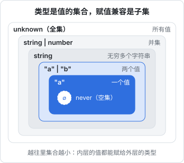
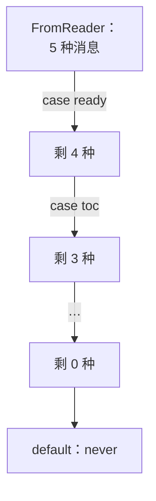

# 类型系统的集合论视角

这本书写给已经天天写 TypeScript 和 Node 的人：语法、`tsconfig` 的常用选项、Express / NestJS 怎么起服务，这些都默认你会。我们要补的是**「为什么」那一层**：类型为什么这样推导、什么时候该停止写类型体操；Node 的事件循环、V8 的编译和 GC 到底在做什么；内存泄漏、背压、CPU 热点怎么查；以及 Node 直接跑 `.ts` 这件事背后的取舍。

全书分两半：前三章是类型系统，后六章是运行时。两半基本独立，可以按需跳读；但第 1 章是前三章的地基，第 4 章（事件循环）是后面几章的地基，建议先读。类型示例都在 TypeScript 6.0 上用 `tsc --strict` 验证过。运行时部分以 **Node 24 LTS** 为基线：书里的实验和实测数字是在 Node 22（22.23）上实际跑出来的，Node 24 与之不同的地方（Maglev 是否默认开启、type stripping 的稳定性等）按官方发布说明在对应小节写明。

> [!WARNING]
> 版本状态按 2026 年 11 月 Node.js 官方发布日程（github.com/nodejs/Release）整理：Node 22 和 Node 24 都处于维护期 LTS（分别于 2027-04-30、2028-04-30 停止支持），Node 26 已于 2026-10-28 进入 Active LTS；从 Node 27 起改为每年一个大版本。全书的实测数字和默认值是在 TypeScript 6.0 与 Node 22.23 上得到的；Node 24 的差异只按其发布说明整理、没有实机重跑。TypeScript 7（基于 Go 的 tsgo）也在推进，编译器上限、V8 默认选项、type stripping 的状态都可能随版本变化；以 TypeScript 发布说明（Release Notes）、Node.js 官方 changelog 和发布说明为准。

本章只做一件事：建立一个心智模型——**类型就是值的集合**。有了它，`never`、`unknown`、联合、交叉、`keyof`、函数参数的变型这些看似零散的规则，都能从同一个原理推出来。

## 类型 = 值的集合

把一个类型理解成「所有属于它的值」组成的集合：

| 类型 | 对应的集合 |
|---|---|
| `never` | 空集，没有任何值 |
| `"a"`、`42`、`true` | 只有一个元素的集合（单元类型） |
| `boolean` | `{ true, false }`，等于 `true \| false` |
| `string` | 所有字符串，无穷集合 |
| `{ id: string }` | 所有「至少有一个 string 类型的 `id` 属性」的值 |
| `unknown` | 全集，所有值 |

**赋值兼容（assignability）就是子集关系**。`const x: string = "a"` 能通过，是因为 `"a"` 这个集合是 `string` 的子集。TypeScript 文档里说「A extends B」「A 可以赋给 B」，翻译过来都是 A ⊆ B。



这个视角马上能解释两个边界：

- `never` 是空集，空集是任何集合的子集，所以 `never` 能赋给任何类型
- `unknown` 是全集，任何集合都是它的子集，所以任何值都能赋给 `unknown`；反过来，`unknown` 不能赋给除 `unknown`（和 `any`）之外的类型，必须先收窄

```ts
declare const nothing: never;
const s: string = nothing; // 空集是任何集合的子集

declare const anything: unknown;
// @ts-expect-error unknown 是全集，不是 string 的子集
const t: string = anything;

if (typeof anything === "string") {
  const u: string = anything; // 收窄后集合变小了，可以赋值
}
```

### any 不是集合

`any` 是这个模型里唯一的例外：它同时当顶类型和底类型用，既能接收一切，又能赋给一切。它不是一个集合，而是**关掉类型检查的开关**。所以写库的边界、解析外部输入时用 `unknown`，只在迁移老代码或确实没办法时用 `any`，并把它关在尽量小的范围里。

## 联合是并集，交叉是交集

`A | B` 是并集，`A & B` 是交集。基本类型上很直观：

```ts
type Id = string | number;      // 字符串和数字的并集
type Impossible = string & number; // 没有既是字符串又是数字的值 → never

const check: Impossible extends never ? true : false = true;
```

到了对象类型，很多人会觉得反直觉：**交叉之后属性反而变多了**。

```ts
type HasId = { id: string };
type HasTitle = { title: string };
type Book = HasId & HasTitle; // { id: string; title: string }

const b: Book = { id: "ts-node-advanced", title: "TS 与 Node 进阶" };
```

用集合想就通了。`{ id: string }` 不是「只有 id 的对象」，而是「**至少**有 id 的所有对象」（TypeScript 的对象类型是开放的）。约束越多，满足的值越少：

- `HasId` 的集合：所有带 `id` 的值
- `HasTitle` 的集合：所有带 `title` 的值
- 两者的交集：同时带 `id` 和 `title` 的值——写成类型，就是属性的「合并」

所以对对象类型来说：**属性越多，集合越小**。`{ id: string; title: string }` 是 `{ id: string }` 的子类型。这也是结构化类型（structural typing）的本质：不看名字，只看你是不是落在那个集合里。

如果同名属性的类型冲突，交集会塌缩：

```ts
type A = { kind: "a"; n: number };
type B = { kind: "b"; n: number };
type AB = A & B; // kind 必须同时是 "a" 和 "b"，整个类型变成 never

const isNever: AB extends never ? true : false = true;
```

判别属性（`kind`）冲突时，TypeScript 会把整个交叉类型化简成 `never`，这正是集合论的结论。

## keyof 是「反过来」的

`keyof T` 是「T 中所有值**都**有的键」。值越多，共同拥有的键越少。所以：

- `keyof (A | B)` = `keyof A & keyof B`：并集里的值五花八门，只有两边都有的键才保证存在
- `keyof (A & B)` = `keyof A | keyof B`：交集里的值两边的键都有

```ts
type Cat = { name: string; meow(): void };
type Dog = { name: string; bark(): void };

type K1 = keyof (Cat | Dog); // "name"
type K2 = keyof (Cat & Dog); // "name" | "meow" | "bark"

const k1: K1 = "name";
// @ts-expect-error 联合里不是每个值都有 meow
const k1bad: K1 = "meow";
const k2: K2 = "bark";
```

这就是为什么对一个联合类型的值直接访问 `pet.meow` 会报错：TypeScript 只允许访问联合里每一员都有的属性。要访问特有属性，先收窄。

## 收窄就是让集合变小

`typeof`、`instanceof`、`in`、判别属性比较、自定义类型守卫，本质都是同一个操作：**在某个分支里，把变量的类型换成原集合的一个子集**。

hatch-shelf 里 RN 与阅读器 WebView 之间的消息协议是一个判别联合（摘自 `app/src/reader/bridge.ts`，有删减）：

```ts
type ReaderPosition = { scrollRatio: number; anchor?: string };
type TocItem = { level: 1 | 2 | 3; text: string; anchor: string };

type FromReader =
  | { type: "ready" }
  | { type: "toc"; items: TocItem[] }
  | { type: "position"; position: ReaderPosition }
  | { type: "navigate"; to: "prev" | "next" }
  | { type: "error"; message: string };

function handle(msg: FromReader): string {
  switch (msg.type) {
    case "ready":
      return "ready";
    case "toc":
      return `${msg.items.length} headings`; // 这里 msg 只剩 toc 那一员
    case "position":
      return msg.position.scrollRatio.toFixed(2);
    case "navigate":
      return msg.to;
    case "error":
      return msg.message;
    default: {
      // 所有分支都处理了，剩下的集合是空集
      const exhaustive: never = msg;
      return exhaustive;
    }
  }
}
```

`default` 分支里的 `const exhaustive: never = msg` 是穷尽检查：每个 `case` 都从集合里减掉一员，最后剩下的应该是空集。将来协议里加了新消息类型而这里忘了处理，`msg` 在 `default` 里就不再是 `never`，编译直接报错。**协议改动由编译器帮你找出所有要改的地方**，这在 RN 和 WebView 两端共用一份类型时特别值钱。



## 函数类型的变型

函数类型也是集合：`(x: Animal) => void` 是「所有能接收任意 Animal 的函数」。问题是：`(x: Dog) => void` 和 `(x: Animal) => void` 谁是谁的子集？

想想调用方。一个需要 `(x: Animal) => void` 的地方，可能会传进来 Cat。如果你给它一个只能处理 Dog 的函数，就会出错。反过来，需要 `(x: Dog) => void` 的地方，给它一个能处理所有 Animal 的函数完全没问题。所以：

- **参数位置是逆变的**：`Dog ⊆ Animal`，但 `(x: Animal) => void ⊆ (x: Dog) => void`，方向反过来
- **返回值位置是协变的**：返回 `Dog` 的函数可以当返回 `Animal` 的函数用，方向一致

```ts
type Animal = { name: string };
type Dog = Animal & { bark(): void };

declare let handleAnimal: (a: Animal) => void;
declare let handleDog: (d: Dog) => void;

handleDog = handleAnimal; // 能处理所有动物的函数，当然能处理狗
// @ts-expect-error 只会处理狗的函数，不能交给可能传猫的人
handleAnimal = handleDog;
```

`strict` 里的 `strictFunctionTypes` 就是在开这条检查。有一个历史遗留的例外：**用方法语法声明的成员**（`handle(x: Dog): void`）仍然是双变的（bivariant），两个方向都允许。这是为了兼容 `Array<T>` 这类大量使用方法签名的老类型。想要严格检查，就把成员写成属性语法：

```ts
type Animal = { name: string };
type Dog = Animal & { bark(): void };

interface MethodStyle { handle(x: Dog): void }          // 方法语法：双变
interface PropertyStyle { handle: (x: Dog) => void }    // 属性语法：逆变

const loose: MethodStyle = { handle: (x: Animal) => {} };
const loose2: MethodStyle = { handle: (x: Dog) => {} };

declare const wantsAnimal: { handle(x: Animal): void };
const unsafe: { handle(x: Animal): void } = loose2;     // 方法语法下不报错，有隐患

declare const strictDog: PropertyStyle;
// @ts-expect-error 属性语法下严格逆变
const safe: { handle: (x: Animal) => void } = strictDog;
```

在团队约定里写一条「接口里的回调用属性语法」，能挡住一类很难查的运行时错误。

## 不完全是集合的地方

集合论是一个好用的模型，但 TypeScript 不是严格的集合论实现。有三处要单独记：

| 现象 | 为什么 |
|---|---|
| 多余属性检查：`const b: HasId = { id: "x", extra: 1 }` 报错 | 对象字面量「新鲜」时额外检查拼写错误，是 lint 性质的规则；先赋给变量再传就不报 |
| `any` 能赋给 `never` 以外的一切，也能接收一切 | 它是检查开关，不是集合 |
| 方法参数双变 | 历史兼容，见上节 |

多余属性检查最容易让人误判，它只针对字面量：

```ts
type HasId = { id: string };

// @ts-expect-error 新鲜的对象字面量会做多余属性检查
const direct: HasId = { id: "x", extra: 1 };

const temp = { id: "x", extra: 1 };
const viaVar: HasId = temp; // 结构上是子集，合法
```

## 品牌类型：人为造一个子集

集合视角还能反过来用：既然 `string` 是一个大集合，我们可以**声明一个它的子集**，用来区分语义不同但底层都是字符串的值，比如书的 id 和章节文件名：

```ts
type BookId = string & { readonly __brand: "BookId" };
type ChapterFile = string & { readonly __brand: "ChapterFile" };

const SLUG_RE = /^[a-z0-9]+(?:-[a-z0-9]+)*$/;

function toBookId(raw: string): BookId {
  if (!SLUG_RE.test(raw)) throw new Error(`invalid book id: ${raw}`);
  return raw as BookId; // 唯一允许断言的地方：校验通过之后
}

function openBook(id: BookId): void {}

openBook(toBookId("ts-node-advanced"));
// @ts-expect-error 普通字符串不在 BookId 这个子集里
openBook("ts-node-advanced");
declare const file: ChapterFile;
// @ts-expect-error 两个品牌的交集是空的
openBook(file);
```

`string & { __brand: "BookId" }` 在运行时并不存在这个属性，它只在类型层面把集合切小。配合「只有校验函数能产出品牌值」的约定，就把「这个字符串已经校验过」这个事实编进了类型里。zod 的 `.brand()` 做的是同一件事。

## 本章要点

- 类型是值的集合，赋值兼容就是子集关系；`never` 是空集，`unknown` 是全集，`any` 是关掉检查的开关
- 联合是并集，交叉是交集；对象类型是开放的，**属性越多集合越小**，所以对象交叉表现为属性合并
- `keyof` 方向相反：`keyof (A | B)` 只剩共同的键
- 收窄就是把集合变小；判别联合配合 `never` 穷尽检查，让协议改动由编译器追踪
- 函数参数逆变、返回值协变；方法语法的成员是双变的，回调建议用属性语法
- 品牌类型是人为声明的子集，用来把「已校验」编进类型

## 动手练习

1. **让穷尽检查报错**：把[收窄就是让集合变小](#收窄就是让集合变小)一节的 `FromReader` 和 `handle` 存成 `a.ts`，在联合里加一员 `| { type: "close" }`，不改 `switch`，运行 `npx tsc --strict --noEmit a.ts`。

   验证：报 `error TS2322: Type '{ type: "close"; }' is not assignable to type 'never'.`，位置在 `const exhaustive: never = msg` 那一行。补上 `case "close":` 分支后通过。

   参考答案：每个 `case` 从集合里减掉一员，漏掉的那一员留到了 `default`，`msg` 不再是空集，赋给 `never` 失败。

2. **方法语法的隐患能跑出运行时错误**：

   ```ts
   type Animal = { name: string };
   type Dog = Animal & { bark(): void };
   interface MethodStyle { handle(x: Dog): void }
   const m: MethodStyle = { handle: (x: Dog) => x.bark() };
   const a: { handle(x: Animal): void } = m;
   a.handle({ name: "cat" });
   ```

   先 `tsc --strict --noEmit` 检查，再编译运行（`npx tsc --strict --target es2022 --outDir out b.ts && node out/b.js`）。然后把两处成员都改成属性语法 `handle: (x: ...) => void`，再检查一次。

   验证：方法语法下类型检查零报错，运行时抛 `TypeError: x.bark is not a function`；改成属性语法后，第 5 行报 `TS2322`，错误链最后一行指出 `Property 'bark' is missing in type 'Animal'`。

   参考答案：方法语法的参数是双变的，`strictFunctionTypes` 管不到；属性语法按逆变检查，把「只会处理狗的函数」交给「可能传猫的人」会被拒绝。

3. **多余属性检查只看字面量**：

   ```ts
   type HasId = { id: string };
   const direct: HasId = { id: "x", extra: 1 };
   const temp = { id: "x", extra: 1 };
   const viaVar: HasId = temp;
   ```

   预测哪一行报错、报什么，再用 `tsc --strict --noEmit` 验证。

   验证：只有第 2 行报 `error TS2353: Object literal may only specify known properties, and 'extra' does not exist in type 'HasId'.`，第 4 行通过。

   参考答案：结构上带 `extra` 的对象仍是 `HasId` 集合的成员；多余属性检查是只针对新鲜字面量的拼写检查，不是集合关系的一部分。
