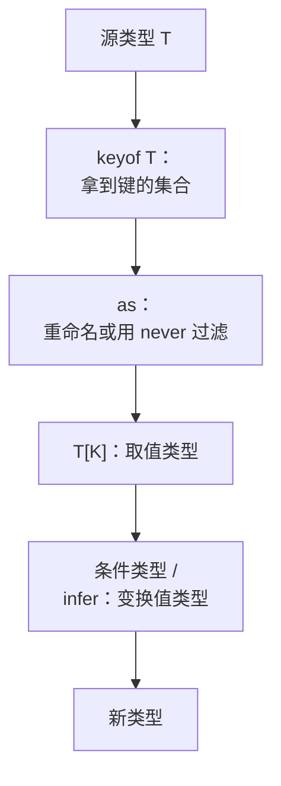

# 泛型、条件类型与 infer 实战

上一章把类型看成集合。这一章往前走一步：**把泛型看成作用在类型上的函数**。条件类型是这个函数里的 `if`，`infer` 是模式匹配，映射类型是 `map`。掌握这四样，绝大多数「类型写不出来」的问题都能解决。最后用几个真实场景串起来：WebView 消息的处理表、路由参数推导、zod schema 推出类型。

## 泛型是类型层面的函数

```ts
type Box<T> = { value: T };       // 类型函数：输入 T，输出一个对象类型
type A = Box<string>;             // 调用：{ value: string }

function box<T>(value: T): Box<T> {
  return { value };
}
const b = box(42);                // T 被推断为 number
```

对照普通函数：`T` 是形参，`Box<string>` 是调用，`extends` 约束是形参的类型（上界）。区别是：类型函数的「调用」大部分时候由编译器从实参**推断**完成。所以写泛型函数时，真正要设计的是**推断从哪里来**。

### 约束是上界，不是默认值

```ts
function longest<T extends { length: number }>(a: T, b: T): T {
  return a.length >= b.length ? a : b;
}

const s = longest("abc", "de");          // T = "abc" | "de"，保留了调用方的具体类型
const arr = longest([1, 2], [3]);        // T = number[]
// @ts-expect-error number 没有 length，不满足上界
longest(1, 2);
```

`T extends X` 的意思是「T 必须是 X 的子集」。函数体里只能使用 X 保证有的能力（这里是 `.length`），但返回的仍是调用方传进来的那个更具体的 T。这就是泛型比直接写 `{ length: number }` 好的地方：**不丢信息**。

### 控制推断：const 类型参数与 NoInfer

默认情况下，字面量会被「拓宽」：`["a", "b"]` 推断成 `string[]`。TypeScript 5.0 起可以在类型参数前加 `const`，让它按 `as const` 的方式推断：

```ts
function routes<const T extends readonly string[]>(paths: T): T {
  return paths;
}
const r = routes(["/books", "/settings"]); // readonly ["/books", "/settings"]

function plain<T extends readonly string[]>(paths: T): T {
  return paths;
}
const p = plain(["/books", "/settings"]);  // string[]
```

另一个常见问题是推断来源太多，结果被「放宽」了。5.4 加入的 `NoInfer<T>` 告诉编译器：这个位置不参与推断，只做检查。

```ts
function pick<T extends string>(options: T[], fallback: NoInfer<T>): T {
  return options[0] ?? fallback;
}

pick(["light", "dark"], "dark");
// @ts-expect-error 没有 NoInfer 的话，T 会被放宽成 "light" | "dark" | "sepia"
pick(["light", "dark"], "sepia");
```

## 条件类型：类型层面的 if

```ts
type IsString<T> = T extends string ? true : false;

type A = IsString<"x">;    // true
type B = IsString<number>; // false
```

`T extends U ? X : Y` 问的就是集合问题：T 是不是 U 的子集。

### 分配律：对联合逐个求值

当被检查的是一个**裸的类型参数**，而传进来的是联合时，条件类型会对联合的每一员分别求值再合并：

```ts
type ToArray<T> = T extends unknown ? T[] : never;
type R = ToArray<string | number>; // string[] | number[]，而不是 (string | number)[]

// 标准库的 Exclude / Extract 就是靠分配律实现的
type MyExclude<T, U> = T extends U ? never : T;
type Rest = MyExclude<"a" | "b" | "c", "a">; // "b" | "c"
```

想关掉分配律，就把两边包进元组，让 T 不再「裸」：

```ts
type ToArrayNoDist<T> = [T] extends [unknown] ? T[] : never;
type R2 = ToArrayNoDist<string | number>; // (string | number)[]

// 经典陷阱：never 是空联合，分配之后什么都不剩
type IsNever<T> = T extends never ? true : false;
type N1 = IsNever<never>;   // never，不是 true
type IsNever2<T> = [T] extends [never] ? true : false;
type N2 = IsNever2<never>;  // true
```

`IsNever<never>` 得到 `never` 而不是 `true`，是很多人第一次踩的坑。按集合理解：对空集里的每个元素做映射，结果还是空集。

## infer：模式匹配

`infer` 只能出现在条件类型的 `extends` 子句里，意思是「如果能匹配上这个形状，把这个位置的类型取出来，命名为 X」：

```ts
type MyReturnType<F> = F extends (...args: never[]) => infer R ? R : never;
type MyAwaited<T> = T extends PromiseLike<infer V> ? MyAwaited<V> : T;
type ElementOf<T> = T extends readonly (infer E)[] ? E : never;

type R1 = MyReturnType<() => Promise<number>>; // Promise<number>
type R2 = MyAwaited<Promise<Promise<string>>>; // string
type R3 = ElementOf<readonly ["a", "b"]>;      // "a" | "b"
```

几个实用变体：

```ts
// 1. 带约束的 infer（4.7+）：匹配的同时要求它是 string
type FirstString<T> = T extends [infer H extends string, ...unknown[]] ? H : never;
type F1 = FirstString<["id", 1]>; // "id"
type F2 = FirstString<[1, "id"]>; // never

// 2. 在模板字面量里 infer：拆字符串
type Ext<F> = F extends `${string}.${infer E}` ? Ext<E> | E : never;
type E1 = Ext<"cover.png">;       // "png"

// 3. 取函数参数
type Params<F> = F extends (...args: infer P) => unknown ? P : never;
type P1 = Params<(id: string, n: number) => void>; // [id: string, n: number]
```

## 映射类型：类型层面的 map

```ts
type Book = { id: string; title: string; tags: string[] };

type Optional<T> = { [K in keyof T]?: T[K] };
type ReadonlyDeep<T> = { readonly [K in keyof T]: T[K] extends object ? ReadonlyDeep<T[K]> : T[K] };

// as 子句（4.1+）：重映射键名，返回 never 可以过滤掉键
type Getters<T> = { [K in keyof T as `get${Capitalize<string & K>}`]: () => T[K] };
type OnlyStrings<T> = { [K in keyof T as T[K] extends string ? K : never]: T[K] };

type G = Getters<Book>;      // { getId: () => string; getTitle: ...; getTags: ... }
type S = OnlyStrings<Book>;  // { id: string; title: string }
```

映射类型 + `as` + 条件类型，基本覆盖了「从一个类型派生另一个类型」的所有需求。`Partial`、`Pick`、`Omit`、`Record` 都是它的特例。



## 实战一：消息处理表

hatch-shelf 的阅读器在 WebView 里运行，RN 侧收到的消息是一个判别联合（第 1 章用过它）。`switch` 能处理，但如果想把处理函数写成一张表，并且**每个处理函数的参数自动是对应那一员**，就要用映射类型 + `Extract`：

```ts
type FromReader =
  | { type: "ready" }
  | { type: "position"; position: { scrollRatio: number; anchor?: string } }
  | { type: "link"; href: string }
  | { type: "error"; message: string };

type Handlers<U extends { type: string }> = {
  [K in U["type"]]: (msg: Extract<U, { type: K }>) => void;
};

const handlers: Handlers<FromReader> = {
  ready: () => {},
  position: (m) => console.log(m.position.scrollRatio), // m 自动是 position 那一员
  link: (m) => console.log(m.href),
  error: (m) => console.error(m.message),
};

function dispatch(msg: FromReader) {
  // 这里需要一次断言：TS 无法把 msg.type 和 handlers[msg.type] 的参数关联起来
  (handlers[msg.type] as (m: FromReader) => void)(msg);
}
```

收益和 `switch` 的穷尽检查一样：协议加了一种消息，`handlers` 就会报「缺少属性」。注意 `dispatch` 里那一次断言：这是 TypeScript 的已知限制（关联联合类型，correlated unions），把断言关在这一个函数里就好，别为了消除它去写更复杂的类型。

## 实战二：从路由字符串推出参数

```ts
type Params<Path extends string> =
  Path extends `${string}:${infer Name}/${infer Rest}`
    ? { [K in Name]: string } & Params<`/${Rest}`>
    : Path extends `${string}:${infer Name}`
      ? { [K in Name]: string }
      : {};

type Flatten<T> = { [K in keyof T]: T[K] };

function link<P extends string>(path: P, params: Flatten<Params<P>>): string {
  return path.replace(/:(\w+)/g, (_, k: string) => (params as Record<string, string>)[k] ?? "");
}

link("/books/:bookId/chapters/:file", { bookId: "ts-node-advanced", file: "01-types-as-sets.md" });
// @ts-expect-error 缺少 file
link("/books/:bookId/chapters/:file", { bookId: "x" });
```

`Flatten` 只是为了让鼠标悬停时显示成一个干净的对象，而不是一串 `&`。expo-router 的 typed routes 做的就是这类推导（由它的类型生成器产出），自己写一个小版本有助于理解它报错时在说什么。

## 实战三：先写值，再推类型

前面都是「先有类型，再约束值」。很多时候反过来更好：**让值成为唯一真相，类型从值推出来**。hatch-shelf 的 `@shelf/spec` 就是这么做的（摘自 `packages/spec/src/schema.ts`，有简化）：

```ts
import { z } from "zod";

export const LEVELS = ["beginner", "intermediate", "advanced"] as const;
export type BookLevel = (typeof LEVELS)[number]; // "beginner" | "intermediate" | "advanced"

export const bookManifestSchema = z.object({
  id: z.string().regex(/^[a-z0-9]+(?:-[a-z0-9]+)*$/),
  title: z.string().trim().min(1),
  level: z.enum(LEVELS).optional(),
  chapters: z.array(z.string()).min(1),
});

export type BookManifest = z.infer<typeof bookManifestSchema>;
```

`as const` 让数组保留字面量，`(typeof LEVELS)[number]` 取出所有元素的联合；`z.infer` 内部就是一组条件类型和 `infer`。好处是运行时校验和静态类型**不可能不一致**——改一处，两边一起变。App 和 CLI 共用这一份，避免了「类型说有、实际没校验」的漂移。

### satisfies：校验但不拓宽

另一个「值优先」的工具是 `satisfies`（4.9+）：检查值符合某个类型，但保留值本身更窄的推断结果。

```ts
type ThemeMode = "light" | "dark" | "sepia";

const background = {
  light: "#ffffff",
  dark: "#0d1117",
  sepia: "#f4ecd8",
} satisfies Record<ThemeMode, string>;  // 少一个主题就报错

const k: keyof typeof background = "sepia"; // 键仍然是精确的三个

const wide: Record<ThemeMode, string> = background; // 也能当宽类型用
```

如果写成 `const background: Record<ThemeMode, string> = ...`，校验效果一样，但变量的类型就被固定成宽类型了。经验法则：**配置表、常量映射用 `satisfies`，函数参数和返回值用类型注解**。

## 本章要点

- 泛型是类型层面的函数，约束是上界；写泛型函数时真正要设计的是**推断从哪里来**
- `const` 类型参数保留字面量，`NoInfer` 让某个位置只检查不推断
- 条件类型对裸类型参数有分配律；用 `[T] extends [U]` 关掉它，`IsNever` 必须这样写
- `infer` 是模式匹配，可以加 `extends` 约束，也能在模板字面量里拆字符串
- 映射类型 + `as` 重映射 + 条件类型覆盖了几乎所有类型派生需求
- 能让值做唯一真相时就这么做：`as const`、`z.infer`、`satisfies`

## 动手练习

1. **IsNever 的两种写法**：存成 `a.ts`，运行 `npx tsc --strict --noEmit a.ts`，先预测哪一行报错。

   ```ts
   type IsNever<T> = T extends never ? true : false;
   type IsNever2<T> = [T] extends [never] ? true : false;
   export const n1: IsNever<never> = true;
   export const n2: IsNever2<never> = true;
   ```

   验证：只有第 3 行报 `error TS2322: Type 'true' is not assignable to type 'never'.`。

   参考答案：裸类型参数遇到联合会分配，`never` 是空联合，分配后什么都不剩，`IsNever<never>` 就是 `never`；包进元组后不再分配，按整体比较，得到 `true`。

2. **去掉 NoInfer 看推断被放宽**：在本章 `pick` 旁边写一个 `pickLoose`，唯一区别是 `fallback: T`（没有 `NoInfer`），各调用一次 `(["light", "dark"], "sepia")` 并导出结果。用 `npx tsc --strict --declaration --emitDeclarationOnly --outDir dts b.ts` 生成声明文件，看两个返回值的类型。

   验证：`pick` 那一行报 `TS2345: Argument of type '"sepia"' is not assignable to parameter of type '"light" | "dark"'`；`pickLoose` 不报错。`dts/b.d.ts` 里 `pickLoose` 的结果类型是 `"light" | "dark" | "sepia"`。

   参考答案：没有 `NoInfer` 时 `fallback` 也是推断来源，`T` 取所有候选的联合，错误被「推断」吞掉了；`NoInfer` 让这个位置只做检查。

3. **协议加一员，处理表跟着报错**：用本章「消息处理表」的 `Handlers<U>`，定义一个只有 `ready`、`link`、`close` 三员的 `FromReader`，`handlers` 只写 `ready` 和 `link` 两项，运行 `tsc --strict --noEmit`。

   验证：报 `error TS2741: Property 'close' is missing in type ...`，并且错误信息里能看到 `link` 的参数已被推断为 `{ type: "link"; href: string; }`。补上 `close: () => {}` 后通过。

   参考答案：映射类型以 `U["type"]` 的每一员为键，缺哪个键就报缺哪个属性；`Extract<U, { type: K }>` 让每个处理函数的参数自动收窄到对应那一员。
