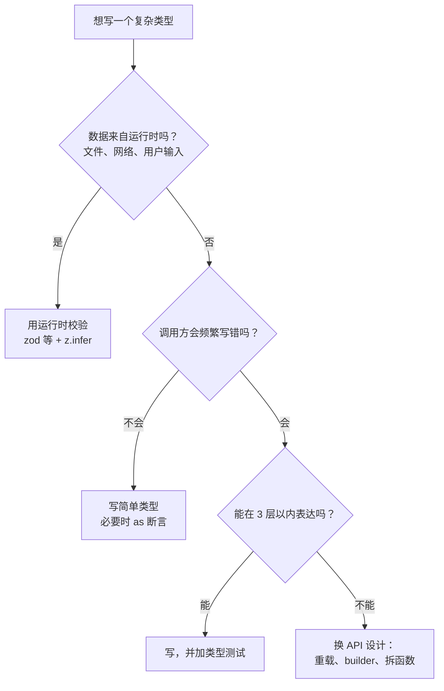

# 类型体操的边界

上一章的工具足够写出非常「聪明」的类型：在类型层面解析 SQL、做四则运算、校验 JSON 字符串。社区管这叫类型体操（type gymnastics）。它很好玩，但在产品代码里，它的代价经常被低估：编译变慢、编辑器卡顿、报错信息没人看得懂、换个人（或换个 agent）就没法维护。

这一章不教更多技巧，而是回答一个更实际的问题：**一个类型写到什么程度该停下来**。先看编译器的硬限制，再看怎么度量类型的成本，最后给出一套判断标准和替代方案。

## 编译器的硬限制

> [!WARNING]
> 本节的递归深度和联合大小上限是在 TypeScript 6.0.3 上实测的编译器内部常量。TypeScript 7（Go 重写的原生编译器 tsgo）可能调整这些上限和报错行为；以 TypeScript 发布说明和 TypeScript 仓库（含 typescript-go）的说明为准，换版本后重测。

类型系统是图灵完备的，所以编译器必须给递归设上限，否则一个写错的类型就能让 `tsc` 永远不结束。下面这些数字都是在 TypeScript 6.0.3 上实测的。

### 递归深度

```ts
// 尾递归写法：递归调用直接作为条件类型的分支结果
type Repeat<S extends string, N extends number, Acc extends string[] = []> =
  Acc["length"] extends N ? Acc : Repeat<S, N, [...Acc, S]>;

type Ok = Repeat<"a", 999>["length"];  // 999
// @ts-expect-error TS2589: Type instantiation is excessively deep and possibly infinite.
type TooDeep = Repeat<"a", 1000>["length"];
```

```ts
// 非尾递归写法：递归结果还要被展开进外层元组
type Build<N extends number, Acc extends unknown[] = []> =
  Acc["length"] extends N ? [] : [Acc["length"], ...Build<N, [...Acc, 0]>];

type Ok = Build<47>["length"];
// @ts-expect-error TS2589
type TooDeep = Build<48>["length"];
```

两者差了二十多倍。TypeScript 4.5 起对**尾递归的条件类型**做了优化，上限放宽到大约一千层；非尾递归仍受实例化深度的限制，几十层就到头。所以写递归类型时，能改成累加器（`Acc`）形式就改。

### 联合的大小

```ts
type D = "0" | "1" | "2" | "3" | "4" | "5" | "6" | "7" | "8" | "9";

type Four = `${D}${D}${D}${D}`; // 1 万个成员，可以
// @ts-expect-error TS2590: Expression produces a union type that is too complex to represent.
type Five = `${D}${D}${D}${D}${D}`; // 10 万个成员，报错
```

模板字面量类型会做笛卡尔积，成员数是乘出来的。一万个成员虽然没报错，但已经很慢了。

| 限制 | 触发条件（TS 6.0.3 实测） | 报错 |
|---|---|---|
| 尾递归条件类型 | 1000 层 | TS2589 |
| 非尾递归 | 本例 48 层 | TS2589 |
| 联合成员数 | 10 万 | TS2590 |

这些上限是编译器内部常量，不同写法、不同版本会有出入，**不要依赖具体数字**。真正该记住的是：碰到 TS2589 / TS2590，第一反应应该是「这个类型是不是写过头了」，而不是去找绕过限制的技巧。

## 度量类型的成本

没报错不代表没代价。`tsc --extendedDiagnostics` 会打印类型数量、实例化次数、内存和检查耗时：

```bash
npx tsc --noEmit --extendedDiagnostics
```

拿上面的 `Repeat<"a", 999>` 加一个 `Four` 联合单独编一个文件，对比一个只有 `export const y = 1` 的空文件：

| 指标 | 空文件 | 两个体操类型 |
|---|---|---|
| Types | 30,559 | 548,111 |
| Instantiations | 32,819 | 541,332 |
| Check time | 0.34s | 0.78s |
| Memory used | 约 115 MB | 约 493 MB |

两行类型定义，类型数量翻了十几倍，内存接近半个 G（空文件那三万多个类型基本来自标准库 `lib.*.d.ts`）。在大仓库里，这种成本会摊到每一次保存、每一次编辑器补全上。

要找出是哪个文件、哪个类型慢，用 `--generateTrace`：

```bash
npx tsc --noEmit --generateTrace trace-out
# 生成 trace.json 和 types.json，可以在 Chrome 的 about:tracing 或 Perfetto 里打开
npx @typescript/analyze-trace trace-out   # 官方的分析工具，直接列出热点
```

trace 里每一段 `checkSourceFile`、`checkExpression` 都有耗时，热点通常集中在少数几个泛型很重的调用点上。

## 报错信息也是成本

类型越聪明，出错时的报错越难读。比较两种写法：

```ts
// 体操版：在类型层面校验「必须是 a-z0-9- 组成的 slug」
type Lower = "a" | "b" | "c" | "d" | "e" | "f" | "g" | "h" | "i" | "j" | "k" | "l" | "m"
  | "n" | "o" | "p" | "q" | "r" | "s" | "t" | "u" | "v" | "w" | "x" | "y" | "z";
type SlugChar = Lower | "0" | "1" | "2" | "3" | "4" | "5" | "6" | "7" | "8" | "9" | "-";
type IsSlug<S extends string> = S extends "" ? true
  : S extends `${infer H}${infer R}` ? (H extends SlugChar ? IsSlug<R> : false) : false;

function bookId<S extends string>(s: IsSlug<S> extends true ? S : never): S {
  return s;
}

bookId("ts-node");
// @ts-expect-error 报错是：Argument of type '"TS_Node"' is not assignable to parameter of type 'never'.
bookId("TS_Node");
```

调用方看到的是「不能赋给 never」，完全不知道错在哪个字符。而且它只对字面量有效，运行时拿到的字符串（来自文件名、用户输入）根本用不上。对比第 1 章的品牌类型：一个正则 + 一个校验函数，报错就是一句 `invalid book id: TS_Node`，运行时也有效。

## 判断标准：什么时候该停



几条可操作的规则：

| 信号 | 建议 |
|---|---|
| 类型在校验**运行时**才知道的数据 | 停。用 zod / valibot 之类做运行时校验，类型从 schema 推出 |
| 同事（或 agent）读不懂、改不动 | 停。类型也是代码，可维护性优先 |
| 报错信息是 `never`、几十行嵌套展开 | 停，或者至少加一个可读的错误分支 |
| 只为消除一处 `as` | 停。一处有注释的断言比一百行类型便宜 |
| 碰到 TS2589 / TS2590 | 停。这是编译器在告诉你写过头了 |
| 写库的公共 API，调用方会很多 | 值得多投入，但要有类型测试 |

### 替代方案

**函数重载**比条件类型的返回值更好读：

```ts
function read(path: string, encoding: "utf8"): string;
function read(path: string): Uint8Array;
function read(path: string, encoding?: "utf8"): string | Uint8Array {
  const bytes = new Uint8Array();
  return encoding ? new TextDecoder().decode(bytes) : bytes;
}

const text = read("a.md", "utf8"); // string
const raw = read("cover.png");     // Uint8Array
```

**拆 API**：与其写一个能接受十种形态参数的函数、再用类型体操推导返回值，不如拆成几个名字清楚的函数。类型体操常常是 API 设计不够简单的症状。

**接受一处断言**：第 2 章 `dispatch` 里那次断言就是例子。在边界处断言、写清理由、用测试覆盖，比追求「零断言」务实得多。

## 类型也要测试

如果你确实写了一个复杂类型（比如库的公共 API），给它写测试。最轻量的办法是用 `@ts-expect-error` 和一个相等判断，放进普通的 `.ts` 文件里，`tsc` 跑过就算通过：

```ts
type Equal<A, B> =
  (<T>() => T extends A ? 1 : 2) extends (<T>() => T extends B ? 1 : 2) ? true : false;
function expectType<T extends true>() {}

type Params<P extends string> = P extends `${string}:${infer N}/${infer R}`
  ? N | Params<`/${R}`>
  : P extends `${string}:${infer N}` ? N : never;

expectType<Equal<Params<"/books/:id">, "id">>();
expectType<Equal<Params<"/books/:id/chapters/:file">, "id" | "file">>();
expectType<Equal<Params<"/settings">, never>>();
// @ts-expect-error 期望失败的断言本身也要能失败
expectType<Equal<Params<"/books/:id">, "file">>();
```

Vitest 自带 `expectTypeOf`（配合 `vitest --typecheck`），写法更友好，hatch-shelf 这种已经用 Vitest 的仓库可以直接用。

## 在 agent 时代多一条

编码 agent 很擅长写类型体操：给它一个模糊需求，它可能交回一个 80 行、四层嵌套的条件类型，而且能编译通过。这时候按上面的标准审：数据是不是来自运行时？报错是否可读？能不能换成重载或 schema？在项目的 `CLAUDE.md` 这类说明文件里写一句「类型保持简单，运行时数据用 schema 校验，复杂类型必须带类型测试」，能省掉很多来回。

## 本章要点

- 编译器对递归和联合大小有硬上限：尾递归约一千层，非尾递归几十层，联合十万成员报错；碰到 TS2589 / TS2590 先反思设计
- 用 `--extendedDiagnostics` 看类型数量和实例化次数，用 `--generateTrace` 定位慢的类型
- 报错信息的可读性是类型设计的一部分，`never` 报错基本等于没报错
- 运行时数据用 schema 校验，不用类型体操；一处有注释的断言比一百行类型便宜
- 复杂类型要有类型测试：`Equal` + `@ts-expect-error`，或 Vitest 的 `expectTypeOf`
