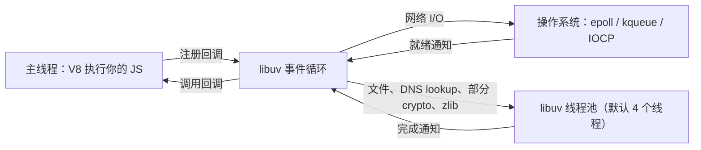
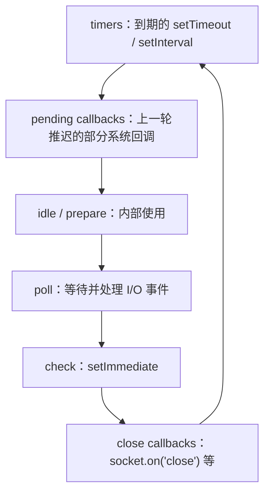

# 事件循环与 libuv

从这一章开始进入运行时。「Node 是单线程的」「Node 是异步非阻塞的」这两句话都对，但只说对了一半：JS 代码确实跑在一个线程上，可 Node 进程里还有一个线程池和操作系统的事件通知机制在干活。搞清楚这几个部件怎么配合，你才能回答这些问题：为什么一次同步的 `pbkdf2Sync` 能让整个服务卡住？为什么 `setTimeout(fn, 0)` 和 `setImmediate` 的顺序时好时坏？为什么把 `UV_THREADPOOL_SIZE` 调大有时有用、有时没用？

## 三个部件



- **V8**：执行 JS，一次只执行一段，同步代码执行期间什么别的都做不了
- **libuv**：一个 C 库，提供事件循环和跨平台的异步 I/O 抽象
- **两种异步来源**：网络套接字用操作系统的就绪通知（Linux 上是 epoll，macOS 上是 kqueue），不占线程；操作系统没有好用异步接口的操作（文件读写、`dns.lookup`、`crypto.pbkdf2` / `scrypt`、`zlib` 的异步方法等）交给线程池

所以「单线程」说的是**你的 JS 只在一个线程上执行**；「非阻塞」说的是 I/O 等待不占用这个线程。两句话的前提都是：你的 JS 本身不要长时间占着线程。

## 事件循环的阶段

libuv 的事件循环每一轮按固定顺序走过几个阶段，每个阶段有自己的回调队列：



最重要的是三个：

| 阶段 | 跑什么 | 要点 |
|---|---|---|
| timers | 到期的定时器 | 「到期」是下限，不是准点；`setTimeout(fn, 0)` 实际是 1 ms |
| poll | I/O 回调（读到数据、连接建立……） | 没有别的事做时，循环会在这里**阻塞等待**，这是进程空闲时不占 CPU 的原因 |
| check | `setImmediate` | 紧跟 poll 之后，所以在 I/O 回调里调用 `setImmediate` 一定比定时器先执行 |

### 微任务插在每个回调之间

阶段之外还有两个优先级更高的队列，它们不属于 libuv，由 Node 和 V8 管理：

- `process.nextTick` 队列（Node 管理）
- Promise 微任务队列（V8 管理，`.then`、`await` 之后的代码、`queueMicrotask`）

自 Node 11 起，**每执行完一个宏任务回调**，Node 都会先清空这两个队列，再执行下一个回调。所以一个无限递归的 `process.nextTick` 或者无限链的 Promise 一样能把事件循环饿死——它们根本不给 I/O 阶段机会。

## 用代码验证顺序

```js
// order.mjs —— 注意是 ESM
import { readFile } from "node:fs";

setTimeout(() => console.log("1 timeout"), 0);
setImmediate(() => console.log("2 immediate"));
Promise.resolve().then(() => console.log("3 promise"));
process.nextTick(() => console.log("4 nextTick"));
queueMicrotask(() => console.log("5 microtask"));

readFile(import.meta.filename, () => {
  setTimeout(() => console.log("6 timeout in I/O"), 0);
  setImmediate(() => console.log("7 immediate in I/O"));
  process.nextTick(() => console.log("8 nextTick in I/O"));
});

console.log("0 sync");
```

Node 22 上的输出：

```text
0 sync
3 promise
5 microtask
4 nextTick
1 timeout
2 immediate
8 nextTick in I/O
7 immediate in I/O
6 timeout in I/O
```

几处值得细看：

1. **ESM 里 Promise 比 nextTick 先**。很多文章说「nextTick 永远先于 Promise」，那是 CommonJS 的情况。ESM 模块的执行本身发生在一个 Promise 任务里，模块代码跑完后 V8 先清空微任务队列，才轮到 Node 的 nextTick 队列。把同样的代码改成 `.cjs`，输出就变成 `nextTick` 在 `promise` 之前。不要写依赖这两者相对顺序的代码
2. **主模块里 timeout 和 immediate 的顺序理论上不确定**：取决于进入循环时 1 ms 是否已经过去。这台机器上多次运行都是 timeout 先，但换个负载可能反过来
3. **I/O 回调里，immediate 一定先于 timeout**：回调在 poll 阶段执行，下一个阶段就是 check

## 线程池：4 个线程的瓶颈

线程池默认只有 4 个线程。所有走线程池的操作共用它们：

```js
// pool.mjs
import { pbkdf2 } from "node:crypto";

const start = performance.now();
for (let i = 1; i <= 8; i++) {
  pbkdf2("pw", "salt", 200_000, 64, "sha512", () => {
    console.log(`#${i} 完成于 ${(performance.now() - start).toFixed(0)} ms`);
  });
}
```

```text
$ node pool.mjs
#1 完成于 41 ms
#4 完成于 43 ms
#2 完成于 45 ms
#3 完成于 45 ms
#5 完成于 84 ms
#6 完成于 86 ms
#7 完成于 88 ms
#8 完成于 88 ms

$ UV_THREADPOOL_SIZE=8 node pool.mjs
#7 完成于 46 ms
#8 完成于 55 ms
...
#4 完成于 72 ms
```

默认配置下 8 个任务明显分成两批，每批 4 个；线程池加到 8 后一批做完（这台机器 12 核）。由此得出几个实践结论：

- 一个服务如果大量做密码哈希、压缩、读文件，这些操作会**互相排队**。比如登录接口的 `scrypt` 占满 4 个线程时，同一进程里的 `fs.readFile` 也得等
- `UV_THREADPOOL_SIZE` 必须在线程池第一次被使用**之前**设置，最稳妥的是写在启动命令或 systemd 的 `Environment=` 里，而不是在代码中途改 `process.env`
- 调大有上限意义：超过 CPU 核数后，CPU 密集任务不会更快，只会多占内存
- 网络 I/O 不走线程池，所以对一个纯 HTTP 转发服务，这个参数基本没影响

## 阻塞主线程的代价

事件循环最怕的是同步代码跑太久。下面用 `perf_hooks` 的 `monitorEventLoopDelay` 量一下：

```ts
// lag.ts —— Node 22.18+ 可以直接 node lag.ts
import { monitorEventLoopDelay } from "node:perf_hooks";
import { pbkdf2Sync } from "node:crypto";

const h = monitorEventLoopDelay({ resolution: 1 });
h.enable();

// 每 100 ms 来一个「请求」，其中一个用了同步加密
let n = 0;
const timer = setInterval(() => {
  n++;
  if (n === 5) pbkdf2Sync("pw", "salt", 500_000, 64, "sha512"); // 阻塞主线程
  if (n === 10) {
    clearInterval(timer);
    h.disable();
    const ms = (ns: number) => (ns / 1e6).toFixed(1) + " ms";
    console.log("p50", ms(h.percentile(50)), "p99", ms(h.percentile(99)), "max", ms(h.max));
  }
}, 100);
```

```text
p50 1.3 ms p99 1.5 ms max 127.9 ms
```

一次 `pbkdf2Sync` 让事件循环停了一百多毫秒。在这段时间里，进程收不到任何新请求、发不出任何响应、定时器也不会触发。如果这是一个 NestJS 服务，所有并发请求的延迟都会被加上这一百多毫秒。（这个直方图的基线大约等于采样间隔 `resolution`，看的是 max 和高分位相对基线的偏离。）

把它接进监控很简单：定期读 `percentile(99)` 和 `max` 上报，然后 `reset()`。事件循环延迟是 Node 服务最有价值的健康指标之一，比 CPU 使用率更能直接反映「用户是不是在等」。

### 常见的阻塞源

| 来源 | 例子 | 替代 |
|---|---|---|
| 同步 API | `fs.readFileSync`、`crypto.*Sync`、`zlib.*Sync` | 用异步版本；启动阶段读配置可以例外 |
| 大 JSON | 几十 MB 的 `JSON.parse` / `JSON.stringify` | 流式解析，或者从源头减小 payload |
| 正则回溯 | 嵌套量词遇到恶意输入（ReDoS） | 简化正则，限制输入长度 |
| 大数组计算 | 对十万条数据排序、聚合 | 推给数据库做，或者放进 Worker |

## CPU 密集任务：worker_threads

真正的 CPU 密集工作（图像处理、大量哈希、解析大文件）应该离开主线程。`worker_threads` 在同一进程里开新的 V8 实例和事件循环：

```ts
// hash-worker.ts
import { parentPort, workerData } from "node:worker_threads";
import { pbkdf2Sync } from "node:crypto";

const { password, salt } = workerData as { password: string; salt: string };
const key = pbkdf2Sync(password, salt, 500_000, 64, "sha512"); // 在 worker 里阻塞没关系
parentPort!.postMessage(key.toString("hex").slice(0, 16));
```

```ts
// main.ts
import { Worker } from "node:worker_threads";
import { once } from "node:events";

async function hashInWorker(password: string, salt: string): Promise<string> {
  const worker = new Worker(new URL("./hash-worker.ts", import.meta.url), {
    workerData: { password, salt },
  });
  const [result] = (await once(worker, "message")) as [string];
  return result;
}

const tick = setInterval(() => process.stdout.write("."), 20); // 主线程没被卡住就会一直打点
console.log("\n" + (await hashInWorker("pw", "salt")));
clearInterval(tick);
```

运行时能看到哈希计算期间主线程一直在打点。注意每次新建 Worker 有几十毫秒级的启动开销和独立的内存，生产里应该用固定大小的 worker 池（自己写一个队列，或者用 piscina 这类库），而不是每个请求开一个。

还要分清 worker 与线程池的关系：`crypto.pbkdf2`（异步版）已经在线程池里跑了，不需要再套 worker；worker 适合的是**你自己写的 JS 计算**，因为那部分只能在某个 V8 线程上执行。

## 本章要点

- Node 进程 = 一个执行 JS 的主线程 + libuv 事件循环 + 默认 4 线程的线程池；网络 I/O 走操作系统通知，文件、DNS lookup、部分 crypto 和 zlib 走线程池
- 事件循环按 timers → poll → check → close 等阶段轮转；每个回调之后先清空 nextTick 和 Promise 微任务
- ESM 中 Promise 微任务会先于 nextTick，CJS 中相反；不要依赖两者的相对顺序
- 线程池任务互相排队，`UV_THREADPOOL_SIZE` 要在启动前设置，超过核数意义不大
- 同步代码是事件循环的头号敌人，用 `monitorEventLoopDelay` 度量并接入监控
- 自己写的 CPU 密集计算放进 `worker_threads`，并用固定大小的池
