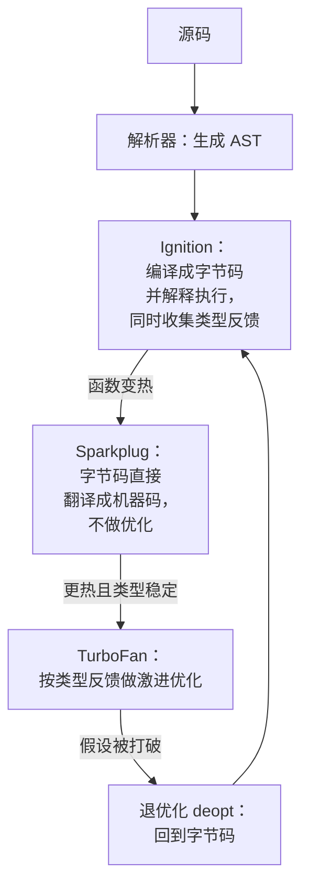
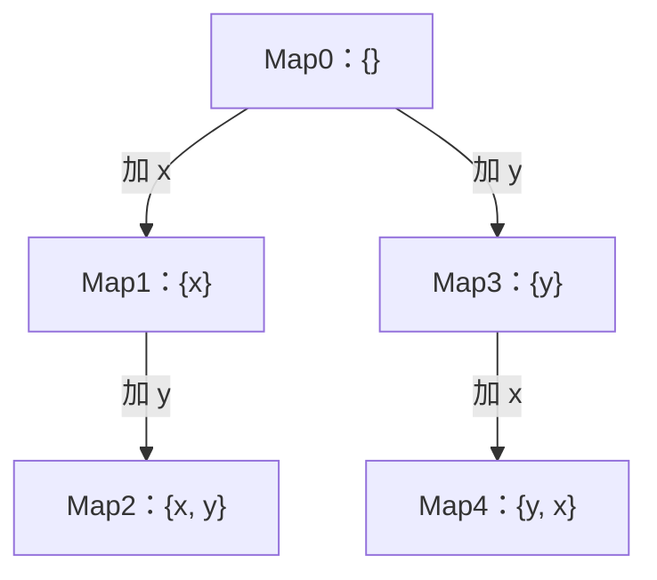
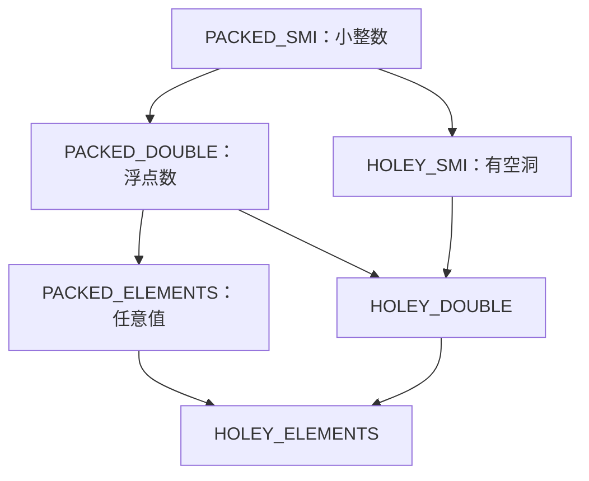

# V8 编译管线与隐藏类

JS 是动态语言：对象随时可以加属性，变量随时可以换类型。按理说这样的语言应该很慢，可 V8 跑出来的性能经常接近静态语言。秘密在于 V8 **赌你的代码其实没那么动态**：它观察运行时的真实类型，按观察结果生成优化过的机器码；一旦赌输，就退回去重来。

这一章讲清这个「观察 → 优化 → 退优化」的循环，以及它依赖的两个关键结构：隐藏类（hidden class，V8 内部叫 Map）和内联缓存（inline cache）。目的不是让你去做微优化，而是让你在性能剖析里看到 `deopt`、`megamorphic` 这些词时知道发生了什么，并且写出「不跟引擎作对」的代码。

## 分层编译管线

> [!WARNING]
> 表中「Maglev 默认关闭」是笔者在 Node 22.23 上用 `node --v8-options` 看到的结果，不同 Node 版本、不同 CPU 架构的默认值可能不同；以 Node.js 发布说明和 V8 官方博客为准，并用下文的命令在你自己的环境里确认。



| 层 | 角色 | 特点 |
|---|---|---|
| Ignition | 解释器 | 启动快、内存省；执行的同时记录每个操作见过什么类型（类型反馈，feedback vector） |
| Sparkplug | 基线编译器 | 把字节码一对一翻译成机器码，省掉解释开销，编译极快 |
| Maglev | 中层优化编译器 | 介于两者之间；在笔者的 Node 22.23 上默认关闭（`node --v8-options` 里显示 `default: --no-maglev`），新版本 Node 可能默认开启 |
| TurboFan | 顶层优化编译器 | 基于类型反馈做内联、逃逸分析、去掉类型检查，生成最快的代码 |

可以用 `node --v8-options | grep -A1 maglev` 查你那个版本的默认值，也可以用 `--trace-opt` 看函数最终被编译到哪一层（输出里的 `target TURBOFAN` / `target MAGLEV`）。

关键在于 TurboFan 的优化**基于假设**。比如它观察到 `shape.w` 每次都是在同一种形状的对象上读的，就生成「直接从固定偏移量读」的机器码，前面只放一个廉价的检查。检查失败，就是 deopt。

## 隐藏类：给动态对象一个静态布局

V8 不把对象当哈希表存。每个对象都指向一个**隐藏类**，描述「有哪些属性、各在第几个槽位」。形状相同的对象共享同一个隐藏类，读属性就变成「查隐藏类 → 按偏移读」，和 C 结构体差不多。

给对象加属性时，V8 会沿着一条**转换链**（transition chain）切换隐藏类：



`{x, y}` 和 `{y, x}` 属性一样，但走的是两条不同的路径，所以是**两个不同的隐藏类**。可以用 V8 的内部函数直接验证（`--allow-natives-syntax` 只用于实验，不要用在生产代码里）：

```js
// maps.js —— node --allow-natives-syntax maps.js
const a = { x: 1, y: 2 };
const b = { x: 3, y: 4 };
const c = { y: 5, x: 6 };
const d = { x: 7 }; d.y = 8;
const e = { x: 1, y: 2 }; delete e.y;

console.log("a~b", %HaveSameMap(a, b));          // true：同样的字面量
console.log("a~c", %HaveSameMap(a, c));          // false：顺序不同
console.log("a~d", %HaveSameMap(a, d));          // false：先建再加，路径不同
console.log("e fast?", %HasFastProperties(e));   // false：delete 让对象退化成字典模式

class P { constructor(x, y) { this.x = x; this.y = y; } }
const p1 = new P(1, 2), p2 = new P(3, 4);
p2.z = 1;
console.log("p1~p2", %HaveSameMap(p1, p2));      // false：事后加属性分叉了

const f = { x: 1, y: 2 }; f.y = undefined;
console.log("f fast?", %HasFastProperties(f), %HaveSameMap(a, f)); // true true
```

最后一行很有用：**想「删掉」一个属性时，赋 `undefined` 不改变形状**，而 `delete` 会把对象打回字典模式（属性存进哈希表，访问变慢，也不再与同类对象共享隐藏类）。

### 写 TS 时自然就做对了的事

好消息是，规矩写 TypeScript 基本天然满足 V8 的偏好：

- **类的字段在声明处或构造函数里一次性初始化**，所有实例形状一致。TS 的 `target` 为 ES2022 及以上时，类字段默认按标准语义（`useDefineForClassFields`）定义，声明了的字段即使没赋值也会以 `undefined` 存在，形状稳定
- **接口固定了对象的形状**，不太会出现「有时有这个属性，有时没有」
- **用 `undefined` / `null` 表示缺失**，而不是 `delete`

真正需要注意的是那些「看起来无害」的动态写法：根据条件给对象追加属性、用对象当字典并频繁增删键（这种场景应该用 `Map`）、同一个函数接收大量不同形状的对象。

## 内联缓存：单态、多态、超态

每个属性访问点（比如 `o.x` 出现在源码里的那一处）都有一个内联缓存，记住它见过哪些隐藏类：

| 状态 | 见过的隐藏类 | 访问代价 |
|---|---|---|
| 单态 monomorphic | 1 种 | 一次比较 + 一次按偏移读，最快 |
| 多态 polymorphic | 2–4 种 | 线性比较几个候选 |
| 超态 megamorphic | 更多 | 放弃缓存，走全局查找，最慢 |

用一个小基准感受一下差别。同一个 `getX(o)`，分别喂 1 种、4 种、8 种形状的对象：

```js
// poly.js —— node poly.js 1 / 4 / 8
function getX(o) { return o.x; }

function bench(label, objs) {
  let s = 0;
  const t = performance.now();
  for (let i = 0; i < 2e7; i++) s += getX(objs[i % objs.length]);
  console.log(label, (performance.now() - t).toFixed(0), "ms");
  return s;
}

const shapes = (n) => Array.from({ length: n }, (_, k) => {
  const o = { x: 1 };
  o["k" + k] = k; // 每个对象多一个不同名的属性 → 不同的隐藏类
  return o;
});

bench(process.argv[2] + " shapes:", shapes(Number(process.argv[2])));
```

```text
1 shapes: 28 ms
4 shapes: 34 ms
8 shapes: 62 ms
```

（Node 22，Apple Silicon，多次运行结果稳定。）超态比单态慢了一倍多。两千万次调用才差三十多毫秒，所以对普通业务代码这完全不是问题；但对热路径——比如一个处理每条日志、每个 token、每个像素的函数——形状的一致性就开始显著影响吞吐。

## 退优化：赌输了会怎样

```js
// deopt.js
function area(shape) {
  return shape.w * shape.h;
}
let sum = 0;
for (let i = 0; i < 1e6; i++) sum += area({ w: i, h: 2 }); // 一直是同一种形状
sum += area({ h: 2, w: 3 });                                // 换了属性顺序 → 新的隐藏类
console.log(sum);
```

```bash
node --trace-opt --trace-deopt deopt.js 2>&1 | grep area
```

输出（地址已省略）：

```text
[marking <JSFunction area> for optimization to TURBOFAN, reason: hot and stable]
[completed optimizing <JSFunction area> (target TURBOFAN)]
[bailout (kind: deopt-eager, reason: wrong map): begin. deoptimizing <JSFunction area> ...]
```

`reason: wrong map` 就是「隐藏类不对」：优化代码假设 `shape` 一定是 `{w, h}` 那个形状，来了一个 `{h, w}`，检查失败，退回字节码。之后 V8 会带着更新的类型反馈重新优化（这次是多态版本）。

偶尔的 deopt 无所谓。要警惕的是**反复 deopt → 重新优化 → 再 deopt** 的震荡，它在 CPU 剖析里表现为某个函数时间异常高，`--trace-deopt` 里同一个函数反复出现。

## 数组的元素种类

数组也有类似的「形状」，V8 叫 elements kind。它只会朝更通用的方向转换，**不会回退**：

```js
// elements.js —— node --allow-natives-syntax elements.js
const kind = (a) => %HasSmiElements(a) ? "SMI" : %HasDoubleElements(a) ? "DOUBLE" : "ELEMENTS";
const holey = (a) => %HasHoleyElements(a) ? "HOLEY_" : "PACKED_";

const a = [1, 2, 3];            console.log(holey(a) + kind(a)); // PACKED_SMI
a.push(4.5);                    console.log(holey(a) + kind(a)); // PACKED_DOUBLE
a.push("x");                    console.log(holey(a) + kind(a)); // PACKED_ELEMENTS
a.pop(); a.pop();               console.log(holey(a) + kind(a)); // 仍是 PACKED_ELEMENTS
const b = new Array(3);         console.log(holey(b) + kind(b)); // HOLEY_SMI
const c = [1, 2, 3]; c[10] = 4; console.log(holey(c) + kind(c)); // HOLEY_SMI
```



SMI（small integer）数组最紧凑，可以直接存整数；混入一个字符串就变成通用数组，每个元素都是指针。有空洞（holey）的数组访问时还要检查原型链。实践建议很朴素：**同一个数组只放同一种东西**；预先知道长度时用 `Array.from({ length: n }, () => 0)` 填满，而不是 `new Array(n)` 后再赋值；大量数值计算直接用 `Float64Array` / `Int32Array` 这类类型化数组。

## 该怎么用这些知识

| 做 | 不做 |
|---|---|
| 先用剖析工具找到热点（第 8 章），再看热点里有没有形状问题 | 凭感觉到处「优化」隐藏类 |
| 热路径上的对象用类或工厂函数统一创建 | 在业务代码里写 `%` 内部函数 |
| 频繁增删键的字典用 `Map` | 把 `delete` 当成常规操作 |
| 热点函数输入的类型保持稳定 | 为了「单态」把代码写得别扭难读 |

V8 的启发式每个版本都在变，今天的「技巧」明天可能就失效了。稳定不变的是原理：**引擎为稳定的形状和类型生成快代码**。写清楚、类型稳定的代码，通常就是快代码。

## 本章要点

- V8 分层编译：Ignition 解释并收集类型反馈 → Sparkplug 基线编译 → TurboFan 按反馈激进优化；Maglev 是否默认开启取决于 Node 版本
- 优化基于假设，假设被打破就 deopt；偶尔 deopt 正常，反复震荡才是问题
- 隐藏类描述对象形状，属性的**添加顺序**决定隐藏类；`delete` 让对象退化为字典模式，赋 `undefined` 不会
- 内联缓存有单态、多态、超态三种状态，热路径上超态可以慢一倍以上
- 数组的 elements kind 只会向通用方向转换，同一数组只放同一类值
- 先剖析、后优化；规矩写 TS 基本天然满足引擎的偏好

## 动手练习

1. **多一个属性也是新形状**：把本章 `deopt.js` 最后那次调用改成 `area({ w: 3, h: 2, d: 1 })`（属性顺序不变，只是多了 `d`），运行 `node --trace-opt --trace-deopt deopt.js 2>&1 | grep area`；再改成 `area({ w: 3, h: 2 })` 运行一次。

   验证：多了 `d` 时仍然出现 `bailout (kind: deopt-eager, reason: wrong map)`；形状完全相同时只有 `marking ... for optimization` 和 `completed optimizing` 几行，没有 `bailout`。

   参考答案：隐藏类由属性集合和添加顺序共同决定，`{w, h, d}` 和 `{w, h}` 是两个隐藏类，优化代码里的形状检查同样会失败。

2. **构造函数里的条件赋值**：用 `node --allow-natives-syntax` 运行：

   ```js
   class Point { constructor(x, y) { this.x = x; if (y !== undefined) this.y = y; } }
   const p1 = new Point(1, 2), p2 = new Point(1);
   console.log(%HaveSameMap(p1, p2));
   const cache = {};
   for (let i = 0; i < 20; i++) cache["k" + i] = i;
   for (let i = 0; i < 10; i++) delete cache["k" + i];
   console.log(%HasFastProperties(cache));
   ```

   先预测两行输出，再把构造函数改成无条件的 `this.y = y;`、把 `cache` 换成 `new Map()`（相应用 `set` / `delete`），想想第一行会怎样变化。

   验证：原代码输出 `false` 和 `false`；无条件赋值后第一行变成 `true`。

   参考答案：条件赋值让同一个类的实例分成两种形状；把对象当字典频繁 `delete`，会退化成字典模式。前者改成总是赋值（缺失时就是 `undefined`），后者换成 `Map`。这两种写法在 TS 代码里都很常见，`--allow-natives-syntax` 只用于这种实验。

3. **把超态变回单态**：本章 `poly.js` 用 8 种形状测得明显变慢。改写 `shapes`，让 8 个对象都是 `{ x: 1, k }`（同一组属性名，值不同），用同样的循环测一次。

   验证：用时回到和 `1 shapes` 同一个量级（比 8 种不同形状时明显更快）；具体毫秒数和机器有关，记下你自己的三组数。

   参考答案：区分对象的信息放在属性**值**里而不是属性**名**里，所有对象共享一个隐藏类，`getX` 的内联缓存保持单态。
