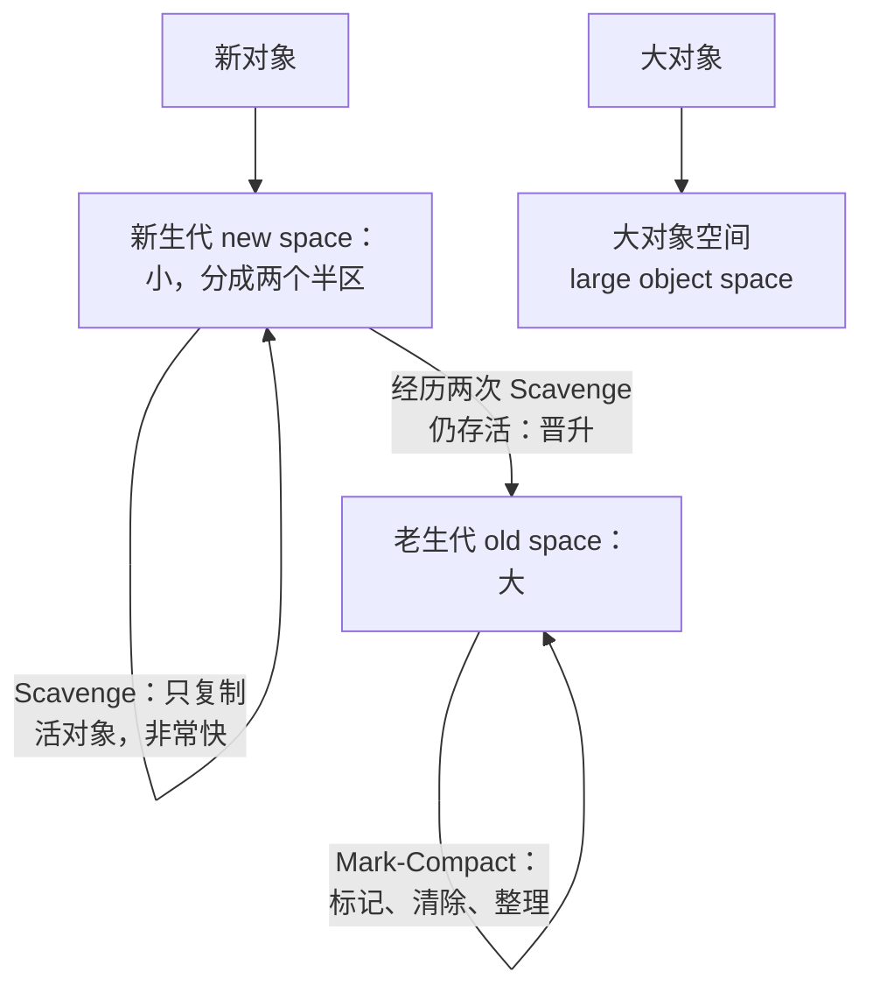
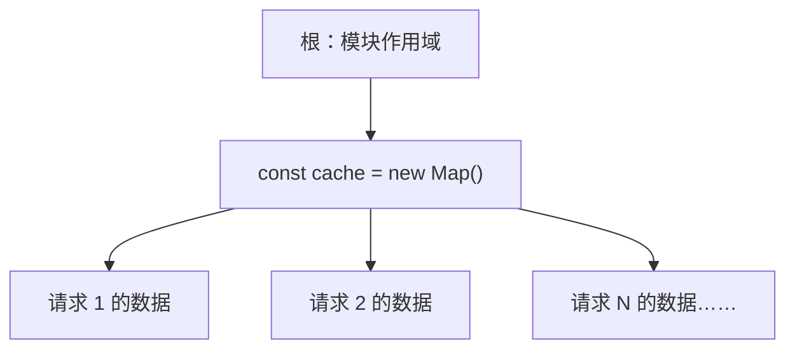
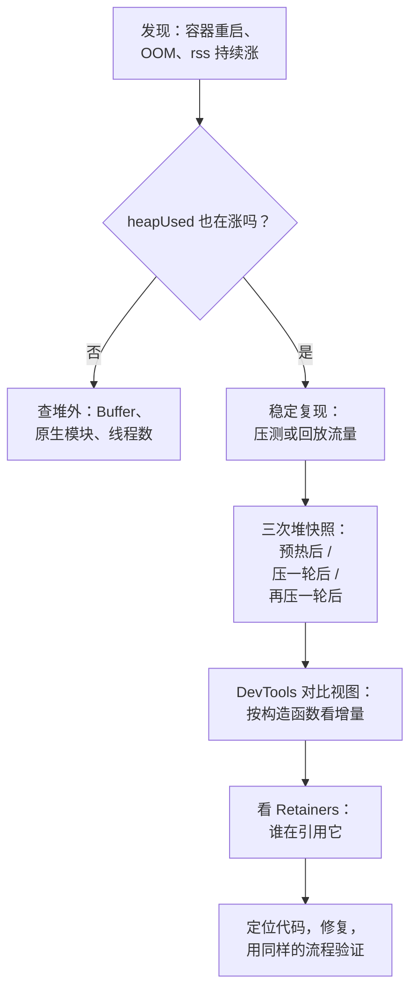

# 内存与 GC、泄漏排查

「服务跑几天就越来越慢，最后被 OOM 杀掉，重启就好了」——这是 Node 后端最常见的故障之一。部署在一台小 VPS 上的 Docker 容器尤其明显：内存配额小，泄漏几百 MB 就到顶。

这一章先讲 V8 堆的结构和垃圾回收怎么工作，因为不懂 GC 就分不清「内存高」和「内存泄漏」；然后列出 Node 里最常见的几种泄漏模式；最后给出一套从「发现内存在涨」到「定位到具体哪行代码」的排查流程。

## 进程内存的组成

`process.memoryUsage()` 返回几个数字，它们的含义经常被混淆：

| 字段 | 含义 |
|---|---|
| `rss` | 常驻内存，操作系统眼里这个进程占了多少物理内存。容器的内存限制、OOM killer 看的是它 |
| `heapTotal` | V8 堆当前向系统申请的大小 |
| `heapUsed` | V8 堆里实际被对象占用的部分 |
| `external` | V8 管理之外、但由 JS 对象持有的 C++ 内存，比如 `Buffer` 的底层数据 |
| `arrayBuffers` | `external` 中属于 `ArrayBuffer` / `Buffer` 的部分 |

`rss` 大约等于「V8 堆 + 堆外内存（Buffer 等） + 代码和线程栈 + 原生模块自己分配的内存」。所以：

- `heapUsed` 稳定但 `rss` 持续涨：怀疑 Buffer 没释放、原生模块（图像处理、数据库驱动）泄漏
- `heapUsed` 持续涨：JS 对象泄漏，用堆快照能查到，本章主要讲这种

## V8 堆与分代回收

V8 的 GC 基于一个经验事实——**分代假说**：大多数对象朝生夕死（一个请求里的临时对象），活下来的对象往往会活很久（缓存、连接池、模块级状态）。所以堆被分成两代，用不同算法回收：



| 代 | 算法 | 特点 |
|---|---|---|
| 新生代 | Scavenge（半区复制） | 只遍历活对象，死对象越多越划算；频繁、每次很短 |
| 老生代 | Mark-Sweep-Compact | 从根出发标记所有可达对象，清掉其余的，必要时整理碎片 |

V8 的 GC 项目叫 Orinoco，它把老生代的标记做成了**增量和并发**的：大部分标记工作在后台线程进行，主线程只需短暂停顿。所以现代 Node 里「GC 停顿」一般在毫秒级，除非堆非常大或者在临近上限时拼命回收。

用 `--trace-gc` 可以看到每次回收：

```bash
node --trace-gc app.js
```

```text
[53650:0x76d280c000]       66 ms: Scavenge 4.3 (4.9) -> 4.2 (5.9) MB, pooled: 0 MB, 0.33 / 0.00 ms ...
[53916:0x756880c000]      648 ms: Mark-Compact 31.3 (65.1) -> 31.2 (65.1) MB, pooled: 0 MB, 0.54 / 0.00 ms ...
```

读法：`31.3 (65.1) -> 31.2 (65.1) MB` 是「回收前已用（堆总量）→ 回收后已用（堆总量）」。**一次 Mark-Compact 之后几乎没有降下来**，说明这些对象都还被引用着——如果这个数字随时间单调上升，基本就是泄漏。

## 「可达」才是关键

GC 回收的是**不可达**的对象：从根（全局对象、当前调用栈、活跃的闭包和句柄）出发顺着引用找不到的对象。所以 JS 里的泄漏从来不是「忘了 free」，而是**某个长寿对象意外地引用了本该死掉的东西**。



上图里的请求数据处理完就没用了，但只要 `cache` 还活着（模块级变量会一直活着）并且引用它们，GC 就永远不能回收。

## 泄漏长什么样

一个最小的复现：模拟请求处理，每个请求分配约 8 KB 的数组；泄漏版本把它放进一个只进不出的 `Map`：

```js
// leak.mjs —— node leak.mjs leak / node leak.mjs ok
const leaky = process.argv[2] === "leak";
const cache = new Map();
let id = 0;

function handle() {
  const req = { id: ++id, rows: Array.from({ length: 1_000 }, (_, i) => i + id) };
  if (leaky) cache.set(req.id, req); // 只进不出：泄漏
  return req.rows.length;
}

const samples = [];
const timer = setInterval(() => {
  for (let i = 0; i < 300; i++) handle();
  samples.push(Math.round(process.memoryUsage().heapUsed / 1024 / 1024));
  if (samples.length === 30) { clearInterval(timer); console.log(JSON.stringify(samples)); }
}, 50);
```


正常版本的临时对象在新生代就被 Scavenge 收掉了，`heapUsed` 稳定在 4 MB 左右；泄漏版本每处理一千个请求涨约 8 MB，一条直线涨上去。真实服务里曲线没这么干净（会叠加 GC 的锯齿），但判断标准一样：**看 GC 之后的低点是不是在持续抬高**。

撞到堆上限时进程会崩溃：

```text
FATAL ERROR: Reached heap limit Allocation failed - JavaScript heap out of memory
```

## 常见泄漏模式

| 模式 | 典型代码 | 修法 |
|---|---|---|
| 无上限的缓存 | 模块级 `Map` / 对象做缓存，只 set 不删 | 加上限（LRU）或过期时间；能用 `WeakMap` 就用 |
| 事件监听器 | 每个请求 `emitter.on(...)`，从不 `off` | 用 `once`、在结束时 `off`，或传 `{ signal }` 统一取消 |
| 定时器 | `setInterval` 闭包里引用大对象，从不 `clearInterval` | 生命周期结束时清理；不需要阻止退出的定时器调 `unref()` |
| 闭包 | 长寿回调意外捕获了大对象 | 只捕获需要的字段 |
| 永不结束的 Promise | 等待一个永远不会来的事件，链上挂着上下文 | 给等待加超时（`AbortSignal.timeout`） |
| 全局数组记日志 / 指标 | 调试时加的 `const logs = []` 忘了删 | 用有界的环形缓冲，或直接输出 |

事件监听器是 Node 特有的高发区，好在 Node 会提醒你：

```ts
// listeners.ts
import { EventEmitter } from "node:events";

const bus = new EventEmitter();

function handleRequest(id: number) {
  // 每个请求都往全局 bus 上挂一个监听器，却从不移除
  bus.on("config-changed", () => console.log(`request ${id} sees new config`));
}

for (let i = 0; i < 20; i++) handleRequest(i);
console.log("listeners:", bus.listenerCount("config-changed"));
```

```text
(node:55131) MaxListenersExceededWarning: Possible EventEmitter memory leak detected. 11 config-changed listeners added to [EventEmitter]. MaxListeners is 10. Use emitter.setMaxListeners() to increase limit
```

**看到这个警告不要第一时间去调 `setMaxListeners`**，先确认是不是真的在累积。

### 给缓存加上限

最小可用的 LRU 只需要利用 `Map` 按插入顺序迭代的特性：

```ts
// lru.ts
class LRU<K, V> {
  #map = new Map<K, V>();
  readonly max: number;
  constructor(max: number) {
    this.max = max;
  }
  get(key: K): V | undefined {
    const v = this.#map.get(key);
    if (v !== undefined) {
      this.#map.delete(key); // 挪到最新
      this.#map.set(key, v);
    }
    return v;
  }
  set(key: K, value: V): void {
    this.#map.delete(key);
    this.#map.set(key, value);
    if (this.#map.size > this.max) {
      const oldest = this.#map.keys().next().value as K;
      this.#map.delete(oldest);
    }
  }
  get size() { return this.#map.size; }
}

const cache = new LRU<number, number[]>(1_000);
for (let id = 0; id < 100_000; id++) cache.set(id, Array.from({ length: 1_000 }, (_, i) => i + id));
console.log("size", cache.size, "heapUsed", Math.round(process.memoryUsage().heapUsed / 1024 / 1024), "MB");
// size 1000 heapUsed 19 MB —— 十万次写入，内存被上限钉住
```

（注意这里没有用 `constructor(readonly max: number)` 这种参数属性写法，原因见第 9 章。）生产里可以直接用 `lru-cache` 这类成熟的库，它还支持按大小和 TTL 淘汰。

### WeakMap 与 WeakRef

如果缓存的键本身是对象（比如给某个请求对象、某个 DOM 节点挂附加数据），用 `WeakMap`：键不再被别处引用时，整条记录自动消失，不需要手动删。`WeakRef` 和 `FinalizationRegistry` 能做更灵活的弱引用，但回收时机不确定，**不要用它们实现业务逻辑**，只适合做「有了更好、没了重算」的缓存。

## 排查流程



### 第一步：确认是泄漏

先把 `heapUsed` 和 `rss` 接进监控（或者至少定期打日志），观察几个小时。流量高峰时内存高、低谷时回落，是正常的；**低谷时的基线一天比一天高**，才是泄漏。

### 第二步：拿堆快照

三种方式拿堆快照（`.heapsnapshot` 文件）：

```bash
# 1. 启动时开启信号触发，运行中 kill -USR2 <pid> 就会在 cwd 写一份快照
node --heapsnapshot-signal=SIGUSR2 dist/main.js

# 2. 快撞到堆上限时自动写快照（最多写 N 份），专门对付「过几天才 OOM」
node --heapsnapshot-near-heap-limit=2 dist/main.js

# 3. 连上 Chrome DevTools 手动拍：chrome://inspect → Memory → Take heap snapshot
node --inspect dist/main.js
```

也可以在代码里调 `v8.writeHeapSnapshot()`，比如做一个只在内网可访问的管理接口。要注意两点：

- 拍快照时**进程会停顿**，堆越大停得越久，而且需要额外占用和堆差不多大的内存；在内存已经紧张的生产容器里拍，可能直接把它推过上限
- 快照里有内存中的所有字符串，包括用户数据和密钥，按敏感文件对待，用完就删

在 Docker 里，最稳的办法是在预发环境用同样的镜像回放流量复现，而不是直接动生产。

### 第三步：三快照对比

单张快照里什么都有，很难看出问题。标准做法是拍三张：

1. 服务启动、预热完成后拍第一张（基线）
2. 压一轮流量（比如几千个请求）后拍第二张
3. 再压一轮后拍第三张

在 DevTools 的 Memory 面板加载第三张，视图切到 **Comparison**，和第二张比。按 `# Delta`（新增对象数）或 `Size Delta` 排序，持续增长的构造函数会排在前面。两轮都在涨、数量和请求数成正比的那一类，就是嫌疑人。

### 第四步：看 Retainers

选中一个可疑对象，下方的 **Retainers** 面板显示「谁引用着它」，一路往上就是到根的引用链。比如会看到类似：`Array` ← `rows` in `Object` ← `Map` ← `cache` in `system / Context`——`cache` 这个变量名就直接指向了源码。

几个看快照的小技巧：

- `(closure)` 和 `system / Context` 代表闭包捕获的变量，泄漏经常藏在这里
- 给关键对象用 class 而不是对象字面量，快照里会显示类名，比一堆 `Object` 好认得多
- `Shallow Size` 是对象自身大小，`Retained Size` 是「它死了能释放多少」，找大户看后者

## 容器里的堆上限

V8 会根据可用内存自动决定老生代上限，但在容器里，这个推断和你给容器的配额未必一致。实践中建议**显式设置**：

```bash
# 容器配额 512 MB 时，给堆留出 Buffer、代码、线程栈等堆外开销的余量
node --max-old-space-size=384 dist/main.js
```

```yaml
# docker-compose.yml 片段
services:
  api:
    environment:
      NODE_OPTIONS: --max-old-space-size=384
    deploy:
      resources:
        limits:
          memory: 512M
```

具体留多少余量取决于应用的堆外内存（大量 Buffer、图像处理会占很多），没有通用数字，用监控里 `rss - heapTotal` 的实际值来定。设对了的好处是：泄漏时进程以「JS heap out of memory」的明确错误退出，而不是被内核 OOM killer 悄无声息地杀掉，日志里能查到原因。

## 本章要点

- 区分 `rss`、`heapUsed` 和 `external`：堆在涨查 JS 对象，只有 rss 涨查 Buffer 和原生模块
- V8 分代回收：新生代 Scavenge 快速回收短命对象，老生代 Mark-Compact 并发标记；`--trace-gc` 能直接看到每次回收
- JS 的泄漏是「长寿对象引用了该死的对象」；判断标准是 GC 后的低点持续抬高
- 高发模式：无上限缓存、不移除的监听器、不清理的定时器、闭包捕获、永不结束的 Promise
- 排查：确认趋势 → 三次堆快照 → Comparison 视图找增量 → Retainers 找引用链
- 容器里显式设置 `--max-old-space-size`，为堆外内存留余量

## 动手练习

1. **从 --trace-gc 里认出泄漏**：用本章的 `leak.mjs`，分别运行 `node --trace-gc leak.mjs leak` 和 `node --trace-gc leak.mjs ok`，只看 `Scavenge` 行里 `->` 后面的数字。

   验证：`ok` 模式下每次回收后都回到 3–4 MB 左右；`leak` 模式下回收前后几乎一样，而且一路涨到七十多 MB。两次运行最后打印的 `samples` 数组和本章的图一致。

   参考答案：正常的临时对象在新生代就死了，回收后内存回落；泄漏的对象一直被 `cache` 引用，回收也收不掉。判断泄漏看的是「回收后的值」，不是峰值。

2. **让泄漏撞墙**：运行 `node --max-old-space-size=32 leak.mjs leak`，再运行 `node --max-old-space-size=32 leak.mjs ok`。

   验证：`leak` 模式在打印出 `samples` 之前崩溃，stderr 里有 `FATAL ERROR: Reached heap limit Allocation failed - JavaScript heap out of memory`；`ok` 模式正常打印一串 4 左右的数字。

   参考答案：堆上限压低后，泄漏几秒钟就能复现成一次明确的崩溃。复现长时间才出现的泄漏时，压低上限是加快反馈的好办法；生产里设对 `--max-old-space-size` 也是为了得到这种明确的错误，而不是被内核悄悄杀掉。

3. **修好监听器泄漏**：运行本章的 `listeners.ts`，确认看到 `MaxListenersExceededWarning` 和 `listeners: 20`。然后改成每个请求结束时移除自己的监听器：

   ```ts
   function handleRequest(id: number) {
     const onChange = () => console.log(`request ${id} sees new config`);
     bus.on("config-changed", onChange);
     return () => bus.off("config-changed", onChange); // 请求结束时调用
   }
   for (let i = 0; i < 20; i++) handleRequest(i)();
   ```

   验证：警告消失，输出 `listeners: 0`。

   参考答案：`off` 要拿到同一个函数引用，所以监听器要先存进变量。只想响应一次的用 `once`；要批量取消时用 `AbortSignal` 配合 `events.on` / `addEventListener` 一类支持 `signal` 的接口（`EventEmitter.prototype.on` 本身不接受 `signal` 选项）。
