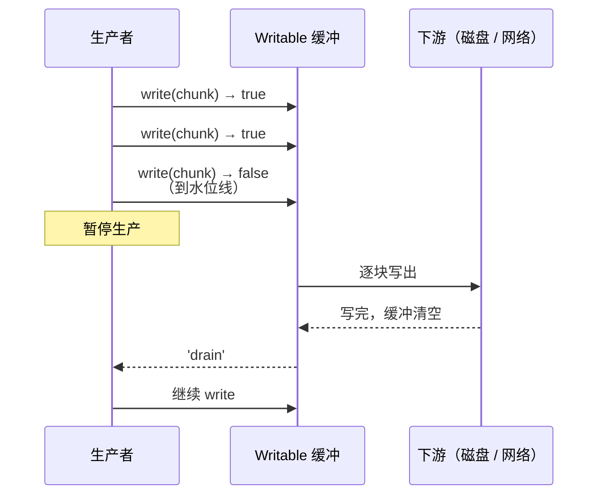
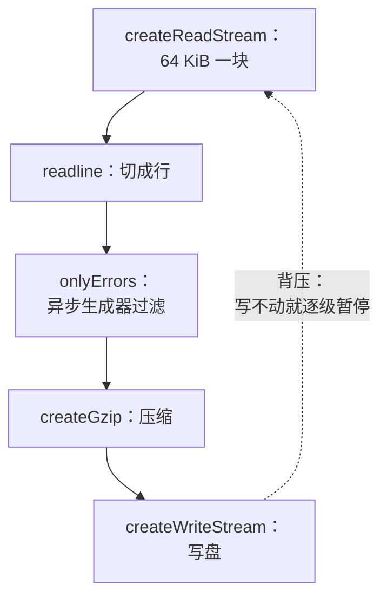

# Stream 与背压

导出一个几百 MB 的数据包、把用户上传的文件转存到对象存储、逐行处理一个大日志——这些任务如果先 `readFile` 整个读进内存再处理，内存占用就和文件大小成正比，一台 1 GB 内存的 VPS 撑不了几个并发。Stream 的意义是**让内存占用和数据总量无关**：一次只在内存里放一小块，处理完再拿下一块。

但 Stream 真正难的地方不是「分块」，而是**背压**（backpressure）：下游处理得比上游慢时，怎么让上游停下来等。处理不好背压，Stream 就退化成「换了个方式把整个文件读进内存」。这一章讲清背压的机制，以及在 Node 22 里写 Stream 代码的推荐姿势：`pipeline` + 异步迭代。

## 四种流

| 类型 | 方向 | 例子 |
|---|---|---|
| Readable | 产出数据 | `fs.createReadStream`、HTTP 请求体 `req`、`process.stdin` |
| Writable | 消费数据 | `fs.createWriteStream`、HTTP 响应 `res`、`process.stdout` |
| Duplex | 两个独立方向 | TCP socket |
| Transform | 输入经过变换后输出 | `zlib.createGzip()`、加解密、按行切分 |

每个流内部都有一个缓冲区，`highWaterMark` 是它的「水位线」：

- 字节流默认 64 KiB（Node 22 起；之前的版本是 16 KiB）
- 对象模式（`objectMode: true`）默认 16 个对象
- `fs.createReadStream` 一直是 64 KiB

水位线**不是硬上限**，而是一个信号阈值：缓冲超过它，流就会告诉上游「先别给了」。

## 背压的机制

背压的全部秘密在 `writable.write()` 的返回值：

- 返回 `true`：缓冲还没到水位线，可以继续写
- 返回 `false`：缓冲已达到或超过水位线，**应该停下来**，等 `'drain'` 事件再继续



关键在于：**`write()` 返回 `false` 时数据其实已经收下了**，它只是在建议你停。如果你无视这个建议继续写，数据会一直堆在内存里，没有任何报错。

### 实验：无视背压会怎样

```js
// bp.mjs —— node bp.mjs bad / node bp.mjs good
import { Writable } from "node:stream";
import { once } from "node:events";

// 一个很慢的下游：每块要 1 ms 才能「写完」
const slow = () => new Writable({
  write(chunk, _enc, cb) { setTimeout(cb, 1); },
});

const CHUNK = 16 * 1024;
const mb = (n) => (n / 1024 / 1024).toFixed(0) + " MB";

async function ignoreBackpressure() {
  const w = slow();
  for (let i = 0; i < 20_000; i++) w.write(Buffer.alloc(CHUNK)); // 不看返回值
  console.log("无视背压：缓冲", mb(w.writableLength), "，rss", mb(process.memoryUsage().rss));
  w.destroy();
}

async function respectBackpressure() {
  const w = slow();
  let peak = 0;
  for (let i = 0; i < 20_000; i++) {
    const ok = w.write(Buffer.alloc(CHUNK));
    peak = Math.max(peak, w.writableLength);
    if (!ok) await once(w, "drain"); // 满了就等下游消化
  }
  console.log("尊重背压：缓冲峰值", peak / 1024, "KB，rss", mb(process.memoryUsage().rss));
  w.end();
}

await (process.argv[2] === "bad" ? ignoreBackpressure() : respectBackpressure());
```

```text
$ node bp.mjs bad
无视背压：缓冲 313 MB ，rss 370 MB
$ node bp.mjs good
尊重背压：缓冲峰值 64 KB，rss 63 MB
```

同样写 20,000 块（共 312.5 MB），无视背压时所有数据瞬间堆进缓冲，rss 飙到 370 MB；尊重背压时缓冲峰值正好是 64 KiB 的水位线，内存稳定。代价是 good 版本跑了二十多秒——因为下游就是这么慢，**背压的本质就是让快的一方按慢的一方的速度走**。在真实服务里，这个「慢的一方」可能是一个网速很差的手机客户端；不处理背压，一个慢客户端就能让服务端为它缓存整个文件。

## 用 pipeline，不要用 pipe

手写 `write` + `drain` 容易出错，标准做法是把流串起来交给 Node 管理。历史上有两个 API：

```ts
// pipe-vs-pipeline.ts
import { Readable, Writable } from "node:stream";
import { pipeline } from "node:stream/promises";

const failing = () => new Readable({
  read() { this.destroy(new Error("source broke")); },
});
const sink = () => new Writable({ write(_c, _e, cb) { cb(); } });

// 1. pipe：源出错，目标不会被关闭，错误也不会传过去
const a = failing(), b = sink();
a.on("error", () => {}); // 不加这行，进程会因未处理的 error 事件崩溃
a.pipe(b);
setTimeout(() => console.log("pipe     → dest destroyed?", b.destroyed), 10);

// 2. pipeline：任何一环出错，所有流都被销毁，错误从 await 抛出
const c = failing(), d = sink();
try {
  await pipeline(c, d);
} catch (err) {
  console.log("pipeline → caught:", (err as Error).message, "| dest destroyed?", d.destroyed);
}
```

```text
pipeline → caught: source broke | dest destroyed? true
pipe     → dest destroyed? false
```

`pipe()` 处理了背压，但**不处理错误和清理**：源出错时目标流还开着（文件句柄、socket 泄漏），每个流的 `error` 事件都要自己监听。`pipeline`（推荐从 `node:stream/promises` 导入 Promise 版本）把这些都包了：

- 自动处理每一段之间的背压
- 任何一段出错或提前关闭，销毁所有流
- 结果是一个 Promise，能用 `try / catch` 统一处理

**结论：新代码里不要再用 `.pipe()`**。

## 异步迭代：最好写的 Transform

Readable 流实现了异步迭代器，可以直接 `for await`。而 `pipeline` 的中间环节可以是一个**异步生成器函数**，这是写 Transform 最简单的方式，背压也是自动的——`yield` 在下游没准备好时会暂停：

```ts
// grep-errors.ts —— 从日志里挑出 ERROR 行，压缩后写到新文件
import { createReadStream, createWriteStream } from "node:fs";
import { createGzip } from "node:zlib";
import { pipeline } from "node:stream/promises";
import { createInterface } from "node:readline";

const [input = "app.log", output = "errors.log.gz"] = process.argv.slice(2);

async function* onlyErrors(source: AsyncIterable<string>) {
  for await (const line of source) {
    if (line.includes(" ERROR ")) yield line + "\n";
  }
}

const lines = createInterface({ input: createReadStream(input), crlfDelay: Infinity });
await pipeline(lines, onlyErrors, createGzip(), createWriteStream(output));
console.log("done →", output);
```

用一个 20 万行、约 8.7 MB 的日志测试，输出 4000 行 ERROR，内存占用和日志大小无关——换成 8.7 GB 的日志，内存也一样。`readline` 负责把字节流切成行，`onlyErrors` 过滤，`createGzip` 压缩，每一环都只持有一小块数据。



对比用 `class extends Transform` 重写 `_transform` 的老写法，异步生成器更短、更好测试（它就是一个普通函数，可以喂数组进去单测），推荐优先使用。

## HTTP 里的流

HTTP 请求体 `req` 是 Readable，响应 `res` 是 Writable，大文件下载、上传都应该走流。

### 下载：处理慢客户端和中途断开

hatch-counter 的数据导出接口（NestJS）就是这样写的：从对象存储拿到一个流，直接 `pipeline` 到响应上，并且专门处理了「下到一半用户关了页面」的情况。下面是用 `node:http` 写的等价最小版本：

```ts
// serve.ts
import { createServer } from "node:http";
import { createReadStream } from "node:fs";
import { stat } from "node:fs/promises";
import { pipeline } from "node:stream/promises";

const server = createServer(async (req, res) => {
  const file = "app.log";
  const { size } = await stat(file);
  res.writeHead(200, { "content-type": "text/plain", "content-length": size });
  try {
    // 客户端读得慢，res.write 就会返回 false，pipeline 自动暂停读文件
    await pipeline(createReadStream(file), res);
  } catch (err) {
    // 下载到一半客户端断开：响应头早已发出，只能记录
    console.warn("download aborted:", (err as NodeJS.ErrnoException).code);
  }
});
server.listen(3000, () => console.log("http://localhost:3000"));
```

用 `curl --limit-rate 100k --max-time 1 localhost:3000` 模拟一个慢且中途放弃的客户端，服务端会打出 `download aborted: ERR_STREAM_PREMATURE_CLOSE`，文件流随之关闭，不会泄漏句柄。在 NestJS 里用 `@Res()` 拿到 Express 的 `res` 后，写法完全一样；如果不需要自定义错误处理，NestJS 的 `StreamableFile` 也能替你做这件事。

### Web Streams 与 Node Streams

Node 18 起内置的 `fetch` 返回的 `res.body` 是 **Web Streams**（`ReadableStream`），和 Node 的 `stream.Readable` 是两套 API。Cloudflare Workers、浏览器里只有 Web Streams。两者可以互转：

```ts
// fetch-to-file.ts
import { createWriteStream } from "node:fs";
import { Readable } from "node:stream";
import { pipeline } from "node:stream/promises";

const res = await fetch("http://localhost:3000");
if (!res.ok || !res.body) throw new Error(`HTTP ${res.status}`);
// fetch 返回的是 Web Stream，用 Readable.fromWeb 转成 Node Stream 再接进 pipeline
await pipeline(Readable.fromWeb(res.body), createWriteStream("copy.log"));
console.log("saved copy.log");
```

反方向用 `Readable.toWeb(nodeStream)`。一个类型上的坑：如果 tsconfig 的 `lib` 里带了 `DOM`，`res.body` 的类型来自 DOM 库，和 `node:stream/web` 的 `ReadableStream` 类型不兼容，`Readable.fromWeb(res.body)` 会报一长串类型错误。纯 Node 项目的 `lib` 只写 `["ES2022"]` 之类、不带 DOM，`fetch` 的类型交给 `@types/node`，就没有这个问题。hatch-recordwall 的 `tools/tsconfig.base.json` 里专门写了一句「不给 DOM：这儿跑在 Node 里，没有 window」，就是这个道理。

## 常见错误

| 错误 | 后果 | 正确做法 |
|---|---|---|
| 忽略 `write()` 的返回值 | 内存无限增长 | 用 `pipeline`；手写时 `await once(w, "drain")` |
| 用 `.pipe()` 串流 | 出错时句柄泄漏、错误丢失 | `pipeline` |
| 在 `'data'` 事件里做异步操作 | 不会等你，数据照样涌进来 | 用 `for await` 或异步生成器 |
| 先 `Buffer.concat` 收齐再处理 | 失去流的意义 | 逐块处理；必须整体处理时限制大小 |
| 不处理客户端中途断开 | 未捕获的错误、残留的上游请求 | `pipeline` 外包 `try / catch`；把 `AbortSignal` 传给上游 |
| 对象模式下一次 push 巨大的对象 | 水位线按个数算，16 个大对象也可能很大 | 控制单个对象大小，或调小 `highWaterMark` |

## 本章要点

- Stream 让内存占用和数据总量无关，前提是正确处理背压
- 背压信号是 `write()` 返回 `false`，此时应等 `'drain'`；无视它不会报错，只会把数据全堆进内存
- Node 22 字节流的默认 `highWaterMark` 是 64 KiB，对象模式是 16 个
- 一律用 `node:stream/promises` 的 `pipeline`，它处理背压、错误传播和清理；不要再用 `.pipe()`
- 异步生成器是写 Transform 最简单的方式，`for await` 和 `yield` 自带背压
- HTTP 下载要处理客户端中途断开；`fetch` 的 Web Stream 用 `Readable.fromWeb` 转换，Node 项目的 `lib` 不要带 DOM

## 动手练习

1. **调高水位线**：把本章 `bp.mjs` 的 good 版本缩成 2000 块（省时间），给 `new Writable({...})` 加上 `highWaterMark: 1024 * 1024`，打印 `w.writableHighWaterMark` 和缓冲峰值。先不加跑一次，再加上跑一次。

   验证：不加时输出 `hwm 64 KB，峰值 64 KB`；加上后输出 `hwm 1024 KB，峰值 1024 KB`。

   参考答案：背压生效时缓冲刚好涨到水位线就停，峰值由 `highWaterMark` 决定。调高它能减少暂停次数，代价是每个流多占内存；有很多并发流时（比如每个下载请求一个），这个数要乘以并发数来估算。

2. **'data' 事件不会等你**：

   ```js
   // data.mjs —— node data.mjs data / node data.mjs iter
   import { Readable } from "node:stream";
   import { setTimeout as sleep } from "node:timers/promises";
   const src = Readable.from([1, 2, 3]);
   if (process.argv[2] === "data") {
     src.on("data", async (n) => { console.log("start", n); await sleep(10); console.log("end", n); });
   } else {
     for await (const n of src) { console.log("start", n); await sleep(10); console.log("end", n); }
   }
   ```

   预测两种模式的输出顺序。

   验证：`data` 模式是 `start 1`、`start 2`、`start 3`、`end 1`、`end 2`、`end 3`；`iter` 模式是 `start 1`、`end 1`、`start 2`、`end 2`、`start 3`、`end 3`。

   参考答案：事件监听器的返回值（这里是 Promise）会被忽略，流照样推下一块，异步处理全部并发涌进来；`for await` 在循环体结束前不会取下一块，自带背压。

3. **生成器里抛错，pipeline 负责收拾**：

   ```js
   // perr.mjs
   import { Readable, Writable } from "node:stream";
   import { pipeline } from "node:stream/promises";
   async function* check(src) {
     for await (const line of src) {
       if (line.includes("BAD")) throw new Error(`bad line: ${line}`);
       yield line;
     }
   }
   const out = new Writable({ objectMode: true, write(c, _e, cb) { console.log("wrote", c); cb(); } });
   try {
     await pipeline(Readable.from(["a", "b", "BAD c", "d"]), check, out);
   } catch (e) {
     console.log("caught:", e.message, "| out destroyed?", out.destroyed);
   }
   ```

   预测输出。

   验证：依次输出 `wrote a`、`wrote b`、`caught: bad line: BAD c | out destroyed? true`，`d` 不会被写出。

   参考答案：中间环节抛出的错误会让 `pipeline` 销毁所有流并 reject，一个 `try / catch` 就能统一处理；用 `.pipe()` 串的话，下游流会一直开着。
