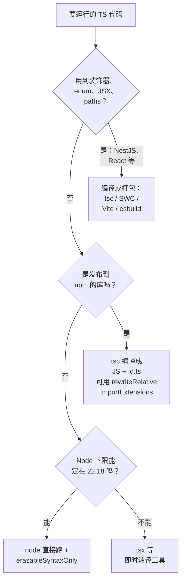

# Node 直接跑 TS 与 erasableSyntaxOnly

很长一段时间里，在 Node 上跑 TypeScript 要么先 `tsc` 编译，要么借助 ts-node、tsx 这类工具即时转译。现在 Node 自己就能跑 `.ts` 文件：`node src/index.ts`，没有构建步骤，没有额外依赖。

但「能跑」有前提：Node 只**擦掉**类型，不**编译** TypeScript。凡是需要生成运行时代码的 TS 语法，它都不认。这一章讲清 Node 的类型擦除是怎么工作的、哪些语法会炸、怎么用 `erasableSyntaxOnly` 等编译选项在写代码时就挡住它们，最后以 hatch-recordwall 的 `tools/` 为例给出一套完整配置，并讨论什么时候该用、什么时候不该用。

## Node 做了什么

> [!WARNING]
> 下表的版本节点按截至 2026-11 的 Node.js 发布说明整理；type stripping 的稳定性级别（实验 / 稳定）、警告输出和相关参数在 23.x、24.x 及之后的版本里仍有调整，以 Node.js 官方文档的 Modules: TypeScript 页面和 Node.js changelog 为准。

Node 的类型擦除（type stripping）大致经历了这几步：

| 版本 | 状态 |
|---|---|
| 22.6 | 加入 `--experimental-strip-types`，需要显式开启 |
| 23.6 | 默认开启，不再需要参数 |
| 22.18 | 默认开启被移植回 22 LTS |

hatch-recordwall 的根 `package.json` 里写着 `"engines": { "node": ">=22.18" }`，就是这个原因：低于 22.18，`node src/index.ts` 会直接报语法错误，不是降级运行。可以用 `node -p process.features.typescript` 检查当前 Node 的模式，22.23 上输出 `strip`。

擦除的方式很特别：**把类型注解原地替换成空格**，而不是删掉后重新排版：


这样做的好处是代码的行号、列号完全不变，**不需要 source map**。报错堆栈、CPU 剖析（第 8 章）里的位置直接对应源码。代价是 Node 只能处理「删掉之后剩下的就是合法 JS」的语法。

## 哪些语法擦不掉

下面每一条都在 Node 22.23 上实测过：

| 语法 | Node 的反应 |
|---|---|
| `enum Level { Info, Warn }` | `ERR_UNSUPPORTED_TYPESCRIPT_SYNTAX`：enum 会生成一个运行时对象 |
| `namespace Util { export const x = 1 }` | 同上；只含类型的 `declare namespace` 可以 |
| `constructor(private x: number) {}` | 同上：参数属性要生成 `this.x = x` |
| `<number>value` 尖括号断言 | 不支持，提示改用 `value as number` |
| 装饰器 `@Injectable()` | V8 不认识装饰器语法，直接 `SyntaxError` |
| `import x = require("y")`、`export =` | 不支持 |
| `.tsx` 文件 | `ERR_UNKNOWN_FILE_EXTENSION`，JSX 需要真正的编译 |

注意装饰器这一条：**NestJS 重度依赖装饰器和 `emitDecoratorMetadata`**，所以 NestJS 应用不能用 Node 直接跑，仍然需要 `tsc` / SWC 编译。

另外两类问题不报语法错，但同样会在运行时出事：

```ts
// colors.ts
export type Color = "red" | "green";
export const paint = (c: Color): string => c;
```

```ts
// bad-import.ts —— Color 只是类型，擦除后这行 import 会真的去找一个叫 Color 的导出
import { Color } from "./colors.ts";
```

```text
SyntaxError: The requested module './colors.ts' does not provide an export named 'Color'
```

```ts
// bad-ext.ts —— Node 按字面路径找文件，./colors.js 不存在
import { paint } from "./colors.js";
```

```text
Error [ERR_MODULE_NOT_FOUND]: Cannot find module '.../colors.js'
```

第二个很有迷惑性：在 `moduleResolution: nodenext` 下，`tsc` 会把 `./colors.js` 映射到 `colors.ts`，类型检查完全通过，一跑就挂。

## 让编译器提前拦住

这些错误都要到运行时才暴露，而对 CLI 工具来说，「运行时」往往就是你要用它的那一刻（比如出包上架的当口）。所以要在 `tsconfig` 里打开几道闸门，让编辑器和 `tsc --noEmit` 在写代码时就报错：

| 选项 | 拦住什么 | 引入版本 |
|---|---|---|
| `erasableSyntaxOnly` | enum、带运行时代码的 namespace、参数属性、尖括号断言、`import =` | TS 5.8 |
| `verbatimModuleSyntax` | 没写 `type` 的类型导入（要求写 `import { type Color }` 或 `import type`） | TS 5.0 |
| `allowImportingTsExtensions` | 允许写 `./colors.ts`（要求 `noEmit` 或配合 `rewriteRelativeImportExtensions`） | TS 5.0 |
| `module` / `moduleResolution: nodenext` | 按 Node 的真实规则解析模块，认得 `.ts` 后缀 | — |

实测这三类问题：

```text
bad-enum.ts(1,6): error TS1294: This syntax is not allowed when 'erasableSyntaxOnly' is enabled.
bad-param.ts(1,23): error TS1294: This syntax is not allowed when 'erasableSyntaxOnly' is enabled.
bad-import.ts(1,10): error TS1484: 'Color' is a type and must be imported using a type-only import when 'verbatimModuleSyntax' is enabled.
```

有一个漏网之鱼：**装饰器不在 `erasableSyntaxOnly` 的检查范围内**（TS 认为标准装饰器是合法的 JS 语法），但 V8 目前还不支持。在「Node 直接跑」的包里，用 lint 规则或代码评审禁掉装饰器。

### 擦不掉的语法怎么替换

```ts
// enum → as const 对象 + 联合类型
export const Level = { Info: 0, Warn: 1, Error: 2 } as const;
export type Level = (typeof Level)[keyof typeof Level]; // 0 | 1 | 2

function log(level: Level, msg: string) {
  if (level >= Level.Warn) console.error(msg);
}
log(Level.Warn, "disk almost full");

// 参数属性 → 显式字段
class Uploader {
  readonly bucket: string;
  constructor(bucket: string) {
    this.bucket = bucket;
  }
}

// namespace → 模块本身就是命名空间：import * as util from "./util.ts"
```

这些写法本来就更接近标准 JS，打包工具处理起来也更简单。TypeScript 团队近几年的方向也是如此：新特性尽量只在类型层面做文章，不再引入需要生成代码的语法。

## 一套完整配置：hatch-recordwall 的 tools/

hatch-recordwall 的 `tools/` 下有几个 CLI 包（出 iOS 包传 TestFlight、在运行中的 App 里执行 JS、重新打包一段注入 WebView 的脚本），全部 `node src/index.ts` 直接跑，不装 tsx，也没有构建步骤。它们共用的 `tools/tsconfig.base.json`（注释有精简）：

```jsonc
{
  "compilerOptions": {
    "target": "ES2022",
    // 不给 DOM：这儿跑在 Node 里，没有 window
    "lib": ["ES2022"],
    // nodenext 才认得带 .ts 后缀的相对导入
    "module": "nodenext",
    "moduleResolution": "nodenext",
    "allowImportingTsExtensions": true,
    // 两道给「Node 只擦不编」兜底的闸门
    "erasableSyntaxOnly": true,
    "verbatimModuleSyntax": true,
    "noEmit": true,
    "strict": true,
    "noUncheckedIndexedAccess": true,
    "skipLibCheck": true,
    // shamefully-hoist 把全仓 @types 提到了根，不写死会全收进来
    "types": ["node"]
  }
}
```

每个包的 `package.json`：

```json
{
  "name": "@tools/ship",
  "type": "module",
  "scripts": {
    "typecheck": "tsc --noEmit -p tsconfig.json",
    "ship": "node src/index.ts"
  },
  "dependencies": { "@tools/shared": "workspace:*" }
}
```

几个值得注意的细节：

- **`"type": "module"`**：让 `.ts` 文件按 ESM 处理。不写的话 Node 22 会根据语法自动检测，但 `tsc` 会把文件当成 CommonJS，报一堆模块相关的错误。明确写上，两边口径一致
- **跨包共享源码**：`@tools/shared` 的 `package.json` 里 `"exports": { ".": "./src/index.ts" }`，直接导出 TS 源码。Node 规定**不擦除 `node_modules` 里的 `.ts`**（会报 `ERR_UNSUPPORTED_NODE_MODULES_TYPE_STRIPPING`），但 pnpm workspace 的依赖是指向 `tools/shared` 的符号链接，Node 解析到的真实路径不在 `node_modules` 下，所以能跑。这条只对 workspace 内部包成立，**发到 npm 上的包仍然必须编译成 JS**
- **类型检查是单独一步**：Node 只擦不查，类型错了照样运行。`pnpm typecheck` 必须放进提交前检查或 CI
- **`types: ["node"]`**：TypeScript 6.0 起 `types` 的默认值就是空数组（不再自动收录所有 `@types/*`），recordwall 当时用的是 TS 5.9，所以要显式写；在 TS 6 下这一行依然要写，否则连 `process` 都找不到

## Node 不管的事

Node 的类型擦除**完全不读 tsconfig**。所以这些 tsconfig 里的功能在 Node 直接跑时统统不生效：

| tsconfig 功能 | 后果 | 替代 |
|---|---|---|
| `paths`（`@/*` 别名） | 运行时找不到模块 | 用 `package.json` 的 `imports` 字段（`#src/*`），Node 原生支持 |
| `target` 降级 | 不降级，写什么跑什么 | Node 22 本身支持到 ES2024 左右，基本不需要 |
| `jsx` | `.tsx` 根本不支持 | 用打包工具 |
| `experimentalDecorators` / `emitDecoratorMetadata` | 装饰器语法错误 | 用 `tsc` / SWC 编译 |

## 选哪种方式



几个真实项目的选择：

| 项目 | 方式 | 原因 |
|---|---|---|
| hatch-recordwall `tools/*` | `node src/index.ts` | 内部 CLI，Node 版本自己能控制，零依赖、无构建 |
| hatch-shelf `tools/shelf-pack` | `tsx src/cli.ts` | 更早写成，依赖的 `@shelf/spec` 用 `moduleResolution: Bundler`、导入不带后缀，要改成 Node 直接跑需要先统一导入写法 |
| hatch-counter 的 NestJS API | 编译后运行 | 装饰器、依赖注入元数据 |
| Expo / Electron 渲染进程 | Metro / Vite 打包 | JSX、资源处理，本来就需要打包 |

如果要把一个 Node 直接跑的包发到 npm，`tsc` 可以在输出时把 `./a.ts` 改写成 `./a.js`：

```bash
tsc --module nodenext --rewriteRelativeImportExtensions --outDir dist
```

```js
// dist/main.js —— 源码里是 import { a } from "./a.ts"
import { a } from "./a.js";
console.log(a);
```

### 如果实在需要 enum

Node 还有一个 `--experimental-transform-types` 参数，会真正转换 enum、namespace 这些语法（同时生成 source map）。它仍是实验性功能，运行时会打印 `ExperimentalWarning`。与其依赖它，不如把代码改成可擦除的写法——那才是这个生态正在收敛的方向。

## 本章要点

- Node 22.18+ / 23.6+ 默认能直接运行 `.ts`，方式是把类型替换成空格：行列号不变，不需要 source map，但完全不读 tsconfig、不做类型检查
- 擦不掉的语法：enum、带代码的 namespace、参数属性、尖括号断言、`import =`；装饰器和 `.tsx` 也不支持，所以 NestJS 和 React 代码仍需编译
- `erasableSyntaxOnly` + `verbatimModuleSyntax` + `allowImportingTsExtensions` + `nodenext` 让这些问题在编辑器里就暴露；装饰器是漏网之鱼，要靠 lint
- 相对导入写 `.ts` 后缀；写 `.js` 后缀 tsc 不报错但 Node 找不到文件
- `node_modules` 里的 `.ts` 不会被擦除；pnpm workspace 内部包因为是符号链接可以直接导出源码，发 npm 的包仍要编译
- 内部工具、脚本、CLI 适合直接跑；库、NestJS、前端代码继续用编译或打包

读完这本书，类型系统和运行时这两块地基就打好了。技术栈纵深的下一站是[《React 19 原理与模式》](../react-internals/)，它会用类似的方式拆开 React 的调度和渲染；如果你更关心后端，可以接着读[《NestJS 后端架构》](../nestjs-backend/)，把本书第 4 章到第 8 章的运行时知识用到真实的服务里。
