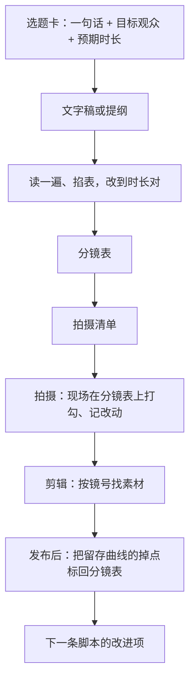

# 脚本的作用与类型

这一章回答三个问题：一条几十秒的短视频为什么还要写脚本；脚本有哪几种；什么时候用哪一种。读完你会有一个判断表，拿到任何选题都能决定「这条写到什么程度就够了」。

## 这本书讲什么、适合谁、怎么读

这本书写给下班后做内容副业的开发者。你没学过影视，可能连「中景」和「近景」都分不清，但你会写需求文档、会画流程图、习惯把模糊的事拆成清单。脚本和分镜本质上就是**视频的需求文档和任务拆解**，这正好是你擅长的东西。

全书的路线是：


本书负责中间三格：脚本、分镜表、拍摄清单。两头不展开：

- 选题、开头钩子、爆款结构，见《选题与爆款结构》
- 设备、灯光收音、剪映操作、调色，见《拍摄与剪辑实务》
- 短剧（多集、付费卡点、AI 生成画面）的剧本和分镜，见《短剧编剧》和《AI 短剧分镜与画面生成》。本书讲的是通用短视频：口播、剧情短片、测评、vlog、图文转视频
- 文字本身怎么写得清楚、不像 AI，见《文案与内容》

建议的读法：第 1–3 章讲脚本，第 4–6 章讲分镜和拍摄准备，第 7–8 章是五个完整示例，第 9 章讲怎么让 AI 帮你写。如果你明天就要拍，可以直接跳到第 5 章拿模板，再翻到第 7–8 章找一个最像你选题的示例照抄结构。

## 为什么要写脚本

很多新手的做法是：想好大概说什么，打开手机就录，录完再剪。结果通常是这样的：

- 录了 20 分钟素材，剪出来 1 分钟，其中一半在说「然后呢」「就是说」
- 剪的时候发现少了一个关键镜头，比如说到「这个按钮」时没拍按钮特写，只能重新布置再拍
- 前 5 秒在自我介绍，观众已经划走了
- 每条视频的结构都不一样，没法复盘哪里出了问题

脚本解决的是四件事：

| 作用 | 没有脚本时 | 有脚本时 |
|---|---|---|
| **想清楚** | 边录边想，逻辑在镜头前才组织 | 在纸上把结构定好，录的时候只管表达 |
| **省时间** | 素材量是成片的 10–20 倍，剪辑像大海捞针 | 按镜号拍、按镜号剪，素材有序 |
| **不漏镜头** | 剪的时候才发现缺东西 | 拍之前对着清单逐项打勾 |
| **能复盘** | 只知道「这条没火」 | 能定位到「第 3 镜的 8 秒完播率掉得最厉害」 |

最后一条对开发者尤其有用。平台后台会给出观看留存曲线，告诉你观众在第几秒离开（具体指标见《抖音与快手》《投流与数据分析》）。如果你有带时长的分镜表，就能把掉点对到具体镜头上，这和对着日志定位 bug 是一回事。

## 三种脚本

业内对「脚本」的叫法很乱，这本书统一用三个名字：

| 类型 | 写什么 | 长什么样 | 写一条要多久 |
|---|---|---|---|
| **文字稿** | 每一句要说的话 | 一段段文字，可加停顿、重音标记 | 30–60 分钟 |
| **提纲式脚本** | 要拍的几个段落、每段的要点和必拍画面 | 几行列表 | 10–20 分钟 |
| **分镜脚本**（分镜表） | 每个镜头的景别、画面、运镜、时长、台词、字幕、音效 | 一张表，一行一个镜头 | 1–3 小时 |

它们不是三选一，而是逐层细化的关系：分镜表里的「台词」列来自文字稿；提纲式脚本是还没细化到镜头的分镜表。

### 文字稿

文字稿只关心「说什么」。适合画面简单、靠语言撑起来的内容：口播、知识讲解、解说。

```text
【开头】
你的电脑是不是开机要两分钟，开个浏览器都卡？
先别急着换。做完这三件事，大部分旧电脑能再战两年。

【第一件】
打开任务管理器，点「启动」……
```

文字稿的标准是：**照着念出来，就是成片的声音**。不是「大概意思」，是逐字的。口播稿怎么写成能念的样子，第 2 章细讲。

### 提纲式脚本

提纲式脚本只定结构和必拍镜头，具体说什么、怎么拍留给现场。适合没法预先写台词的内容：vlog、探店、活动记录、街头采访。

```text
选题：下班后两小时做副业的一天
时长：约 2 分钟

1. 开场（10 秒）：地铁上，手机备忘录里今晚的待办 —— 必拍：备忘录特写
2. 到家（15 秒）：开门、换衣服、泡茶 —— 必拍：开门、茶杯热气
3. 干活（60 秒）：剪视频、回私信、写脚本 —— 必拍：屏幕、手、时钟
4. 卡住（15 秒）：一个问题没解决，出去走一圈 —— 必拍：楼下路灯
5. 收尾（20 秒）：关电脑，说一句今天的收获 —— 必拍：对镜头说话
```

提纲式脚本的关键是「必拍」那一栏：vlog 现场什么都可能发生，但剪辑时一定会用到的转场镜头、细节镜头，要在出门前就写下来。第 8 章的 vlog 示例会展开。

### 分镜脚本

分镜脚本把视频拆到「镜头」这个最小单位。一个镜头就是摄像机从开始录到停下之间的连续画面，剪辑后表现为两个剪切点之间的那段画面。

一行分镜大概是这样（完整的列在第 5 章逐个讲）：

| 镜号 | 景别 | 画面 | 运镜 | 时长 | 台词 / 旁白 | 字幕 | 音效 / BGM |
|---|---|---|---|---|---|---|---|
| 3 | 特写 | 手指点开任务管理器的「启动」页 | 固定 | 3s | 「打开任务管理器，点启动。」 | 启动项 = 开机自己跑的程序 | 鼠标点击声 |

分镜表适合**画面信息量大**或**需要多人配合**的内容：剧情短片、产品测评、教程演示、商单（品牌方通常要求先审分镜，见《广告商单与品牌合作》）。

## 什么时候用哪一种

用下面这张表判断。两条以上命中右边一列，就写分镜表：

| 判断项 | 文字稿够用 | 需要分镜表 |
|---|---|---|
| 画面主要是什么 | 一个人对着镜头说 | 多个场景、多个人、多个物件 |
| 拍摄人数 | 自己一个人 | 两人以上，需要告诉别人怎么站、怎么演 |
| 能不能重拍 | 随时能重拍 | 场地、人、产品只有一次机会 |
| 有没有第三方要审 | 没有 | 品牌方、合作方要看 |
| 画面要和台词对点 | 不需要 | 「说到这里要出现这个东西」 |
| 是否系列化生产 | 单条 | 同一个格式要做几十条，需要模板 |

再按内容类型给一个默认建议：

| 内容类型 | 推荐 | 原因 |
|---|---|---|
| 知识口播 | 文字稿 + 简易分镜（只标插入画面） | 主体是说话，但要标出哪里插截图、字幕 |
| 剧情短片 | 文字稿（对白）+ 完整分镜表 | 人物、场景、机位都要提前定 |
| 产品测评 | 提纲 + 完整分镜表 | 产品细节镜头多，样品可能要归还 |
| vlog | 提纲式脚本 + 必拍镜头清单 | 无法预写台词，但转场镜头必须保证 |
| 图文转视频 | 文字稿 + 素材对照表 | 画面来自已有图片和录屏，按句配图 |
| 商单 | 完整分镜表 | 品牌方审核，交付要可追溯 |

### 一个省事的原则：先写到能拍为止

不要为了「专业」把每条都写成完整分镜表。一个人做口播，写了 30 行的分镜表，结果 25 行都是「中景、固定、对镜头说话」，这是浪费。

判断够不够的标准只有一个：**把脚本交给一个不认识你的人，他能不能拍出你想要的东西**。能，就够了；不能，缺什么补什么。

## 脚本的生命周期

脚本不是写完就扔，它跟着视频走完整个流程：



最后两步最容易被省略，但它们决定你会不会进步。建议每条视频一个文件夹，里面放脚本、分镜表、拍摄清单和发布后的数据截图，用 Git 或网盘管理都行。开发者的习惯在这里直接能用：

```text
videos/
├── 2026-11-05-old-pc-3-tips/
│   ├── script.md        # 文字稿
│   ├── storyboard.csv   # 分镜表
│   ├── shotlist.md      # 拍摄清单
│   └── review.md        # 发布 48 小时后的数据和复盘
└── 2026-11-08-pm-changes-req/
    └── ...
```

`review.md` 里至少写三行：完播率、平均观看时长、留存曲线最大的掉点在第几秒、对应哪个镜号。积累十几条之后，你会发现自己的掉点集中在固定的几种镜头上（常见的是开头自我介绍、长段落没有画面变化、产品参数念白），这就是下一条脚本要改的地方。

## 选题卡：脚本之前的一页纸

动笔写脚本前，先填一张选题卡。它强迫你在写之前想清楚这条视频给谁看、看完得到什么：

```text
选题卡
- 一句话选题：旧电脑别急着换，先做这 3 件事
- 给谁看：用了三年以上 Windows 笔记本、不太懂电脑的上班族
- 看完得到：3 个能马上操作的步骤，不花钱
- 类型：知识口播
- 预期时长：60–75 秒
- 平台和画幅：抖音 / 视频号，竖屏 9:16
- 开头钩子（第一句话）：你的电脑是不是开机要两分钟？
- 结尾动作：评论区说你的电脑型号，我看看还能不能救
- 必要素材：任务管理器录屏、磁盘清理录屏、浏览器扩展页录屏
```

选题卡上「一句话选题」和「开头钩子」怎么写得更好，属于《选题与爆款结构》的范围。这里只要求一点：**填不满这张卡就不要开始写脚本**。填不满说明选题还没想清楚，写出来的脚本也会是散的。

### 关于画幅和规格

国内主流平台（抖音、快手、视频号、小红书）的短视频以竖屏为主，业内通用的制作规格是 9:16、1080×1920 像素。B 站和西瓜视频横屏内容更多，常用 16:9、1920×1080。

时长上限、文件大小、封面尺寸等具体规格各平台经常调整。写作本书时（2026-11）我没有找到各平台公开的、带日期的官方规格页，因此本书不列具体数字，**以发布页面上的提示为准**；各平台的差异见《抖音与快手》《小红书、视频号与 B 站》。

画幅会影响脚本：竖屏画面窄，同一个景别能装下的东西比横屏少，所以竖屏视频普遍更偏近景和特写，画面里的物件要更少、更大。这一点在第 4 章展开。

## 常见误区

| 误区 | 问题 | 改法 |
|---|---|---|
| 「我很会说，不需要稿子」 | 会说和说得紧凑是两回事，即兴表达的废话率通常很高 | 至少写提纲，录完对照提纲剪 |
| 写成文章 | 书面语念出来很怪，句子太长观众跟不上 | 按第 2 章改成口语稿 |
| 只写台词，不写画面 | 剪辑时 1 分钟都是一张脸，没有画面变化 | 在台词旁标「这里插什么」 |
| 分镜写得很细，现场一条没按着拍 | 分镜脱离实际：场地、道具、人手做不到 | 写分镜前先看场地、清点道具（第 6 章） |
| 每条都从零写 | 效率低，质量不稳定 | 固定栏目用固定模板，只换内容 |

## 本章要点

- 脚本解决四件事：想清楚、省时间、不漏镜头、能复盘
- 三种脚本逐层细化：文字稿管「说什么」，提纲管「拍哪几段、必拍什么」，分镜表管「每个镜头怎么拍」
- 判断写到什么程度：交给陌生人能不能拍出来；多人、不能重拍、有人审、画面要对点，就写分镜表
- 动笔前先填选题卡，填不满不开写
- 竖屏 9:16 是国内短视频主流制作规格，具体平台限制以发布页为准
- 每条视频一个文件夹，发布后把留存掉点标回分镜表，这是进步最快的方法
