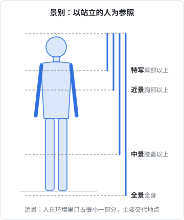
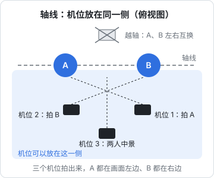

# 镜头语言速成

写分镜表时，你要在每一行填上「景别」「角度」「运镜」「转场」。这些词听起来专业，其实各自只有几个选项，每个选项有明确的用途。这一章把它们压缩成几张表，目标是让你看到一句台词时能判断「这里该用什么镜头」，不追求影视学院的完整体系。

镜头语言里的每个选择都在回答一个问题：**此刻观众应该看什么、感受什么**。

## 景别：拍多大

景别是画面里主体（通常是人）占多大比例。中文常用的分法以人体为参照：



| 景别 | 取景范围 | 观众得到什么 | 短视频里常用于 |
|---|---|---|---|
| 远景 | 人很小，环境为主 | 在哪里、多大的空间 | vlog 开场、换场时交代地点 |
| 全景 | 人的全身，带一点环境 | 人在做什么动作、和环境的关系 | 剧情开场、展示穿搭、运动动作 |
| 中景 | 膝盖以上 | 人物之间的关系、手部动作 | 两人对话、边说边操作 |
| 近景 | 胸部以上 | 表情和说话 | 口播主镜头、对话中的单人镜头 |
| 特写 | 肩部以上，或一个物件占满画面 | 情绪、细节 | 反应镜头、产品细节、关键道具 |
| 大特写 | 身体局部（眼睛、手指）或物件局部 | 强烈强调 | 反转揭示、按键、接口、文字 |

关于分法的说明：景别的边界在不同教材里略有出入，比如有的把「腰部以上」算中景、把「膝盖以上」叫中全景。不必纠结，**在你自己的分镜表里保持一致**就行。建议在分镜表开头写一行「本表景别约定」。

### 竖屏的景别要再近一档

竖屏画面宽度只有横屏的一半多一点。同样是「中景」，横屏里两个人并排站得下，竖屏里会挤到画面边缘。实际经验是：

- 口播：横屏常用中景，竖屏常用近景
- 两人对话：横屏可以用一个中景同时拍两人，竖屏更常用两个近景来回切
- 产品：竖屏里产品要占画面至少一半，否则在手机上看不清

### 景别要有变化

连续几个镜头景别相同，画面会显得呆。连续几个镜头景别跳得太大（远景直接切大特写），又会显得乱。常用的节奏：

- **由远到近**：远景交代环境 → 中景交代人物 → 近景看表情 → 特写看细节。最稳妥的叙事顺序
- **由近到远**：先给一个特写制造悬念（这是什么？），再拉开揭示。适合开头钩子
- **两极对比**：在情绪爆发点故意从全景跳到特写，制造冲击

口播视频画面单一，也可以靠景别变化增加节奏：同一段话用两个机位（近景 + 特写）同时拍，剪辑时交替使用；或者只用一个机位、在剪辑里放大画面模拟「推近」。后者的画质代价见《拍摄与剪辑实务》。

## 角度：从哪拍

| 角度 | 机位 | 效果 | 用途 |
|---|---|---|---|
| 平视 | 镜头和眼睛同高 | 平等、自然 | 口播、对话，默认选择 |
| 俯拍 | 镜头在上方往下 | 主体显得小、弱，或展示桌面全貌 | 角色处境不利时；桌面操作、做饭、开箱 |
| 仰拍 | 镜头在下方往上 | 主体显得高大、有压迫感 | 强势角色（老板、甲方）；展示建筑 |
| 正顶拍 | 镜头垂直朝下 | 像平面图，干净 | 开箱、手账、桌面整理、美食摆盘 |
| 过肩 | 从一个人肩后拍另一个人 | 对话的代入感，交代两人位置关系 | 两人对话 |
| 主观 | 镜头就是角色的眼睛 | 观众代入角色 | 「我」的视角：打开门看到什么、看手机屏幕 |

口播最常见的错误是**机位太低**：手机放在桌上往上拍，观众看到的是鼻孔和天花板。手机应该和眼睛同高或略高。

## 运镜：镜头怎么动

| 运镜 | 怎么拍 | 效果 | 一个人能不能拍 |
|---|---|---|---|
| 固定 | 三脚架，不动 | 稳定、客观 | 能，最常用 |
| 推 | 镜头向主体靠近，景别变小 | 强调、进入情绪 | 能，用滑轨或手持慢走；也可剪辑时放大 |
| 拉 | 镜头远离主体，景别变大 | 揭示环境、结束感 | 同上 |
| 摇 | 机位不动，镜头左右或上下转 | 扫视环境、跟随视线 | 能，三脚架云台 |
| 移 | 机位平行移动 | 展示一排东西、陪着人走 | 较难，需要稳定器 |
| 跟 | 跟在移动的人后面或侧面 | 带观众一起走 | 自拍可以，用稳定器或自拍杆 |
| 升降 | 镜头上升或下降 | 揭示、开场或结束 | 难 |
| 手持 | 手拿着拍，带轻微晃动 | 真实感、临场感 | 能，vlog 常用 |

对一个人下班拍视频来说，**固定镜头能解决 80% 的需求**。运镜不是越多越好，每次运动都要有理由：推是因为要强调，拉是因为要揭示，跟是因为人在走。没有理由的运镜只会让观众晕。

写分镜时，运镜要写清方向和起止景别，例如「缓推，近景到特写，3 秒」，而不是只写「推」。

## 转场：镜头怎么接

两个镜头之间的连接方式就是转场。

| 转场 | 做法 | 用途 |
|---|---|---|
| 直切 | 两个镜头直接接上 | 默认，占绝大多数 |
| 匹配剪辑 | 前后镜头的形状、动作或位置相似 | 时间或空间跳跃时保持流畅：关电脑屏幕 → 关家门 |
| 动作剪辑 | 在动作进行中切换角度 | 拿起杯子：中景开始拿，切特写拿到嘴边 |
| 遮挡转场 | 物体或手挡住镜头，下一镜从遮挡中移开 | vlog 换场景，最容易做 |
| 甩镜转场 | 快速摇镜造成模糊，下一镜同方向甩入 | 节奏快的 vlog、换场景 |
| 声音先入 | 下一镜的声音提前出现 | 换场景时自然过渡 |
| 叠化 | 前一镜淡出同时后一镜淡入 | 时间流逝，慎用，容易显得老气 |
| 黑场 | 淡出到黑再淡入 | 段落结束、重大转折 |

需要在拍摄时就设计好的转场（匹配、遮挡、甩镜）**必须写进分镜表**，因为前后两个镜头都要专门拍。直切、叠化、黑场在剪辑时随时能加，不用写。

## 轴线：对话不要拍乱

两个人对话时，两人之间连一条假想的线，叫轴线。所有机位都放在这条线的同一侧，画面里 A 永远在左、B 永远在右，观众就不会混乱。如果切到另一侧拍，A 和 B 在画面里会左右互换，观众会以为谁走了位。



上图里三个机位都在轴线的同一侧。分镜表里写对话镜头时，可以在备注列注明「A 左 B 右」，拍的时候照着放机位。一人分饰两角时尤其要注意：两个角色的视线方向要相反，一个看画面右侧，一个看画面左侧，剪在一起才像在对视。

## 构图的两条规则

构图细节见《拍摄与剪辑实务》，写分镜时记住两条就够：

- **三分法**：把画面横竖各三等分，主体放在交叉点附近，比放正中间更自然。口播例外，口播人物通常居中
- **视线前方留空**：人看向画面右边，右边要多留空间

竖屏还有一条：**画面上下要给平台界面留位置**。竖屏视频播放时，顶部有搜索栏、底部有标题和账号名、右侧有点赞评论按钮，会盖住画面。关键内容（脸、产品、字幕）放在中间偏上的区域。各平台的界面遮挡范围不同而且会改版，最可靠的办法是导出一帧截图，放到手机上用平台的发布预览看一下。

## 从台词到镜头：判断表

写分镜时，对每一句台词或每一个动作问一遍：

| 这一句在表达什么 | 推荐景别 | 推荐角度 / 运镜 |
|---|---|---|
| 交代在哪里 | 远景、全景 | 固定或缓摇 |
| 人物在做什么 | 中景、全景 | 固定 |
| 人物在说话 | 近景 | 平视固定 |
| 人物的情绪反应 | 特写 | 固定，或缓推 |
| 一个关键物件、文字、数字 | 特写、大特写 | 固定，正顶拍或平视 |
| 强势 / 弱势 | 近景 | 仰拍 / 俯拍 |
| 揭示真相、反转 | 由特写拉到中景，或从中景切大特写 | 拉、或直切 |
| 时间流逝、换场 | 空镜（无人物的环境镜头） | 固定或延时 |
| 带观众一起走 | 中景 | 跟拍、手持 |

「空镜」值得单独说一下：没有人物的环境或物件镜头，比如窗外的天色、桌上的咖啡、路灯。它们是剪辑时的万能胶水，可以盖住口播里的剪切点、过渡场景、调整节奏。**每次拍摄都多拍几个空镜**，几乎不会浪费。

## 练习：拆一条视频的镜头语言

镜头语言靠看比靠背学得快。找一条你喜欢的、60 秒左右的剧情或测评视频，在剪辑软件里逐个找剪切点，每个镜头记一行：

```text
| 镜号 | 起止 | 景别 | 角度 | 运镜 | 这个镜头让我看什么 |
|---|---|---|---|---|---|
| 1 | 0.0–1.8 | 特写 | 平视 | 固定 | 手机屏幕上的时间，交代他赶时间 |
| 2 | 1.8–4.0 | 中景 | 平视 | 固定 | 人物和工位，交代在哪 |
| 3 | 4.0–5.2 | 近景 | 仰拍 | 固定 | 老板出场，显得强势 |
```

最后一列最重要：每个镜头都问一句「为什么是这个景别、这个角度」。拆过三五条以后，你会发现大部分视频用的就是本章表格里那几种组合，写自己的分镜时就有了参照。拆的时候注意三件事：

- **数镜头**：60 秒里有多少个镜头，平均每个多长。这是你写分镜时估算镜头数的依据
- **找规律**：景别是怎么变化的，是不是由远到近；情绪最强的地方用了什么景别
- **找做不到的**：哪些镜头需要你没有的器材或人手，想想换成什么固定镜头也能表达

## 本章要点

- 景别：远景交代地点，全景交代动作，中景交代关系，近景看说话，特写看情绪和细节；竖屏比横屏再近一档
- 景别要有变化，最稳的顺序是由远到近；在自己的分镜表里写明景别约定
- 角度默认平视；俯拍显弱、仰拍显强，正顶拍适合桌面
- 运镜要有理由，一个人拍以固定镜头为主；写清方向、起止景别和时长
- 需要专门拍的转场（匹配、遮挡、甩镜）必须写进分镜表
- 对话遵守轴线，A 左 B 右；关键内容避开平台界面遮挡区
- 每次拍摄多拍空镜
