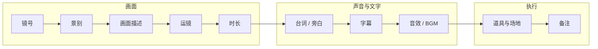

# 分镜表逐列讲解

分镜表是本书的核心工具。它把一条视频拆成一行行镜头，每一行回答「这个镜头拍什么、怎么拍、多长、配什么声音和字幕」。写好了，拍摄的人照着拍、剪辑的人照着剪，哪怕这两个人都是你自己，也能省掉大量来回。

这一章先讲怎么把脚本拆成镜头，再逐列讲十个列：每列写什么、写到什么颗粒度、常见错误，最后给一份可以直接复制的空白模板。

## 先拆镜头

拿到文字稿或剧情脚本后，第一步不是填表，而是**决定在哪里切镜头**。切镜头的信号有这几种：

| 信号 | 例子 | 为什么要切 |
|---|---|---|
| 换了地点或时间 | 从工位到电梯 | 必须换画面 |
| 换了说话的人 | A 说完 B 说 | 对话来回切 |
| 要看的东西变了 | 台词说到「这个按钮」 | 观众需要看到按钮 |
| 情绪变了 | 从平静到震惊 | 换景别强调情绪 |
| 一个镜头太长 | 口播一段超过 8–10 秒没有变化 | 防止画面疲劳 |
| 需要隐藏剪切点 | 口播中间删了一句 | 用插入画面盖住跳帧 |

最后一条是口播的特殊情况：一段话中间删了一句，人物的头会突然跳一下（业内叫跳切），要么接受这种风格，要么在剪切点上盖一个插入画面。

### 拆镜头的操作方法

把脚本打印出来或者在编辑器里，用斜线在每个切镜头的位置划开，然后从 1 开始编号。以第 3 章剧情脚本的开头为例：

```text
（小林坐在工位前，显示器上贴满便利贴。）/1
（他看了一眼手机：18:40，屏幕上消息「七点电影院门口见」。）/2
（他开始收拾包。）/3
产品经理：（从画外走进来，笑着）小林——/4
（小林拉拉链的手停住。）/5
```

五个斜线，就是五个镜头。然后每个镜头一行，进表。

### 一条视频多少个镜头

没有标准答案，但可以用平均镜头时长来估算：

| 类型 | 常见平均镜头时长 | 60 秒视频大约 |
|---|---|---|
| 口播（单机位） | 5–10 秒（含插入画面） | 8–12 个 |
| 剧情短片 | 2–4 秒 | 15–30 个 |
| 产品测评 | 2–4 秒 | 15–25 个 |
| 快节奏 vlog | 1–3 秒 | 20–40 个 |

这些数字是经验范围，不是规则。更好的做法是去拆一条你想对标的视频：用剪映或任何剪辑软件把它导入，逐帧找剪切点，数一数它 60 秒里有多少个镜头。拆解对标的方法见《账号定位与对标拆解》。

## 十个列

一份完整的分镜表包含下面十列。前五列管画面，中间三列管声音和文字，后两列管执行：



### 1. 镜号

**写什么**：镜头的编号，从 1 开始顺序递增。

**颗粒度**：一个镜头一个号。如果一个场景很多，可以用「场-镜」两级编号，例如 `2-3` 表示第 2 场第 3 个镜头。

**规则**：
- 编号按**成片顺序**，不按拍摄顺序。拍摄顺序在拍摄清单里另排（第 6 章）
- 改稿时插入新镜头，用 `3a` `3b`，不要重新编号。重编号会让已经发出去的表、已经拍了的素材全部对不上
- 删掉的镜头保留编号，在备注写「删」，不要让后面的号前移

**常见错误**：拍摄时临时加了镜头没编号，剪辑时找不到对应的位置。现场加的镜头也要当场在表上记 `5a`。

### 2. 景别

**写什么**：远景、全景、中景、近景、特写、大特写之一。可以加角度：「近景 / 仰拍」「特写 / 顶拍」。

**颗粒度**：一个镜头一个景别。如果镜头里景别有变化（推、拉），写起止：「近景→特写」。

**规则**：
- 在表的开头写清景别约定（第 4 章说过，各家分法略有差别）
- 只用固定的几个词，不要写「稍微近一点」「大概半身」。分镜表是给人照着做的，词要像枚举值一样确定

**常见错误**：
- 全表一种景别。检查方法：把景别这一列单独看，连续三个以上一样的就考虑调整
- 竖屏写了「中景两人」，实际拍出来两个人都挤在边上

### 3. 画面描述

**写什么**：镜头里能看到的东西：谁、在哪、做什么动作、表情、重要物件在画面哪里。

**颗粒度**：一个陌生人读完能摆出这个画面。标准是**主体 + 动作 + 关键细节**，一般一到三句。

| 颗粒度 | 例子 | 评价 |
|---|---|---|
| 太粗 | 小林在工位 | 不知道在干什么、拍什么 |
| 合适 | 小林坐在工位前低头看手机，显示器上贴满黄色便利贴，画面左侧是显示器、右侧是小林 | 能摆出来 |
| 太细 | 小林穿灰色卫衣，左手拿手机，右手放在鼠标上，手机屏幕亮度 80%，便利贴共 23 张…… | 写了拍摄时自然就有的东西，浪费时间 |

**规则**：
- 只写**看得见的**，不写心理活动。「小林很绝望」改成「小林慢慢靠回椅背，盯着天花板」
- 用现在时，像在描述一张照片
- 屏幕内容、文字、数字要写出来，例如「手机屏幕：18:40，微信消息『七点电影院门口见』」。它们需要提前准备
- 需要观众注意的东西写位置：「画面右下角」「占画面一半」

**常见错误**：写成了台词的复述。画面描述写的是**眼睛看到的**，台词列写的是**耳朵听到的**，两列不要重复。

### 4. 运镜

**写什么**：固定、推、拉、摇、移、跟、手持，加方向和速度。

**颗粒度**：方向 + 起止 + 速度。「缓推，近景→特写」「左摇，从门口摇到工位」「手持跟拍，在人物身后」。

**规则**：
- 大部分镜头是「固定」，照写，不要空着。空着的格子会让人不确定是忘了写还是不需要
- 需要器材的运镜（滑轨、稳定器）在备注里写器材
- 剪辑时做的「推」（数字放大），写「固定（后期缓推）」，拍摄的人就知道要拍得比成片宽一点，给放大留余量

**常见错误**：一条 60 秒的视频写了十几个运动镜头，自己一个人根本拍不了，最后全部变成固定。写之前先想清楚你有什么器材。

### 5. 时长

**写什么**：这个镜头在**成片**里的预计时长，单位秒。

**颗粒度**：精确到 0.5 秒就够。

**规则**：
- 有台词的镜头，时长由台词决定：字数 ÷ 你的语速 + 前后留白。第 2 章算过语速
- 无台词的镜头：看清一个简单动作约 1.5–2 秒；读一行字幕约 2–3 秒；看清一个产品细节约 2 秒
- 表的最后一行写合计，和目标时长对比。超了就删镜头或删台词，不要指望剪辑时压缩
- **拍摄时长要比成片时长长**：每个镜头前后各多拍 1–2 秒，给剪辑留余地。分镜表写的是成片时长，这一点在表头注明

**常见错误**：所有镜头都写 3 秒，加起来正好 60。这说明时长是凑出来的，不是算出来的。

### 6. 台词 / 旁白

**写什么**：这个镜头里听到的人声，逐字。区分三种：

| 标记 | 含义 | 例子 |
|---|---|---|
| 角色名： | 画面里这个人在说话（同期声） | 小林：好的好的，没问题哈。 |
| 角色名（画外）： | 声音来自画面外的人 | 产品经理（画外）：小林—— |
| 旁白： | 后期配的解说，不属于剧中人 | 旁白：这是他这个月第七次说「没问题」。 |

**颗粒度**：逐字，带第 2 章的停顿和重音标记。

**规则**：
- 一句台词跨两个镜头时（比如说话时切到反应镜头），在两个镜头里都写，后一个写「（接上）……」
- 没有人声写「无」，不要空着

**常见错误**：只写「介绍产品」「讲第一点」。这是提纲不是台词，现场一定会卡壳。

### 7. 字幕

**写什么**：画面上要出现的文字。分两种：

| 类型 | 内容 | 写不写进分镜表 |
|---|---|---|
| 台词字幕 | 台词的逐字文本 | 不用写，剪映等工具可以识别语音自动生成，只需校对 |
| 花字 / 信息字幕 | 台词之外额外加的文字：标题、要点、数字、吐槽 | **必须写** |

所以这一列只写**台词以外的文字**。

**颗粒度**：逐字，标出位置和样式（如果有约定的话）。「顶部大字：三件事让旧电脑再战两年」「数字：7.82 GB → 4.31 GB」。

**规则**：
- 一屏的花字不超过一行半，2 秒读得完
- 不要和台词字幕重叠位置。通常台词字幕在下方，花字在上方或中间
- 涉及数字、型号、价格的字幕，拍摄前核对一遍，发布前再核对一遍。字幕上的错误数字截图传播的速度比视频还快

**常见错误**：把整段台词又抄一遍到字幕列，表变得很宽，真正需要做的花字反而被淹没。

### 8. 音效 / BGM

**写什么**：这个镜头需要的背景音乐变化和音效。

**颗粒度**：BGM 写**变化点**，不是每行都写：「BGM 起：轻快」「BGM 停」「BGM 换：紧张」。音效写具体的声音：「键盘声」「消息提示音」「打板声」。

**规则**：
- BGM 的起、停、换要和情绪转折对齐。反转前停 BGM 一两秒，是最常用也最有效的手法
- 需要现场录的声音（同期声、环境声）在这里写「同期」，拍摄时要收音
- 后期从素材库加的音效写「后期」

**常见错误**：
- 全片一首 BGM 从头铺到尾，没有变化
- 用了没有授权的音乐。各平台都有自己的音乐库，在平台内用通常是授权的，但导出后搬到其他平台可能不行；商单的音乐要求更严。音乐版权见《拍摄与剪辑实务》和《自媒体与短剧合规财税》

### 9. 道具与场地

**写什么**：这个镜头需要准备的物件、服装、场地和陈设。

**颗粒度**：能列成清单。「手机（屏幕预设：微信对话截图）、笔记本电脑、黄色便利贴约 20 张、工牌（假名字）」。

**规则**：
- 屏幕内容属于道具，要提前准备好：做一张截图、一个假页面，或者用备用手机
- 场地写实际地点：「家里书桌（扮演工位）」
- 这一列是第 6 章生成道具清单和拍摄顺序的来源，**不要漏**

**常见错误**：只在第一次出现时写道具，后面同一个道具的镜头不写。排拍摄顺序时这些镜头被打乱，到现场才发现道具没带。每行都写全。

### 10. 备注

**写什么**：前九列装不下但拍摄时必须知道的事。

常见内容：

- 器材：「稳定器」「补光灯从左侧」「手机横放」
- 连戏：「杯子里的水要和第 4 镜一样多」「左手拿手机」
- 轴线：「A 左 B 右」
- 转场：「遮挡转场，与第 9 镜连接」
- 拍法：「多拍 3 条，表情由轻到重」
- 状态：「已拍」「删」「改：见 5a」

**规则**：备注写给现场的人看，短、具体、可执行。

## 一个填好的样例

用上面第 3 章剧情的开头五个镜头：

| 镜号 | 景别 | 画面描述 | 运镜 | 时长 | 台词 / 旁白 | 字幕 | 音效 / BGM | 道具与场地 | 备注 |
|---|---|---|---|---|---|---|---|---|---|
| 1 | 中景 | 小林坐在工位前，显示器上贴满黄色便利贴，画面左侧显示器、右侧小林 | 固定 | 2s | 无 | 18:40 | BGM 起：轻快；键盘声（同期） | 书桌（扮工位）、显示器、便利贴约 20 张、工牌（假名） | 台灯暖光营造傍晚 |
| 2 | 大特写 / 主观 | 手机屏幕：时间 18:40，微信消息「七点电影院门口见」 | 固定 | 2s | 无 | 无 | 消息提示音（后期） | 手机（预设聊天截图） | 屏幕亮度调高，防反光 |
| 3 | 近景 | 小林笑着把手机塞进口袋，开始往双肩包里装东西 | 固定 | 2s | 无 | 无 | 同期 | 双肩包 | 动作要快，有期待感 |
| 4 | 中景 | 产品经理从画面右侧走入，抱着笔记本电脑，侧面夹着的电影票露出一角 | 固定 | 2s | 产品经理：小林—— | 无 | BGM 停 | 笔记本电脑、电影票 | A（小林）左 B（产品经理）右；票不给特写 |
| 5 | 特写 | 小林拉拉链的手停住 | 固定 | 1.5s | 无 | 无 | 无声 1 秒 | 双肩包 | 手停住后保持 1 秒再停机 |

合计 9.5 秒。第 7 章会把整条剧情的分镜表写完。

## 空白模板

### Markdown 版

复制到你的笔记或 Git 仓库里：

```markdown
# 分镜表：<选题>

- 目标时长：__ 秒   画幅：9:16 竖屏   版本：v1   日期：YYYY-MM-DD
- 景别约定：特写=肩部以上 / 近景=胸部以上 / 中景=膝盖以上 / 全景=全身
- 时长列为成片时长；拍摄时每个镜头前后各多拍 1–2 秒
- 字幕列只写台词以外的花字；台词字幕后期自动识别

| 镜号 | 景别 | 画面描述 | 运镜 | 时长 | 台词 / 旁白 | 字幕 | 音效 / BGM | 道具与场地 | 备注 |
|---|---|---|---|---|---|---|---|---|---|
| 1 |  |  |  |  |  |  |  |  |  |
| 2 |  |  |  |  |  |  |  |  |  |
| 3 |  |  |  |  |  |  |  |  |  |

合计时长：__ 秒（目标 __ 秒）
```

### 表格软件版

在飞书多维表格、腾讯文档、Excel 或 Numbers 里建表时，用下面的列定义。设成下拉选项的列能防止写出不统一的词，后面筛选和排拍摄顺序都靠它们：

| 列名 | 类型 | 选项 / 格式 | 建议列宽 | 说明 |
|---|---|---|---|---|
| 镜号 | 文本 | `1` `2` `3a` | 窄 | 用文本而不是数字，才能写 `3a` |
| 场次 | 文本 | `1` `2` | 窄 | 可选，多场景时用 |
| 景别 | 单选 | 远景 / 全景 / 中景 / 近景 / 特写 / 大特写 | 窄 | |
| 角度 | 单选 | 平视 / 俯拍 / 仰拍 / 顶拍 / 过肩 / 主观 | 窄 | 可与景别合并 |
| 画面描述 | 长文本 | | 宽 | |
| 运镜 | 单选 + 文本 | 固定 / 推 / 拉 / 摇 / 移 / 跟 / 手持 | 中 | 方向和起止写在备注或画面描述里 |
| 时长 | 数字 | 一位小数，单位秒 | 窄 | 表底做求和 |
| 台词 / 旁白 | 长文本 | | 宽 | |
| 字幕 | 长文本 | | 中 | 只写花字 |
| 音效 / BGM | 文本 | | 中 | |
| 道具 | 多选 | 按本条视频的道具建选项 | 中 | 多选才能按道具筛选 |
| 场地 | 单选 | 按你能用的场地建选项 | 窄 | 排拍摄顺序用 |
| 机位 | 单选 | A 机 / B 机 / 手持 | 窄 | 排拍摄顺序用 |
| 参考图 | 附件 | | 中 | 对标截图或手绘草图 |
| 状态 | 单选 | 待拍 / 已拍 / 需补拍 / 删 | 窄 | 现场勾选 |
| 备注 | 长文本 | | 中 | |

比 Markdown 版多出来的「场次」「场地」「机位」「状态」「参考图」五列，是为第 6 章的拍摄清单准备的。只拍一个场景、一个机位时可以不要。

如果你想用脚本处理（比如自动生成拍摄清单），把表导出成 CSV，表头用英文更方便：

```text
shot,scene,size,angle,picture,move,sec,line,caption,sound,props,location,camera,ref,status,note
```

### 参考图要不要画

专业分镜会给每个镜头画一张草图。对你来说，下面三种做法任选其一就够：

- **火柴人草图**：在纸上画方框（竖屏就画竖的），方框里画火柴人和关键物件，拍照存到参考图列。丑没关系，能看出构图就行
- **对标截图**：从对标视频里截一帧构图相似的画面
- **AI 生成**：用文生图工具按画面描述生成一张参考图（第 9 章）。注意它只是构图参考，不是成片

## 交付前检查

| 检查项 | 怎么查 |
|---|---|
| 时长合计和目标相差不超过 10% | 看表底合计 |
| 前 3 秒的镜头有钩子 | 看第 1–2 行 |
| 没有连续三个以上相同景别 | 单独看景别列 |
| 每个台词镜头都有逐字台词 | 看台词列有没有「介绍一下」这类提纲词 |
| 屏幕内容、文字道具都写明了 | 搜「屏幕」「手机」 |
| 每行道具与场地都填了 | 看有没有空格 |
| 字幕里的数字、型号核对过 | 逐个对原始资料 |
| 需要专门拍的转场两端都写了 | 搜「转场」 |

## 本章要点

- 先在脚本上划斜线拆镜头：换地点、换人、换看的东西、换情绪、镜头太长、要盖剪切点
- 十列：镜号、景别、画面描述、运镜、时长、台词 / 旁白、字幕、音效 / BGM、道具与场地、备注
- 镜号按成片顺序，插入用 `3a`，删除不重编号
- 画面描述写「主体 + 动作 + 关键细节」，只写看得见的；台词逐字；字幕只写花字
- 时长按台词字数和动作算，表底求和对目标；拍摄时每镜前后多拍 1–2 秒
- 道具每行写全，它是拍摄清单的来源
- 表格软件里把景别、运镜、场地、机位、状态做成单选，方便筛选和排序
