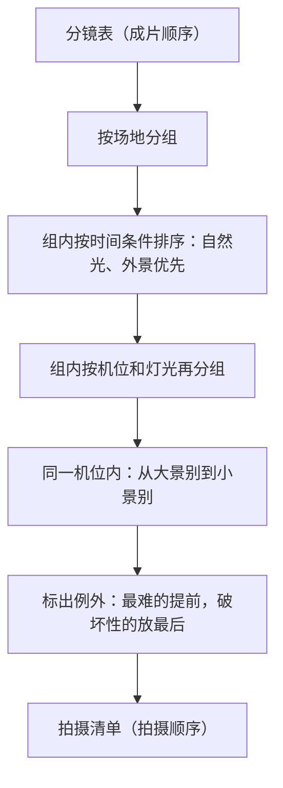
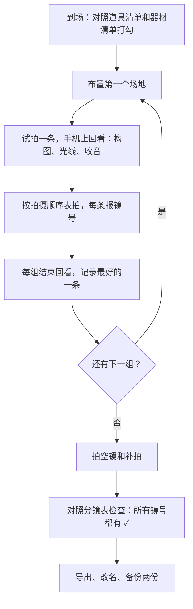

# 从分镜到拍摄清单

分镜表是按**成片顺序**排的：第 1 镜、第 2 镜……但拍摄不能按这个顺序来。假设第 1、5、12 镜都在书桌前、用同一个机位，第 2、8 镜在门口，如果按镜号拍，你要在书桌和门口之间搬三脚架、调灯光好几次。

拍摄清单就是把分镜表**重新排序**，按场地、机位、灯光、人物合并，让你用最少的布置次数拍完所有镜头。这一章讲怎么排、要准备哪些清单，以及拍摄现场怎么记录，保证剪辑时找得到素材。

## 排序原则

拍摄顺序按下面的优先级合并，越靠上越优先：

| 优先级 | 合并依据 | 原因 |
|---|---|---|
| 1 | 场地 | 换场地最费时间：搬设备、重新布置陈设 |
| 2 | 时间条件 | 需要自然光的镜头必须在有光时拍；外景受天气影响 |
| 3 | 机位和灯光 | 挪一次三脚架、调一次灯，大约要几分钟到十几分钟 |
| 4 | 人物和服装 | 别人来帮忙时，他的镜头集中拍完让他先走；换服装费时间 |
| 5 | 景别 | 同一机位，从大景别拍到小景别，方便调焦和构图 |
| 6 | 情绪和体力 | 哭戏、喊戏、需要大量体力的镜头放在后面，或者单独安排 |

还有两条例外：

- **最难、最不可控的镜头先拍**：需要别人配合的、需要特定光线的、有失败风险的（比如倒咖啡要洒出来），趁精力和时间充足先拍
- **会破坏场景的镜头最后拍**：吃掉、弄乱、弄脏、拆开包装。开箱视频尤其要注意，包装拆了就回不去了



## 一个排序示例

假设一条剧情短片的分镜表里，场地和机位如下（只列排序相关的列）：

| 镜号 | 景别 | 场地 | 机位 | 人物 | 备注 |
|---|---|---|---|---|---|
| 1 | 中景 | 书桌 | A：书桌正面 | 小林 | |
| 2 | 大特写 | 书桌 | 手持 | 手机屏幕 | |
| 3 | 近景 | 书桌 | A：书桌正面 | 小林 | |
| 4 | 中景 | 书桌 | B：书桌侧面 | 小林、产品经理 | |
| 5 | 特写 | 书桌 | 手持 | 小林的手 | |
| 6 | 近景 | 书桌 | B：书桌侧面 | 产品经理 | |
| 7 | 全景 | 门口 | C：门口 | 小林 | 推门出去 |
| 8 | 特写 | 书桌 | A：书桌正面 | 小林 | 哭笑不得的表情 |
| 9 | 中景 | 门口 | C：门口 | 小林、产品经理 | 产品经理追出来 |

排出来的拍摄顺序：

| 拍摄顺序 | 场地 | 机位 | 镜号 | 内容 | 需要的人 |
|---|---|---|---|---|---|
| 1 | 书桌 | B 侧面 | 4、6 | 两人中景、产品经理近景 | 小林、产品经理 |
| 2 | 门口 | C | 9、7 | 产品经理追出来、小林推门 | 小林、产品经理 |
| — | | | | **产品经理收工** | |
| 3 | 书桌 | A 正面 | 1、3、8 | 中景 → 近景 → 特写 | 小林 |
| 4 | 书桌 | 手持 | 2、5 | 手机屏幕、手部特写 | 小林 |

为什么这样排：

- 产品经理是来帮忙的朋友，他的镜头（4、6、9）集中先拍，拍完他就可以走，这是对帮忙的人最基本的尊重
- 第 9 镜需要产品经理，所以门口这组也提前，第 7 镜顺便一起拍
- A 机位三个镜头从中景拍到特写
- 手持特写放在最后，因为不需要架机位，随时能补

## 四份清单

排好顺序后，从分镜表里生成四份清单，拍摄当天照着用。

### 1. 拍摄顺序表

上面那张表的完整版，加上预计用时。拍摄现场看这一张就够：

```text
拍摄顺序表：产品经理改需求   日期：周六 14:00–17:00

| 序 | 时间 | 场地 / 机位 | 镜号 | 要点 | 状态 |
|---|---|---|---|---|---|
| 1 | 14:00–14:40 | 书桌 / B 侧面 | 4、6 | A 左 B 右；第 6 镜多拍 3 条 | ☐ |
| 2 | 14:40–15:10 | 门口 / C | 9、7 | 门要关好再开拍 | ☐ |
|   | 15:10 | 产品经理收工 | | 先回看一遍他的镜头再让他走 | ☐ |
| 3 | 15:20–16:10 | 书桌 / A 正面 | 1、3、8 | 中→近→特 | ☐ |
| 4 | 16:10–16:30 | 书桌 / 手持 | 2、5 | 手机屏幕亮度调高 | ☐ |
| 5 | 16:30–17:00 | — | 空镜 + 补拍 | 窗外、台灯、便利贴特写 | ☐ |
```

注意「先回看一遍他的镜头再让他走」：帮忙的人走了以后发现某个镜头失焦或穿帮，就再也补不了了。

### 2. 道具清单

把分镜表「道具与场地」列的所有内容去重合并，按「在哪里拿」分组，出发前（或开拍前）逐项打勾：

```text
道具清单
【书桌区】
☐ 显示器（擦干净）
☐ 黄色便利贴约 20 张，提前写好字
☐ 工牌（假名字「林一」，不要用真实公司 logo）
☐ 咖啡杯（装半杯水）
☐ 双肩包
【电子设备】
☐ 手机 A：拍摄机
☐ 手机 B：道具机，预设聊天截图「七点电影院门口见」，时间改成 18:40 或用截图
☐ 笔记本电脑：预设页面，二十几个红圈的需求文档截图
【服装】
☐ 小林：灰色卫衣
☐ 产品经理：衬衫，带一副眼镜（方便区分）
```

**屏幕类道具要单独核对**。它们最容易出问题：截图里有真实姓名、手机通知弹出来、时间对不上。拍屏幕时开勿扰模式。

### 3. 器材清单

```text
器材清单
☐ 拍摄手机，存储剩余 > 30 GB
☐ 三脚架 ×2（A、B 机位不想反复挪的话）
☐ 手机夹
☐ 补光灯 ×1 + 电源线
☐ 领夹麦 ×2，前一晚充满电
☐ 充电宝 + 线
☐ 提词器（如果有台词较长的镜头）
☐ 打板：没有场记板就用另一部手机显示镜号，或者拍摄开始时拍手
```

器材本身怎么选，见《拍摄与剪辑实务》。

### 4. 时间表

一个人或两个人拍短视频，最常见的问题是**严重低估时间**。下面是一个保守的估算方法：

| 项目 | 估算 |
|---|---|
| 每个场地的首次布置（陈设、灯光、机位） | 20–30 分钟 |
| 同一场地换机位 | 10 分钟 |
| 每个有台词的镜头 | 5–10 分钟（含重拍 3–5 条） |
| 每个无台词的简单镜头 | 2–5 分钟 |
| 回看检查 | 每组结束后 5 分钟 |
| 空镜和补拍 | 总时长的 15% |

按这个估算，上面那条九个镜头的剧情短片，大约需要 2.5–3 小时。这对一条 60 秒的视频来说很正常。第一次拍的话再加 50%。

## 现场记录：让剪辑时找得到素材

拍摄时最重要的事情之一，是让每段素材都能对上镜号。否则拍了 80 段素材，剪辑时要一段段点开看是哪一镜。

### 方法一：开拍前报镜号

每条开拍前，对着镜头说「第 4 镜，第 2 条」，或者在镜头前举起一部显示镜号的手机。剪辑时快速划过每段素材的开头就能识别。

如果需要声音和画面对齐（比如领夹麦和手机分开录音），开拍时拍一下手。剪辑时找到画面里两手合拢的那一帧和音轨里的波峰，对齐就行。

### 方法二：现场记录表

在分镜表上加一列「素材」，每拍一条就记一笔：

```text
| 镜号 | 条数 | 结果 | 备注 |
|---|---|---|---|
| 4 | 1 | ✗ | 产品经理笑场 |
| 4 | 2 | ✓ | |
| 4 | 3 | ✓✓ | 表情最好，用这条 |
| 6 | 1 | ✗ | 失焦 |
| 6 | 2 | ✓ | |
```

`✓✓` 标出最好的一条，剪辑时直接用。

### 方法三：拍完立刻重命名

当天拍完，导出素材时按镜号重命名：

```text
s04_t3_best.mov
s06_t2.mov
s02_t1.mov
```

开发者可以写个小脚本，按拍摄时间顺序和现场记录表批量改名。下面是一个示例：读取拍摄顺序对应的镜号列表，按文件的修改时间排序后重命名（使用前先在副本上试）：

```python
# rename_takes.py：按拍摄顺序给素材改名
# 用法：python3 rename_takes.py 素材目录 takes.csv
# takes.csv 每行：镜号,条数,标记（按拍摄先后顺序，一行对应一个文件）
import csv
import sys
from pathlib import Path

folder, takes_file = Path(sys.argv[1]), sys.argv[2]
files = sorted(
    (p for p in folder.iterdir() if p.suffix.lower() in {".mov", ".mp4"}),
    key=lambda p: p.stat().st_mtime,
)
with open(takes_file, newline="", encoding="utf-8") as f:
    takes = list(csv.reader(f))

if len(files) != len(takes):
    sys.exit(f"文件数 {len(files)} 和记录数 {len(takes)} 不一致，先核对再改名")

for path, (shot, take, mark) in zip(files, takes):
    suffix = f"_{mark}" if mark else ""
    new_name = f"s{shot.zfill(2)}_t{take}{suffix}{path.suffix.lower()}"
    print(f"{path.name} -> {new_name}")
    path.rename(path.with_name(new_name))
```

文件数和记录数对不上时脚本直接退出，不会改错名。拍摄时多录了一段没记、或者删了一段，都会被这个检查拦住。

## 用表格自动生成拍摄清单

如果分镜表在表格软件里，并且按第 5 章的建议有「场地」「机位」「道具」列，拍摄清单可以半自动生成：

1. **复制一份**分镜表，不要在原表上排序
2. 按「场地 → 机位 → 景别」多级排序，景别按「远景、全景、中景、近景、特写、大特写」的自定义顺序
3. 手动调整例外：最难的提前、破坏性的放最后、外援的镜头集中
4. 在复制出来的表上加「拍摄顺序」和「状态」列，拍摄当天就用这一张
5. 道具清单：把「道具」列的多选项展开去重。飞书多维表格、Excel 的透视表都能做到

导出 CSV 用脚本处理也可以，排序逻辑就是上面的多级排序，二十行以内的代码能写完。但对于一条视频二三十个镜头的规模，手动排往往更快。脚本的价值在于**系列化生产**：同一个栏目每周拍三条，格式固定，自动生成能省下可观的时间。

## 拍摄当天的流程



最后一步「备份两份」不是夸张。手机存储、电脑硬盘、网盘任意两处。拍了一下午的素材因为误删或者手机丢了而全部重来，是最让人崩溃的事。

## 常见坑

| 坑 | 后果 | 预防 |
|---|---|---|
| 按镜号顺序拍 | 反复搬设备，时间翻倍 | 按场地、机位排 |
| 开箱先拆了包装 | 需要「未拆封」的镜头补不了 | 破坏性镜头放最后 |
| 帮忙的人走了才发现镜头有问题 | 补拍要再约一次 | 外援的镜头拍完立刻回看 |
| 连戏穿帮 | 同一场戏杯子里的水一会儿多一会儿少 | 备注列写连戏要求，拍前拍一张现场照片做参考 |
| 屏幕道具出问题 | 真实通知弹出、出现个人信息 | 勿扰模式、用备用手机、提前截图 |
| 没拍空镜 | 剪辑时没有素材盖剪切点 | 时间表里留 15% 给空镜和补拍 |
| 素材没改名 | 剪辑时一段段点开找 | 报镜号 + 现场记录 + 当天改名 |
| 只存了一份 | 丢了就全部重来 | 当天备份两处 |

## 本章要点

- 拍摄顺序按场地、时间条件、机位灯光、人物、景别、情绪体力合并；不按镜号拍
- 例外：最难、最不可控的先拍；会破坏场景的最后拍；外援的镜头集中拍完先回看
- 从分镜表生成四份清单：拍摄顺序表、道具清单、器材清单、时间表
- 屏幕类道具单独核对，开勿扰模式，不出现真实个人信息
- 一条 60 秒剧情短片拍两三个小时很正常，时间表里留 15% 给空镜和补拍
- 每条报镜号、记现场记录、当天按镜号改名、备份两处
