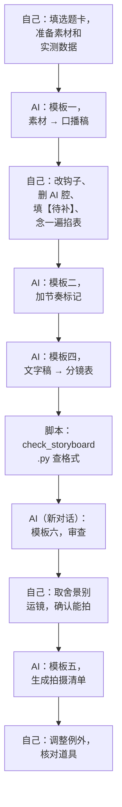

# 用 AI 辅助写脚本和分镜

大语言模型很适合做脚本和分镜里那些「格式化、体力活」的部分：把文章改成口语稿、把文字稿拆成镜头、把分镜表重排成拍摄清单、检查时长加起来对不对。它不擅长的是你的亲身经历、真实数据和现场判断。

这一章给六个可以直接用的提示词模板，再讲 AI 写的脚本和分镜最常见的问题以及怎么改。AI 写作的一般原则（AI 腔从哪来、怎么去掉），[《文案与内容》](../copywriting-content/)已经讲过，这里不重复；整条内容生产的工具链（配音、字幕、批量剪辑），见[《AI 内容生产工具链》](../ai-content-pipeline/)。

## 分工

| 环节 | 交给 AI | 留给自己 |
|---|---|---|
| 选题 | 列候选、扩展角度 | 选哪个，判断自己懂不懂、有没有素材 |
| 素材 | 整理你给它的笔记 | 亲历、实测数据、截图、录屏 |
| 文字稿 | 初稿、口语化改写、压缩字数 | 钩子的最终版、观点、所有数字 |
| 剧情 | 列反转的多种可能、台词变体 | 选哪个、角色的说话方式 |
| 分镜表 | 拆镜头、填格式、估时长 | 景别和运镜的取舍、能不能拍 |
| 拍摄清单 | 按场地机位排序、合并道具 | 例外调整、时间估算 |
| 检查 | 按清单逐条查 | 最终通读、念一遍 |

一句话：**AI 做格式和体力，你做判断和事实**。

## 六个提示词模板

下面的模板用 `{}` 标出需要你填的部分。它们在主流的对话式大模型上都能用。

### 模板一：素材 → 口播稿

不要只给题目，要给素材。这是 AI 写得像不像人的关键。

```text
你是短视频口播稿的编辑。根据我提供的素材写一份口播文字稿。

【选题】{一句话选题}
【观众】{给谁看}
【目标时长】{秒} 秒，我的语速是 {字/秒} 字/秒，所以正文不超过 {字数} 字
【开头钩子】{你想好的第一句，或写「请给 3 个候选」}
【结尾动作】{具体的互动动作}

【素材】（我的亲身经历和实测数据，只能使用这里的事实，不要补充任何我没提供的数字、案例或经历）
{贴你的笔记、实测结果、操作步骤}

【要求】
- 口语：每句不超过 20 个字，用「你」，不用「大家」「用户」
- 结论先行，不要自我介绍，不要「今天给大家分享」「希望对你有帮助」
- 每 10–15 秒有一个让人想继续听的句子
- 精确数字只出现在字幕建议里，台词里说约数
- 素材里没有的信息写成【待补：……】，不要编

【输出格式】
按段落输出，每段标注时间范围，例如【钩子 0–3s】。
最后单独列出：字数统计、所有【待补】项、字幕建议。
```

「不要补充任何我没提供的数字」和「写成【待补】」这两条最重要。AI 很擅长编出一个看起来合理的数字（「开机时间缩短了 47%」），而这种数字一旦发出去，就是你在说谎。

### 模板二：给文字稿加节奏标记

```text
下面是一份口播稿。请按以下规则加标记，不要改动任何文字：
- `/` 短停顿，`//` 长停顿（句号处、问句后）
- `**词**` 重音：每句最多一个，优先给数字、对比的两端、新概念
- `↑` 问句或悬念处语调上扬
- `→` 一带而过的过程描述
标完后，列出你认为念起来可能拗口的句子，并说明原因，但不要改。

{贴文字稿}
```

「不要改动任何文字」是为了把改写和标记分开。让 AI 一次做两件事，它往往会顺手把你的句子改得更「通顺」，也就是更像 AI。

### 模板三：剧情构思

```text
帮我构思一条 {秒} 秒的剧情短视频。

【限制】（必须遵守）
- 角色：最多 {n} 个，由 {谁} 扮演
- 场景：只能用 {列出你能用的场地}
- 道具：只能用家里常见的东西，或者 {列出你有的}
- 不出现真实品牌、真实人名
- 不以地域、性别、职业、外貌为笑点

【方向】{一句话：谁 + 想要什么 + 被什么挡住}

【输出】
给 3 个不同的结局方案，每个方案包括：
1. 结构：建立 / 冲突 / 升级 / 结局，各一句话
2. 反转类型（身份 / 视角 / 动机 / 结果 / 规模）
3. 线索：在前面埋什么、在哪里揭示
4. 一句话说明这个反转为什么「意料之外、情理之中」
不要写台词。
```

先要结构、不要台词，是为了让你在结构层面做选择。直接要完整剧本，你会被一大段台词淹没，很难判断故事本身好不好。选定方案后，再让它写剧本正文，或者自己写。

### 模板四：文字稿 → 分镜表

```text
把下面的脚本拆成分镜表。

【拍摄条件】
- 画幅：9:16 竖屏
- 人手：{一个人 / 两个人}
- 器材：{手机 + 三脚架 / 有稳定器 / 有滑轨}
- 场地：{列出}
- 景别约定：特写=肩部以上，近景=胸部以上，中景=膝盖以上，全景=全身

【拆镜规则】
- 换地点、换说话的人、换要看的东西、换情绪时切镜头
- 单个镜头超过 8 秒且没有画面变化时，建议插入画面
- 运镜只能用上面器材做得到的；默认固定
- 时长按台词字数 ÷ {语速} 估算，无台词镜头按动作估

【输出】
CSV 格式，表头固定为：
镜号,景别,画面描述,运镜,时长,台词/旁白,字幕,音效/BGM,道具与场地,备注
- 画面描述只写看得见的东西，不写心理活动，不用「温馨」「氛围感」这类形容词
- 字幕列只写台词以外的花字
- 最后一行写时长合计
- 表后列出：你认为拍摄有难度的镜头及原因

【脚本】
{贴文字稿或剧本正文}
```

要求输出 CSV，是因为它能直接粘进表格软件，也方便你用脚本检查。

### 模板五：分镜表 → 拍摄清单

```text
根据下面的分镜表生成拍摄清单。

【排序规则】
1. 按场地分组，再按机位，同一机位内从大景别到小景别
2. {外援姓名} 的镜头集中排在最前，排完后加一行「回看后收工」
3. 会破坏场景的镜头（拆包装、弄乱、吃掉）放在该场地最后
4. 需要自然光的镜头放在 {时间段}

【输出】
1. 拍摄顺序表：序号、场地/机位、镜号、要点
2. 道具清单：去重，按存放位置分组，每项前加 ☐
3. 屏幕类道具单独列出，注明需要提前准备的截图内容
4. 你调整了哪些顺序、为什么

【分镜表】
{贴 CSV}
```

### 模板六：分镜表审查

```text
你是短视频分镜审查员。逐条检查下面的分镜表，只指出问题，不要重写。

检查项：
1. 时长合计是否在目标 {秒} 秒 ±10% 内
2. 前 2 个镜头是否构成钩子
3. 是否有连续 3 个以上相同景别
4. 台词列是否有提纲式写法（如「介绍产品」「讲第一点」）
5. 画面描述是否有看不见的内容（心理活动、抽象形容词）
6. 运镜是否超出器材能力：{器材}
7. 道具与场地是否每行都填了
8. 对话镜头是否标注了轴线（谁左谁右）
9. 是否出现真实品牌、真实人名、个人信息
10. 是否有需要实测但看起来是编造的数字

输出：问题清单，每条写「镜号 + 检查项编号 + 问题 + 建议」。没有问题的检查项写「通过」。

{贴分镜表}
```

审查最好在一个**新的对话**里做，不要在生成分镜表的同一个对话里让它自查。同一个对话里，它倾向于认为自己刚写的东西没问题。

## AI 稿子的常见问题和改法

### 口播稿

| 问题 | 例子 | 改法 |
|---|---|---|
| 开头寒暄 | 「哈喽大家好，今天来聊一个很多人都关心的话题」 | 删，换成选题卡上的钩子 |
| 空洞的承诺 | 「让你的电脑焕然一新」 | 换成具体的结果：「开机少等二十秒」（实测后填） |
| 编造数字 | 「90% 的人都不知道」 | 删，或换成你能证明的事实 |
| 排比和金句 | 「不是电脑老了，是你还没学会爱它」 | 删。一条视频最多一句金句，而且最好是你自己的话 |
| 全是正确的废话 | 「定期维护非常重要」 | 换成具体操作 |
| 结尾总结腔 | 「总之，只要做好以上三点……」 | 换成具体互动动作 |

### 剧情脚本

| 问题 | 改法 |
|---|---|
| 场景超出能力：写了商场、地铁、写字楼大堂 | 在提示词里写死能用的场地；输出后逐场核对 |
| 角色过多 | 合并，限制在两人 |
| 台词像书面语、像说明书 | 按第 3 章改：能用动作的不用台词，加潜台词 |
| 反转没有线索 | 要求它列线索表；没有就让它补，或换方案 |
| 笑点冒犯人 | 在提示词里写禁止项，输出后再查一遍 |

### 分镜表

| 问题 | 例子 | 改法 |
|---|---|---|
| 形容词画面 | 「温馨的居家氛围」「充满科技感的画面」 | 改成具体物件和位置：「台灯暖光，桌上一杯冒热气的茶」 |
| 做不到的运镜 | 一个人用手机写了「环绕运镜」「航拍」「升降」 | 改成固定，或删 |
| 时长凑整 | 每个镜头都是 3 秒 | 按台词字数重算 |
| 字幕列抄台词 | 字幕列和台词列一样 | 清空，只留花字 |
| 道具只在第一次写 | 后面的行道具为空 | 每行补全 |
| 景别不统一 | 「半身」「中近景」「大特写」混用 | 按你的景别约定统一 |

## 用脚本检查 AI 输出

对开发者来说，分镜表的格式问题可以用几十行代码自动查出来。下面的脚本读取 CSV，检查时长合计、连续景别、空格子和提纲式台词：

```python
# check_storyboard.py：检查分镜表 CSV
# 用法：python3 check_storyboard.py storyboard.csv 60
import csv
import sys

SIZES = {"远景", "全景", "中景", "近景", "特写", "大特写"}
OUTLINE_WORDS = ("介绍", "讲一下", "说明", "讲第", "展示一下")
VAGUE_WORDS = ("氛围", "温馨", "科技感", "高级感", "唯美")

path, target = sys.argv[1], float(sys.argv[2])
with open(path, newline="", encoding="utf-8") as f:
    rows = [r for r in csv.DictReader(f) if r["镜号"].strip() not in ("", "合计")]

problems = []
total = 0.0
run_size, run_len = None, 0
for r in rows:
    shot = r["镜号"]
    sec = r["时长"].rstrip("s")
    total += float(sec) if sec else 0
    size = r["景别"].split("/")[0].strip()
    if size and size not in SIZES:
        problems.append(f"镜 {shot}：景别「{size}」不在约定内")
    run_len = run_len + 1 if size == run_size else 1
    run_size = size
    if run_len == 3:
        problems.append(f"镜 {shot}：连续 3 个「{size}」")
    for col in ("画面描述", "运镜", "时长", "台词/旁白", "道具与场地"):
        if not r.get(col, "").strip():
            problems.append(f"镜 {shot}：{col} 为空")
    if any(w in r["台词/旁白"] for w in OUTLINE_WORDS):
        problems.append(f"镜 {shot}：台词像提纲")
    if any(w in r["画面描述"] for w in VAGUE_WORDS):
        problems.append(f"镜 {shot}：画面描述有形容词")

print(f"时长合计 {total:.1f}s，目标 {target:.0f}s")
if abs(total - target) > target * 0.1:
    problems.append("时长超出目标 ±10%")
print("\n".join(problems) or "未发现格式问题")
```

它查不出的问题（故事好不好、画面能不能拍、数字是不是真的），还是要靠你自己通读。脚本的作用是把机械的检查自动化，让你的注意力留给需要判断的地方。

## 用 AI 生成分镜参考图

文生图工具可以按画面描述生成参考图，放在分镜表的「参考图」列里，用来和合作的人对齐构图。几点注意：

- **它是构图参考，不是成片**。生成的人物、场景不要直接用到视频里，除非你就在做 AI 内容，并且按规定标识
- 提示词里写清画幅（竖版 9:16）、景别、角度、主体位置，比写风格词有用
- 一个镜头生成两三张挑一张就行，不要在参考图上花太多时间。火柴人草图常常更快

用 AI 生成画面来**制作**视频（而不只是参考），是另一套流程，见[《AI 短剧分镜与画面生成》](../ai-drama-storyboard/)。

## 一个完整的 AI 辅助流程



注意每一步 AI 输出之后，都有一步「自己」。跳过任何一步「自己」，最后拍出来的都会是一条平均水平、没有你的视频。

## 本章要点

- 分工：AI 做格式和体力（改写、拆镜、排序、检查），你做判断和事实（选题、钩子、数字、取舍）
- 给 AI 素材而不是题目；明确禁止编造数字，缺的信息让它标【待补】
- 改写和加标记分开做；剧情先要结构再要台词；分镜要 CSV
- 审查在新对话里做；格式问题用脚本自动查
- AI 稿的典型问题：寒暄开头、编造数字、形容词画面、做不到的运镜、时长凑整
- AI 参考图只用于对齐构图；AI 生成的内容进成片要按规定标识
