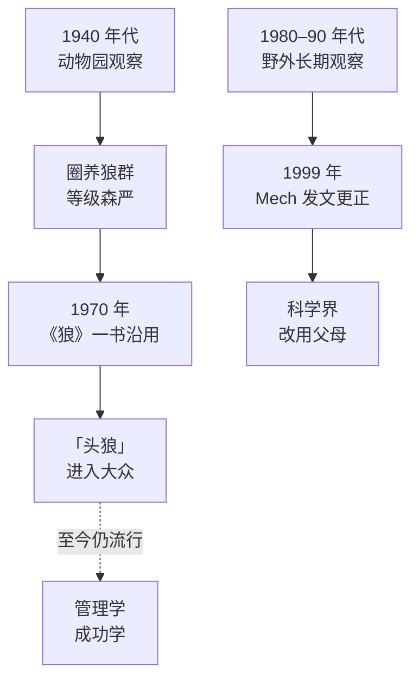

# 头狼的倒掉

「头狼」大概是关于狼最深入人心的概念：狼群里有一只最强的狼，靠力量和威慑统治其他成员，其余的狼按强弱排成一条等级链。这个形象被用来讲管理、讲两性关系、讲训狗，至今仍随处可见。

它是错的。更准确地说，它是在一个特殊的环境里观察到的真实现象，被错误地推广到了野外的狼身上。这个错误本身，以及它为什么那么难以纠正，是理解本书方法的一把钥匙。

## 一个错误是怎样诞生的

20 世纪 40 年代，瑞士动物学家 Rudolph Schenkel 在动物园里研究圈养的狼。那是一群原本互不相识的成年狼，被放进同一个围栏。他观察到大量的争斗、威吓和臣服的姿态，于是描述了一套等级：最强势的一公一母处在顶端，他称之为「alpha」。

1970 年，美国狼类学者 L. David Mech 出版了《狼》（*The Wolf*）一书，汇总了当时关于狼的研究，其中沿用了 alpha 的说法。这本书影响很大，「头狼」从此进入大众语言。

之后的二十多年里，Mech 在加拿大北极的埃尔斯米尔岛上连续多个夏天近距离观察一个野生狼群。那里的狼很少见到人，对观察者几乎不设防。他看到的是另一幅景象：狼群就是一个家庭，一对父母带着它们前几年生下的孩子；父母自然地主导着狩猎和迁移，孩子们跟随它们，没有什么持续的争斗来「维持地位」。

1999 年，Mech 在《加拿大动物学杂志》（*Canadian Journal of Zoology*）发表论文《狼群中的 alpha 地位、支配与分工》。他指出，过去关于狼群社会结构的研究，大多来自「人为拼凑的圈养狼群」；野外典型的狼群是一个家庭，父母通过**分工**而不是争斗来引导全家的活动：母亲主要负责照看和保护幼崽，父亲主要负责觅食和把食物带回来。他建议用「繁殖的雌狼 / 雄狼」或者干脆用「父母」来称呼它们。

此后多年，他一直在公开场合纠正这个说法，并反复请出版社停止印刷他 1970 年那本书。据国际狼中心（International Wolf Center）的说法，这本书在 2022 年终于绝版。

> [!NOTE]
> 本章的人物、年份和论文以公开的科学史资料为准。野外狼群并非完全没有支配行为：在少数特别大、包含多个繁殖对的狼群里，成员之间会有更复杂的关系。但「靠打斗维持的线性等级」不是野生狼群的常态。

## 错误出在哪

Schenkel 的观察本身没有错。圈养的狼确实会那样打。错在把它推广到了一个条件完全不同的地方：

| | 动物园的狼群 | 野外的狼群 |
|---|---|---|
| 怎么组成的 | 人为放在一起的陌生成年狼 | 一家人 |
| 能不能离开 | 不能 | 长大的孩子会自己离开 |
| 资源从哪来 | 饲养员喂 | 自己打猎 |
| 冲突为什么多 | 无法分散，只能在原地解决矛盾 | 矛盾可以靠离开解决 |

关键的变量是**能不能离开**。在野外，一只不满现状的年轻狼不需要去挑战父母，它可以离开，去找自己的配偶和领地。而在围栏里，这条路被堵死了，矛盾只能靠打来解决。所以，等级森严的狼群不是狼的天性，而是**围栏的产物**。

## 为什么这个错误这么难纠正

科学界在九十年代末就已经修正了这个说法，而流行文化到今天仍然热爱「头狼」。原因不在于证据不够，而在于这个故事太合人的胃口：

- **它把复杂的群体简化成一条线**。谁在上、谁在下，一目了然，这给人一种秩序感
- **它为某些行为提供了正当性**。如果「强者统治」是自然法则，那么强势、压制、争抢就都有了来自自然的背书
- **它满足了一种关于自己的想象**。几乎每个讲「头狼」的人，都默认自己是或者应该成为那只头狼

一个故事如果同时满足了简化、正当化和自我想象这三种需要，证据就很难撼动它。这一点在本书第 9 章还会再遇到：不只是关于狼的故事，关于成功的故事也常常是这样流传的。

## 这件事给一人公司的启发

本书不打算把「狼群是家庭」再生硬地套成「公司要像家庭」。这个科学史故事真正值得带走的，是一个关于**经验从哪里来**的提醒。

### 你的经验，可能是在围栏里学到的

很多想做一人公司的人，此前的职业经验都来自大公司或者成熟团队。在那里学到的很多东西是真实有效的：怎样写可维护的代码，怎样设计可扩展的架构，怎样做规范的流程。但其中也有相当一部分，是那个环境的产物：

- 「需求要先写完整的文档再开发」：在需要几十人协作的组织里是必要的；一个人做产品，它可能只是在拖慢验证
- 「架构要考虑百万用户」：在已经有大量用户的公司是对的；一个还没有第一个付费用户的产品，这是浪费
- 「做功能比做销售更重要」：在有专门销售团队的公司里成立；一个人的公司里，没有人替你卖
- 「加班体现投入」：在用工时衡量贡献的组织里或许是这样；在一个只看市场结果的地方，它什么也不体现

这些经验就像 Schenkel 在围栏里观察到的等级：**在原来的条件下是真的，换了条件就不一定**。一个人开始独立做事时，最需要警惕的往往不是不懂的东西，而是那些「我很确定」的东西，因为它们可能是在另一个围栏里学来的。

### 判断一条经验能不能带走

可以对每条你很确定的做事原则问一句：**它成立依赖什么条件？这个条件在我现在的处境里还在吗？**

比如「代码质量第一」，依赖的条件是代码会被长期维护、会被很多人读。如果你在做的是一个两周就要见分晓的验证原型，这个条件就不在。反过来，如果你的产品已经有了稳定的付费用户、要长期维护，这个条件又回来了。

这和 Mech 修正自己的方法是一样的：不是说过去的观察是假的，而是**回到条件本身去看**。本书接下来每一章引用狼的研究，都会尽量讲清楚它的条件：在什么地方、观察的是哪些狼、能推出什么、不能推出什么。

### 修正自己需要的东西

Mech 这件事里还有一个容易被忽略的细节：纠正这个错误的，正是当初让它流行起来的那个人。他花了二十多年在野外重新看狼，然后公开承认自己当年的书里有误导性的内容，并且请出版社停印。

对一个独立做事的人来说，这种能力格外重要。没有上级、没有同事来指出你的错误，你对自己的判断几乎没有外部的校准。愿意回到现场重新看、愿意公开改口，是一个人长期做对事情的前提。这一点会在第 6 章讲「群」的时候再回来。

下一章从狼最反直觉的一个事实开始：它们的大多数狩猎都是失败的。
