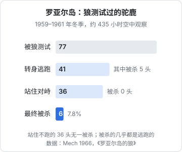
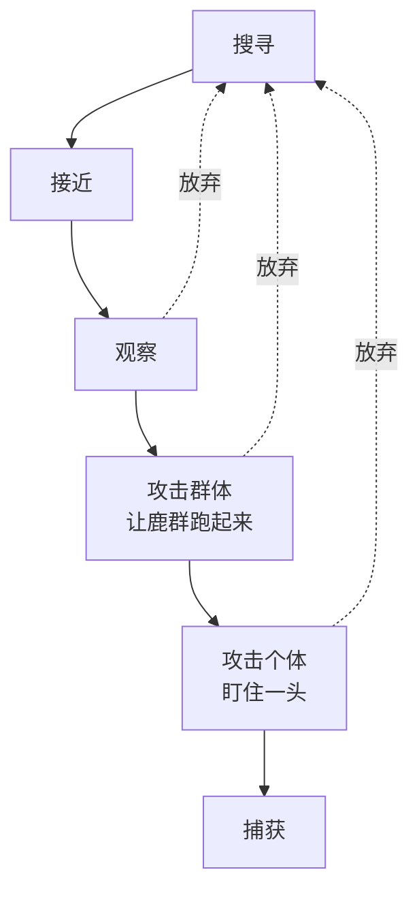

# 大多数狩猎都会失败

在流行的想象里，狼是一出手就能扑倒猎物的猎手。野外研究给出的数字正好相反：**狼的大多数狩猎都以失败告终**。

这一章先看这些数字，再看狼是怎样在这样低的成功率下活下来的：它们怎样测试猎物，怎样挑选目标，为什么从不和健壮的猎物死磕。最后讲人在面对低成功率时最常见的几种自我欺骗。

## 先看数字

### 罗亚尔岛：77 头里只杀死 6 头

1959 到 1961 年的三个冬天，年轻的 L. David Mech 在密歇根州苏必利尔湖上的罗亚尔岛（Isle Royale）乘小飞机跟踪狼群，累计空中观察约 435 小时。岛上的狼主要捕食驼鹿。1966 年他把观察结果写成了《罗亚尔岛的狼》。



在这三个冬天里，狼群「测试」过 77 头驼鹿，最后只杀死了 6 头，成功率 7.8%。更值得注意的是另一组数字：被狼逼近时**站住不跑、转身对峙**的 36 头驼鹿，没有一头被杀；转身逃跑的 41 头里，被杀了 5 头。

### 黄石：很少超过两成

黄石国家公园的狼主要捕食马鹿（elk）。黄石狼项目几十年的观察给出的结论是：狼群对马鹿的狩猎成功率**很少超过 20%**；如果只算成年马鹿，成功率低于 10%。一只狼单独对付一头成年马鹿，成功的机会大约只有 2%。

成功率还随环境大幅波动。Mech 等人 2001 年的研究里，同一片地方，严冬那年（1997 年）的成功率是 26%，第二年冬天只有 15%：雪深的时候马鹿跑不动，体弱的也更多。

至于野牛，一只狼单独面对成年野牛几乎没有任何机会；平均而言，马鹿比野牛容易捕获三倍左右。

> [!NOTE]
> 本章数字来自 Mech 1966《罗亚尔岛的狼》、黄石国家公园管理局发布的《Yellowstone Science》第 24 卷第 1 期，以及 MacNulty 等人的系列研究。不同地区、年份、猎物差异很大，不要把某一个数字当作「狼的成功率」。

## 一次狩猎的几个阶段

黄石的研究者 Daniel MacNulty 和 Mech 等人在 2007 年发表的论文里，基于两千多小时的观察、五百多次狼与马鹿的遭遇，把一次狩猎拆成了几个阶段：



每一个阶段都可能终止。狼会在任何一步判断「不值得」，然后转身离开。这张图最重要的部分是那几条虚线：**放弃是狩猎流程的正常出口，而且是最常走的出口**。

其中「攻击群体」这一步尤其关键。狼冲向鹿群，并不一定是想马上抓住谁，而是要让鹿群跑起来：在奔跑中，谁慢、谁落单、谁腿脚不灵，一下子就暴露出来。罗亚尔岛上那些站住不跑的驼鹿，等于是拒绝参加这场测试，狼也就没有了下手的理由。

## 狼怎样挑选目标

### 狼专挑「容易的」

黄石的研究反复证实，狼的猎物明显偏向老、幼、弱。Wright 等人 2006 年比较了北黄石被狼杀死和被人类猎人猎杀的雌性马鹿：狼杀死的成年雌鹿平均年龄 13.9 岁，猎人打到的平均只有 6.5 岁。猎人挑的是正值壮年、体格最好的，狼挑的是老的。夏天，狼的猎物里大约三分之二是刚出生不久的幼鹿。

这不是「欺软怕硬」，而是一笔非常清楚的账。

### 猎物选择模型

行为生态学里有一个经典的**猎物选择模型**（prey choice model，由 MacArthur、Pianka、Charnov 等人在六七十年代发展起来）。它的核心概念是「收益率」：

$$
\text{收益率} = \frac{\text{从这个猎物得到的能量}}{\text{捕获和处理它花的时间}}
$$

动物应该按收益率给所有可能的猎物排序，然后从高到低决定吃哪些。这个模型有两个反直觉的推论：

1. **要不要吃一种猎物，不取决于它本身有多常见，而取决于排在它前面的、更好的猎物有多常见**。如果更好的猎物足够多，那么即使这种差一些的猎物就在眼前，也应该放过
2. **一种猎物要么总是吃，要么总是不吃**（所谓「全或无」规则），不存在「偶尔吃一点」的最优策略

对狼来说，一头健壮的驼鹿体型最大、能量最多，但它的「处理时间」极长：要追很远、要反复周旋，还要冒着被踢断下颌的风险。把风险折算进去，它的收益率很低。老弱的马鹿肉少一些，但处理时间短得多、风险也小，收益率反而高。

## 翻译到一人公司

### 用「收益率」而不是「大小」给机会排序

一人公司面对的「猎物」，可能是一个产品方向、一个客户、一个获客渠道、一个功能需求。人们习惯按「大小」给它们排序：市场有多大、客单价有多高、潜在用户有多少。猎物选择模型提醒我们，更该看的是**收益 ÷ 拿下它要花的时间和风险**：

| 机会 | 「大小」 | 拿下它的成本与风险 | 收益率 |
|---|---|---|---|
| 给大型连锁企业做定制系统 | 很大 | 销售周期一年、需要团队、合同风险高 | 对一个人来说往往很低 |
| 给一个行业的小商家做标准化工具 | 中等 | 能自己交付，能一个个上门谈 | 往往最高 |
| 一个通用的效率工具 | 看起来很大 | 获客极难，要和大公司正面竞争 | 往往很低 |

大型连锁客户就像那头健壮的驼鹿：最大、最诱人，但对一个人来说处理时间太长、风险太高，一旦被拖进去，可能整整一年都没有别的收获。

### 好机会够多时，要敢于放过

猎物选择模型的第一个推论，对一人公司格外有用：**如果你手上已经有足够多的高收益率机会，那么即使一个次一些的机会就摆在眼前，也应该放过。**

这听起来简单，做起来很难。一个找上门的外包项目、一个「顺手就能做」的功能需求、一个朋友介绍的「不错的合作」，单独看都不坏。但如果你当前的主线机会更好，接下它们就会挤占主线的时间。很多独立开发者的问题，不是没有机会，而是被一堆中等的机会切碎了。

反过来，当高收益率的机会稀少时（比如刚起步、主产品还没有起色），就应该放宽标准，把次一些的机会也纳入进来。这和第 7 章要讲的「饿的时候」是一个道理。

### 先让鹿群跑起来

狼的「攻击群体」这一步，翻译过来就是**用一个低成本的动作，让市场自己暴露出信号**：

- 发一篇讲清楚问题的帖子，看谁来留言、谁来私信
- 做一个只有介绍和报名表的落地页，看有多少人留下联系方式
- 给二十个潜在客户打电话或上门，看谁愿意多聊十分钟
- 给一个还没写的功能挂一个「预约」按钮，看点击率

这些动作的目的不是马上成交，而是让「跑得慢的那一头」暴露出来：那些痛点最明确、最急着解决、最愿意付钱的用户。具体方法见[《一人公司方法论》的快速验证](../opc-playbook/03-fast-validation.md)。

站住不跑的驼鹿也有对应：那些对你的问题毫无反应、觉得「现在的办法挺好」的市场。罗亚尔岛的数据说明，对这样的猎物死磕，成功率是零。

## 低成功率下，人最常见的几种自我欺骗

狼面对低成功率，似乎没有什么心理负担：没成就走，下一次再来。人没有这么洒脱。面对一连串的失败，我们会本能地启动几种保护自尊的机制，而它们恰恰会妨碍下一次狩猎。

### 「这次不算」

失败之后最常见的反应，是为这一次找一个特殊的理由：时机不好、渠道不对、刚好碰上了节假日。这些理由可能是真的，但如果每一次失败都有一个「特殊理由」，你就永远无法从失败中提取信息。

狼的做法是统计性的：它不在乎某一次为什么失败，它在乎的是在哪种猎物、哪种地形上整体更容易成功。对应的做法是**记录所有的尝试，而不只是记住成功的那几次**。

### 「只要再努力一点」

第 1 章说过，把失败归因于「不够努力」是一个自我封闭的解释。在低成功率的领域，这种归因尤其有害：它让你在一个本来就不可能成功的目标上持续加码。罗亚尔岛上的狼如果对站着不跑的驼鹿「再努力一点」，结果依然是零，还可能多几只被踢伤的狼。

### 「我不适合做这个」

另一个极端，是把一连串正常的失败当成对自己能力的否定。如果狼的成功率是一成，那么连续失败五次的概率接近六成，这在统计上再正常不过。一人公司的许多尝试也是如此。**在高失败率的领域，连续失败本身几乎不包含关于你能力的信息**。真正有信息量的，是你有没有在测试阶段就识别出信号、有没有在没希望的目标上及时收手。

## 一张狩猎记录

把本章的内容落到一个可执行的习惯上：每次尝试记一行。

```text
日期 | 猎物（方向/客户/渠道） | 怎么测试的 | 花了多少时间 | 对方的反应 | 追/放弃 | 结果
```

坚持几个月，这张表会告诉你三件事：

1. 你的真实成功率大概是多少。这个数字通常比你想象的低，但知道它会让你平静
2. 哪类猎物、哪种测试方式更容易出信号。这是你自己的「收益率排序」
3. 你有没有在该放弃的时候放弃。如果一行「追」后面跟着很长时间的投入和一个「失败」，回头看测试阶段，往往能找到当时被忽略的信号

下一章接着讨论一个更大的问题：不是要不要追某一头猎物，而是要不要离开整片猎场。
