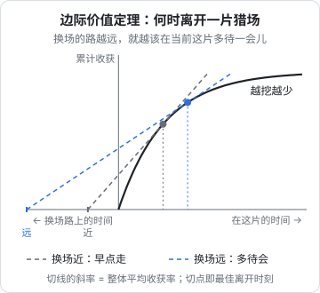

# 什么时候离开一片猎场

上一章讲的是「追不追」：面对一头具体的猎物，值不值得出手。这一章讲一个更大、也更折磨人的问题：**一片猎场还值不值得待下去**。

对一个做产品的人来说，这就是那个经常在深夜冒出来的问题：这个项目还要不要继续？已经做了八个月，有几十个用户，收入不多不少，每周都有一点进展，但离能养活自己还差得很远。走，舍不得；留，看不到头。

行为生态学对这个问题有一个相当漂亮的回答。

## 一片越挖越少的地

想象一只觅食的动物来到一片资源丰富的地方：一片灌木上的浆果、一个鹿群冬天聚集的山谷、一条有鲑鱼洄游的溪流。刚来时收获很快；待得越久，容易拿的拿完了，剩下的越来越难得手，**单位时间的收获越来越少**。生态学里把这样的一片资源叫作一个「斑块」（patch）。

离开当然也有代价：去下一片要花时间赶路，路上什么也得不到。

那么，在一片斑块里待多久最合算？

## 边际价值定理

1976 年，生态学家 Eric Charnov 给出了答案，后来被称为**边际价值定理**（marginal value theorem）：

> 当你在当前斑块里的**边际收获率**（此刻每多待一单位时间能多得到的东西）下降到等于**整个环境的平均收获率**（把赶路时间也算进去，长期来看每单位时间能得到的平均收获）时，就该离开。



图里的黑色曲线是在当前斑块的累计收获，开始陡、后来平，因为越挖越少。从左边「换场路上的时间」那一点向曲线作切线，切点就是最佳离开时刻。这条切线的斜率，正是你能做到的最高的长期平均收获率。

这个定理有几个推论，每一个都和直觉有点出入：

1. **不要等到挖光再走**。最佳离开时刻，当前斑块里通常还剩不少东西。等到一点都挖不出来才走，长期平均反而更低
2. **换场成本越高，越该多待**。图里的两条切线说明：去下一片的路越远（蓝线），最佳离开时刻越靠后。路很近（灰线），就该早一点走
3. **环境整体越好，越该早走**。如果别处的机会普遍都很好，平均收获率高，当前斑块的边际收获就会更早跌到这条线以下
4. **决定离不离开的，不是这片地本身好不好，而是它和你的其他选择相比如何**

这个定理最初是一个理论模型，后来被大量实验检验过，从鸟类到蜜蜂到人类的觅食行为都有。结果大体支持它的方向，但动物普遍有一个偏差：**它们往往比模型预测的待得更久**。人也是。

## 翻译到一个项目上

把定理里的几个量换成项目的语言：

| 模型里的量 | 项目里对应什么 |
|---|---|
| 当前斑块的累计收获 | 这个项目到目前为止带来的收入、用户、能力、声誉 |
| 边际收获率 | 再投入一个月，能多带来多少：新增收入、新增用户、学到的新东西 |
| 换场成本 | 开始一个新项目要花的时间：重新找方向、重新验证、重新积累第一批用户 |
| 环境的平均收获率 | 以你的能力和资源，做一个「典型的」新项目，长期每月大概能得到多少 |

于是那个深夜的问题，可以改写成一个比较能回答的问题：

> **这个项目下个月的边际收获，比我把同样的时间投到别处的平均收获，高还是低？**

注意这个问题里**没有**「我已经投入了多少」。前八个月花了多少心血，在这里一项都不出现。这是边际价值定理和人的直觉冲突最厉害的地方。

### 推论在项目上的含义

**不要等到项目彻底死掉才走。** 一个每月新增两三个付费用户的项目，并不是「失败」，它还在产出。但如果你判断换一个方向、以你现在的能力每月能做得更好，那么在它彻底停下之前就该转移重心。很多人走得太晚，正是因为在等一个「明确失败」的信号，而这个信号可能永远不会来。

**换场成本高时，多给一点耐心。** 如果你在一个行业里已经积累了大量的客户关系和领域知识（比如 hatch-counter 在门店这个行业里），换到一个全新领域的成本非常高，那就值得在当前领域里多待、多挖、多换几种做法，而不是轻易跳走。反过来，如果你做的是一个和其他事情没什么关联的小工具，换场成本低，就该果断得多。

**外面机会多的时候，要更挑剔。** 当技术或市场发生大变化、到处都是新机会时（比如一波新的 AI 能力出来），环境的平均收获率上升，你对当前项目的容忍度应该降低。这不是「追风口」，而是对比的基准变了。

## 为什么人总是待得太久

实验里的动物普遍比模型待得更久，原因有好几种解释：对未来的收益打折扣更狠、对环境的估计不准、换场本身有风险。人身上，还要再加上几样只有人才有的东西。

### 沉没成本

「已经做了八个月了，现在放弃太可惜。」这句话几乎每个做过项目的人都说过。从决策的角度看，过去的投入已经花掉了，无论走还是留都拿不回来，它不应该影响下一步的选择。但人的心理账户不是这样记的：放弃意味着承认那八个月「白费了」，而这比继续投入更让人难受。

边际价值定理的好处是，它在形式上就把沉没成本排除在外：图里只看切点，不看曲线下面已经走过的部分。

### 身份

比沉没成本更难处理的，是身份。一个人独立做产品，常常会把自己和这个产品绑在一起：「我是做某某的那个人」。放弃项目，在感觉上就像否定了自己。

一个有用的区分是：**你是一个会觅食的动物，不是某一片斑块。** 狼离开一个山谷，并不意味着它不再是狼。项目可以换，你在过程中积累的判断力、技能、人脉、对用户的理解，会跟着你走到下一片。

### 进展的错觉

一个半死不活的项目最有迷惑性的地方，是它**每周都有一点进展**：修了几个 bug、加了一个功能、来了一个新用户。这些进展是真实的，但它们回答的是「我有没有在做事」，而不是「这是不是我能做的最好的事」。第 1 章说过，拼命是逃避思考最体面的方式；在一个边际收获已经很低的项目上持续「推进」，是同一种逃避的温和版本。

## 一个可操作的做法

定理里的量很难精确估算，但不需要精确，只需要定期、诚实地比一比。可以每个季度问自己三个问题：

```text
1. 过去三个月，这个项目每月的边际收获是多少？
   （新增收入、新增活跃用户，或者你学到的关键东西，尽量写数字）
2. 如果把这三个月投到一个新方向，以我现在的能力，合理的预期是多少？
   （参考自己以往起步一个新项目的速度，或者同类人的公开案例）
3. 换方向要付出多少「赶路时间」？我在当前领域的积累能带走多少？
```

如果第 1 个数字连续两个季度明显低于第 2 个，并且换场成本不算太高，就到了认真考虑离开的时候。这比「感觉不太行了」或者「再坚持一下」都更可靠。

具体的止损线和退出方式，见[《一人公司方法论》第 6 章](../opc-playbook/06-when-to-quit.md)；离开之后怎么在一个新方向上快速验证，见[第 3 章](../opc-playbook/03-fast-validation.md)。

> 离开一片还有东西可挖的猎场，需要的不是狠心，而是对整个环境的清醒估计。
