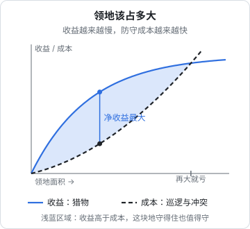

# 领地的经济学

狼群是有领地的动物。一个狼群长期占据一块地方，在里面狩猎、产仔、养大孩子，并且尽力把这块地的边界告诉邻居。

流行的「狼性」把竞争理解为撕咬对手。真实的狼群之间确实会打，而且打得很凶，但正因为打得凶，它们发展出了一整套**尽量不打**的办法。这一章从领地的经济学讲起，再看狼群之间的冲突有多致命，最后讲一个反直觉的现象：两个狼群的交界处，反而成了猎物的避难所。

## 领地有多大，是一笔账

### 由猎物决定

> [!NOTE]
> 黄石的数字来自美国国家公园管理局的公开资料，欧洲和北方的数字来自德国联邦狼资料中心（DBBW）等机构的科普材料，只用来说明量级。

狼群领地的大小差别极大：

| 地区 | 典型领地面积 |
|---|---|
| 黄石北部（马鹿密集） | 平均约 274 平方公里，最小 58，最大 1151 |
| 黄石内陆（马鹿较少） | 平均约 620 平方公里 |
| 中欧 | 约 100–350 平方公里 |
| 西伯利亚、加拿大北部（猎物稀少） | 常常超过 1000 平方公里 |

同在黄石，北部的领地平均不到内陆的一半，原因很简单：北部冬天聚集着大量马鹿，一小块地就能养活一个狼群。**领地的大小不由狼想要多少决定，而由这块地上的食物决定。**

### 守得住，才值得占

1964 年，生态学家 Jerram Brown 提出了「经济可防御性」（economic defendability）的概念：动物只有在**保卫一块资源带来的收益大于保卫它的成本**时，才会去占领它。

收益和成本都随领地面积增长，但形状不同：

- **收益**一开始增长很快，后来越来越慢。猎物再多，一个狼群也吃不完
- **成本**一开始很低，后来越来越快。领地越大，边界越长，巡逻越累，和邻居撞上的机会越多，渗透进来的也越难发现

两条曲线之间的距离就是净收益。它在某个中等的面积上最大；再往外扩，每多一块地带来的收益不如多出来的防守成本，最后甚至会亏。

> [!NOTE]
> 这张图是按经济可防御性的思路画的示意图，曲线形状是说明性的，不是某个狼群的实测数据。

## 竞争有多致命

### 被同类杀死

对恢复后的黄石狼来说，**被别的狼群杀死**大约占到它们自然死亡原因的三分之二。狼最大的天敌，是别的狼。

Cassidy、MacNulty、Mech 等人 2015 年在《行为生态学》（*Behavioral Ecology*）上分析了黄石 1995 年以来记录到的 121 次狼群间的冲突：其中 71 次升级为攻击，12 次造成了死亡。谁会赢？

- **规模**：每多一只狼，赢的几率（odds）大约提高到原来的 2.4 倍。模拟 10 只对 9 只，大约 100 次里大群赢 71 次
- **成年公狼**：每多一只，赢的几率提高约 65%
- **老狼**：每多一只 6 岁以上的老狼，赢的几率提高约 150%，这个效应甚至能压过数量上的劣势

最后一条很有意思：在冲突里，经验能抵消人数。

另一项研究（Cubaynes 等，2014）发现，北黄石成年狼的存活率随种群密度上升而下降，主要原因是同类之间的攻击，而和猎物多少关系不大。也就是说，当地盘变得拥挤时，真正威胁狼的不是饿死，而是彼此厮杀。

### 所以要「说清楚」

既然打架这么危险，狼投入了大量精力去避免它。主要靠两种方式：

**气味标记**。Peters 和 Mech 在 1975 年用雪地追踪的方法跟踪了 13 个戴无线电项圈的狼群，记录了 583 次抬腿排尿的标记行为，结论是：狼用气味标记来维持领地。标记在领地边缘尤其集中，相邻的狼群闻到就知道这里已经有主人了。

**嚎叫**。Harrington 和 Mech 在 1979 年的研究里分析了嚎叫在维持领地中的作用。狼群的合嚎在开阔地带能传到十公里左右。嚎叫一方面召集同伴，一方面向邻居宣告：我们在这里，而且我们人不少。

这两种方式的共同点是：**用很小的成本，避免一次可能致命的冲突**。

## 缓冲带：两个狼群之间的避难所

1977 年，Mech 在《科学》（*Science*）杂志上发表了一篇只有两页的短文，记录了明尼苏达州东北部的一个现象。

那几年当地的白尾鹿数量在下降。Mech 注意到，幸存下来的鹿，大多生活在**相邻狼群领地的交界地带**。原因是：狼在交界处很少打猎，因为在那里容易撞上邻居，而撞上邻居可能是致命的。只有在走投无路的时候，它们才会去那里冒险。于是，两个狼群之间的缓冲带变成了鹿的避难所。等到条件好转，这些幸存的鹿又会向外扩散，重新充实领地的中心。

第 7 章还会回到这一点：吃得饱的狼，不会把命押在边界上；只有饿极了，才会去冒险。

## 翻译到一人公司

### 你的领地应该多大

一人公司的「领地」是你的细分市场。经济可防御性的那张图，几乎可以原样搬过来：

- **收益**：这个市场里愿意付钱的用户。市场越大，潜在收益越多，但你一个人能服务的用户是有限的，收益增长会越来越慢
- **成本**：获客、交付、客服、跟上竞争。市场越宽，你要覆盖的用户类型越杂、要应对的竞争对手越多，成本增长会越来越快

所以，对一个人来说，最划算的领地往往**比你直觉想要的小**。「所有小商家」不是一块守得住的地；「某个城市某个行业的门店」可能是。先在一块小地上做到收益最大，再考虑向外扩，比一开始就铺开要稳得多。hatch-counter 就是先从一个具体行业的门店做起。具体怎么选方向，见[《一人公司方法论》第 2 章](../opc-playbook/02-choosing-direction.md)。

### 用「标记」代替「撕咬」

狼的气味标记和嚎叫，对应到一人公司，是**持续、清晰地公开你在为谁做什么**：

- 一个说清楚「为谁解决什么问题」的主页，而不是「让工作更高效」这种谁都能说的话
- 在你的用户聚集的地方持续出现：行业群、垂直社区、内容平台
- 稳定的更新日志、用户案例、公开的路线图

这些「标记」的作用，一是让用户找到你，二是让潜在的竞争者看到这块地已经有人在深耕。大多数竞争者在看到一块地已经被认真经营时，会选择去别处，就像狼会避开有新鲜标记的地方。具体做法见[《获客与增长》](../growth-marketing/)和[《文案与内容》](../copywriting-content/)。

### 不和邻居硬碰

狼群冲突的数据告诉我们两件事：一是正面冲突的代价极高；二是规模大的一方通常会赢。一个人对上一家公司，几乎永远是「规模小的那一方」。

所以当一个强大的对手开始全力进攻你的细分市场时，更好的选择通常不是迎战，而是**挪一挪**：换一个更窄的用户群、换一个价位、换一种交付方式。

但第三条数据也值得记住：**经验能抵消人数**。老狼多的狼群，在冲突中能打赢比自己大的狼群。对一人公司来说，你对某个行业的深入理解、和用户之间积累多年的信任、对细节的熟悉，就是你的「老狼」。在一块你已经深耕多年的领地上，你未必会输给一个刚进来的大玩家。在一块你刚进入的领地上，你几乎一定会输。

### 在缓冲带里找机会

Mech 的缓冲带现象，可能是这一章对一人公司最有启发的部分。

两个大玩家的势力范围之间，常常存在一些**两边都不太愿意碰的地带**：对大公司来说太小、太杂、太麻烦，或者容易引发和另一个大玩家的正面冲突。这些地带对大公司来说不划算，但对一个人来说，可能恰好是一块大小合适、竞争不激烈的领地。

几种常见的「缓冲带」：

- 两个大平台都覆盖了一半、都不愿意做深的交叉场景
- 大公司的产品有、但嫌用户太少不愿意认真做的垂直行业版本
- 需要大量本地化、线下服务、行业知识，大公司规模化做不了的细分市场

和鹿一样，你在缓冲带里能生存，靠的不是自己有多强，而是两边的大玩家都有更好的地方要去。这也意味着：一旦某个大玩家「饿了」，开始认真进入这块地，你就需要考虑挪一挪。所以第 4 章说的定期重新评估，在这里同样适用。

## 领地是会变的

狼群的领地并不永久。猎物迁徙、狼群壮大或减员、邻居的变化，都会让边界移动。一人公司的领地也一样：今天守住的细分市场，几年后可能萎缩，也可能被新技术改写。

[《一人公司行动手册》](../opc-action-plan/)里的周循环和季度复盘，就是重新看一遍领地的固定时间：用户还在不在？他们的问题变了没有？边界上有没有新的邻居？你有没有不知不觉中扩张到了一个守不住的大小？

下一章看狼群本身：群要多大才合适，一个人的公司又需要一个什么样的「群」。
