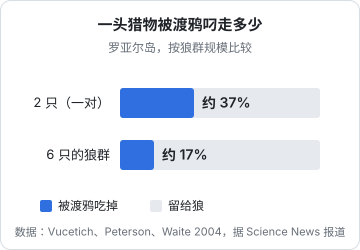
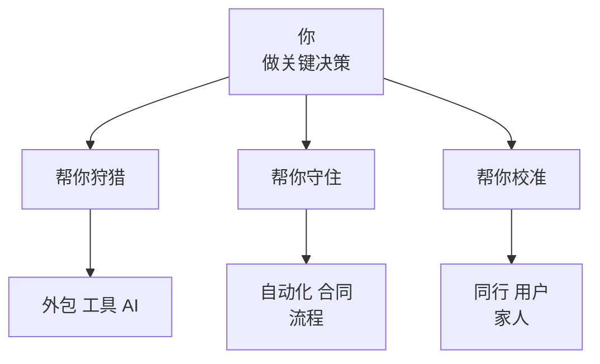

# 群要多大

「狼群」这个词，常被用来歌颂团队：人多力量大，众志成城。真实的研究给出的结论要复杂得多，也有意思得多：**狼群并不是越大越好**。超过一定规模，多出来的狼不再提高狩猎成功率，有的狼甚至开始偷懒；每只狼分到的食物，往往随着狼群变大而变少。

那狼为什么还要成群？答案藏在一个意想不到的地方：渡鸦。

这一章先讲清楚狼群规模的账，再讨论一人公司的「群」：外包、工具、AI、合作者、同行、家人，各自该放在什么位置，以及一个人独立做事时最容易被忽视的风险——没有人来校准你的判断。

## 多一只狼，多一份力吗

### 马鹿：四只就够了

MacNulty、Smith、Mech 等人 2012 年在《行为生态学》上分析了黄石狼群捕猎马鹿的大量记录，结论是：

- 捕获马鹿的成功率随狼群规模增加而提高，但**超过大约 4 只之后就基本不再提高**；从 4 只到 11 只，成功率几乎是平的
- 原因不是大群里混进了不会打猎的狼，而是**个体的投入随群体变大而下降**：多出来的狼开始「搭便车」
- 最常偷懒的，是不负责繁殖的成员、在最危险的环节（扑咬、按住猎物）上的狼，以及在一群熟练猎手当中的狼

换句话说，当身边已经有足够多能干的同伴时，每只狼都会倾向于让别人去承担最危险的那部分工作。

### 野牛：需要更大的群

2014 年，MacNulty 等人又研究了黄石狼群捕猎野牛的情况，发现规律变了：对付野牛，成功率要到 **9 到 13 只**才趋于平稳，甚至可能继续上升。野牛体型巨大、会反击，需要更多的狼真正合作才能拿下；面对这样的猎物，大群里的狼也更少偷懒。

两项研究放在一起，结论是：**合适的群体规模，取决于猎物有多难对付**。对付容易的猎物，几只就够；对付难的猎物，才需要大群，而且大群在这种时候才会真正合作。

> [!NOTE]
> 本节数字来自 MacNulty 等人 2012 年发表于《Behavioral Ecology》和 2014 年发表于《PLoS ONE》的两篇论文。此外，黄石的研究还发现，捕猎马鹿最厉害的是 2–3 岁的狼，之后狩猎能力会随年龄下降。

### 每只狼分到的更少

Schmidt 和 Mech 在 1997 年汇总了多项研究的数据，发现了一个让人意外的规律：**狼群越大，每只狼每天分到的食物越少**。没有一项分析显示大群的人均食物更多。

如果只看吃饭这件事，狼应该以一对为单位生活才对。那它们为什么要成群？

## 渡鸦的账

答案之一来自罗亚尔岛。Vucetich、Peterson 和 Waite 在 2004 年的研究里加进了一个此前常被忽略的角色：**渡鸦**。

狼杀死一头驼鹿之后，不可能一次吃完。在它们进食、休息、再进食的这段时间里，成群的渡鸦会不停地来偷肉。一对狼守着一头驼鹿，吃得慢、守不住；一大群狼吃得快，留给渡鸦的就少。

研究者的模型显示：**如果没有渡鸦，一对狼是最优的规模**；把渡鸦的偷食算进去，最优的规模就大幅上升，最大的狼群反而有最高的人均收获。他们同时指出，单靠亲缘关系（照顾自己的孩子），并不能完全解释那些包含成年或非亲缘成员的大狼群。

Schmidt 和 Mech 当年给出的解释也和这一点相关：繁殖的父母把吃不完的那部分猎物分给自己的孩子，而不是白白留给食腐动物。从父母的角度看，与其让渡鸦吃掉，不如喂给自己的后代。

> [!NOTE]
> 渡鸦偷食的比例来自对该研究的科学新闻报道（Science News），原文的具体数值可能略有差别。

所以，狼群存在的理由，并不是「人多好打猎」，而是**守住已经到手的收获**、把它留给自己人，再加上第 5 章讲过的：在和邻居的冲突中，大群更容易赢。

## 一个人的公司需要什么样的群

这一章对一人公司的启发，可以归结为三个问题：**谁来帮你狩猎，谁来帮你守住收获，谁来校准你的判断。**

### 帮你狩猎：规模按猎物来定

MacNulty 的研究最直接的启示是：**需要多少帮手，取决于你在追什么样的猎物**。

- 一个工具型的小产品、一个标准化的服务，是「马鹿」：一个人加上几样工具和偶尔的外包就够了，再多人只会增加协调成本，还会有人搭便车
- 一个需要销售团队、实施团队、长期定制的大型项目，是「野牛」：真要做，就需要真正的团队。但一人公司的定义就是不去追野牛，或者至少不在起步阶段去追

外包和工具的好处是可以随时增减，相当于按猎物临时组队。AI 和 agent 在这里尤其合适：它们不会搭便车，也不要求分成，只是需要你把任务说清楚、把结果检查好。怎么用 AI 承担一人公司的各个岗位，见[《用 AI 撑起一人公司》](../ai-native-opc/)和[《个人 Agent 工作流》](../personal-agent-workflow/)。

### 帮你守住收获：别让「渡鸦」吃掉一半

渡鸦的故事提醒我们：**很多损失不是发生在狩猎时，而是发生在收获之后**。一人公司的「渡鸦」有很多种：

- 签了单却没收到钱，或者收款周期一拖再拖
- 用户付费后因为没人跟进而流失
- 合同里没写清楚，被客户无限追加需求
- 平台抽成、支付手续费、没有规划的税
- 一个人忙不过来，已有用户的问题没及时处理，口碑慢慢流失

一个人守不住所有这些，所以需要「守护者」：自动化的续费和催款流程、写清楚的合同、及时的客服响应（可以先由 AI 接第一轮）、定期的财务梳理。这些事不像狩猎那样令人兴奋，但它们决定了你辛苦打来的猎物最后能留下多少。相关的内容见[《合同与法律文书》](../contracts-legal/)和[《财务与税务》](../opc-finance/)。

### 帮你校准：一个人最大的盲区

狼群还有一个研究里不太容易量化、但对人来说至关重要的功能：彼此作为参照。

一个人独立做事，最被低估的风险不是能力不够，而是**判断失真**。在公司里，你的判断会被同事、上级、用户反馈不断地校准；独立以后，这些校准几乎全部消失。连续几个月一个人闷头做事，常见的结果是：

- 把一个小挫折看成灾难，或者把一个小成功看成转折点
- 对一个没人要的功能越做越投入，因为没有人问「这个有人用吗」
- 渐渐只和认同自己的人交流，听到的都是自己想听的

第 2 章说过，Mech 能修正自己的错误，是因为他回到了野外、重新去看。一个独立做事的人，需要刻意为自己安排这种「回到现场」：

- **用户**：定期和真实的用户交谈，而不只是看后台数据
- **同行**：有两三个也在独立做事、愿意说真话的朋友，定期互相看产品、互相挑毛病
- **家人**：让他们知道你的真实状况，包括坏消息。他们不一定懂你的业务，但他们能看到你看不到的东西：你的状态、你说话的方式、你是不是越来越焦虑

这一类的「群」不需要大，三五个人就够。重要的是他们愿意、也能够对你说「我觉得你这里想错了」。

### 什么时候需要真正的伙伴

狼群的核心是一对伴侣，靠分工维系：一个主要照看幼崽，一个主要负责觅食。一人公司是否也需要一个合伙人？

可以用本章的框架来想：

- 如果你缺的是一项可以外包、可以用工具解决的能力，就像对付马鹿时多一只狼也没用，不需要合伙人
- 如果你要追的是一头「野牛」，或者你缺的是一项长期的、核心的、你学不会也买不到的能力，并且遇到了信得过的人，合伙是合理的
- 合伙之前，先一起「狩猎」一次：在一个小项目上合作一段时间，看看谁在最危险的环节上会退缩，谁会搭便车

## 关于「搭便车」的一点提醒

MacNulty 的研究里，最常偷懒的是「在一群熟练猎手当中的狼」。这个现象在人身上有一个对应：当你身边有一个很能干的合作者、一个很强的工具、一个看起来什么都能做的 AI 时，你也会不知不觉地把判断和责任交出去。

工具和帮手越强，越要守住两件事不外包：**决定追什么**，和**检查结果对不对**。这是一个人做公司时，唯一不能让别人替你承担的那部分危险工作。

下一章讨论一个藏在所有选择背后的变量：你此刻有多饿。
