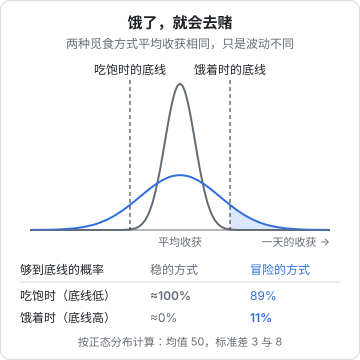

# 饿了，就会去赌

狼的生活没有固定的三餐。一次成功的狩猎之后，它们会吃到肚子鼓起来；接下来可能好几天，甚至一两周抓不到像样的东西。生物学家把这种模式叫作「盛宴与饥荒」（feast or famine）。

前面几章讨论的都是「怎么选」：追哪头猎物、什么时候离开一片猎场、领地要多大、群要多大。这一章讨论一个藏在所有选择背后的变量：**你此刻有多饿**。因为同一个动物，饱的时候和饿的时候，会做出完全不同的选择。人也一样。

## 狼怎样在盛宴与饥荒之间活下来

> [!NOTE]
> 进食量和耐饥时间的数字来自国际狼中心等科普机构，个体差异很大，只取量级。

- **一次吃很多**：一只成年狼一顿可以吃下 9–10 公斤肉，大约相当于它体重的五分之一
- **能扛很久**：吃饱之后，狼可以很多天不进食，仍然保持活动能力
- **把力气用在刀刃上**：没有在狩猎、巡逻或照看幼崽的时候，狼大部分时间在休息
- **饿极了才去冒险**：第 5 章会讲到，狼平时很少深入和邻居交界的地带打猎，因为那里容易撞上别的狼群；只有在猎物短缺、走投无路时，它们才会去那里冒险

这几样适应合在一起，是一套完整的「现金流管理」：**有收入时一次多存，平时压低消耗，用储备撑过没有收入的日子，把体力留给关键的时刻。**

这本身不难理解，这套书的其他几本也讲过跑道和固定成本。这一章要讲的是更深一层的东西：储备的多少，不只决定你能撑多久，还会**改变你的决策方式**。

## 风险敏感觅食

假设一只动物每天有两种觅食方式可选：

- **稳的方式**：每天的收获差不多，起伏很小
- **冒险的方式**：平均收获和稳的方式一样，但起伏很大，有时满载而归，有时空手

两种方式的平均值相同，按「期望收益最大」的思路，选哪个都一样。但动物并不是这样选的。

20 世纪 80 年代前后，行为生态学家用鸟做了一系列实验（Caraco 等人的工作是其中的经典）：给鸟两个喂食器，一个每次给固定数量的种子，另一个平均数量相同、但有时多有时少。结果发现，**鸟的偏好取决于它们有多饿**：

- 当鸟的能量储备充足、按稳的方式就能撑过夜晚时，它们偏好**稳的**喂食器
- 当鸟的储备不足、按稳的方式注定撑不过夜晚时，它们转而偏好**冒险的**喂食器

David Stephens 在 1981 年把这个现象总结成一条简洁的规则，后来被称为**能量预算规则**（energy budget rule）：

> 如果平均收获足以满足需要，就规避风险；如果平均收获不足以满足需要，就追求风险。



图里的两条曲线，是两种方式一天的收获分布：灰色的稳、蓝色的冒险，平均都是 50。

- 如果你吃饱了，只需要收获 40 就能过关，稳的方式几乎百分之百能做到，冒险的方式反而有一成的概率失手。这时冒险是愚蠢的
- 如果你饿着，需要收获 60 才能过关，稳的方式几乎没有可能，冒险的方式还有大约一成的机会。这时冒险是**唯一理性的选择**

关键在于：后一种情况下的冒险**并不是因为它更好**，它的平均值和稳的方式一模一样，而且绝大多数时候会失败。它被选中，只是因为稳的方式已经注定失败了。

> [!NOTE]
> 能量预算规则在不少物种的实验里得到了支持，但并非所有研究都能复现，后来的理论也对它做了很多修正。这里取它最核心、争议最小的直觉。

## 一个人做事时的「饿」

把这个规则翻译到一人公司，「饿」就是你离底线的距离：跑道还剩几个月、这个月的收入够不够生活、家人的耐心还有多少。

当你吃饱的时候——跑道充足、有稳定的过渡收入——你会自然地做出稳健的选择：慢慢验证、只追有把握的猎物、在一个方向上耐心挖。

当你饿着的时候，同样的规则会把你推向另一边：

- 把剩下的积蓄全部投进广告，赌一次爆发
- 接下一个明显超出能力、但报酬很高的项目
- 在一个没有验证过的新方向上孤注一掷
- 突然大幅降价，或者答应一个大客户各种不合理的定制要求

从能量预算规则的角度看，这些选择在那一刻可能确实是「理性的」：稳的路已经走不通了，只有赌还有机会。问题不在于你在饥饿时做了错误的选择，而在于**你让自己陷入了一个只剩下赌这一个选项的处境**。

这就是本章想说的核心：

> **储备的真正价值，不是让你多撑几个月，而是让你保有选择稳健方式的权利。**

一个跑道充足的人和一个跑道快要见底的人，面对同一个机会，会做出完全不同的判断，而且两个人都觉得自己是理性的。

## 饥饿也会改变判断本身

能量预算规则说的是：处境改变了最优选择。人身上还有一层更隐蔽的影响：处境会改变你**看问题的能力**。

经济学家 Sendhil Mullainathan 和心理学家 Eldar Shafir 在《稀缺》（*Scarcity*）一书里汇总了不少研究，提出一个观点：当人长期处于钱或时间的稀缺状态时，注意力会被眼前的缺口牢牢吸住。他们称之为「隧道视野」：对眼前的问题极度专注，对隧道之外的一切——长期规划、健康、关系、其他可能性——都视而不见。他们还把这种状态比作「认知带宽」被占用：同一个人，在稀缺状态下的判断力和自控力会明显下降。

> [!NOTE]
> 《稀缺》中引用的部分实验（尤其是关于认知能力下降幅度的研究）后来存在复现上的争议。这里只取它的定性观点：长期的财务压力会挤占注意力，让人更难做长远的判断。

对一人公司来说，这意味着：跑道快见底的时候，你不仅面对更差的选项，而且**正处在最不适合做选择的状态**。这也是为什么本书系列反复强调：止损线、回去上班的条件，要在吃饱的时候就写下来，而不是等到饿了再想。

## 怎样让自己一直「吃饱」

### 把跑道算清楚，留出余量

能撑多久，取决于储备除以每月的固定支出。两头都可以动：

- **储备**：离职前存够足以覆盖一段时间生活开支的钱；好月份把多出来的收入存起来，而不是立刻提高生活水平
- **固定支出**：狼不在空闲时浪费体力。一人公司不背办公室、不雇全职员工、定期清理没在用的订阅；个人生活开支往往是固定支出里最大的一项，也最值得认真算

具体怎么算、要留多少，见[《过渡期收入与个人保障》](../opc-transition/)。

### 保留一份「稳的」收入

能量预算规则里，人之所以被迫冒险，是因为稳的方式已经无法满足需要。反过来，只要有一份能覆盖基本生活的稳定收入，你就几乎总能选择稳健的路。

外包、咨询、培训，甚至一份兼职，在这里扮演的就是「稳的喂食器」的角色。它们不是对产品梦想的背叛，而是让你在做产品时**不必去赌**的保障。

### 让底线变低

另一个常被忽略的办法，是降低「底线」本身：减少每月必须达到的收入。生活成本低一点、家人对这段时间的预期清楚一点、对「什么时候必须盈利」的期限宽一点，都是在把图里的那条底线往左推。底线越低，越多的选择会落在「稳的方式就够用」的区间里。

### 在饿之前就写好规则

把下面这几条写下来，放在一个你能经常看到的地方：

```text
跑道低于 ___ 个月：开始接外包或咨询，补充稳定收入
跑道低于 ___ 个月：停止所有新的大额投入（广告、设备、外包开发）
跑道低于 ___ 个月：开始找工作
任何时候：不在一次决策里押上超过 ___ 的储备
```

这些规则的意义，是让吃饱时的你替饿着的你做决定。

## 休息是储备的一部分

最后回到狼身上。狼的大部分时间在休息。这不是懒惰，而是因为狩猎非常耗体力，而且有受伤的风险。在体力不足时追一头鹿，成功率低，受伤的可能却更高。

人的精力也遵循类似的逻辑。疲惫的时候做重要的决定、和客户谈判、写核心代码，都容易出错；长期透支则会让你进入另一种形式的「饥饿」：精力的稀缺，同样会带来隧道视野。

一人公司没有打卡，用不着每天产出一样多。更现实的节律是：有一段集中做事的时间，全力投入；之后留出恢复的时间。用周和月来衡量进展，而不是用天。精力节奏的具体安排，见[《一人公司方法论》第 5 章](../opc-playbook/05-energy-rhythm.md)。

> 狼吃饱了就躺下，不是因为它懈怠，而是因为它知道，下一次狩猎需要一个不饿、也不累的自己。
