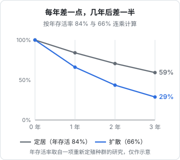

# 离群

几乎每一只在狼群里长大的狼，迟早都要离开。生物学上把这个过程叫作「扩散」（dispersal）：年轻的狼离开出生的家庭，独自上路，去寻找配偶和一块属于自己的领地。

我们印象里的「独狼」，大多就是处在这段路上的狼。它们不是天生喜欢独处，而是正在从一个群走向另一个群。

对很多想做一人公司的人来说，辞职就是这样一段离群的路。这一章看狼是怎样离开的、路上有多危险，再讨论人在离开一个组织时会经历的、比钱更难处理的东西：身份。

## 狼是怎样离开的

> [!NOTE]
> 本节数据主要来自美国北落基山脉 1993–2008 年的狼扩散研究（Jimenez 等，2017）和明尼苏达州的研究（Gese 与 Mech，1991），不同地区差别很大。

几个常被引用的事实：

- **不只是少年**：在北落基山脉的研究里，已知年龄的扩散者中，成年狼占 59%，一岁左右的占 37%，幼崽只占 4%。平均离开的年龄大约是 32 个月，也就是快三岁的时候
- **走得不算太远，但有的走得很远**：直线距离的平均值，公狼约 98 公里，母狼约 88 公里；但有 3.4% 走出了 300 公里以外
- **什么时候走，看家里和外面的条件**：明尼苏达的研究发现，一岁狼的扩散比例在种群下降时约为 70%，种群稳定时约 47%，种群增长时高达 83%。食物紧张时被「推」出去，外面有机会时被「拉」出去
- **狼群是「扩散泵」**：Mech 和 Boitani 在他们编的狼类研究综述里，把狼群形容为不断向外输送扩散个体的「泵」。一个健康的狼群，本来就会定期把长大的孩子送出去

这些事实合在一起，描绘出的「离群」和流行的独狼形象很不一样：**它不是叛逆，也不是一时冲动，而是一个健康狼群正常生命周期的一部分**。狼在家里先学会打猎，等到本领够了、时机合适，再离开。

## 路上有多危险

离群的狼要独自狩猎，只能对付小一些的猎物，或者冒更大的险；要穿过别的狼群的领地，第 5 章说过，被邻居撞上可能是致命的；还要穿过公路、农场和人类活动的区域。

研究普遍发现，扩散中的狼存活率低于定居的狼。在一项对重新定殖种群的研究里，扩散个体的年存活率约为 66%，定居个体约为 84%。

单看一年，84% 和 66% 的差别似乎不大。但如果把它们连乘，三年后一个还剩约六成，一个只剩约三成。真实的狼当然不会扩散三年，大多数会在一两年内要么定居下来，要么死在路上；这张图想说明的是另一件事：**在高风险的状态里停留得越久，代价就越会成倍累积**。

扩散期的危险，不在于某一天的风险特别高，而在于这种状态如果拖得太久，风险会一点点叠加。所以对一只离群的狼来说，最重要的目标不是「走得远」，而是**尽快定下来**。

## OR-7：一千多英里的路

2011 年 9 月，一只编号 OR-7 的年轻公狼离开了俄勒冈州东北部瓦洛厄山区的 Imnaha 狼群。它戴着研究人员装的 GPS 项圈，所以它的路线被完整地记录了下来。

到 2011 年 12 月底，它越过州界进入加利福尼亚，成为自 1924 年以来在加州被记录到的第一只野狼。到 2012 年初，据新闻报道，它已经走了约 1200 英里（约 1900 公里）。2014 年 6 月，美国鱼类及野生动物管理局确认它在俄勒冈州南部的喀斯喀特山区找到了伴侣，并生下了幼崽；2015 年 1 月，这个新的家庭被命名为 Rogue 狼群，是俄勒冈西部的第一个狼群。

OR-7 的故事常被讲成「孤胆英雄」，但它真正值得注意的地方是另外几点：

- **它不是漫无目的地在走**。它一直在找两样东西：配偶和一块没人占的地。走那么远，是因为近处没有
- **它走了将近三年**，才真正建起自己的家。这比大多数扩散的狼都长得多，它是那个能活下来的少数
- **它最后建了一个新的群**。独行是手段，不是目的

最后一点需要多说一句。OR-7 之所以出名，正是因为它罕见：大多数走那么远的狼，结局我们根本不知道。第 9 章会专门讨论这种「被记住的都是成功者」的偏差。这里先记住：**OR-7 是一个可能性，不是一个范本。**

## 对应：辞职这段路

### 在家里先学会打猎

狼平均快三岁才离开，在这之前，它跟着父母打了一两年的猎。对应过来，最稳妥的路径是：在职期间就开始用副业练习那些独立以后必须会的事：

| 狼在家学的 | 你在职期间可以练的 |
|---|---|
| 跟着父母狩猎 | 做一个小产品，从获客到收款完整走一遍 |
| 在领地边缘独自活动 | 用下班和周末经营它，看自己能不能独立拿到收入 |
| 短暂离开又回来 | 接一个外包、做一次付费咨询，确认自己真的能在外面活 |
| 等外面出现机会 | 等到方向经过验证、有了第一批付费用户 |

[《一人公司行动手册》](../opc-action-plan/)把这条路分成了几个阶段，每个阶段都有量化的进入和退出条件；辞职是第四阶段，前三个阶段都在「家」里完成。

### 缩短高风险的那段时间

存活率那张图的教训是：不要在高风险的状态里停留太久。对一个刚辞职的人来说，「扩散期」就是那段**既没有工资、产品又养不活自己**的时间。缩短它的办法有几种：

- **带着猎物离开**：离职前产品已经有一些收入，哪怕不够生活
- **路上能抓到小猎物**：外包、咨询、培训这类起步快的收入，可以显著降低这段时间的风险
- **备足储备**：跑道越长，你越不需要在第 7 章说的「饥饿」状态下做决定
- **提前处理好「穿过人类区域」的风险**：离职后的社保、医保怎么续，提前了解清楚

这些具体的做法，见[《过渡期收入与个人保障》](../opc-transition/)。

### 比钱更难处理的：身份

狼离开狼群，大概不会有身份上的困扰。人会。

离开一家公司，失去的不只是工资，还有一整套你可能从没意识到的东西：一个可以随口回答「你在哪工作」的答案；一群每天见面的人；一种「我在一个体面的地方做着重要的事」的感觉；以及一种被组织认可的节奏——晋升、绩效、年终奖，告诉你自己做得怎么样。

独立以后，这些全都没有了。很多人在辞职后的头几个月，感到的不是自由，而是一种难以名状的失重：没人在意你今天做了什么，没有任何外部信号告诉你做得好还是坏，亲戚朋友问起来，「我在做一个自己的产品」听起来既模糊又心虚。

这种失重感会直接影响判断：

- 为了尽快找回「被认可」的感觉，过早地追求表面的成就：粉丝数、发布会、媒体报道，而不是付费用户
- 为了证明自己的选择是对的，对坏消息视而不见
- 或者反过来，一点小挫折就怀疑整个决定，草草回去上班

对此没有什么简单的解法，但有几件事会有帮助：

1. **提前知道它会来**。失重感是正常的，不说明你选错了路
2. **自己建立反馈信号**。没有了绩效考核，就给自己定几个可以每周看到的数字，比如对话过的潜在用户数、付费用户数、月收入，用它们而不是情绪来判断进展
3. **找到新的群**。第 6 章说过，一个人需要能校准自己的人。离开公司的同事圈以后，主动加入一个独立开发者或者你所在行业的小圈子
4. **把身份放在「在做什么事」上，而不是「在哪里」**。「我在给门店做一个管理工具」比「我辞职创业了」更具体、更踏实，也更容易被别人理解

## 回去也不丢人

不是每只离开的狼都能建立新的狼群。有的在路上消失了，有的回到了出生的领地附近，过一段时间再试一次。

一人公司也一样。辞职一段时间，产品没能养活自己，回去上班不是失败，而是一次带着更多本事的「回家」：你学会了获客、定价、和客户打交道，也更了解自己。下次出发会更有把握，也可能你会发现，带着这些本事在一个组织里工作，同样很好。

> [!TIP]
> 离职前就写好「回去」的条件：跑道剩多少个月、连续几个月收入低于多少，就开始找工作。把这条线在吃饱的时候写下来，比到时候在焦虑中做决定好得多。

下一章换一个角度：从黄石公园一个流传很广的故事出发，谈谈我们应该怎样对待「成功的故事」，包括这本书里的。
