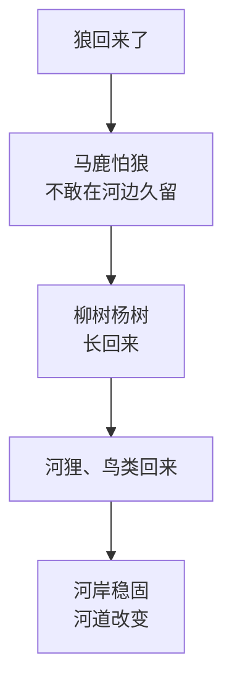
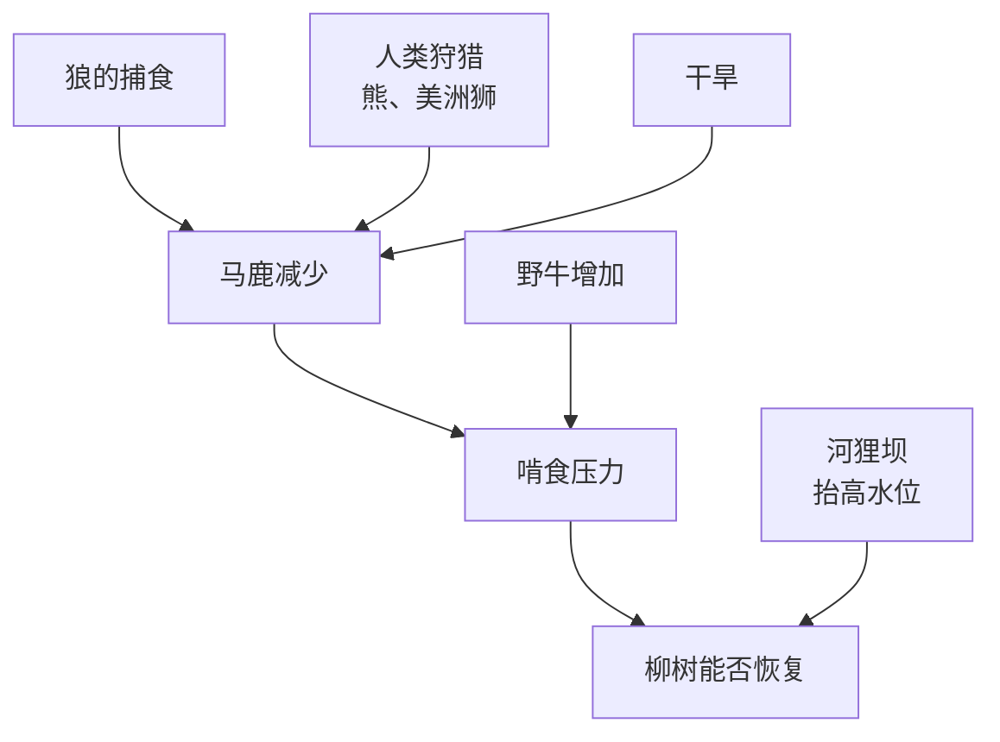

# 狼改变了河流吗

关于狼，大概没有哪个故事比这个流传得更广：

> 狼被重新引入黄石公园之后，马鹿不敢再在河边久留；河边的柳树和杨树长了回来，河狸回来了，鸟类回来了，河岸稳固了，连河道都改变了。一个物种，改变了整个生态系统。

这个故事被做成了短视频，在网上被反复转发，也常出现在科普读物、演讲和管理学课程里。它动人、清晰、充满希望。

它也被过分简化了。这一章讲清楚这个故事里哪些是真的、哪些是被夸大的，然后把这次检查推广出去：我们应该怎样对待成功的故事，包括这本书里讲的。

## 发生了什么

20 世纪初，黄石国家公园里的狼被人类捕杀殆尽。之后的七十年里，公园里没有狼。

1995 年 1 月，14 只从加拿大艾伯塔省捕获的灰狼被运进黄石，在围栏里适应了大约十周之后放归；1996 年 1 月，又从不列颠哥伦比亚省引入了 17 只。两年一共 31 只。此后几十年里，黄石的狼成为世界上被研究得最透彻的狼群，本书前面引用的很多研究都来自这里。

狼回来之后，北黄石的马鹿数量明显下降。到这里为止，没有太大争议。

## 「营养级联」的故事

接下来的部分是故事的核心。生态学里有一个概念叫「营养级联」（trophic cascade）：顶级捕食者的变化，沿着食物链一级一级往下传导，最终改变植物和整个地貌。

以 William Ripple 和 Robert Beschta 为代表的一批研究者认为，黄石就是营养级联的一个经典案例：狼不只吃掉了马鹿，还通过「恐惧」改变了马鹿的行为，让它们不敢在河边等危险的地方久留，于是河边的植被得以恢复。他们至今仍在发表支持这一观点的研究，2025 年的一篇论文声称，黄石的柳树冠层体积增加了约 1500%。

## 后来的研究怎么说

另一批研究者花了二十多年去检验这个故事，得出的结论要谨慎得多：

- **「恐惧景观」证据不足**。Kauffman 等人 2010 年在《生态学》（*Ecology*）上发表的研究发现，即使在狼出没风险高的地方，杨树也没有在恢复，马鹿的啃食也没有更少。「马鹿因为怕狼而避开河边」的机制，没有得到数据支持
- **柳树需要的不只是没有马鹿**。Hobbs 等人 2024 年在《生态学专论》（*Ecological Monographs*）上发表了一个持续二十年的野外实验：他们在河边围起栅栏挡住动物，有的地块还模拟了河狸坝。结果是，柳树要真正恢复，**既要挡住啃食，又要有河狸坝抬高地下水位**。几十年前河狸消失、河道下切之后，即使马鹿少了，柳树也很难自己长回来
- **啃食的不只是马鹿**。马鹿减少的同时，野牛的数量增加了，对植被的啃食压力并没有像故事里说的那样消失
- **马鹿减少也不只是因为狼**。人类狩猎、熊和美洲狮的捕食、干旱，都在同一时期起了作用
- **方法上的问题**。2021 年的一项研究指出，只测量每片林子里最高的 5 棵杨树，会高估恢复的程度；2025 年 MacNulty 等人对那篇「1500%」的论文提出反驳，认为它的计算方法存在循环论证，样地选择和照片也有偏差

目前多数实证研究的看法是：狼对黄石生态的影响是真实的，但它是**弱的、局部的、取决于很多其他条件的**。「狼改变了河流」这个强版本的故事，在学界是有争议的。

把两个版本画出来，差别一眼就能看到。流行版是一条直线：

按上面列的研究修正后，是好几个原因一起作用，而且中间断了一环：

第二张图里，「马鹿怕狼、避开河边」这条线被拿掉了，因为数据不支持；柳树能不能长回来，除了啃食压力，还要看河狸坝把地下水位抬回来没有，而河狸又要靠柳树才能回来，这是一个鸡生蛋的问题。狼仍然在图里，只是变成了好几个原因之一。

> [!NOTE]
> 这是一个仍在进行中的学术争论，双方都在持续发表研究。本章尽量呈现争论的结构，而不是替任何一方下结论。

## 为什么简单的故事传得更远

「狼改变了河流」比「狼、熊、人类狩猎、干旱、野牛和河狸共同以复杂的方式影响了植被，其中狼的作用相对较弱」传得远得多。这不奇怪，第 2 章讨论「头狼」时已经看到过类似的机制。一个故事要流传开来，最好具备这几个特点：

- **一个主角**：一个明确的原因，最好是一个有魅力的角色
- **一条直线**：从原因到结果，一步接一步，没有岔路
- **一个寓意**：它最好能证明一些我们本来就愿意相信的东西，比如自然的和谐、一个人或一个物种的力量

这些特点和真实世界的因果关系正好相反：真实世界通常是多个原因、相互缠绕，而且充满偶然。

## 成功的故事也是这样流传的

一人公司的世界里，充满了「狼改变了河流」式的故事：

- 「他坚持了三年，终于等到了爆发」
- 「她抓住了 AI 的风口，一个人做到了年入百万」
- 「他只做了一件事：每天发一条推文，坚持了一千天」

每一个故事都有一个主角、一条直线和一个寓意。它们可能都是真的，但几乎一定是不完整的。

### 幸存者偏差

第 8 章说过，OR-7 之所以出名，是因为它活了下来，走得很远，还建立了新的狼群。我们不知道还有多少只狼走了同样远的路，然后死在了某条公路上。

成功的故事也是这样被筛选出来的。每一个「坚持三年终于爆发」的人背后，都有不知道多少个坚持了三年、然后悄悄关掉产品的人，他们的故事没有人讲，也没有人听。如果只看讲出来的故事，你会得出「坚持就会成功」的结论；如果能看到所有人，你可能会发现，坚持者里成功的比例并不比别人高多少。

[《一人公司案例库》](../opc-cases/)专门收录了失败和关停的案例，正是为了对抗这种偏差。

### 叙事谬误

成功者讲自己的故事时，会自然地把过去整理成一条通向成功的直线。那些走错的路、运气的成分、当时根本没想清楚的决定，都会在讲述中被淡化或者被重新解释。不是因为他们在说谎，而是人的记忆就是这样工作的：我们总是从结果出发，回头去找原因。

所以读成功故事时，有几个问题值得问：

| 问题 | 它在检查什么 |
|---|---|
| 和他做了同样事情、但没成功的人有多少？ | 幸存者偏差 |
| 他成功之前有什么积累：存款、人脉、受众、行业经验？ | 被省略的起点 |
| 当时的市场、平台、技术环境，现在还在吗？ | 时机能不能复制 |
| 故事里有没有运气、偶然、意外的转折？如果没有，为什么？ | 叙事被整理过的程度 |
| 他讲的原因，是当时就知道的，还是事后总结的？ | 事后合理化 |

这些问题不是为了否定别人的成功，而是为了分清哪些部分可以学，哪些部分只能羡慕。

## 也包括这本书

最后，这个检查也必须用在这本书自己身上。

这本书做的事情，本质上和「狼改变了河流」的故事很像：拿一种动物的行为，讲一个关于人的道理。这种做法有几个风险，读者应该知道：

- **挑选**。狼有很多行为，我挑了那些能讲出道理的。狼也有很多不适合类比的地方：它们不规划未来、不讲道德、它们的群是血缘而不是选择
- **跳跃**。从「狼群规模超过 4 只后成功率不再提高」跳到「一人公司不需要大团队」，中间隔着巨大的差异：猎物不是市场，狼不是人。类比能帮你想到一个问题，但不能替你回答它
- **决策模型的简化**。边际价值定理、猎物选择模型、能量预算规则，都是生态学里的简化模型，它们在动物身上的实验支持也是部分的。用它们来想问题是有用的，把它们当成精确的公式就错了

我尽量在每一处都标明了研究的来源和局限。但最可靠的办法，仍然是你自己去检查：这个类比在你的处境里成立吗？它依赖的条件，在你身上还在吗？这正是第 2 章从「头狼」的故事里得出的那个问题。

> 一个故事越动人，越值得多问一句：还有什么被省略了？

最后一章，把全书收拢起来。
