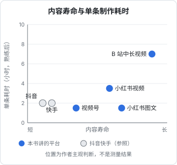

# 三个平台怎么选

小红书、视频号、B 站经常被放在一起说，因为它们都不是抖音、快手那种「纯推荐、拼完播」的短视频平台。但三者之间的差别，比它们和抖音的差别还大：小红书是一个被当成搜索引擎用的种草社区，视频号长在微信的社交关系上，B 站是一个以中长视频和社区文化为核心的视频站。

这本书写给下班做内容的在职开发者，讲**创作者怎么在这三个平台长期做内容**：推荐和搜索怎么分发、内容做成什么样、后台数据怎么看、哪些行为会被限流。[《国内私域与内容平台》](../private-domain-cn/)第 3、4、5 章已经从「给产品引流」的角度讲过这三个平台的开号、导流规则和最小投入，本书不重复那部分，只在需要时引用；本书的视角是**把内容本身当生意**。

直播、投流、带货、商单各有专书（[《直播实战》](../live-streaming/)[《投流与数据分析》](../paid-traffic/)[《带货与选品》](../ecommerce-selling/)[《广告商单与品牌合作》](../brand-deals/)），本书讲到这些入口时只说明「在平台的什么位置、对创作者有什么要求」，具体打法去看对应的书。

## 先看清三个平台的差异

### 一张对比表

| | 小红书 | 视频号 | B 站 |
|---|---|---|---|
| 主要分发 | 推荐 + 搜索双通道 | 社交推荐（好友点赞、转发）+ 算法推荐 | 推荐 + 搜索 + 关注动态 + 分区 |
| 主力形态 | 图文笔记、竖屏短视频 | 竖屏 / 横屏短视频、直播 | 横屏中长视频（5–30 分钟常见） |
| 内容寿命 | 长，靠搜索持续被找到 | 短到中，靠转发链条 | 最长，好视频能被搜几年 |
| 起号难度 | 低，图文门槛低 | 中，冷启动依赖自己的微信关系 | 高，单条制作成本最高 |
| 用户为什么来 | 找攻略、找参考、做决策 | 熟人推荐、打发时间、看直播 | 学东西、看兴趣内容、社区归属 |
| 离私域多远 | 远，导流规则严 | 最近，同在微信里 | 远，社区对营销反感 |
| 对开发者的友好度 | 中：工具测评、效率、职场类可做 | 中：职场、技术科普适合中年用户 | 高：科技区、知识区是主场 |

这张表里的「难度」「友好度」是作者的判断，不是平台数据。用户规模这类数字三个平台的公开程度不同：B 站作为上市公司按季度披露，2026 年第二季度日均活跃用户 1.17 亿、月均活跃用户 3.71 亿、日均使用时长 113 分钟（来源：B 站 2026 年 Q2 财报，2026-08-27 发布，品玩等媒体报道）；小红书引用较多的是「超过 70% 的月活用户使用搜索」（来源：小红书《十大搜索趋势洞察》2024 年上半年报告，经人人都是产品经理等转引）；视频号的用户规模微信官方长期不单独公布。

### 和抖音、快手的根本区别

抖音、快手是「内容找人」做到极致的平台：一条视频的命运在发出后几小时内由完播率、互动率决定，过了这个窗口基本就没有流量了。[《抖音与快手》](../douyin-kuaishou/)会详细讲它们的流量池机制。

三个平台各有一个抖音不那么依赖的通道：

- **小红书的搜索**。用户搜「Mac 效率软件」「程序员副业」，你两个月前发的笔记仍然会出现。这让小红书的内容像一篇博客，而不是一条朋友圈
- **视频号的社交关系**。你的好友点了赞，他的好友就可能刷到。冷启动的第一批观众是你的微信好友，而不是陌生人
- **B 站的关注和搜索**。B 站用户有「关注 UP 主、追更新」的习惯，粉丝的动态页是稳定的分发渠道；技术教程类视频的搜索流量可以持续好几年

这意味着三个平台都**奖励长期积累**：持续更新、内容能被搜到、关系链能传播。对每周只有 5–8 小时的副业创作者，这一点比抖音友好得多，因为你不需要每天都赌一次爆款。



## 按你自己的情况选主平台

### 四个问题

选主平台之前，先老实回答四个问题：

1. **每周能稳定拿出多少小时？** 少于 4 小时，只能做小红书图文；4–8 小时，可以做小红书视频或视频号；8 小时以上，才考虑 B 站中长视频
2. **能不能出镜、能不能出声？** 都不能：小红书图文。只能出声：视频号或 B 站的录屏 + 配音。能出镜：三个都行
3. **你想写给谁？** 年轻人、学生、开发者同行：B 站；20–35 岁、关心生活方式和效率工具的人：小红书；30 岁以上的职场人、中老年、你自己的微信圈子：视频号
4. **最终怎么赚钱？** 接品牌合作：小红书商业化最成熟；卖课、卖咨询、做私域：视频号离成交最近；技术个人品牌、长期声誉：B 站

### 选择矩阵

| 你的情况 | 主平台 | 辅助平台 |
|---|---|---|
| 每周 ≤4 小时，不出镜 | 小红书图文 | 无，先把一个做稳 |
| 做开发者工具、编程教程、技术评测 | B 站 | 小红书（同一主题做成图文） |
| 做职场、效率、AI 工具使用 | 小红书 | 视频号 |
| 已有公众号、想卖课或咨询 | 视频号 | 公众号（本来就有） |
| 目标是接广告商单 | 小红书 | B 站（科技数码类商单单价较高，属行业经验） |
| 想做 AI 工具、编程类知识付费 | B 站或视频号 | 另一个 |

一个主平台，最多一个辅助平台。三个平台同时做，对副业创作者几乎一定会变成三个平台都断更。第 8 章讲「一份内容改造后分发」，那是在主平台跑通之后才考虑的事。

### 一个反例

```text
情况：后端开发，每周 6 小时，不想出镜。
想法：三个平台都开号，每周一条视频同步发。
结果：
- 视频做成横屏 10 分钟录屏，发 B 站还行；
- 原样发小红书，封面是视频截图，没人点；
- 原样发视频号，好友里没人对这个话题感兴趣，播放两位数；
- 第 5 周开始断更。
```

问题不在于平台选错了，而在于**一份内容原样发三个平台**，每个平台都不是为它做的。正确做法是先选 B 站做主平台，跑三个月，再把每条视频的核心结论做成一篇小红书图文。

## 开号前的准备

### 账号基础信息

三个平台通用的几项，开号时一次想好：

| 项目 | 要求 | 例子 |
|---|---|---|
| 账号名 | 好记、和赛道相关、三个平台尽量一致 | 「老周写代码」「效率工具箱阿林」 |
| 头像 | 真人照片或固定的形象，小尺寸下能认出来 | 不用风景照、不用模糊截图 |
| 简介 | 你是谁 + 讲什么 + 更新频率，不写联系方式 | 「后端开发 8 年｜讲程序员能用上的 AI 工具｜每周二、五更新」 |
| 领域 | 在平台设置里选对领域 / 分区 | 小红书选「科技数码」或「职场」；B 站选「科技」或「知识」相关分区 |

账号名的修改次数三个平台都有限制，具体次数以设置页提示为准。**简介里不要出现微信号、「V」、二维码等任何形式的联系方式**，三个平台的导流规则见[《国内私域与内容平台》第 9 章](../private-domain-cn/09-rules-and-bans.md)和本书第 10 章。

### 账号定位的最小验证

[《账号定位与对标拆解》](../account-positioning/)专门讲怎么找对标、定人设。这里只给一个落到这三个平台的快速验证：

```text
1. 在目标平台搜索你打算做的 3 个核心关键词
   例：「程序员副业」「AI 编程工具」「Mac 效率」
2. 每个关键词看前 20 条结果，记录：
   - 发布时间（最近 3 个月内的占多少）
   - 互动量级（点赞 / 收藏或播放）
   - 作者粉丝量（有没有粉丝几千的小号也有高互动）
3. 判断：
   - 最近 3 个月有新内容、且有小号做出高互动 → 可以进
   - 前 20 条全是半年前的大号内容 → 竞争固化或需求萎缩，换词
   - 搜不到什么内容 → 可能没人搜，也可能是机会，先发 5 条试
```

「小号也有高互动」是关键信号：说明平台在这个话题上愿意给新人流量。

## 三个月的节奏

无论选哪个平台，第一阶段都按三个月计算。三个平台的冷启动周期都比抖音长，因为搜索和关注这两个通道需要时间积累。

| 阶段 | 小红书 | 视频号 | B 站 |
|---|---|---|---|
| 第 1–4 周 | 每周 2–3 篇，测试 3 种选题类型 | 每周 2 条，先发给自己微信圈子能接受的内容 | 每两周 1 条，打磨第一条的完整制作流程 |
| 第 5–8 周 | 看哪类收藏高，复制这一类 | 看哪条被转发得多，做同类 | 看哪条搜索流量高、平均观看时长高 |
| 第 9–12 周 | 固定 2 个栏目 | 尝试第一次直播（可选） | 固定 1 个系列 |
| 三个月后判断 | 搜索流量占比在上升吗 | 有没有好友以外的人在转发 | 新增粉丝是否主要来自自然推荐和搜索 |

三个月后的止损判断：

- 如果主平台的数据**三个月没有任何上升趋势**（不是绝对值低，而是没有在变好），先检查是不是内容和平台不匹配（看第 2、4、6 章的对应部分），再考虑换方向
- 如果是**平台选错了**（例如你的目标读者根本不在这个平台），换平台；[《自媒体与短剧行动手册》](../media-action-plan/)有完整的止损线和每周清单

## 常见坑

- **用抖音的方式做小红书**：前 3 秒强刺激、标题党，在小红书上反而收藏低。小红书用户是来「存起来以后用」的
- **把视频号当成冷启动平台**：视频号的第一波流量来自你的微信好友。如果你的好友都是同事，而你讲的是同事看了会尴尬的内容，第一波就起不来
- **在 B 站发竖屏 1 分钟快剪**：不是不能发，但 B 站的优势在中长视频，竖屏短视频在 B 站的竞争对手是全网的短视频
- **一开始就开三个号**：精力分散，三个都做不深。一个主平台，跑通再扩
- **先研究算法再做内容**：算法细节平台不公开，网上流传的公式多半是猜测。前 20 条内容比任何算法分析都更能告诉你什么有效

## 本章要点

- 三个平台都有抖音不那么依赖的长期通道：小红书的搜索、视频号的社交关系、B 站的关注和搜索，它们奖励持续积累
- 按每周可用时间、能否出镜、写给谁、怎么赚钱四个问题选主平台；一个主平台，最多一个辅助平台
- 不要一份内容原样发多个平台；先在主平台跑通三个月，再做改造分发
- 开号时一次想好账号名、头像、简介、领域，简介不写任何联系方式
- 用「搜 3 个关键词、看前 20 条」快速验证赛道：最近有新内容、小号也有高互动，就可以进
- 三个月是一个判断周期，看趋势不看绝对值
